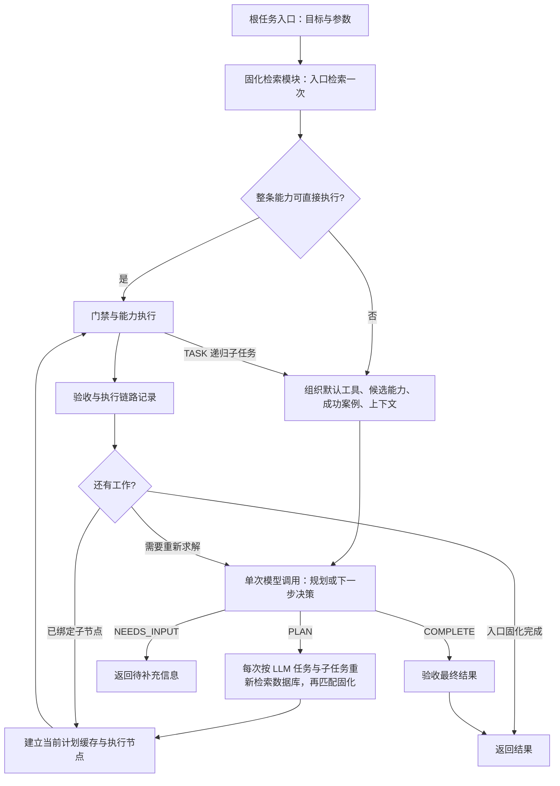

# MyHelper 重构项目总文档

> 共同开发规则（2026-11-11 用户确认）：固定 LLM 文本集中到 LlmTexts；不用 Lambda，以可读性选择循环、方法和 switch，允许 `case ... ->`。所有任务继续前阅读[24-LLM文本与代码可读性规范](24-LLM文本与代码可读性规范.md)。

更新：2026-11-11。本文是重构设计总入口；实际实现和验证状态以[接续文档](重写架构与进度.md)及源码为准。下文明确区分已有核心组件与后续模块设计。

## 1. 项目定位与已确认方向

本项目重构旧 MyHelper。旧原稿位于 `C:/Users/l4259/Desktop/myhelper设计文档.txt`；仓库 docs/01～08、my.md 为历史资料，不是新项目实现清单。保留统一世界模型、能力递归组合、执行前条件检查、执行后验收、经验固化和探索的理念；不照搬旧类名、自动升级阈值或部署结论。

用户已确认：保留单次模型调用；增加外层循环，模型通过编排工具递归提交任务；具体任务依赖决定并发；保存执行链路供其他模块消费。规划前与规划后独立检索固化能力，后续循环可直接执行已匹配的整条能力或子节点。检索与缓存独立成包或类，便于替换。模块按职责隔离，不要求独立服务或 Maven 子模块。

用户后续已授权实现循环与固化检索接入。当前源码已有世界模型、AgentCaller、persistence，以及 orchestration/capability 的核心组件和本地测试。技能生成/审核/发布等未开始模块只提供开发文档，没有自动扩大为全部模块实现。

## 2. 核心收益与成本口径

- 完整复用：入口目标、参数、条件和验收都能确定时，直接运行整条能力。
- 局部复用：模型完成规划后，已固化子节点直接执行，仅未解决部分继续调用模型。
- 并发推进：独立任务及其模型调用可以并发，汇合点等待明确依赖；性能仍受模型服务限流和实际资源约束。
- 逐步积累：从已验证子图形成能力候选，独立审核后发布；不必等整项任务全部固化。

“直接执行”指无需额外模型规划，并不保证工具内部没有 LLM；“零 Token”需明确为所计范围内不调用生成式 LLM。嵌入、检索和普通计算仍有成本。离线可用还要求工具、数据、模型（如需）、检索入口和验收依赖在本地；不调用 LLM 不等于无需网络。

## 3. 主路径

图中门禁、执行、验收是不同职责；链路在规划、排队、执行和验收各阶段持续记录。检索产生候选，语义相似不等于执行资格。规划后的整个能力替换只能发生在未执行部分；已有副作用不能重新跑一遍。

规划前检索只在根入口发生一次；每次模型提交 PLAN 后，根据 LLM 给出的任务与子任务重新检索数据库，再匹配整条或子节点并缓存。递归和下一轮不重复入口检索。模型可多次规划；后续检索不局限于入口候选。等待、工具回包和未改变的已绑定节点不重复语义检索。新发现能力不会静默替换已运行计划。成功案例/世界上下文检索及技能候选提交仍为后续设计。

## 4. 模块导航与交付边界

| 模块 | 文档 | 当前状态 |
| --- | --- | --- |
| 世界模型结构 | [09](09-统一世界模型.md) | 十二个结构类；已有链路位置及成功/失败/归因统计字段，自动记账与完整链路合同未实现 |
| 显式数据库读写与补偿 | [10](10-统一双写模块分析.md) | 有实现及本地检查，未真实服务联调 |
| 单次模型调用 | [11](11-单次模型调用模块.md) | 有实现，未真实 LLM 联调 |
| 递归、并发循环编排 | [12](12-并行分支循环编排设计.md) | 已接入单次类，有本地测试；动态新指令/持久化恢复未实现 |
| 共享执行链路 | [13](13-执行链路记录开发文档.md) | 有界内存 Map/集合、只读快照；归档未实现 |
| 工具及组合能力执行 | [14](14-工具与能力执行开发文档.md) | ToolCallback 适配及 TaskPlan 执行；通用 Unit 扩展未实现 |
| 门禁与验收 | [15](15-门禁与验收开发文档.md) | 已有注入端口，独立业务策略未实现 |
| 技能固化与发布 | [16](16-技能固化开发文档.md) | 开发设计 |
| 自主探索 | [17](17-自主探索开发文档.md) | 开发设计 |
| 模型接入与路由 | [18](18-模型接入与路由开发文档.md) | 开发设计 |
| 固化检索与缓存 | [19](19-固化检索与缓存开发文档.md) | 独立 capability 包、有限缓存及 Qdrant HTTP 适配，未真实服务联调 |
| 交互与语音 | [20](20-交互与语音开发文档.md) | 开发设计，保留资源不等于已接通 |
| 装配、部署及验收 | [21](21-装配部署与集成验收.md) | 开发设计，现有存储装配见 10 |
| 工具生成、记忆维护及旧扩展 | [22](22-扩展模块开发边界.md) | 分模块设计，后续按需实施 |
| 世界模型查询与上下文 | [23](23-世界模型查询与上下文开发文档.md) | 开发设计，与结构层分开 |
| LLM 固定文本与可读性规则 | [24](24-LLM文本与代码可读性规范.md) | LlmTexts 已实现，Lambda 已移除；固定异常反馈提取和复杂回调可读性仍有收尾项 |

## 5. 数据所有权

长期知识和能力继续用 WorldEntity、EntityRef；类型到库的映射由上层仓储决定。数据库模块只按明确来源/目标读写，不解释引用或业务类型。执行图是一次运行的事实与状态，能力图是可复用定义，不能混为同一份可变 Map。模型消息、计划缓存和执行图也分别保存。

运行图由编排器统一更新，固化、门禁、探索、交互及统计通过只读快照/事件读取。固化读取版本固定的已验证子图并生成新的能力定义，不修改历史执行事实。候选、审核、发布、停用必须保留来源、版本、范围和证据。

现有 persistence 仍只按 ID 读取当前实体；候选搜索由新增 QdrantCapabilityRepository 独立负责，不改变数据库模块边界。历史版本读取和运行日志尚未实现，内存 Map 不支持跨重启保存。

## 6. 缓存与发布边界

采纳用户指定的按需策略：规划前/后查询数据库候选，按 ID 与版本加载少量命中能力；当前计划缓存绑定步骤，进程热点缓存有容量与 TTL 上限。无需把全部固化能力放进内存，也不要求每次发布广播给所有运行任务。

新固化能力在下一次检索时发现；已有计划不保证立刻采用它。停用/撤销与新能力发现不同：执行前需检查本次引用是否仍可执行，首版可按 ID 批量读取权威状态，失败返回无法确认。详细一致性和索引就绪规则见 19。

## 7. 实施顺序与必须闭合的合同

1. 在已有核心组件上装配真实模型、工具、嵌入、候选仓储及合同匹配/门禁策略。
2. 补齐输出映射、通用 Unit 版本/引用合同、上下文及案例查询。
3. 接入链路持久化、子图固化、独立审核、历史版本和索引发布/修复。
4. 增加在途新指令、等待用户恢复和持久化去重；完成真实服务联调与性能验证，再接外围模块。

还需明确：重试与副作用未知、动态指令版本、超时/预算、当前状态新鲜度、缓存容量、并发资源冲突、调用来源和验收证据。将这些作为模块合同，不另外增设一批独立服务。新版 04/05/06 原稿尚未取得，相关验收细节保留待核对。

## 8. 文档维护规则

README 提供导航；本文描述当前目标架构；各模块文档维护接口与边界；接续文档记录实际状态与变更。改接口必须同步调用方文档；已确认方向、建议合同、已实现、已验证分别记录。修改前重读文件以保护其他聊天更新。历史文档只保留背景，不将其“已实现”条目搬到新项目。

2026-11-11 已统一模型固定文本，生产及测试代码移除 Lambda；保留 switch，并将长回调和多分支结果汇总整理为有名称的方法。异步调度、单次调用、检索和存储边界保持，验证记录见接续文档。
