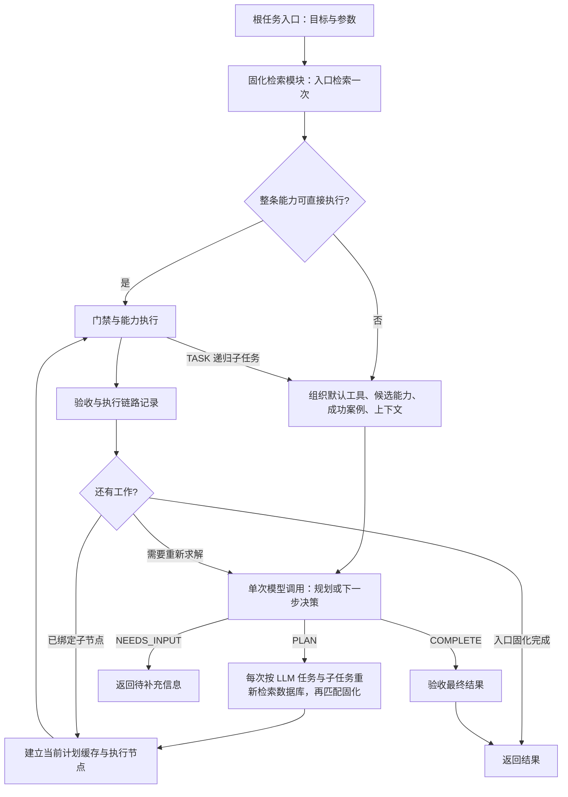

# MyHelper 重构项目总文档

> 共同开发规则（2026-11-11 用户确认）：固定 LLM 文本集中到 LlmTexts；不用 Lambda，以可读性选择循环、方法和 switch，允许 `case ... ->`；所有测试与检查资料统一放入 `checks`。所有任务继续前阅读[24-LLM文本与代码可读性规范](24-LLM文本与代码可读性规范.md)。

更新：2026-11-16。本文是重构设计总入口；实际实现和验证状态以[接续文档](重写架构与进度.md)及源码为准。下文明确区分已有核心组件与后续模块设计。

当前代码的组件关系、运行分支和数据链路见[已实现架构图](completed/已实现架构图.md)。

2026-11-16 当前源码的全模块逻辑、接通边界及已知问题见[全量实现与代码复核](completed/全量实现与代码复核.md)。

[文档目录](README.md) · [窗口、模块和源码](modules/README.md) · [待做与设计](planned/README.md) · [已完成与验证](completed/README.md) · [旧版资料](legacy/README.md)

## 1. 项目定位与已确认方向

本项目重构旧 MyHelper。旧原稿位于 `C:/Users/l4259/Desktop/myhelper设计文档.txt`，原 01–08 和合并稿见[旧版资料](legacy/README.md)。重写保留统一世界模型、能力递归组合、执行前条件检查、执行后验收、经验固化和探索的理念。

用户已确认：保留单次模型调用；增加外层循环，模型通过编排工具递归提交任务；具体任务依赖决定并发；保存执行链路供其他模块消费。规划前与规划后独立检索固化能力，后续循环可直接执行已匹配的整条能力或子节点。检索与缓存独立成包或类，便于替换。模块按职责隔离，不要求独立服务或 Maven 子模块。

用户后续已授权实现循环与固化检索接入，并在 2026-11-16 授权直接对接生产仓储。当前源码已有世界模型、AgentCaller、persistence，以及 orchestration/capability 的核心组件和本地检查。技能已有生产候选仓储、审核/双库发布、参数仓储、模型范围查询及 Spring 装配；任务记录生产仓储、实际执行自动记账和归档消费仍未完成。模块不要求独立启动或暴露 HTTP 接口。

2026-11-12 当前交付：循环通过 `CapabilitySearchPort` 检索固化能力，持有执行 DAG 和模型分支的生命周期。对实际仍需模型的计划，循环处理 `TaskPlan.routing` 和分叉/汇合，按需打开 `ModelAdapter.Session`；纯工具计划直接按执行依赖调度。独立的 `ConfiguredModelAdapter` 已实现按协议筛选模型、分配与继承、引用回收及客户端解析。应用装配和真实供应商联调仍待完成。见[循环](modules/orchestration/12-并行分支循环编排设计.md)、[模型路由](modules/llm/18-模型接入与路由开发文档.md)、[模型适配器](modules/llm/27-模型适配器开发文档.md)和[任务验收、进度与恢复设计](planned/26-任务验收进度与断点恢复设计.md)。

## 2. 核心收益与成本口径

2026-11-12 职责及实现：循环只负责查询、向外发送数据及根据模型计划/外部结论调度。固化适用判断已独立为 `CapabilityUsePort`；执行图接入 `ExecutionTracePort`，任务事件、进度及恢复事项接入 `TaskRecordPort`。循环已有执行前意图、返回、验收和前后证据上报、RECOVERY 上下文、外部结论审核及 `resume(taskId)`。模型依据证据提出是否处理、如何处理及哪些工作可继续，外部模块核验并维护权威状态。生产任务仓储、实际业务核对/补偿、结构化验收及跨重启联调尚未实现。详见[记录模块交接](modules/records/28-执行记录与恢复端口开发文档.md)及[26 第 7、9 节](planned/26-任务验收进度与断点恢复设计.md)。

- 完整复用：入口目标、参数、条件和验收都能确定时，直接运行整条能力。
- 局部复用：模型完成规划后，已固化子节点直接执行，仅未解决部分继续调用模型。
- 并发推进：独立任务及其模型调用可以并发，汇合点等待明确依赖；性能仍受模型服务限流和实际资源约束。
- 逐步积累：从已验证子图形成能力候选，独立审核后发布；不必等整项任务全部固化。

“直接执行”指无需额外模型规划，并不保证工具内部没有 LLM；“零 Token”需明确为所计范围内不调用生成式 LLM。嵌入、检索和普通计算仍有成本。离线可用还要求工具、数据、模型（如需）、检索入口和验收依赖在本地；不调用 LLM 不等于无需网络。

## 3. 主路径

图中门禁、执行、验收是不同职责；链路在规划、排队、执行和验收各阶段持续记录。检索产生候选，语义相似不等于执行资格。规划后的整个能力替换只能发生在未执行部分；已有副作用不能重新跑一遍。

规划前检索只在正常根入口发生，最多一次。每次模型提交 PLAN 后，根据任务与子任务重新检索数据库，再匹配并缓存。递归与后续轮次不重做根入口查询。技能已有候选生成、审核和双库发布入口。任务归档驱动的自动提取和固化、成功案例和世界上下文查询仍待完成。

## 4. 模块导航与交付边界

| 模块 | 文档 | 当前状态 |
| --- | --- | --- |
| 世界模型结构 | [09](modules/world/09-统一世界模型.md) | 十二个结构类；已有链路位置及成功/失败/归因统计字段，自动记账与完整链路合同未实现 |
| 显式数据库读写、查询与补偿 | [10](modules/persistence/10-统一双写模块分析.md) | 已实现 ID/EntityRef/批量读取、两库字段分页、Qdrant 向量查询与统一写入补偿；126 项 JUnit 和 4 组存储检查通过，未真实服务联调 |
| 单次模型调用 | [11](modules/agent/11-单次模型调用模块.md) | 有实现，未真实 LLM 联调 |
| 递归、并发循环编排 | [12](modules/orchestration/12-并行分支循环编排设计.md) | 已接入单次类、恢复端口、新指令与实际收尾后重规划；生产持久恢复待实现 |
| 共享执行链路 | [13](modules/orchestration/13-执行链路记录开发文档.md) | `ExecutionTracePort` 已接口化，当前为有界内存实现；持久归档未实现 |
| 执行记录与恢复接线 | [28](modules/records/28-执行记录与恢复端口开发文档.md) | 稳定任务身份、事件、恢复审核、指令版本与根完成原子提交合同已接入；生产记录/策略待独立模块实现 |
| 工具及组合能力执行 | [14](modules/orchestration/14-工具与能力执行开发文档.md) | ToolCallback 适配及 TaskPlan 执行；通用 Unit 扩展未实现 |
| 门禁与验收 | [15](modules/gate/15-门禁与验收开发文档.md) | 已有注入端口，独立业务策略未实现 |
| 技能固化与发布 | [16](modules/skill/16-技能固化开发文档.md) | 开发设计 |
| 自主探索 | [17](modules/exploration/17-自主探索开发文档.md) | 开发设计 |
| 模型接入与路由 | [18](modules/llm/18-模型接入与路由开发文档.md)、[27](modules/llm/27-模型适配器开发文档.md) | ConfiguredModelAdapter 已实现分支分配、绑定及解析，供应商配置绑定与应用联调待完成 |
| 固化检索与缓存 | [19](modules/capability/19-固化检索与缓存开发文档.md) | 独立业务匹配、发布/版本核验与有限缓存；候选及权威实体读取均经 DualWriteStore，未真实服务联调 |
| 交互与语音 | [20](modules/interaction/20-交互与语音开发文档.md) | 开发设计，保留资源不等于已接通 |
| 装配、部署及验收 | [21](modules/deployment/21-装配部署与集成验收.md) | 开发设计，现有存储装配见 10 |
| 记忆维护及旧扩展 | [22](modules/extensions/22-扩展模块开发边界.md) | 分模块设计，后续按需实施 |
| 世界模型查询与上下文 | [23](modules/world/23-世界模型查询与上下文开发文档.md) | 开发设计，与结构层分开 |
| LLM 固定文本与可读性规则 | [24](24-LLM文本与代码可读性规范.md) | LlmTexts 已实现，Lambda 已移除；固定异常反馈提取和复杂回调可读性仍有收尾项 |
| 工具管理与隔离运行 | [25](modules/tools/25-工具管理与隔离运行设计.md) | 来源目录、范围先验及评分接入组件已实现，生成、热加载、公共变量和固化技能工具入口为设计 |
| 任务验收、进度与断点恢复 | [26](planned/26-任务验收进度与断点恢复设计.md) | 职责已确认、循环端口已接入；稳定要求进度、结构化验收、持久仓储与实际核对/补偿待实现 |

装配方可将同一个 `ConfiguredModelAdapter` 实例分别作为九参数编排器的模型端口和 `AgentCaller` 的解析函数。2026-11-15 起旧构造缺少可靠度查询时回模型；零模型固化需通过十二参数构造注入可靠度门禁，没有 ModelAdapter 时不能执行低分回退。已有编排端口和适配器实现的本地检查，运行记录见[独立检查说明](../checks/README.md)。

十参数构造增加外部任务记录，十一参数再增加独立固化适用判断。旧构造默认禁用任务记录，没有持久恢复保证。`AgentCaller` 仍只负责单次调用，本轮不增加任务进度或恢复职责。

2026-11-12 模型任务数据：已在每轮取得实际模型时记录目标、参数、模型引用和分支关联，调用开始、返回/失败使用相同 callId 继续记录。用户要求的标签由外部模块提供，能力画像与按画像选型待模型模块接入；当前没有更改配置顺序分配策略，也没有把记录正常返回等同于任务验收成功。见[模型适配器交接](modules/llm/27-模型适配器开发文档.md)和[记录合同](modules/records/28-执行记录与恢复端口开发文档.md)。

2026-11-12 仅设计补充：用户要求加入中断记录、程序再次运行后的恢复，以及任务途中新增用户指令后的重规划，并明确先补文档。方案保存原始指令、已做事项、实际修改和未确认效果；首版建议同一 taskId 下正常收束旧运行后新建 rootRunId，异常退出另走核对与受控接管。记录模块维护持久事实、指令版本和领取，循环检查旧计划是否过期并传递上下文，模型解释变化并规划剩余工作，应用触发恢复；单次主流程不扩大职责。完整流程见[26 第 10 节](planned/26-任务验收进度与断点恢复设计.md)，端口扩展见[28 第 9 节](modules/records/28-执行记录与恢复端口开发文档.md)。这些新增合同、生产存储与启动恢复尚未实现。外部画像稿的可参考方向和修订建议同步在[27 第 10 节](modules/llm/27-模型适配器开发文档.md)，用户打断不直接算模型能力失败。

## 5. 数据所有权

2026-11-13 收尾与技能固化交接：循环在真实工作收束后经 TaskRecordPort 提交最终执行记录，记录仓储通过统一 persistence 保存；固化模块在任务外读取固定图快照和验收证据，独立生成候选、审核及发布。当前仅已接 RUN_ENDED 最终结果，完整图快照尚未随收尾提交，也没有生产归档回执/读取路径；不能把内存 close 或 settled 当作数据库归档完成。已有记录标识、拟扩提交点和生产缺口见[28 第 11 节](modules/records/28-执行记录与恢复端口开发文档.md)。

2026-11-12 授权实施结果：新增 TaskInstructionPort，经 TaskRecordPort.instructions() 装配；循环提供 instruct/amend、Handle.settled、固定指令上下文、旧计划派发拦截和根完成校验。新增 TaskRecoveryService 有界恢复入口，恢复始终沿用 taskId 并建立新 rootRunId。停止后真实回执保留，模型根据原目标、新要求和外部已做事实重规划，单次 AgentCaller 无职责扩张。具体代码入口和调用示例见[28 第 10 节](modules/records/28-执行记录与恢复端口开发文档.md)。检查中的存储仍是替身，不具备生产跨重启保证；持久仓储、远端核对、跨运行预算、正式 main/输入装配仍待完成，画像路由未在本轮实施。

长期知识和能力继续用 WorldEntity、EntityRef；类型到库的映射由上层仓储决定。数据库模块只按明确来源/目标读写，不解释引用或业务类型。执行图是一次运行的事实与状态，能力图是可复用定义，不能混为同一份可变 Map。模型消息、计划缓存和执行图也分别保存。

运行图由编排器统一更新，固化、门禁、探索、交互及统计通过只读快照/事件读取。固化读取版本固定的已验证子图并生成新的能力定义，不修改历史执行事实。候选、审核、发布、停用必须保留来源、版本、范围和证据。

2026-11-13 用户确认并已落地：所有 Neo4j/Qdrant 查询和保存都经过 `DualWriteStore`，包括单次主流程、并发循环、模型适配器的配套业务模块。存储接口明确指定来源/目标，提供按 ID、EntityRef 当前目标核对、批量 ID、字段条件分页及向量候选查询；不增加业务类型路由或引用展开。QdrantCapabilityRepository 已移除直接 HTTP，实际连接复用存储配置；它仍负责能力发布、版本和定义合同。模型画像在选型回调外经存储加载，本地 route 不查库。

字段条件依赖写入时保存的 queryTerms/query_terms，旧记录需显式重写投影；没有自动迁移真实库。通用查询不代表生产记录/画像仓储已经完成。当前已有 Neo4j 单实体 CAS，仍没有历史修订保留、多实体条件事务、租约、持久消费游标或跨重启恢复保证。详细接口、升级和验证见[10](modules/persistence/10-统一双写模块分析.md)。新任务务必维护自己的模块文档、本文和总接续进度，写好字段及关键执行语句上方注释；需要新增数据库能力应扩展统一入口，不在业务包建立数据库旁路。

## 6. 缓存与发布边界

采纳用户指定的按需策略：规划前/后查询数据库候选，按 ID 与版本加载少量命中能力；当前计划缓存绑定步骤，进程热点缓存有容量与 TTL 上限。无需把全部固化能力放进内存，也不要求每次发布广播给所有运行任务。

新固化能力在下一次检索时发现；已有计划不保证立刻采用它。停用/撤销与新能力发现不同：执行前需检查本次引用是否仍可执行，首版可按 ID 批量读取权威状态，失败返回无法确认。详细一致性和索引就绪规则见 19。

## 7. 实施顺序与必须闭合的合同

1. 在已有核心组件上装配真实模型、工具、嵌入、候选仓储及合同匹配/门禁策略。
2. 补齐输出映射、通用 Unit 版本/引用合同、上下文及案例查询。
3. 接入链路持久化、子图固化、独立审核、历史版本和索引发布/修复。
4. 增加在途新指令、等待用户恢复和持久化去重；完成真实服务联调与性能验证，再接外围模块。

还需明确：重试与副作用未知、动态指令版本、超时/预算、当前状态新鲜度、缓存容量、并发资源冲突、调用来源和验收证据。将这些作为模块合同，不另外增设一批独立服务。新版 04/05/06 原稿尚未取得，相关验收细节保留待核对。

## 8. 文档维护规则

README 提供导航；本文描述当前目标架构；各模块文档维护接口与边界；接续文档记录实际状态与变更。改接口必须同步调用方文档；已确认方向、建议合同、已实现、已验证分别记录。修改前重读文件以保护其他聊天更新。历史文档只保留背景，不将其“已实现”条目搬到新项目。

检查代码、替身、检查脚本和基线快照统一位于 [checks](../checks/README.md)，与业务源码隔离。检查通过显式入口运行，不纳入主工程默认 Maven 流程；当前生产启动与装配仍未实现，检查 Harness 不能替代它们。所有当前模块与新任务都遵守根 AGENTS.md 和共同开发规范。

2026-11-11 已统一模型固定文本，生产及测试代码移除 Lambda；保留 switch，并将长回调和多分支结果汇总整理为有名称的方法。异步调度、单次调用、检索和存储边界保持，验证记录见接续文档。

## 2026-11-15 固化工具可靠度接入

2026-11-16 按最新源码复核：循环在固化工具参数绑定后调用技能模块 ToolReliability.assess。普通技能实际累计成功次数默认至少 5 次，且先验加权估计成功率严格高于 0.85；可信原子工具仅免累计次数，两项门限读取 application.yml。未知、查询失败或不达标交回模型，保留已有结果、门禁和验收。先前净成功次数 / 100 与 0.05 已被后续确认的规则替换。生产 Lookup、可信工具目录、参数事实保存与装配现已实现，自动执行记账及归档消费仍待完成，详见[技能当前合同](modules/skill/16-技能固化开发文档.md#13-2026-11-15-直执的累计成功与评分门限)。

### 2026-11-15 存储接续

数据库窗口补齐 Neo4j 单实体 writeIfAbsent/compareAndSet（唯一约束、节点锁、完整快照比较），供候选首次保存和并发统计等业务仓储接线。Qdrant/跨库条件事务与生产固化、记录、画像仓储仍未完成。该阶段曾有 12 项循环路径检查失败，已由后续改动修复；2026-11-16 现编译验证为 144 项 JUnit 和 4 组存储检查通过，未真实服务联调。具体接法和当时通知状态见[10 交接](modules/persistence/10-统一双写模块分析.md#2026-11-15-跨窗口数据访问核查与条件写入)。后续任务继续维护自己的模块及总文档，字段和关键执行语句注释放在上方。

## 2026-11-16 全链路接线复核

后续用户已授权直接接线。新增 StoredSkillRepository 和 SkillRepositoryConfiguration，候选去重、审核 CAS、双库发布/补偿、固定载荷重试均已实现；模型窗口提供实际嵌入及对话装配，能力查询和发布共享 textEmbedding 与权威库配置。工具来源目录、模型范围查询、参数仓储和可靠度装配已实现；阶段验证为 103 个源文件、172 项 JUnit 和 4 组存储检查通过。任务记录生产仓储、实际执行身份冻结/自动记账及归档自动消费尚未完成，循环和技能窗口状态均显示等待操作审批。下段保留实施前复核，不能作为当前已实现清单；最新阶段见[生产对接记录](modules/persistence/10-统一双写模块分析.md#2026-11-16-生产仓储对接实施)。实际配置的两库当前连接失败、Docker daemon 不可用，未进行真实数据库写入。

当前普通读写和单实体条件更新可接，固化检索已经通过统一存储；技能仓储、完整图归档与记录仓储、统计记账、可靠度生产查询及画像提供方仍缺实现。用户随后确认参数范围调用大模型判定，模型无法调用则直接保存本次实际跑出的完整参数；非大模型生成、非固化组合、非当前项目开发的工具均可信。这两项规则已确定，不再列为等待用户补充；生产模型判定、参数保存降级、目录/先验供给及其他仓储装配属于实现工作。可信资格只免累计次数，可靠度门限保持。此次同步规则、文档及接口注释，未实现上述生产服务；逐项断点及验证范围见[数据库任务复核](modules/persistence/10-统一双写模块分析.md#2026-11-16-最新逻辑补齐后的接线复核)和[技能合同](modules/skill/16-技能固化开发文档.md#14-2026-11-16-参数范围与可信来源规则用户已确认待接线)。
