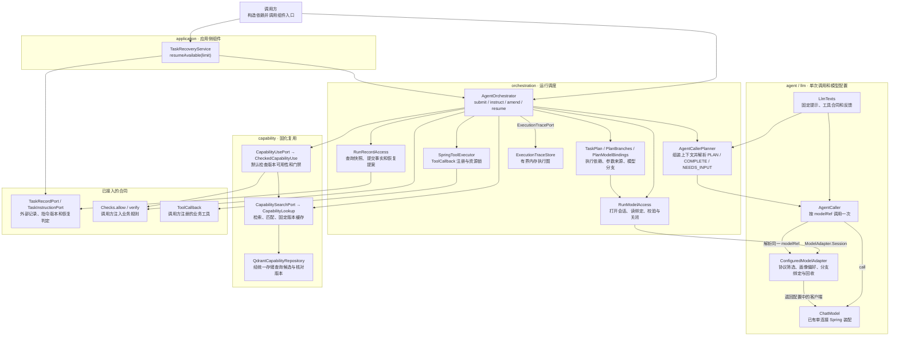
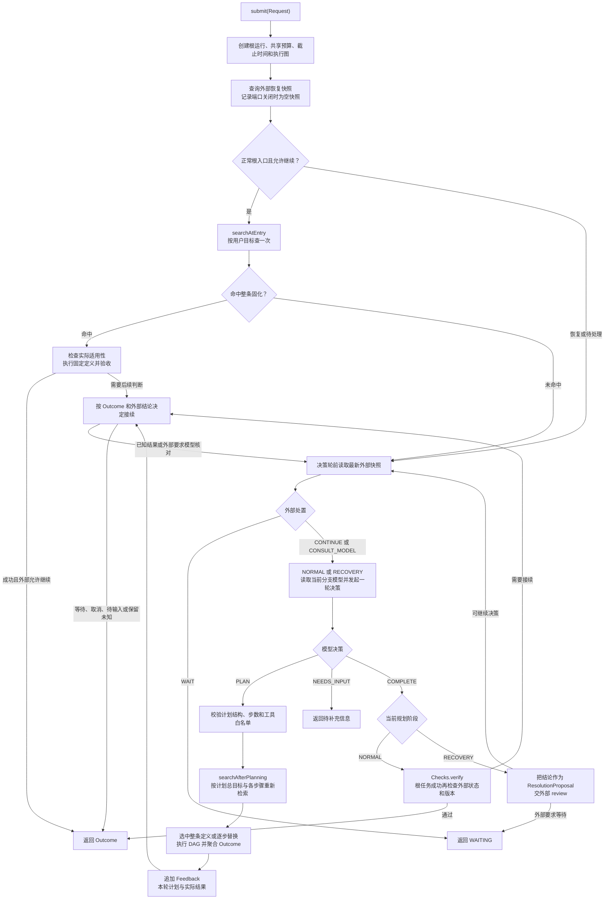
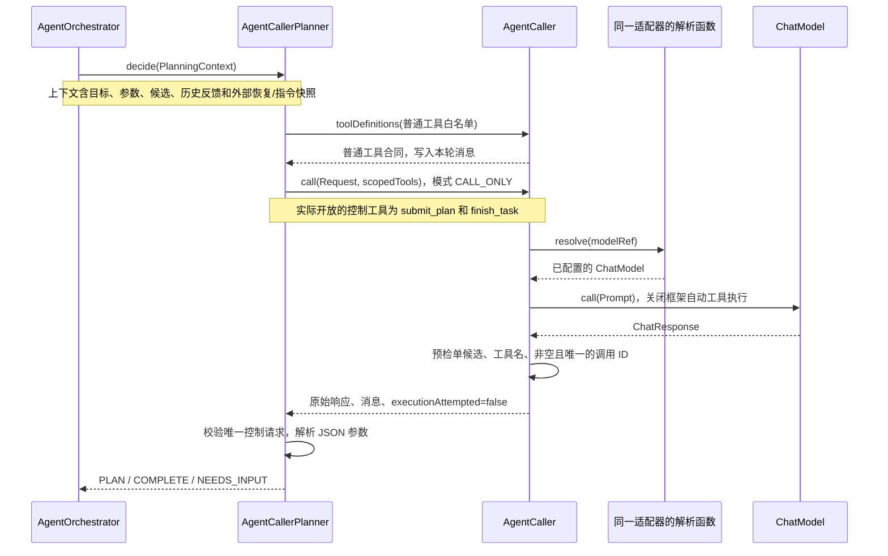
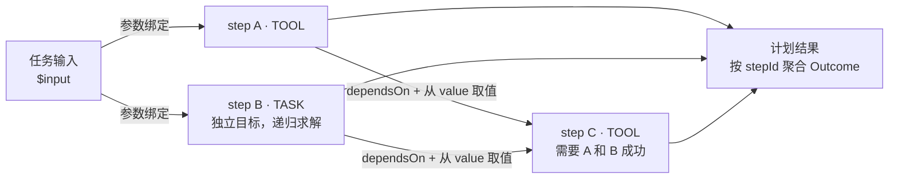
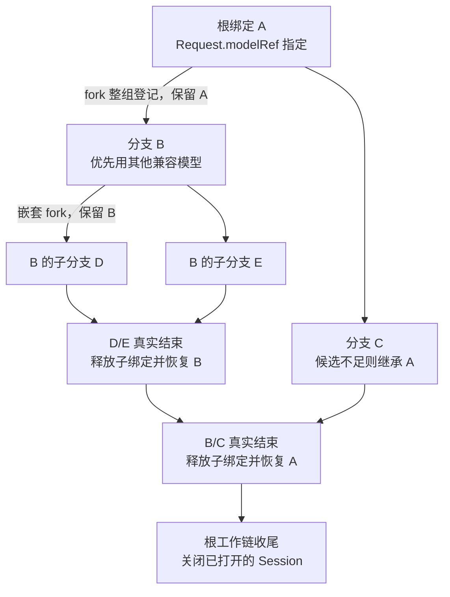
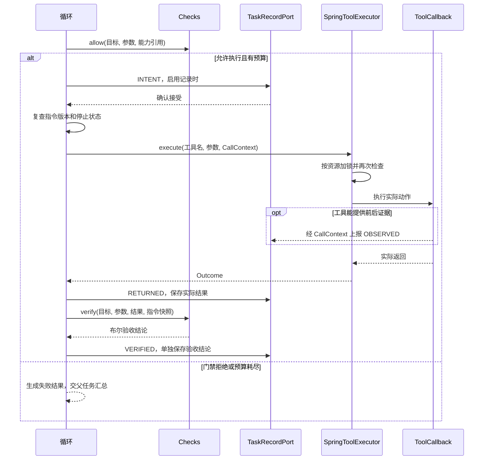
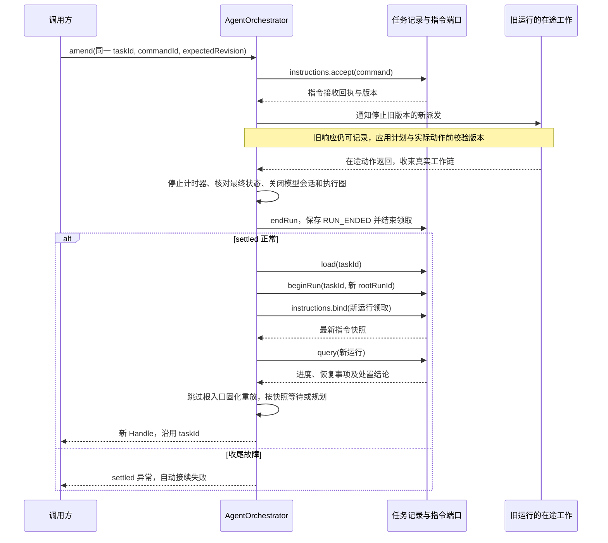
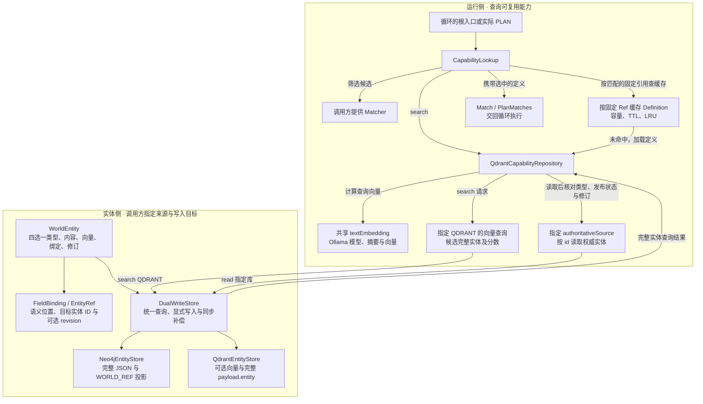
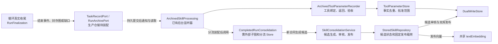

# MyHelper 已实现架构图

源码复核日期 2026-11-16。范围为三块主流程及已接入的固化、工具、记录和恢复组件，另附世界模型与存储的数据链路。组件对应业务源码，注入端口由调用方提供实现或策略。各模块实现与问题见[全量代码复核](全量实现与代码复核.md)。

## 1. 组件总图

正常任务通过 `submit(Request)` 进入。已有的单连接 Spring 装配将 `ConfiguredModelAdapter` 用作单次调用的模型解析器。调用方需把同一适配器装进循环。九参数默认禁用记录，十参数加入 `TaskRecordPort`，十一参数可替换适用策略，十二参数可接可靠度门限。旧构造缺少评分查询时交回模型。固化直执可跳过规划模型，判断某个新参数是否属于已批准范围时仍可调用范围模型。

组件入口和合同见 [AgentOrchestrator](../../src/main/java/com/example/myhelper/orchestration/AgentOrchestrator.java)、[TaskRecoveryService](../../src/main/java/com/example/myhelper/application/TaskRecoveryService.java)和[记录与恢复端口](../modules/records/28-执行记录与恢复端口开发文档.md)。

## 2. 一项任务如何进入下一轮

- 每个新 `PLAN` 重新检索并保存本轮 `PlanMatches`。递归 `TASK` 从自己的模型决策开始，共享根预算，不重复根入口检索。
- 任务树共享轮次以外的全局调用上限、截止时间和取消信号，各子任务维护自己的决策轮次与反馈。编排按 `UNKNOWN → CANCELLED → WAITING → NEEDS_INPUT → FAILED → SUCCESS` 的优先级汇总计划结果。
- 规划后整条固化已命中时，代码仍可能先对原计划做模型分支分析。原 `TASK` 依赖图存在归属歧义时，可能在选中定义执行前报错。见 [executeModelPlan](../../src/main/java/com/example/myhelper/orchestration/AgentOrchestrator.java#L793)。

## 3. 单次调用如何接到循环

`CALL_AND_EXECUTE` 是 `AgentCaller` 的独立用法。整批预检通过且有工具请求时，由 Spring AI 的 `DefaultToolCallingManager` 执行本次工具请求并返回消息。循环的业务工具则走第 4 节的调度与记录链。两条路径都在同一次 `AgentCaller.call` 内至多请求模型一次。规划始终要求 `TOOL_CALLING`，普通工具白名单为空时仍适用。

两层调用入口见 [AgentCaller](../../src/main/java/com/example/myhelper/agent/AgentCaller.java) 和 [AgentCallerPlanner](../../src/main/java/com/example/myhelper/orchestration/AgentCallerPlanner.java)。

## 4. DAG、分支模型和工具执行

**执行依赖和数据来源**

`TaskPlan` 校验步骤身份、依赖、参数来源和无环性。编排建立每步的 `CompletableFuture`，全部前驱成功后才组装参数、选执行分支，并优先使用已匹配的固定能力。普通工具使用 `SpringToolExecutor`，递归任务使用 `task(...)`。等待前驱和子任务使用异步接续，普通工具争用同一资源时在执行器内通过条带锁串行，等锁后再次检查停止和指令版本。执行图分别保存 `DEPENDS_ON` 与 `DATA_FROM`。

**模型分支的分配与回收**

`PlanBranches` 处理模型分支拓扑。结构明确时可推导，有歧义时需要 `TaskPlan.routing`。 `PlanModelBindings` 根据就绪及汇合时机申请或释放绑定，`RunModelAccess` 按需打开根会话，并在实际请求前读取绑定。 `ConfiguredModelAdapter` 用配置顺序筛选当前根运行中可用且尚无活动引用的模型，候选不足的子分支继承父引用。分支身份与工作线程无关，引用计数用于绑定分配和回收。

纯工具计划沿用计划所有者的逻辑分支。对它本身的执行，无需新模型会话、分叉绑定或模型路由分析。根入口直接完成的纯工具路径可全程跳过编排模型调用。当前每连接实际请求许可与按任务画像排序仍待实施。

依赖、分支和会话实现见 [TaskPlan](../../src/main/java/com/example/myhelper/orchestration/TaskPlan.java)、[PlanBranches](../../src/main/java/com/example/myhelper/orchestration/PlanBranches.java)、[PlanModelBindings](../../src/main/java/com/example/myhelper/orchestration/PlanModelBindings.java)、[RunModelAccess](../../src/main/java/com/example/myhelper/orchestration/RunModelAccess.java) 和 [ConfiguredModelAdapter](../../src/main/java/com/example/myhelper/llm/ConfiguredModelAdapter.java)。

## 5. 执行事实、验收与外部记录

| 记录 | 当前数据和归属 |
| --- | --- |
| 内存执行图 | `ExecutionTracePort` 接收节点、边和结果，现有 `ExecutionTraceStore.snapshot(rootRunId)` 提供节点、边和事件快照 |
| 工具事实 | 同一操作节点关联 `INTENT`、`RETURNED`、`VERIFIED`，工具可另报 `OBSERVED`。结果已产生但记录或验收故障时，尽可能保留原值与不确定状态 |
| 模型事实 | 取得绑定记录 `MODEL_TASK_ASSIGNED`，用调用身份关联 `MODEL_CALL_STARTED`、`MODEL_CALL_RETURNED` 或 `MODEL_FAILED`。耗时覆盖本地规划器调用区间，规划组装、解析失败也可能计入规划请求失败 |
| 外部进度与恢复事项 | `TaskRecordPort` 接收上述事实、提供快照，并审核恢复提案。生产仓储待接入，目前本地验证使用记录替身 |

事实用 `taskId`、`rootRunId`、`runId`、节点、分支、计划版本和指令版本关联。普通 `verify` 与恢复提案 `review` 有不同入口，生产验收策略和业务证据由对应模块提供。参见[执行链路](../modules/orchestration/13-执行链路记录开发文档.md)与[记录端口](../modules/records/28-执行记录与恢复端口开发文档.md)。

## 6. 中断、改指令和恢复

- `Handle.result()` 可能在取消或超时时提前结束。 `Handle.settled()` 表示真实工作和资源、记录收尾已经结束，或报告收尾失败。
- `instruct(Command)` 接收指令并通知活动运行。 `amend(Command)` 用于 AMEND 并安排实际收尾后自动接续。恢复以原任务和最新指令建立新根运行，新模型 `PLAN` 仍照常检索。
- `TaskRecoveryService.resumeAvailable(limit)` 接收外部有界候选，按任务去重、逐项调用 `resume`，并隔离单项受理失败。领取发生在循环内部。生产仓储、候选发现、远端核对及跨进程接管待接入。
- 运行本地停止指令当前可被迟到的旧回执覆盖。旧动作仍在途时，先暂停、再取消、再重发原暂停命令，按代码路径可能使取消被报告为 `WAITING`。见 [instruct](../../src/main/java/com/example/myhelper/orchestration/AgentOrchestrator.java#L177) 和 [Control.check](../../src/main/java/com/example/myhelper/orchestration/AgentOrchestrator.java#L1912)。

## 7. 固化检索与双库实体读写

2026-11-13 数据链路已更新：固化业务仓储的候选查询和权威实体读取全部经过 DualWriteStore，直接数据库 HTTP 已移入 QdrantEntityStore。向量结果携带完整实体，业务仓储提取固定引用，再按明确来源回读并核对修订与发布状态。默认固化适用策略在执行前重新核对可用性，内容缓存命中时也适用。当前仅核对当前版本，历史版本读取待实现。

双库读写由调用方显式指定来源和目标。两库可保存完整实体及其引用数据，Neo4j 额外投影图关系。引用的业务解释和展开由上层负责。现有批次补偿覆盖同步失败。

参见[统一世界模型](../modules/world/09-统一世界模型.md)、[双库读写](../modules/persistence/10-统一双写模块分析.md)和[固化检索](../modules/capability/19-固化检索与缓存开发文档.md)。

## 8. 执行归档到技能组件

归档回放、参数事实与候选发布均已有可执行组件。虚线表示仍依赖生产记录仓储或分流装配的链路。 [归档合同](../modules/records/28-执行记录与恢复端口开发文档.md) · [技能模块](../modules/skill/16-技能固化开发文档.md)

## 9. 已验证范围

2026-11-16 使用 `checks/run.ps1` 重编译 105 个 Java 文件，**174 项 JUnit 和 4 组存储检查通过**。模型调用、Neo4j 和任务记录使用替身，Qdrant 与 Ollama 使用本地 HTTP 协议服务。已有部分 Spring 组件，正式应用入口、真实服务联调和生产跨重启恢复待完成。 [检查记录](../../checks/README.md) · [待做索引](../planned/README.md)
