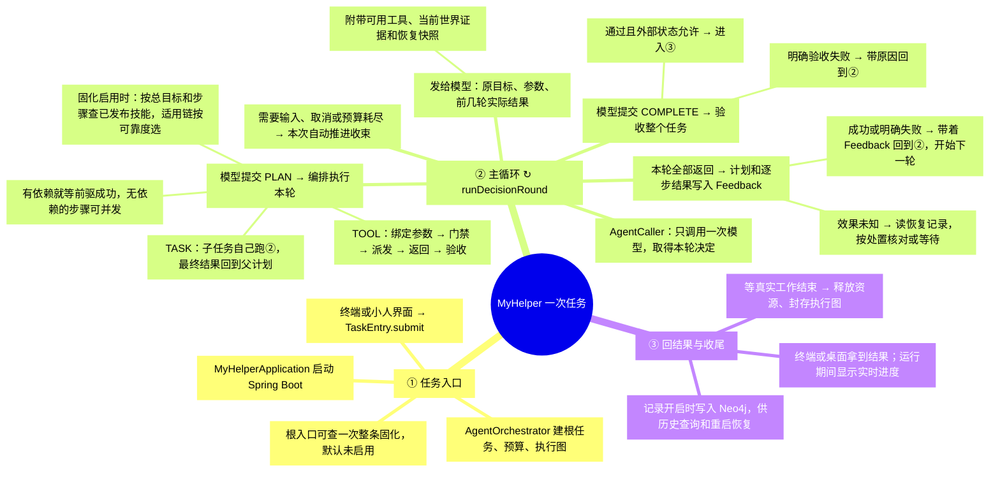
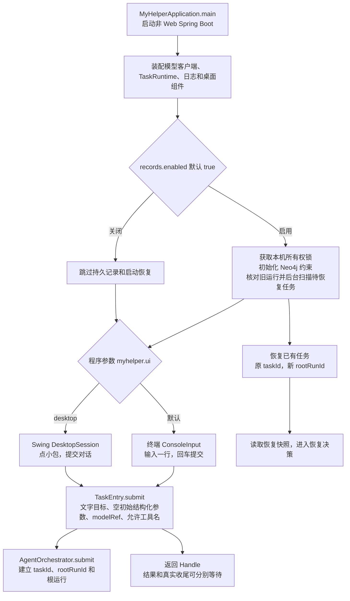
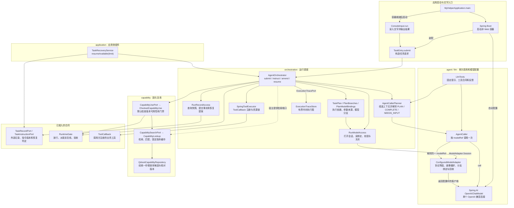
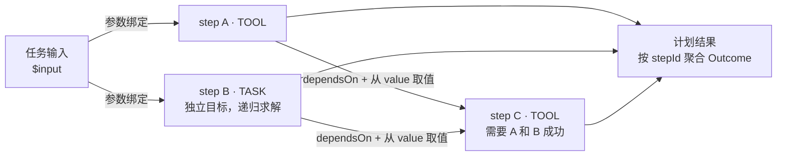
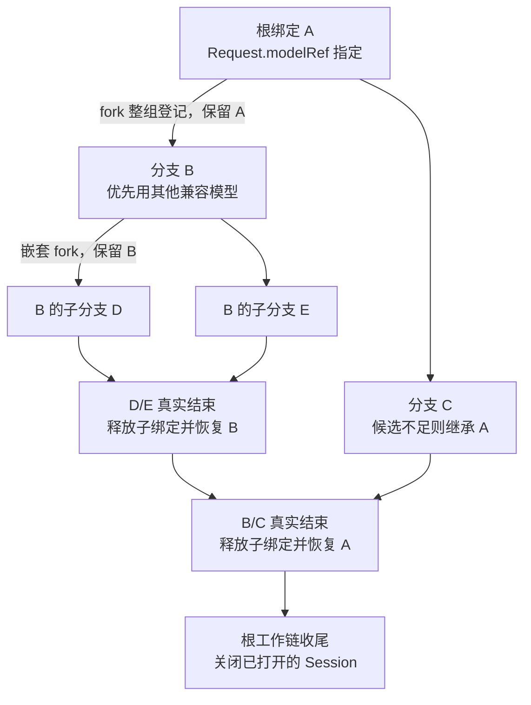
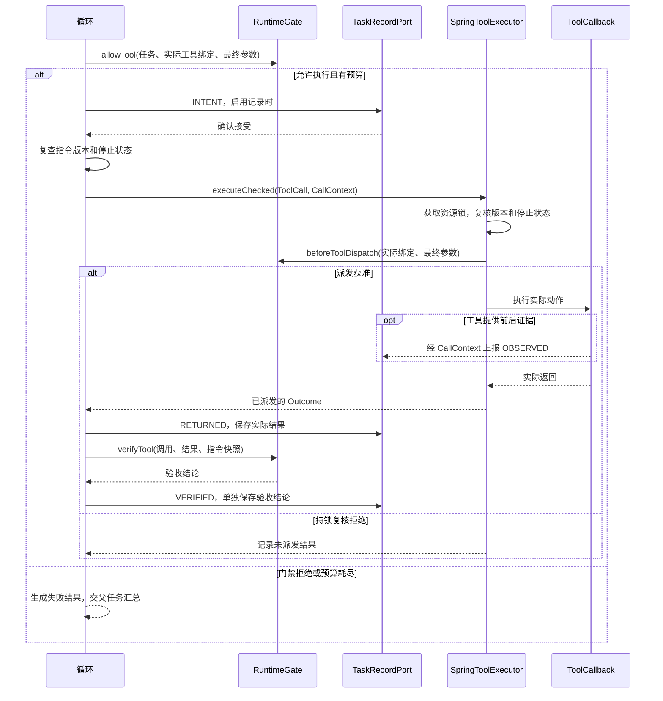
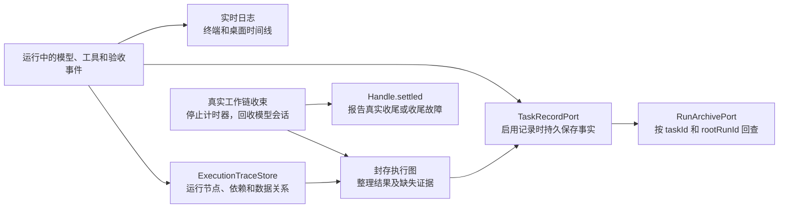
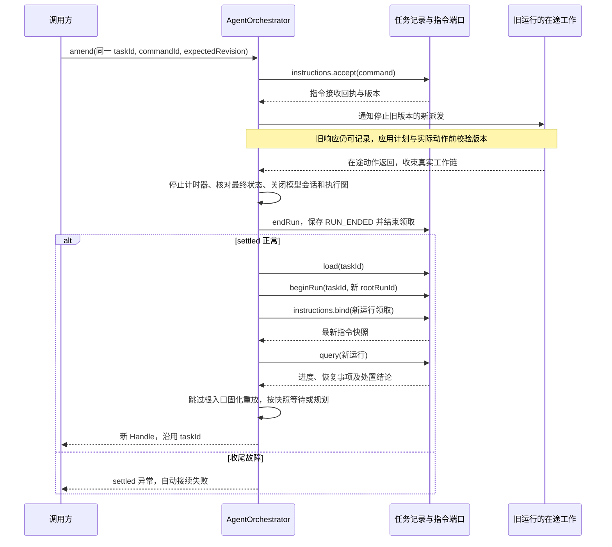
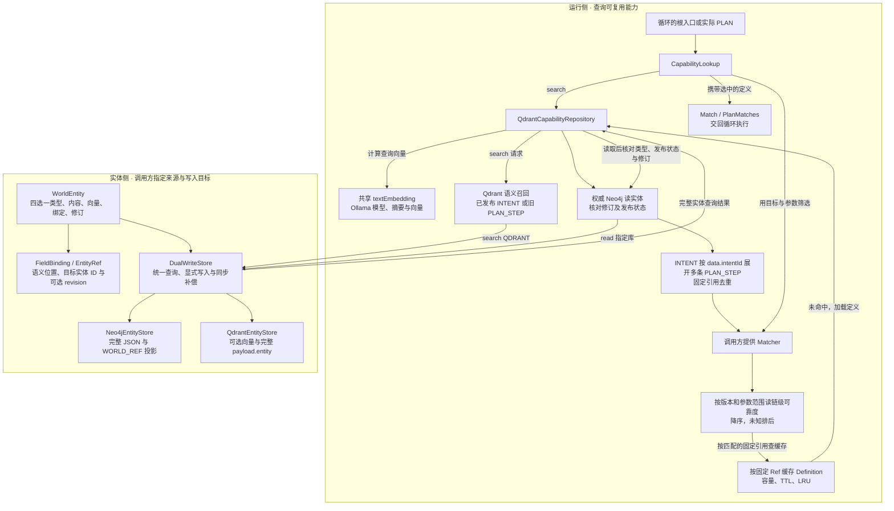
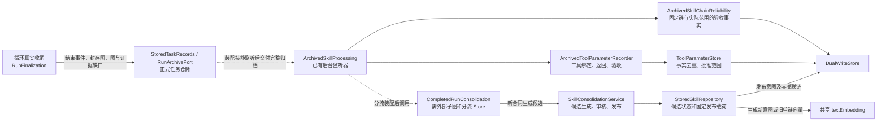

# MyHelper 已实现架构图

2026-11-18 按正式入口及当前代码更新。实线表示图中当前可用的调用关系，虚线表示需要额外配置或业务实现的接线。启动入口、循环、工具派发和记录收尾见下列流程。 [全量代码复核](全量实现与代码复核.md)

## 一次任务的思维导图



②会反复发生。`TASK` 自己执行②，父计划只在它返回最终结果后汇总该步骤。正式入口默认未开启固化检索。 [入口](../../src/main/java/com/example/myhelper/interaction/TaskEntry.java#L64) · [续轮](../../src/main/java/com/example/myhelper/orchestration/AgentOrchestrator.java#L938) · [子任务](../../src/main/java/com/example/myhelper/orchestration/AgentOrchestrator.java#L1302)

## 0. 应用启动到提交任务



记录启用时，Neo4j 初始化失败会结束启动。关闭记录适用于只试文字主流程。终端和桌面使用同一个任务入口。桌面通过实时日志和执行图显示气泡、步骤和结果。 [正式入口](../../src/main/java/com/example/myhelper/MyHelperApplication.java#L33) · [启动恢复](../../src/main/java/com/example/myhelper/application/StartupTaskRecovery.java#L75) · [文字入口](../../src/main/java/com/example/myhelper/interaction/TaskEntry.java#L64)

## 1. 组件总图



单次调用与编排器共用一个 `ConfiguredModelAdapter`。正式入口默认启用任务记录，业务工具按配置绑定，固化检索在宿主提供检索端口时启用。已装配的纯工具固化链可跳过规划模型，适用范围判断仍可按其策略调用范围模型。 [应用启动链路](../modules/interaction/20-交互与语音开发文档.md#应用启动链路) · [当前运行装配](../../src/main/java/com/example/myhelper/interaction/TaskRuntimeConfiguration.java)

组件入口和合同见 [AgentOrchestrator](../../src/main/java/com/example/myhelper/orchestration/AgentOrchestrator.java)、[TaskRecoveryService](../../src/main/java/com/example/myhelper/application/TaskRecoveryService.java)和[记录与恢复端口](../modules/records/28-执行记录与恢复端口开发文档.md)。

## 2. 一项任务如何进入下一轮

`TaskEntry` 交给 `AgentOrchestrator` 一个任务目标。正常新根任务有一次 `searchAtEntry` 的机会。检索开启且整条固化链成功执行、验收、记录复核通过时，可在这里完成。默认启动未装配检索，直接进入第一轮模型决策。恢复进来的旧任务从进度和恢复处置开始。 [根入口](../../src/main/java/com/example/myhelper/orchestration/AgentOrchestrator.java#L476)

循环发生在 `runDecisionRound`。一次调用只向模型取一次决策。如果返回 `submit_plan`，编排验证并执行这份计划，等本轮各步有结果，追加 `Feedback`，然后以 `round + 1` 再调用 `runDecisionRound`。

```text
runDecisionRound(第 1 轮，history = [])
  → 模型返回 submit_plan，得到计划 P1
  → 编排执行 P1，得到实际结果 O1
  → 追加 Feedback(P1, O1)
  → runDecisionRound(第 2 轮，history = [P1/O1])
     → 模型返回 submit_plan，得到计划 P2
     → 编排执行 P2，得到实际结果 O2
     → 追加 Feedback(P2, O2)
     → runDecisionRound(第 3 轮，history = [P1/O1, P2/O2])
        → 模型返回 finish_task(COMPLETE, 答复)
        → 编排把答复交给门禁验收，复核最新记录和指令
        → 通过后返回 SUCCESS，根运行收尾
```

### 下一轮模型看到的数据

编排每轮重组结构化 `task`、`availableTools` 和 `worldContext`。`task.history` 保存本任务前几轮的 `Feedback(revision, plan, outcome)`。按普通 DAG 执行时，`outcome.value` 按步骤编号保存实际状态、返回值和错误。当前目标、初始参数、指令和恢复快照也随本轮输入提供。记录启用时，恢复快照还可提供同一根任务的实际执行事实，包括子任务的工具结果。恢复运行的局部 `history` 重新开始，以持久快照接续。`availableTools` 描述可计划的业务工具，模型使用 `submit_plan` 或 `finish_task` 向编排器返回决定。 [请求组装](../../src/main/java/com/example/myhelper/orchestration/AgentCallerPlanner.java#L60) · [追加反馈](../../src/main/java/com/example/myhelper/orchestration/AgentOrchestrator.java#L923)

下一轮模型读取这些结果，再决定是否提交一份新计划。新计划的 `dependsOn` 和步骤输出绑定指向本计划里的步骤。跨轮使用旧结果时，模型可从历史读取数值并填入新计划，也可以让工具按已有产物标识回读。 `$input` 始终表示本任务传入的参数。 [参数绑定](../../src/main/java/com/example/myhelper/orchestration/AgentOrchestrator.java#L1707)

### 父任务怎样等待子任务

以「统计 A、B 两个文件的有效记录数，再求总数」为例，假设已注册统计工具。父任务第一轮提交两个没有依赖的步骤。A 是 `TOOL`，实际工具返回 12。B 是 `TASK`，编排把子目标和绑定参数交给一个独立的子任务。B 可以先跑一个失败的方案，再根据自己的反馈换方案，最后验收得到 8。两步可以并发。父计划等到 A 与 B 都返回，才把 `A=12、B=8` 写入父任务的该轮结果。父模型第二轮可以提交汇总步骤，第三轮用汇总结果提交最终答复。B 的各轮反馈属于 B，父计划得到的是 B 的最终 `Outcome`。

如果汇总步骤已在第一份计划内声明依赖 A、B，编排会在同一轮等两者都成功后执行汇总，随后才进入下一次父模型决策。任一前驱未成功，依赖它的后继不派发。每个 `TASK` 有独立轮次及反馈，整棵树共享模型与工具调用预算、截止时间和取消信号。 [依赖与并发](../../src/main/java/com/example/myhelper/orchestration/AgentOrchestrator.java#L1140) · [递归子任务](../../src/main/java/com/example/myhelper/orchestration/AgentOrchestrator.java#L1291)

### 走下一轮、等待或结束的条件

| 本轮发生的事 | 编排接下来的动作 |
| --- | --- |
| `submit_plan`，结果为 `SUCCESS` 或明确 `FAILED` | 都可追加反馈进入下一轮。失败时保留成功步骤的实际结果及错误，供模型判断剩下的工作 |
| `finish_task(COMPLETE)` | 普通任务进入完成验收。通过并复核外部记录后结束，验收失败可带原因再规划。恢复阶段的 `COMPLETE` 交外部审核恢复提案 |
| `finish_task(NEEDS_INPUT)`、等待或取消 | 返回相应状态，本次自动循环收束 |
| 执行效果 `UNKNOWN` | 查询恢复处置。明确要求模型核对才进入恢复决策，其他情况按处置等待或保留未知 |
| 固化检索已启用，模型提交一份新计划 | 按新计划总目标及步骤目标重新查固化。派发前用已绑定的真实参数复核。确定没有派发时可试另一条，实际失败后同条件重规划避开该固定版本 |

[循环续轮与停止](../../src/main/java/com/example/myhelper/orchestration/AgentOrchestrator.java#L938) · [完成验收](../../src/main/java/com/example/myhelper/orchestration/AgentOrchestrator.java#L805) · [多链选择](../modules/capability/19-固化检索与缓存开发文档.md#2026-11-17-一意图多链的展开与可靠度选择)

## 3. 单次调用如何接到循环


`CALL_AND_EXECUTE` 是 `AgentCaller` 的独立用法。整批预检通过且有工具请求时，由 Spring AI 的 `DefaultToolCallingManager` 执行本次工具请求并返回消息。循环的业务工具则走第 4 节的调度与记录链。两条路径都在同一次 `AgentCaller.call` 内至多请求模型一次。规划始终要求 `TOOL_CALLING`，普通工具白名单为空时仍适用。

两层调用入口见 [AgentCaller](../../src/main/java/com/example/myhelper/agent/AgentCaller.java) 和 [AgentCallerPlanner](../../src/main/java/com/example/myhelper/orchestration/AgentCallerPlanner.java)。

## 4. DAG、分支模型和工具执行

**执行依赖和数据来源**



`TaskPlan` 校验步骤身份、依赖、参数来源和无环性。编排建立每步的 `CompletableFuture`，全部前驱成功后才组装参数、选执行分支，并优先使用已匹配的固定能力。普通工具使用 `SpringToolExecutor`，递归任务使用 `task(...)`。等待前驱和子任务使用异步接续，普通工具争用同一资源时在执行器内通过条带锁串行，等锁后再次检查停止和指令版本。执行图分别保存 `DEPENDS_ON` 与 `DATA_FROM`。

**模型分支的分配与回收**



`PlanBranches` 处理模型分支拓扑。结构明确时可推导，有歧义时需要 `TaskPlan.routing`。 `PlanModelBindings` 根据就绪及汇合时机申请或释放绑定，`RunModelAccess` 按需打开根会话，并在实际请求前读取绑定。 `ConfiguredModelAdapter` 用配置顺序筛选当前根运行中可用且尚无活动引用的模型，候选不足的子分支继承父引用。分支身份与工作线程无关，引用计数用于绑定分配和回收。

纯工具计划沿用计划所有者的逻辑分支。对它本身的执行，无需新模型会话、分叉绑定或模型路由分析。根入口直接完成的纯工具路径可全程跳过编排模型调用。当前每连接实际请求许可与按任务画像排序仍待实施。

依赖、分支和会话实现见 [TaskPlan](../../src/main/java/com/example/myhelper/orchestration/TaskPlan.java)、[PlanBranches](../../src/main/java/com/example/myhelper/orchestration/PlanBranches.java)、[PlanModelBindings](../../src/main/java/com/example/myhelper/orchestration/PlanModelBindings.java)、[RunModelAccess](../../src/main/java/com/example/myhelper/orchestration/RunModelAccess.java) 和 [ConfiguredModelAdapter](../../src/main/java/com/example/myhelper/llm/ConfiguredModelAdapter.java)。

## 5. 执行事实、验收与外部记录



| 记录 | 当前数据和归属 |
| --- | --- |
| 内存执行图 | `ExecutionTracePort` 接收节点、边和结果，现有 `ExecutionTraceStore.snapshot(rootRunId)` 提供节点、边和事件快照 |
| 工具事实 | 同一操作节点关联 `INTENT`、`RETURNED`、`VERIFIED`，工具可另报 `OBSERVED`。结果已产生但记录或验收故障时，尽可能保留原值与不确定状态 |
| 模型事实 | 取得绑定记录 `MODEL_TASK_ASSIGNED`，用调用身份关联 `MODEL_CALL_STARTED`、`MODEL_CALL_RETURNED` 或 `MODEL_FAILED`。耗时覆盖本地规划器调用区间，规划组装、解析失败也可能计入规划请求失败 |
| 外部进度与恢复事项 | `StoredTaskRecords` 接收上述事实、提供快照并保存恢复处置。生产入口默认装配正式仓储，业务核对和补偿由宿主策略决定 |

事实用 `taskId`、`rootRunId`、`runId`、节点、分支、计划版本和指令版本关联。普通 `verify` 与恢复提案 `review` 有不同入口，生产验收策略和业务证据由对应模块提供。参见[执行链路](../modules/orchestration/13-执行链路记录开发文档.md)与[记录端口](../modules/records/28-执行记录与恢复端口开发文档.md)。



设备状态查询是已实现的可配置业务分支。`DeviceReadGate` 使用世界模型按授权定位设备和读取 `power`。有可信新鲜值可用于答复验收。证据缺失或过期时，只有匹配已授权的固定感知工具才允许刷新，持锁后复核并占用一次刷新。HA 只读回调返回后，世界接口追加观测并复查，门禁据可信结果核对答复。启用需真实设备映射、宿主授权和资源解析。 [设备工具](../modules/tools/25-工具管理与隔离运行设计.md#8-设备状态查询与感知接线) · [设备只读门禁](../modules/gate/15-门禁与验收开发文档.md#9-设备只读门禁首版实现)

## 6. 中断、改指令和恢复



- `Handle.result()` 可能在取消或超时时提前结束。 `Handle.settled()` 表示真实工作和资源、记录收尾已经结束，或报告收尾失败。
- `instruct(Command)` 接收指令并通知活动运行。 `amend(Command)` 用于 AMEND 并安排实际收尾后自动接续。恢复以原任务和最新指令建立新根运行，新模型 `PLAN` 仍照常检索。
- `StartupTaskRecovery` 在 Neo4j 初始化和旧运行核对后扫描本机所有者的待恢复任务。`TaskRecoveryService.resumeAvailable(limit)` 按任务去重、逐项调用 `resume`，并隔离单项受理失败。领取发生在循环内部。远端效果核对及跨主机接管仍待接入。
- 停止标记携带指令版本，只接受更高版本。暂停、取消后重放旧暂停回执，旧运行仍按最新指令收尾。 [指令与恢复](../modules/records/28-执行记录与恢复端口开发文档.md)

## 7. 固化检索与双库实体读写



固化业务仓储经 `DualWriteStore` 召回意图或旧单链，再在明确的权威来源核对发布和修订。多链先由业务 Matcher 核对合同及实参，再按链级可靠度选择。缓存只保留固定定义，执行前复核真实参数、资格和可用性。正式 `main` 仍需导入能力与技能配置，提供业务 Matcher 和链分才能使这条路径生效。通用历史修订读取仍待实现。

双库读写由调用方显式指定来源和目标。两库可保存完整实体及其引用数据，Neo4j 额外投影图关系。引用的业务解释和展开由上层负责。现有批次补偿覆盖同步失败。

参见[统一世界模型](../modules/world/09-统一世界模型.md)、[双库读写](../modules/persistence/10-统一双写模块分析.md)和[固化检索](../modules/capability/19-固化检索与缓存开发文档.md)。

## 8. 执行归档到技能组件



正式记录仓储已装配。技能配置提供归档监听、链级评分及审核后归组发布的组件。完整自动固化还需装配子图提取、业务审核与分流。 [归档合同](../modules/records/28-执行记录与恢复端口开发文档.md) · [技能模块](../modules/skill/16-技能固化开发文档.md)

## 9. 已验证范围

2026-11-16 使用 `checks/run.ps1` 重编译 105 个 Java 文件，**174 项 JUnit 和 4 组存储检查通过**。模型调用、Neo4j 和任务记录使用替身，Qdrant 与 Ollama 使用本地 HTTP 协议服务。

2026-11-17 可执行 JAR 已通过本地模型协议验证，覆盖启动、中文任务提交、结果输出及退出。该次独立检查 **191 项 JUnit 和 4 组存储检查通过**。真实服务联调和生产跨重启恢复待完成。 [检查记录](../../checks/README.md) · [待做索引](../planned/README.md)
