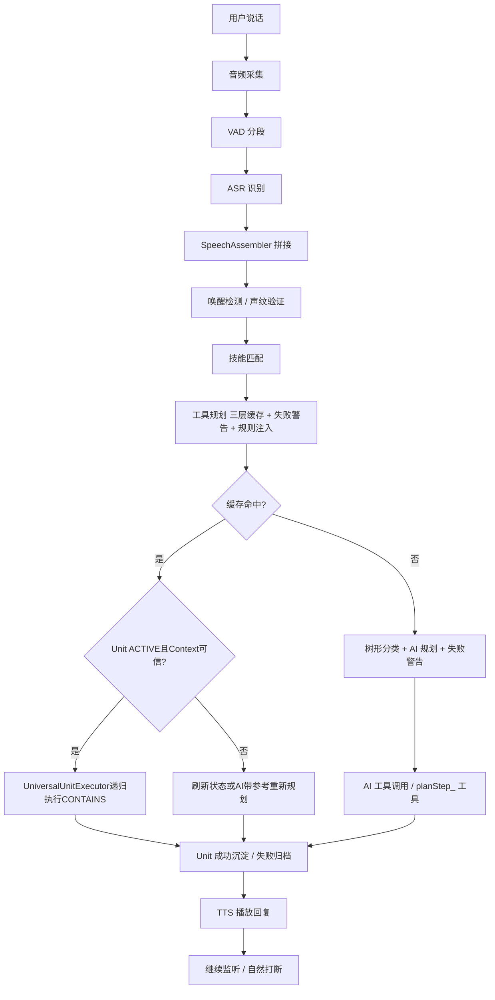
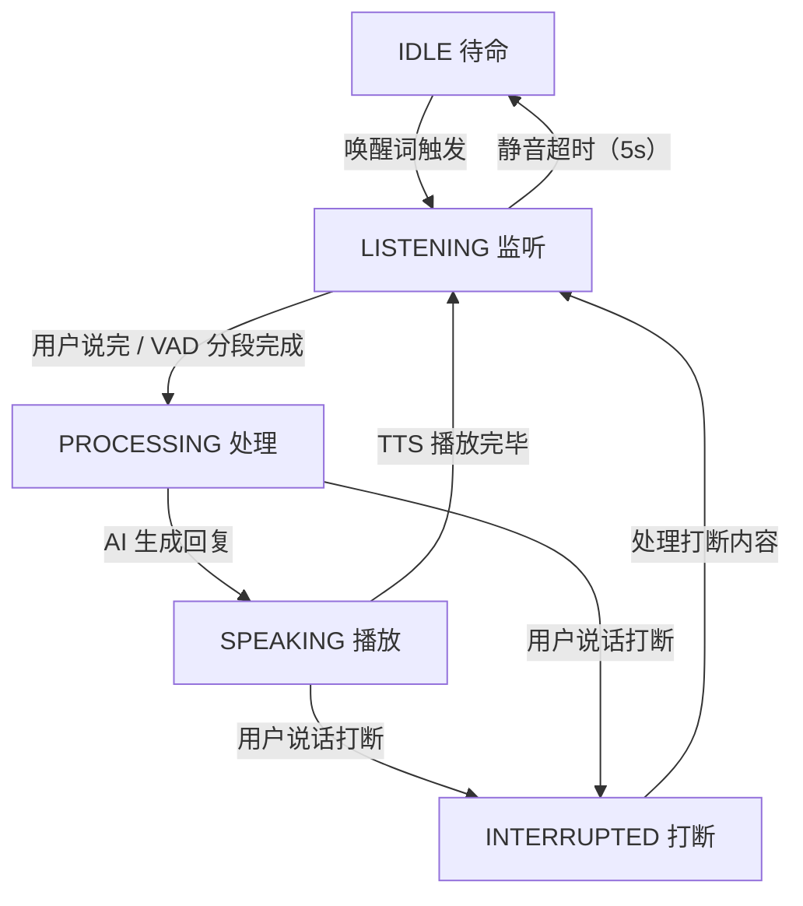

# MyHelper 文档中心

> 当前基线：2026-09-02。代码是最终事实；本文定义文档边界和推荐阅读顺序。

## 当前架构一句话

MyHelper 是一个本地优先的长期自主助手：`WorldObject + ContextUnit` 表达统一世界模型，
`Unit` 表达可递归组合的能力图，Qdrant 负责语义召回，Neo4j 保存结构真相；新任务由模型探索，
成功经验沉淀为 Unit，后续在可信世界状态满足时确定性执行。

## 推荐阅读顺序

1. [系统总架构](01-系统总架构.md)：系统边界、模块和完整闭环。
2. [核心执行流程](03-核心执行流程.md)：一轮请求从语音到执行、验证和沉淀。
3. [递归世界模型与条件直达](13-递归世界模型与条件直达.md)：世界状态、快照、条件和刷新。
4. [记忆与向量系统](05-记忆与向量系统.md)：Unit 图、语义索引、图归纳和数据流。
5. [工具与技能体系](06-工具与技能体系.md)：工具发现、规划、MCP和技能配置。
6. [对话与语音系统](04-对话与语音系统.md)：VAD、ASR、声纹、打断和TTS。
7. [数据库与部署](07-数据库与部署.md)：Neo4j、Qdrant、模型和启动方式。
8. [代码实现清单](02-代码实现清单.md)：按包定位源码。

## 专题文档

| 文档 | 内容 |
|---|---|
| [工具自生成与动态加载](08-工具自生成与动态加载.md) | 缺失工具生成、编译和加载 |
| [小说创作质量门禁](09-小说创作质量门禁.md) | 小说子系统质量校验 |
| [探索知识与记忆维护](10-探索知识与记忆维护.md) | 自主探索、知识沉淀和清理 |
| [记忆价值评分系统](11-记忆价值评分系统.md) | Unit质量、保留和清理 |
| [元自我优化](12-元自我优化.md) | 配置实验、指标和回滚 |
| [项目目录约定](00-项目目录约定.md) | 文件、模型、数据和脚本边界 |

## 三种归纳不要混淆

| 机制 | 触发 | 产物 | 用途 |
|---|---|---|---|
| 在线Unit折叠 | 每次成功沉淀 | 复用已有PLAN_STEP的CONTAINS边 | 新经验不重复已有子图 |
| 离线Unit图归纳 | 每天03:15 | 公共PLAN_STEP和重写后的CONTAINS | 整理旧图、参数提升、形成层级 |
| 经验规则归纳 | 每天03:00 | RuleNode | 给模型规划注入跨案例教训 |

## 当前定时任务

| 时间/间隔 | 服务 | 作用 |
|---|---|---|
| 每60秒巡检 | `AutonomousExplorationService` | 空闲满足条件时探索 |
| 每小时 | `MetaOptimizationService` | 受控配置实验与回滚 |
| 每5分钟 | `UnitStore.compensateMissingUnits` | 补偿缺失Qdrant索引 |
| 03:00 | `RuleInductionService` | 归纳通用规划规则 |
| 03:15 | `UnitGraphCompactionService` | 提取公共Unit路径并重写旧图 |
| 03:30 | `ExperienceQualityService` | 刷新Unit经验质量 |
| 04:00 | `MemoryMaintenanceService` | 清理低价值Unit |
| 04:30 | `ContextUnitMaintenanceService` | 维护快照、推断和历史保留 |

后台自主总开关为 `myhelper.autonomous.enabled`。各任务仍有各自配置条件；表中为默认值。

## 文档状态边界

- `docs/00`～`docs/13`：当前实现文档。
- `docs/history/`：已退役设计，只用于解释演进，不得作为当前实现依据。
- `docs/reference/`：研究参考或早期设想，默认不代表已经实现。
- `docs/audits/`：阶段性审计记录，可能已经被后续代码修复。

## 核心不变量

- Unit执行结构只有Neo4j中的带参数 `CONTAINS` 图，没有第二份扁平脚本。
- 存储结构允许多个父Unit共享子Unit，因此整体是DAG/图；单次执行按当前入口递归展开为有序调用树。
- Qdrant只做召回索引；命中后必须回Neo4j读取结构。
- 历史观测与标准状态都使用ContextUnit；OBSERVATION通过`stateId`指向STATE。
- Unit的REQUIREMENT/EXPECTATION最终匹配STATE；状态不可信时调用`refreshUnitId`指向的Unit。
- 父子参数保存在CONTAINS关系；上下游数据使用`$step.var`和`outputSignature`传递。
- 结构归纳尽量确定性完成；只有语义命名、规则总结等模糊环节交给模型。
# 01 - 系统总架构

> 文档基线：2026-09-02。阅读入口见 [文档中心](README.md)。本文只描述当前架构；退役设计放在 `history/`。

> 当前执行模型：`WorldObject + ContextUnit + Unit`。Unit 的唯一执行结构为带参数的 `CONTAINS` 能力图；语义命中后检查 REQUIREMENT，必要时调用刷新 Unit，满足条件才直接执行，并以 EXPECTATION 验证。历史模型见 [v1 脚本化 Unit](history/历史迭代-v1-脚本化Unit.md)。

> 最后更新：2026-09-01 | 技术栈：Java 25 / Spring Boot 4.1.0-M2 / Spring AI 2.0.0-M3

---

## 1. 项目愿景

**MyHelper** 是一个本地化、多模态的个人 AI 桌面助手，目标是实现 Jarvis 级别能力：

- **自然语音交互** ― 唤醒词激活、流式对话、任意时刻打断、声纹身份识别
- **持久化记忆** ― 记住偏好和习惯、语义检索历史对话、经验跨重启复用
- **统一世界模型** ― 用 `WorldObject + ContextUnit` 统一表达设备、用户、系统自身、人格、事实、观测、条件、预期与推断
- **自主执行任务** ― 查资料、装软件、控智能家居、操控屏幕/键盘/鼠标
- **自我学习进化** ― 成功经验自动沉淀为可复用的 Unit，失败模式自动归档为规则，空闲时自主探索新能力
- **设备全连接** ― MCP 协议统一管理所有智能设备（GUI、智能家居、工具链）

---

## 2. 技术栈

### 2.1 核心框架

| 领域 | 技术 | 版本 | 用途 |
|------|------|------|------|
| 语言 | Java | 25 | 核心开发（需 `--enable-native-access=ALL-UNNAMED`） |
| 框架 | Spring Boot | 4.1.0-M2 | DI / 配置 / 定时任务 |
| AI 框架 | Spring AI | 2.0.0-M3 | ChatClient / Tool Calling / MCP Client |
| 主对话模型 | DeepSeek | `deepseek-v4-flash` | API 调用（OpenAI 兼容） |
| 探索模型 | 模型路由（ModelRouter） | `model2` | `model2`=全程云端 DeepSeek；`model1`=本地 qwen3:30b 优先、失败请教云端 |
| 嵌入模型 | bge-m3 | 1024 维 | Ollama 本地推理（中文+多语言语义向量） |

### 2.2 语音识别与合成

| 组件 | 引擎 | 模型 | 说明 |
|------|------|------|------|
| **ASR** | Sherpa-ONNX | Zipformer (int8) + Paraformer (zh-small) | 双模型：IDLE 低延迟唤醒 / 对话高精度识别 |
| **TTS** | Sherpa-ONNX | VITS (中文) | 离线语音合成 |
| **VAD** | Silero VAD | v4 (ONNX) | 语音活动检测，支持能量检测回退 |
| **声纹** | Sherpa-ONNX | 3D-Speaker Embedding | 说话人识别（相似度阈值 0.6） |

### 2.3 数据库与基础设施

| 组件 | 部署方式 | 端口 | 用途 |
|------|----------|------|------|
| **Qdrant** | Docker | 6333 | 向量语义搜索（1024 维，bge-m3） |
| **Neo4j** | Docker | 7687 / 7474 | 知识图谱：Unit、FailureCause、设备、偏好、规则、工具注册 |
| **Ollama** | 本地进程 | 11434 | 嵌入模型（bge-m3） |
| **robot-mcp** | 本地进程 | 8081 | MCP 协议：屏幕/鼠标/键盘/OCR 操作 |
| **Home Assistant** | Docker | 8123 | 智能家居设备控制 |

### 2.4 工具生态

| 类别 | 数量 | 来源 | 说明 |
|------|------|------|------|
| MCP 工具 | 运行时动态 | robot-mcp | GUI 操控、截图、OCR、鼠标、键盘、浏览器 |
| 本地 @Tool | 138 个方法 | 58 个类 | 文件操作、软件安装、智能家居、联系人、搜索、工具查询等 |
| 生成工具 | 25 个 | `generated/` | AI 自动生成，带 `@GeneratedTool` 标识，3 次连续失败自动清除 |

---

## 3. 系统架构图

统一世界模型是系统中央状态层，不是独立于执行器之外的普通知识库。感知工具把环境写入世界模型；规划器读取可信上下文；Unit 以同一批 ContextUnit 表达执行要求和结果预期；执行后再用观测工具刷新并验证世界状态。

```
环境/用户/系统自身
        │ 感知与状态更新 Unit
        ��
┌─────────────────────────────────────────────────────────────┐
│                    统一世界模型（Neo4j）                     │
│ WorldObject：人、设备、应用、文件、系统，可递归组合           │
│ ContextUnit：STATE / OBSERVATION / FACT / REQUIREMENT        │
│              EXPECTATION / INFERENCE / PERSONALITY           │
│ 时效：observedAt、validUntil、maximumAgeMillis、confidence   │
│ 刷新：状态不可信时通过 refreshUnitId 递归调用感知 Unit        │
└──────────────┬──────────────────────┬───────────────────────┘
               │ 当前可信上下文       │ 条件/预期引用
               ��                      ��
语音/文字 → TurnProcessor → ToolPlanner → Unit 语义召回与规划
                                      │
                                      ��
                          UniversalUnitExecutor
                          REQUIREMENT → CONTAINS → EXPECTATION
                                      │
                                      ��
                         本地工具 / MCP / Home Assistant
                                      │ 执行结果与新观测
                                      └──────────→ 统一世界模型

Qdrant：Unit、工具、记忆的语义检索入口
Neo4j：世界对象、上下文、Unit 能力图、规则、失败原因的结构化主存储
自主探索/反思/自我优化：共同读取世界状态并沉淀 Unit、规则和新上下文
```

---

## 4. 模块划分

### 4.1 模块总览

| 模块 | 包路径 | 职责 |
|------|--------|------|
| **入口启动** | `com.example.myhelper` | Spring Boot 主类、启动流程编排、音频循环、语音调度 |
| **对话系统** | `com.example.myhelper.dialog` | 五态状态机、语音片段 debounce 拼接 |
| **核心服务** | `com.example.myhelper.service` | ASR/TTS/VAD/声纹、TurnProcessor 执行管线、工具规划、工具搜索、规则归纳 |
| **配置层** | `com.example.myhelper.config` | 属性绑定、模型路由、ChatClient Bean、Docker 启动检查、Neo4j schema 初始化 |
| **记忆-门面** | `com.example.myhelper.memory` | MemoryService 统一 API |
| **记忆-向量** | `com.example.myhelper.memory.vector` | 嵌入（bge-m3）、向量存储、工具分类与 ReflectService |
| **记忆-Unit** | `com.example.myhelper.memory.unit` | Unit 统一对象、UnitStore 双写、UniversalUnitExecutor、成功沉淀、失败归因 |
| **记忆-图谱** | `com.example.myhelper.memory.graph` | Unit/FailureCause/Device/Preference/Rule 实体与 Repository |
| **统一世界模型** | `com.example.myhelper.world` | WorldObject/ContextUnit 图谱、可信度与时效判断、状态刷新、规划上下文组装 |
| **集成层** | `com.example.myhelper.integration` | Home Assistant 客户端与 @Tool 工具、设备发现 |
| **自主探索** | `com.example.myhelper.exploration` | 探索主控、空闲检测、上下文压缩、记忆维护 |
| **工具自生成** | `com.example.myhelper.autogen` | AI 生成 .java → 编译 → 动态加载 @Tool |
| **工具注册中心** | `com.example.myhelper.registry` | 工具统一注册：Neo4j + Qdrant + L1 内存三级缓存 |
| **已生成工具** | `com.example.myhelper.generated` | AI 自动生成的 25 个工具（@GeneratedTool 标识） |
| **小说辅助** | `com.example.myhelper.novel` | 小说创作辅助（章节/角色/伏笔记忆，独立子系统） |
| **元自我优化** | `com.example.myhelper.optimization` | 运行指标采集、白名单配置试验、效果验证与自动回滚 |
| **工具-系统** | `com.example.tools.windows` | 文件操作、软件下载安装、系统信息 |
| **工具类** | `com.example.myhelper.util` | Native DLL 加载 |

### 4.2 类注解分布

| 注解 | 说明 |
|------|------|
| `@Service` | 业务服务层 |
| `@Component` | 通用组件 |
| `@Configuration` | 配置类 |
| `@Node` | Neo4j 节点实体（15 个，包含世界模型的 WorldObject/ContextUnit，以及 Unit、工具、规则、设备、偏好、小说和定时任务节点） |
| `@Tool` | 138 个方法，分布在 58 个类中 |
| `@Scheduled` | 定时任务（探索巡检 + 规则归纳 + 记忆维护） |
| `@GeneratedTool` | 25 个 AI 自动生成的工具标识 |

---

## 5. 核心执行流程

### 5.1 启动流程（CommandLineRunner）

```
MyHelperApplication.run()
  ├── 扫描所有 @Tool bean → localTools
  ├── 合并 MCP tools + local tools → allToolCallbacks
  ├── turnProcessor.initToolSearch(allToolCallbacks)
  ├── turnProcessor.initDynamicClassLoader()
  ├── toolSyncService.syncOnStartup(...)        ← 工具全量同步（Neo4j + Qdrant）
  ├── 注册 shutdown hook（释放 sherpa-onnx 资源）
  ├── turnProcessor.syncCategories(...) 异步     ← 工具分类同步（异步）
  ├── speechEventLoop.start()                    ← 语音事件循环启动
  ├── backgroundAudio.start()                    ← 后台录音启动
  └── 主线程文字对话循环 (Scanner → System.in)
```

### 5.2 语音处理全链路

```
用户说话 → 麦克风 PCM 采集
  → VAD (Silero) 语音分段
  → 声纹 (3D-Speaker) 身份识别
  → ASR (Zipformer/Paraformer 双模) 识别
  → SpeechAssembler 分句拼接 (200ms debounce)
  → speechQueue → DialogStateMachine 路由
```

**对话状态机**：

```
IDLE ──唤醒词("那个谁")──→ LISTENING
LISTENING ──用户说完──→ PROCESSING
PROCESSING ──AI 生成回复──→ SPEAKING
SPEAKING ──TTS 播放完毕──→ LISTENING
SPEAKING ──用户说话──→ INTERRUPTED → LISTENING
```

### 5.3 工具规划 ― 三层缓存

```
plan(userInput, allTools)
  ├─ Layer 1: 内存缓存 (~0ms)
  │   key = normalizeKey(userInput)，LRU 上限由 myhelper.tool-planner.max-cache-size 配置
  │
  ├─ Layer 2: Unit 语义检索 (~200ms，跨重启持久化)
  │   UnitStore.findSimilar → Qdrant unit-registry（bge-m3 向量）
  │   命中 → 回填 L1 → 回 Neo4j 补全 → fromCache=true
  │
  └─ Layer 3: 分类索引路由 + AI（新请求）
      doPlan():
        1. 分类向量召回相关目录，再从 Neo4j 分类快照展开其完整子树工具
        2. 工具向量补充跨分类候选；候选数量在预算内时，AI 一次完成选工具和计划
        3. 分类未命中、候选过少或过宽时，回退为 L1 → L2 → 最终工具选择的多轮浏览
```

**工具分类驱动选择（核心机制）**：
- 分类树始终完整保留；运行时由索引先定位目录，而非让模型逐层阅读全量目录
- 快速路径只在候选分类可信且候选工具规模受控时启用；否则自动使用原多轮目录浏览
- 始终附加 `searchTool`、`listAllTools` 到可选工具
- `searchTool(中文关键词, 英文关键词)`：Qdrant 语义检索（bge-m3，limit=15），名称/描述包含匹配优先，死循环检测
- `listAllTools(page)`：默认锁死；分类降级或索引快速路径需要执行期扩展目录时放行

### 5.4 AI 执行三条路径

```
TurnProcessor.process() → ToolPlanner.plan() 返回 PlanResult
  ├─ 路径 A: 缓存命中 + Unit ACTIVE + REQUIREMENT 满足 → 递归展开 CONTAINS 能力图（零 Token）
  ├─ 路径 B: 缓存命中但尚在学习或条件不可信 → AI 带参考执行/重新规划
  └─ 路径 C: 新规划 → AI + 工具执行 → Reflect 反思 → Unit 沉淀/归档
```

### 5.5 失败处理

```
工具失败 → ReflectService 归因
  ├─ 计划问题 (isPlanIssue=true) → 重新规划 + 重试
  └─ 环境问题 (isPlanIssue=false) → 分段继续执行

FailureCause 复用 + 阈值归档：
  ・ PLAN 失败累计 3 次 → Unit status=ARCHIVED + unindex + 父级 DISABLES
  ・ ENVIRONMENT 失败 → 仅写 notes，不惩罚

跨案例规则归纳：
  ・ RuleInductionService @Scheduled 每天凌晨 3:00
  ・ 扫描 FailureCause → LLM 归纳通用 Rule → 注入规划 prompt
```

---

## 6. 统一世界模型与 Unit 执行

### 6.1 世界对象：WorldObject

`WorldObject` 是世界中一切可被认识、描述或操作对象的统一身份，包括用户、房间、空调、应用、文件和 MyHelper 自身。对象通过 `parentId` 与 `componentIds` 递归组合，因此系统、设备和能力不需要各建一套孤立模型。

### 6.2 世界状态：ContextUnit

ContextUnit 统一承载七种语义角色；状态定义和历史快照仍然都是 ContextUnit：

| 角色 | 用途 |
|------|------|
| `STATE` | 确定性 ID 去重的标准状态定义 |
| `OBSERVATION` | 某次不可变历史观测，通过 stateId 指向 STATE |
| `FACT` | 相对稳定的事实，通过 stateId 指向 STATE |
| `REQUIREMENT` | Unit 直接执行前必须满足的 STATE |
| `EXPECTATION` | Unit 执行成功后应成立的 STATE |
| `INFERENCE` | 从证据推导出的 STATE 结论 |
| `PERSONALITY` | 系统自身的人格 STATE 与行为倾向 |

标准 STATE 使用 `state:{subjectId}:{predicate}:{normalizedValue}` 确定性 ID，同一状态只保存一份。每次感知创建新的 OBSERVATION 快照并引用该 stateId，历史快照不覆盖。Unit 的 REQUIREMENT/EXPECTATION 也引用 STATE，因此长期条件不会与某次历史观测绑定。

### 6.3 可信状态刷新闭环

```text
规划器按 subjectId + predicate 解析最新可信快照的 stateId
  → 状态存在且满足可信度/时效要求：直接使用
  → 状态缺失、过期或低可信：调用 refreshUnitId 指向的感知 Unit
  → 感知 Unit 新建 OBSERVATION 并复用/创建 STATE
  → 每轮只重新判断一次，再决定执行、转 AI 或停止
```

刷新工具仍然被抽象成 Unit，因此感知能力也能递归组合和迭代。执行器通过路径环检测、同一条件每轮最多刷新一次及刷新总量限制切断死循环。过期快照、失效推断和历史保留由 `ContextUnitMaintenanceService` 维护。

### 6.4 Unit 对象模型

所有计划/步骤/工具统一抽象为 `Unit`，靠 `unitKind` 区分：

| 字段 | 说明 |
|------|------|
| `unitKind` | `TOOL`（原子工具）/ `PLAN_STEP`（计划步骤）/ `MCP_TOOL`（MCP 底座） |
| `matchText` | 匹配语言字段，embedding 只对此字段生成向量 |
| `directExecutionStatus` | DISABLED / LEARNING / ACTIVE / SUSPENDED |
| `requiredContextIds` | 直接执行前必须满足的 REQUIREMENT |
| `expectedContextIds` | 执行后用于验证目标的 EXPECTATION |
| `stability` | successCount/(successCount+failureCount) |
| `qualityScore` | 经验质量分：可靠性、样本量、新鲜度、完整度的综合分（0~1） |
| `status` | ACTIVE / ARCHIVED |

### 6.5 Unit 生命周期

```
UnitSedimentationService 沉淀（成功执行后异步）
  ├─ 相同规范化目标 → incrementSuccess → 样本、稳定度和质量达标 → directExecutionStatus升级
  └─ 新目标 → 新建 LEARNING Unit，以 CONTAINS 关系保存步骤和调用参数

新Unit建边前：最长优先复用已有PLAN_STEP；无法安全统一时复用TOOL叶子
每天03:15：从旧图提取高频直接TOOL路径，参数提升后重写为共享PLAN_STEP

注意：相同目标的结构差异自动生成FALLBACK尚未实现；FALLBACK关系由显式维护路径使用。

UnitFailureService 失败归档：
  ・ 同一 PLAN 原因失败 3 次 → ARCHIVED + unindex + DISABLES
```

### 6.6 存储

- **Neo4j（主存储）**：WorldObject、ContextUnit、Unit 图结构、FailureCause、设备关系、偏好、规则
- **Qdrant（检索入口）**：`unit-registry` 集合，embedding 只对 matchText 生成

---

## 7. 自主探索引擎

### 7.1 触发与执行

```
@Scheduled(fixedDelay=60s, initialDelay=60s) 巡检
  → IdleDetectionService.shouldExplore()
      1. 功能开关 enabled
      2. 空闲时间 ≥ 30 分钟（idle-threshold-minutes）
      3. 时段检查（blackout-hours，默认全天可探索）
  → doExplore()（串行锁 AtomicBoolean，单会话超时 10 分钟）
      1. buildContext() 构建决策上下文
      2. decide() → 云端 DeepSeek 决策（exploration-model=model2）
      3. turnProcessor.processExploration() 送入主执行管线
```

### 7.2 上下文压缩器

防止探索上下文无限膨胀：

| 实现 | 说明 |
|------|------|
| `ExplorationSummary` record | 每轮探索压缩为单行 `[goal] | 工具:... | 结果:... | 教训:...` |
| `SUMMARY_BUFFER_MAX = 5` | 摘要环形缓冲最多保留 5 条 |
| `getRecentSummaries(3)` | 只注入最近 3 条摘要到决策上下文 |
| `estimateTokens()` | 粗略估算 token（字符数/3） |
| `MAX_CONTEXT_TOKENS = 800_000` | Token 守卫上限，超限则放弃本轮 |

### 7.3 模型路由（ModelRouter）

所有 AI 调用的唯一入口，项目中不得绕过：

```
ModelRouter.chat() → NORMAL / EXPLORATION 两种模式
  ・ NORMAL  → normal-model（默认云端 DeepSeek）
  ・ EXPLORATION → exploration-model（model2=全程 DeepSeek，model1=本地优先 failover）
  ・ 故障转移：模型1 不可用 → 自动降级到模型2
```

---

## 8. 数据库设计

### 8.1 Qdrant 集合（1024 维，bge-m3）

| 集合 base 名 | 用途 | 初始化位置 |
|------|------|-----------|
| `desktop-memory` | 通用对话记忆 | `QdrantConfig` |
| `tool-registry` | 工具统一注册表（含参数 schema） | `ToolRegistry` |
| `tool-categories` | 工具动态分类 | `ToolCategoryService` |
| `unit-registry` | Unit 语义检索入口 | `UnitStore` |
| `novel-memory` | 小说记忆（章节/角色/伏笔） | `NovelVectorMemoryService` |
| `discovered-devices` | 智能设备发现 | `DeviceDiscoveryService` |

> 所有集合名运行时追加环境后缀（如 `-windows-amd64`）。

### 8.2 Neo4j 核心节点

| 标签 | 关键字段 | 关系 |
|------|----------|------|
| `WorldObject` | objectId, objectType, name, parentId, componentIds, attributes | 对象递归组合与 ContextUnit 主体/客体引用 |
| `ContextUnit` | contextId, role, subjectId, predicate, stateId, objectId/literal, confidence, 时效, refreshUnitId | 快照、事实、条件、预期、推断和人格统一指向 STATE |
| `Unit` | unitId, unitKind, matchText, directExecutionStatus, context引用, qualityScore, status | `[:CONTAINS]`, `[:DISABLES]`, `[:FALLBACK]` |
| `FailureCause` | causeId, reason, category(PLAN/ENVIRONMENT) | `[:CAUSED_BY]` ← Unit |
| `Device` | name, type, room, protocol, state | `[:CONTROLS]`, `[:LOCATED_IN]` |
| `UserPreference` | category, key, value, confidence | ― |
| `Rule` | summary, confidence, source, enabled | ― |
| `Tool` | name, description, type(JAVA/MCP/GENERATED), status | `[:BELONGS_TO]` → ToolCategory |
| `ToolCategory` | name, displayName, description, priority | `[:BELONGS_TO]` ← Tool |
| `NovelChapter` | 章节内容、摘要 | 小说关系 |
| `NovelCharacter` | 角色名、设定 | 小说关系 |
| `NovelPlotThread` | 伏笔、线索 | 小说关系 |
| `NovelOutline` | 小说大纲 | 小说关系 |
| `NovelVolume` | 分卷信息 | 小说关系 |
| `ScheduledTask` | 任务名称、时间、状态 | 定时任务关系 |

---

## 9. 线程模型

| 线程 | 来源 | 职责 |
|------|------|------|
| **bg-recorder** | `backgroundAudio` | 持续录音、VAD 分段、ASR 识别、声纹验证、拼接 |
| **speech-handler** | `SpeechEventLoop` | 消费 speechQueue、状态机流转、调度 TurnProcessor |
| **ai-worker** | `TurnProcessor` | 工具规划 + AI 执行 + 反思学习 + 失败处理 |
| **tts-playback** | `TtsService` | 异步消费 playQueue → SourceDataLine 播放 |
| **主线程** | `CommandLineRunner` | 文字输入模式（Scanner → System.in） |
| **rule-induction** | `RuleInductionService @Scheduled` | 每天凌晨 3:00 跨案例规则归纳 |
| **unit-graph-compaction** | `UnitGraphCompactionService @Scheduled` | 每天凌晨 3:15 提取高频公共路径并重写为共享 Unit |
| **experience-quality** | `ExperienceQualityService @Scheduled` | 每天凌晨 3:30 刷新Unit质量分 |
| **exploration-scheduler** | `AutonomousExplorationService @Scheduled` | 每 60 秒巡检（串行锁） |
| **memory-maintenance** | `MemoryMaintenanceService @Scheduled` | 每天凌晨 4:00 清理低价值 Unit |
| **context-maintenance** | `ContextUnitMaintenanceService @Scheduled` | 每天凌晨 4:30 维护快照、推断与历史保留 |
| **unit-index-compensation** | `UnitStore @Scheduled` | 每5分钟补偿Neo4j到Qdrant的缺失索引 |
| **category-sync** | `TurnProcessor.syncCategories` | 分类同步（异步） |
| **sherpa-shutdown** | JVM Shutdown Hook | 释放 sherpa-onnx native 资源 |

---

## 10. 配置总览

| 文件 | 用途 |
|------|------|
| `application.yml` | 主配置：端口 8082、DeepSeek、Neo4j、Qdrant、bge-m3 |
| `config/myhelper-dialog.yml` | 对话参数：退出/打断/确认/补充关键词 |
| `config/myhelper-voice.yml` | 语音参数：唤醒词、采样率、能量阈值、TTS 回波排空 |
| `config/myhelper-tool.yml` | 工具参数：缓存大小、失败阈值、兜底工具、分类轮次 |
| `config/myhelper-semantic.yml` | 语义关联：相似度阈值、语气词过滤 |
| `config/myhelper-exploration.yml` | 探索引擎：空闲阈值 30 分钟、模型选择、记忆维护 cron |
| `prompts/` | AI Prompt 模板（11 个） |
| `skills/` | 技能定义文件 (.txt) |
| `skills-config.txt` | 技能索引配置 |

---

## 11. 快速开始

```bash
# 1. 一键启动（推荐，Windows 双击或终端执行）
.\start-env.bat
# 会自动：启动 Docker（Neo4j/Qdrant/HA）→ 检查 Ollama → 启动 robot-mcp → 启动 myhelper

# 2. 或手动分步启动
docker compose up -d                          # Neo4j + Qdrant + Home Assistant
ollama serve                                  # 启动 Ollama
ollama pull bge-m3                            # 嵌入模型（中文，约 2GB）

# 3. 启动 robot-mcp（需要 JVM 原生访问参数）
java --enable-native-access=ALL-UNNAMED -jar target/robot-mcp-*.jar

# 4. 编译运行 myhelper
mvn compile -DskipTests
mvn spring-boot:run
```

**验证地址**：
- Neo4j: http://localhost:7474
- Qdrant: http://localhost:6333
- Ollama: http://localhost:11434
- robot-mcp: http://localhost:8081/mcp
- 应用: http://localhost:8082

**交互方式**：
- **语音**：说"那个谁"唤醒 → 对话 → 说"退出"结束
- **文字**：终端直接输入，AI 回复有语音播报
- **打断**：AI 在说/在想时说"停"中断
- **探索**：对 AI 说"学点新东西"手动触发
# 02 - 代码实现清单

> 文档基线：2026-09-02。返回[文档中心](README.md)。按当前源码包维护；历史类名只在明确标注“已删除”时出现。

> 当前实现包含 `world/` 模块（`WorldObject`、`ContextUnit`、`EnvironmentStateService`、`WorldModelTool`、`WorldContextAssembler`、`ContextUnitMaintenanceService`）。STATE 与历史快照仍统一使用 ContextUnit；`CONTAINS.argumentsBase64` 是步骤参数唯一存储。历史执行器已归档至 [v1 脚本化 Unit](history/历史迭代-v1-脚本化Unit.md)。

> 本文档按照模块分类记录核心类职责；批量生成工具、简单DTO/Repository和`package-info.java`不逐项展开，
> 以源码目录为准。小说、探索和元优化的完整清单分别由专题文档维护。
> 状态说明：? 已实现 / ? 部分实现 / ? 未实现

## 1. 入口与启动

| 类名 | 文件路径 | 职责 | 状态 | 说明 |
|------|----------|------|------|------|
| `MyHelperApplication` | `MyHelperApplication.java` | Spring Boot 启动类，整合所有模块，提供文字对话 + 语音唤醒 + AI 工具调用的完整入口 | ? 已实现 | 核心编排类：启动录音线程、语音事件处理线程、调度 AI turn 执行。依赖全部核心服务 |
| `NativeLoader` | `util/NativeLoader.java` | 将 sherpa-onnx DLL 和 onnxruntime DLL 解压到运行目录 | ? 已实现 | 工具类，无依赖，静态方法 `extractToCurrentDir()` |

## 2. 对话系统 (dialog/)

| 类名 | 文件路径 | 职责 | 状态 | 说明 |
|------|----------|------|------|------|
| `DialogStateMachine` | `dialog/DialogStateMachine.java` | 管理对话轮次的状态转换（IDLE → LISTENING → PROCESSING → SPEAKING → INTERRUPTED） | ? 已实现 | `@Component`，通过 `@Value` 注入 `silence-timeout-ms`。无外部依赖注入 |
| `SpeechAssembler` | `dialog/SpeechAssembler.java` | 语音拼接器，解决一句话被 VAD 切成多段的问题，debounce 窗口内合并 | ? 已实现 | `@Component`，当前窗口 200ms；跨窗口时先提交旧句再保留新片段 |

## 3. 核心服务 (service/)

| 类名 | 文件路径 | 职责 | 状态 | 说明 |
|------|----------|------|------|------|
| `AudioRecorder` | `service/AudioRecorder.java` | 静态录音工具类，支持自动检测麦克风采样率 | ? 已实现 | 纯工具类，无 Spring 依赖。提供静态 `record(seconds)` 方法 |
| `BackgroundAudioService` | `service/BackgroundAudioService.java` | 常驻PCM采集、VAD切分、识别任务投递和文本入队 | ? 已实现 | 采集与识别解耦；JNI占用时最多缓冲约2秒PCM |
| `SpeechEventLoop` | `service/SpeechEventLoop.java` | 消费语音文本，管理唤醒、连续对话、打断、注册和Turn提交 | ? 已实现 | 独立事件循环，轮询间隔当前50ms |
| `NativeJniGate` | `service/NativeJniGate.java` | 串行化sherpa-onnx原生调用 | ? 已实现 | 录音侧tryLock，ASR/TTS侧阻塞lock，防原生死锁 |
| `CapabilityService` | `service/CapabilityService.java` | 能力查询，暴露 `listLocalSkills` Tool，让 AI 知晓自身技能列表 | ? 已实现 | `@Component`，构造器注入 `SkillConfig`。**@Tool 方法**: `listLocalSkills()` |
| `FriendMatcher` | `service/FriendMatcher.java` | 联系人模糊匹配（拼音 + 编辑距离），从 `data/private/wechat-friends.json` 加载数据 | ? 已实现 | `@Component`，无依赖注入。`@PostConstruct` 加载好友列表。**@Tool 方法**: `findFriend(input)` |
| `LocalASR` | `service/LocalASR.java` | 本地语音识别（sherpa-onnx），支持在线（zipformer）和离线（Paraformer）两种模型 | ? 已实现 | `@Service`，无依赖注入。`@PostConstruct` 初始化双模型。`@PreDestroy` 释放资源 |
| `LoggingToolCallback` | `service/LoggingToolCallback.java` | `ToolCallback` 装饰器，包装工具调用并收集 `ToolCallLog` 轨迹 | ? 已实现 | 无注解实现类，构造器注入 `ToolCallback delegate` 和 `List<ToolCallLog> collector` |
| `ScreenButtonService` | `service/ScreenButtonService.java` | 屏幕按钮识别：用 Tesseract OCR 查找屏幕文字位置并点击 | ? 已实现 | `@Component`，无依赖注入。静态创建 `Robot`。**@Tool 方法**: `findTextOnScreen(targetText)`, `clickTextOnScreen(targetText)` |
| `SkillConfig` | `service/SkillConfig.java` | 技能配置管理，从 `skills/` 目录扫描 `.txt` 文件，支持热加载 | ? 已实现 | `@Component`，无依赖注入。`@PostConstruct` 扫描技能目录。暴露 `getInstructions()` / `getSkillNames()` |
| `TestController` | `service/TestController.java` | 测试用 REST 控制器，提供 `/test/asr/file` 接口 | ? 已实现 | `@RestController`，构造器注入 `LocalASR` |
| `TtsService` | `service/TtsService.java` | 语音合成（sherpa-onnx OfflineTts / VITS），支持异步朗读和播放队列 | ? 已实现 | `@Component`，无依赖注入。`@PostConstruct` 初始化模型+播放线程。`@PreDestroy` 释放资源 |
| `ToolPlanner` | `service/ToolPlanner.java` | 三层缓存 + 分类索引路由规划器（内存缓存 → Unit 语义检索 → 候选召回 + 一次决策；低置信度回退多轮目录浏览） | ? 已实现 | `@Component`，构造器注入 `ModelRouter`、`UnitStore`、`UnitFailureService`、`ToolCategoryService`、`ToolRegistry`、`RuleInductionService` 等。`plan()` 优先命中缓存；新请求由 `doPlan()` 先尝试无模型目录路由，候选不足/过宽时保留 `parseCategoryNames()` 的 L1/L2 浏览回退，最终由 `parseFinalResponse()` 验证工具名 |
| `ToolSearchService` | `service/ToolSearchService.java` | 工具搜索服务，从 ToolRegistry 向量搜索，返回完整工具信息（含参数类型、来源 Java/MCP） | ? 已实现 | `@Service`，构造器注入 `ToolRegistry`。暴露 `searchTool(kw, kwEn)` / `listAllTools(page)` @Tool |
| `TurnProcessor` | `service/TurnProcessor.java` | AI Turn 核心处理器：技能匹配→工具规划→执行→反思→Unit 沉淀/失败处理 | ? 已实现 | `@Component`，构造器注入 10+ 依赖。暴露 `process()` / `processExploration()` / `mergeTools()` |
| `VadService` | `service/VadService.java` | 语音活动检测（Silero VAD v4），零网络依赖 | ? 已实现 | `@Component`，无依赖注入。`@PostConstruct` 加载 ONNX 模型。`@PreDestroy` 释放资源 |
| `VoiceprintService` | `service/VoiceprintService.java` | 声纹识别（sherpa-onnx SpeakerEmbeddingExtractor），支持注册/验证/搜索多声纹 | ? 已实现 | `@Service`，`@Value` 注入 `speaker.model` 和 `similarityThreshold`。`@PostConstruct` 初始化，`@PreDestroy` 释放 |

## 4. 工具注册中心 (registry/)

> 所有工具（Java @Tool / MCP / @GeneratedTool）统一抽象、存储于知识库，提供搜索、分类和同步能力。
> 核心设计文档见 `06-工具与技能体系.md` §4.3 树形分类工具选择。

| 类名 | 文件路径 | 职责 | 状态 | 说明 |
|------|----------|------|------|------|
| `ToolModel` | `registry/ToolModel.java` | 工具统一数据模型（record），含 id/name/description/type/source/parameters/inputSchema | ? 已实现 | 纯 record，`ParamInfo` 子 record。提供 `toPromptText()` 供 AI 理解 |
| `ToolNode` | `registry/ToolNode.java` | Neo4j 图谱节点：Tool 实体，存储完整元数据 | ? 已实现 | `@Node("Tool")`，字段含 id/name/description/type/source/parametersJson/status/callable |
| `ToolCategoryNode` | `registry/ToolCategoryNode.java` | Neo4j 图谱节点：ToolCategory 分类实体 | ? 已实现 | `@Node("ToolCategory")`，字段含 name/displayName/description/priority/parentCategory |
| `ToolRepository` | `registry/ToolRepository.java` | Neo4j Repository：Tool 节点的 CRUD + 按状态查询 | ? 已实现 | `Neo4jRepository<ToolNode, String>`，提供 `findAllActive()` |
| `ToolCategoryRepository` | `registry/ToolCategoryRepository.java` | Neo4j Repository：ToolCategory 节点的 CRUD | ? 已实现 | `Neo4jRepository<ToolCategoryNode, String>` |
| `ToolRegistry` | `registry/ToolRegistry.java` | 工具统一注册中心：Neo4j 主存储 + Qdrant 向量辅助 + L1 内存缓存 | ? 已实现 | `@Service`，双写 Neo4j + Qdrant，提供 `upsert/deprecate/searchTools/findByName` |
| `ToolSyncService` | `registry/ToolSyncService.java` | 启动同步：扫描 ToolCallback[] → 提取完整元数据 → 对比 Neo4j → 新增/更新/废弃 | ? 已实现 | `@Service`，`syncOnStartup()` 全量同步，`onNewTool()` 增量注册 |

## 5. 记忆系统 (memory/)

### 5.1 顶层入口

| 类名 | 文件路径 | 职责 | 状态 | 说明 |
|------|----------|------|------|------|
| `MemoryService` | `memory/MemoryService.java` | 统一记忆层入口，整合 Neo4j 知识图谱 + Qdrant 向量数据库 | ? 已实现 | `@Service`，构造器注入 `KnowledgeGraphService`、`VectorMemoryService`、`EmbeddingService` |

### 5.2 向量记忆 (memory/vector/)

| 类名 | 文件路径 | 职责 | 状态 | 说明 |
|------|----------|------|------|------|
| `EmbeddingService` | `memory/vector/EmbeddingService.java` | 嵌入向量服务，调用 Ollama 嵌入 API 生成 1024 维语义向量 | ? 已实现 | `@Service`，构造器创建 `WebClient` 连接 `localhost:11434`。`@Value` 注入 `embedding.model`（bge-m3） |
| `QdrantConfig` | `memory/vector/QdrantConfig.java` | Qdrant 向量数据库配置（REST API），初始化集合 | ? 已实现 | `@Configuration`，`@Value` 注入 host/port/collection/vector-size。提供 `qdrantWebClient`、`qdrantCollectionName`、`qdrantVectorSize` Bean |
| `VectorMemoryService` | `memory/vector/VectorMemoryService.java` | 向量记忆 CRUD：存储/搜索对话历史和上下文记忆 | ? 已实现 | `@Service`，构造器注入 `WebClient` 和 `qdrantCollectionName`。提供 `store()` / `search()` / `count()` |

### 5.3 轨迹日志与反思工具（memory/vector/episode/）

> 旧 Episode 经验学习体系（`Episode` / `EpisodeCacheService` / `UnitLearner`）已删除，v1.7 起由 Unit 体系取代。
> `memory/vector/episode/` 包仅保留供 Unit 体系复用的通用工具类：

| 类名 | 文件路径 | 职责 | 状态 | 说明 |
|------|----------|------|------|------|
| `ToolCallLog` | `memory/vector/episode/ToolCallLog.java` | 数据类（record），单次工具调用轨迹的最小单元 | ? 已实现 | 仅用于执行日志和沉淀输入，不是第二份Unit执行脚本 |
| `ReflectService` | `memory/vector/episode/ReflectService.java` | 反思服务，每次执行后让 AI 反思提取经验教训（成功经验/失败归因） | ? 已实现 | `@Service`，构造器注入 `ChatClient.Builder`。提供 `reflectSuccess()`、`reflectFailure()` |

### 5.4 Unit 统一对象 (memory/unit/)

| 类名 | 文件路径 | 职责 | 状态 | 说明 |
|------|----------|------|------|------|
| `Unit` | `memory/unit/Unit.java` | 统一对象 record，计划/步骤/工具统一抽象 | ? 已实现 | 含 directExecutionStatus、requiredContextIds、expectedContextIds、质量与生命周期字段 |
| `UnitKind` | `memory/unit/UnitKind.java` | Unit 类型枚举：`TOOL` / `PLAN_STEP` / `MCP_TOOL` | ? 已实现 | 枚举 |
| `FailureCause` | `memory/unit/FailureCause.java` | 失败原因 record（独立对象），`category`: PLAN/ENVIRONMENT | ? 已实现 | 纯 record。字段含 causeId/network/environment/reason/inputArgs/analysis/category/timestamp/suggestedUnitIds |
| `ExplorationRecord` | `memory/unit/ExplorationRecord.java` | 探索记录 record，`declareType`: VALIDATE/OPTIMIZE | ? 已实现 | 纯 record，仅作追溯 |
| `UnitConverter` | `memory/unit/UnitConverter.java` | Unit ? UnitNode 转换 | ? 已实现 | `@Component`，JSON 序列化辅助 |
| `UnitStore` | `memory/unit/UnitStore.java` | Neo4j 主存储 + Qdrant `unit-registry` 双写（最终一致性），语义检索 `findSimilar`，补偿任务 | ? 已实现 | `@Service`，注入 `UnitRepository`/`UnitConverter`/`EmbeddingService`。`indexToQdrant` 只对 matchText 生成向量 |
| `UniversalUnitExecutor` | `memory/unit/UniversalUnitExecutor.java` | Context条件检查、状态刷新、递归CONTAINS执行与EXPECTATION验证 | ? 已实现 | 深度限制、跨对象防环、数据流替换 |
| `UnitSedimentationService` | `memory/unit/UnitSedimentationService.java` | 成功轨迹沉淀为Unit能力图 | ? 已实现 | 调用参数存储于CONTAINS关系；共享子图形成DAG |
| `UnitGraphCompactor` | `memory/unit/UnitGraphCompactor.java` | 新轨迹沉淀时最长优先复用已有公共 PLAN_STEP 子图 | ? 已实现 | 工具序列与参数模板保守统一 |
| `UnitDataflowInferrer` | `memory/unit/UnitDataflowInferrer.java` | 从成功轨迹推导 Unit 间输出→入参数据流 | ? 已实现 | 精确值匹配；生成 `$step.var` 与 JSON 输出选择器；歧义时不推断 |
| `UnitPathGeneralizer` | `memory/unit/UnitPathGeneralizer.java` | 离线公共路径参数反统一 | ? 已实现 | 相同值保留常量，不同标量提升为关系参数；复杂结构不兼容时跳过 |
| `UnitGraphCompactionService` | `memory/unit/UnitGraphCompactionService.java` | 定时扫描旧 Unit 图并提取高频连续路径 | ? 已实现 | 每日 03:15；差异标量提升为关系参数，原子替换旧 CONTAINS 片段 |
| `ExperienceQualityService` | `memory/unit/ExperienceQualityService.java` | 计算与定时刷新Unit经验质量 | ? 已实现 | 每日03:30刷新；参与复用和条件直达门槛 |
| `UnitIndexingPolicy` | `memory/unit/UnitIndexingPolicy.java` | 判断Unit生命周期状态是否允许进入语义索引 | ? 已实现 | ARCHIVED等状态不回写Qdrant |
| `UnitFailureService` | `memory/unit/UnitFailureService.java` | 失败处理：FailureCause 复用 + PLAN 失败 3 次归档 + unindex + DISABLES | ? 已实现 | `@Service`，MCP 工具只记录不惩罚 |
| `UnitToolCallback` | `memory/unit/UnitToolCallback.java` | PLAN_STEP 包装工具，`call()` 指向 `executePlanStep` | ? 已实现 | 包装 `ToolCallback`，供规划期按需注入 |

### 5.5 知识图谱 (memory/graph/)

| 类名 | 文件路径 | 职责 | 状态 | 说明 |
|------|----------|------|------|------|
| `UnitNode` | `memory/graph/UnitNode.java` | Neo4j节点：统一Unit | ? 已实现 | 含直接执行状态、Context引用、质量和生命周期字段 |
| `UnitRepository` | `memory/graph/UnitRepository.java` | Neo4j Repository：Unit CRUD + CONTAINS/DISABLES/FALLBACK 图关系查询 | ? 已实现 | `@Repository`，提供 `findChildUnitIdsOrdered`/`findParentsOf`/`findDisablersOf` 等 |
| `FailureCauseNode` | `memory/graph/FailureCauseNode.java` | Neo4j 节点实体：失败原因独立对象 | ? 已实现 | `@Node("FailureCause")`，字段含 causeId/reason/category/analysis/suggestedUnitIds |
| `FailureCauseRepository` | `memory/graph/FailureCauseRepository.java` | Neo4j Repository：FailureCause CRUD + 按 reason 查重 | ? 已实现 | `@Repository` |
| `ContainsRelation` | `memory/graph/ContainsRelation.java` | CONTAINS 关系属性类（有序） | ? 已实现 | `@RelationshipProperties`，含 `order` |
| `DisablesRelation` | `memory/graph/DisablesRelation.java` | DISABLES 关系属性类（禁用） | ? 已实现 | `@RelationshipProperties`，含 reason/failCount/condition |
| `FallbackRelation` | `memory/graph/FallbackRelation.java` | FALLBACK 关系属性类（降级） | ? 已实现 | `@RelationshipProperties`，含 priority |
| `DeviceNode` | `memory/graph/DeviceNode.java` | Neo4j 节点实体：设备实体，记录全屋物理设备信息 | ? 已实现 | `@Node("Device")`，包含设备名、类型、房间、协议、状态、控制关系等 |
| `DeviceRepository` | `memory/graph/DeviceRepository.java` | Neo4j Repository，设备节点的 CRUD 查询接口 | ? 已实现 | `@Repository`，继承 `Neo4jRepository`。自定义查询：按名称/类型/房间查找、控制关系查询 |
| `KnowledgeGraphService` | `memory/graph/KnowledgeGraphService.java` | 知识图谱服务，管理设备拓扑关系和用户偏好 | ? 已实现 | `@Service`，构造器注入 `DeviceRepository`、`UserPreferenceRepository`。提供设备 upsert、偏好学习等 |
| `UserPreferenceNode` | `memory/graph/UserPreferenceNode.java` | Neo4j 节点实体：用户偏好与习惯 | ? 已实现 | `@Node("UserPreference")`，包含 category、key、value、trigger、confidence 等 |
| `UserPreferenceRepository` | `memory/graph/UserPreferenceRepository.java` | Neo4j Repository，偏好节点的 CRUD 查询接口 | ? 已实现 | `@Repository`，继承 `Neo4jRepository`。自定义查询：按类别/键/触发条件查找 |

### 5.6 工具分类向量化 (memory/vector/category/)

| 类名 | 文件路径 | 职责 | 状态 | 说明 |
|------|----------|------|------|------|
| `ToolCategory` | `memory/vector/category/ToolCategory.java` | 工具分类 record，Qdrant point 对应实体 | ? 已实现 | 纯 record，包含 id/name/description/tools/version |
| `ToolCategoryService` | `memory/vector/category/ToolCategoryService.java` | 工具分类服务：云端 AI 动态分类 + Qdrant 向量存储 + 语义搜索。分类强制走 DeepSeek 直连，云端未配置则跳过 | ? 已实现 | `@Service`，构造器注入 `WebClient`、`ModelRouter`、`EmbeddingService`。`syncCategories()` 扫描全量工具用云端 AI 分类，`searchCategories()` embed 用户意图匹配分类，`consolidateCategories()` 分类过多时精简合并 |

## 6. 集成模块 (integration/)

| 类名 | 文件路径 | 职责 | 状态 | 说明 |
|------|----------|------|------|------|
| `HaToolService` | `integration/HaToolService.java` | Home Assistant 工具服务，将 HA 能力封装为 Spring AI @Tool | ? 已实现 | `@Component`，构造器注入 `HomeAssistantClient`。**@Tool 方法**: `listDevices()`, `getDeviceState()`, `searchDevices()`, `turnOnLight()`, `turnOffLight()`, `setLightBrightness()`, `setAcTemperature()`, `turnOnSwitch()`, `turnOffSwitch()`, `getSensorReadings()`, `checkConnection()` |
| `HomeAssistantClient` | `integration/HomeAssistantClient.java` | Home Assistant REST API 客户端，封装所有 HTTP 交互 | ? 已实现 | `@Component`，`@Value` 注入 `homeassistant.url` 和 `access-token`。构造器创建 `WebClient` |

## 7. 工具自生成模块 (autogen/)

> 详见 [08-工具自生成与动态加载](08-工具自生成与动态加载.md)

| 类名 | 文件路径 | 职责 | 状态 | 说明 |
|------|----------|------|------|------|
| `ToolGenerator` | `autogen/ToolGenerator.java` | AI 生成工具源码，根据缺失能力描述生成带 @Component+@Tool 的 .java 文件 | ? 已实现 | `@Service`，构造器注入 `ChatClient.Builder`。返回 `GeneratedSource(className, sourceCode)` |
| `ToolCompiler` | `autogen/ToolCompiler.java` | 编译验证 + 持久化，用 javax.tools.JavaCompiler 两阶段编译（临时验证→持久化） | ? 已实现 | `@Service`，无依赖注入。编译到临时目录验证通过后写入 `generated/` 目录 |
| `GeneratedToolRegistry` | `autogen/GeneratedToolRegistry.java` | 管理中心，协调生成流程 + 管理已生成工具记录 + 防重复生成 + **3次失败自动清除** | ? 已实现 | `@Service`，构造器注入 `ToolGenerator`+`ToolCompiler`。`@PostConstruct` 扫描 generated 目录（只识别 @GeneratedTool）。提供 `generateAndPersist()`、`reportToolFailure()`、`removeGeneratedTool()` |

## 8. 配置层 (config/)

| 类名 | 文件路径 | 职责 | 状态 | 说明 |
|------|----------|------|------|------|
| `DockerInitializer` | `config/DockerInitializer.java` | Docker 容器自动启动器，应用启动前检查并自动启动 Neo4j、Home Assistant 等容器 | ? 已实现 | `@Component`，实现 `CommandLineRunner`。通过 `Runtime.exec()` 调用 docker 命令 |

## 9. 工具类 (tools/)

### 9.1 Windows 系统工具

| 类名 | 文件路径 | 职责 | 状态 | 说明 |
|------|----------|------|------|------|
| `SystemInfo` | `tools/windows/system/SystemInfo.java` | 获取系统信息（OS、CPU、内存、JVM） | ? 已实现 | `@Component`，无依赖注入。**@Tool 方法**: `getSystemInfo()` |
| `FileOperations` | `tools/windows/filesystem/FileOperations.java` | 文件操作工具：创建文件夹、列出目录、移动/重命名文件 | ? 已实现 | `@Component`，无依赖注入。**@Tool 方法**: `createFolder(path)`, `listDirectory(path)`, `moveFile(source, target)` |

### 9.2 软件下载与安装

| 类名 | 文件路径 | 职责 | 状态 | 说明 |
|------|----------|------|------|------|
| `DownloadManager` | `tools/windows/download/DownloadManager.java` | 下载管理器：从 URL 下载文件、winget 安装、winget 搜索 | ? 已实现 | `@Component`，无依赖注入。**@Tool 方法**: `downloadFile(url, savePath)`, `installSoftware(softwareId)`, `searchSoftware(keyword)` |
| `SoftwareAssistant` | `tools/windows/download/SoftwareAssistant.java` | 软件助手：一站式推荐并安装软件 | ? 已实现 | `@Component`，构造器注入 `SoftwareCatalog` 和 `SoftwareInstaller`。**@Tool 方法**: `installByIntent(intent)`, `installDirect(softwareId)` |
| `SoftwareCatalog` | `tools/windows/download/SoftwareCatalog.java` | 软件目录：内置 winget 软件推荐分类，按意图推荐 | ? 已实现 | `@Component`，无依赖注入。静态初始化 8 个分类（开发工具/浏览器/办公软件等）。**@Tool 方法**: `recommendByIntent(intent)`, `getSoftwareByCategory(category)` |
| `SoftwareInstaller` | `tools/windows/download/SoftwareInstaller.java` | 软件安装器：通过 winget 搜索、安装、卸载软件 | ? 已实现 | `@Component`，无依赖注入。**@Tool 方法**: `checkWingetAvailable()`, `searchSoftware(keyword)`, `installSoftware(softwareId)`, `uninstallSoftware(softwareId)` |

### 9.3 互联网与错误排查

| 类名 | 文件路径 | 职责 | 状态 | 说明 |
|------|----------|------|------|------|
| `WebSearchTool` | `tools/software/WebSearchTool.java` | 互联网搜索工具，使用 DuckDuckGo Instant Answer API | ? 已实现 | `@Component`，包名 `dev.harrjdk.robotmcp.tools.software`（注意：目录路径为 `com/example/tools/software/`）。**@Tool 方法**: `webSearch(query)` |
| `ErrorKnowledgeBase` | `tools/software/ErrorKnowledgeBase.java` | 错误知识库，本地 winget 常见错误解决方案 | ? 已实现 | `@Component`，包名 `dev.harrjdk.robotmcp.tools.software`（注意：目录路径为 `com/example/tools/software/`）。静态 Map 存储错误→解决方案。**@Tool 方法**: `getSolutionForError(errorMessage)`, `getKnownErrorTypes()` |

## 10. 工具注解 (@Tool) 汇总

| 所属类 | @Tool 方法名 | 功能简述 | 参数 |
|--------|-------------|----------|------|
| `HaToolService` | `listDevices` | 列出所有智能家居设备及其状态 | 无 |
| `HaToolService` | `getDeviceState` | 查询指定设备当前状态 | `entityId: String` |
| `HaToolService` | `searchDevices` | 按关键字搜索设备 | `keyword: String` |
| `HaToolService` | `turnOnLight` | 打开指定的灯 | `entityId: String` |
| `HaToolService` | `turnOffLight` | 关闭指定的灯 | `entityId: String` |
| `HaToolService` | `setLightBrightness` | 调节灯的亮度 | `entityId: String`, `brightness: int` |
| `HaToolService` | `setAcTemperature` | 设置空调温度 | `entityId: String`, `temperature: double` |
| `HaToolService` | `turnOnSwitch` | 打开智能开关/插座 | `entityId: String` |
| `HaToolService` | `turnOffSwitch` | 关闭智能开关/插座 | `entityId: String` |
| `HaToolService` | `getSensorReadings` | 获取所有传感器读数 | 无 |
| `HaToolService` | `checkConnection` | 检查 HA 连接状态 | 无 |
| `CapabilityService` | `listLocalSkills` | 列出本地技能列表 | 无 |
| `DownloadManager` | `downloadFile` | 从 URL 下载文件 | `url: String`, `savePath: String` |
| `DownloadManager` | `installSoftware` | winget 安装软件 | `softwareId: String` |
| `DownloadManager` | `searchSoftware` | winget 搜索软件 | `keyword: String` |
| `ErrorKnowledgeBase` | `getSolutionForError` | 查询错误解决方案 | `errorMessage: String` |
| `ErrorKnowledgeBase` | `getKnownErrorTypes` | 列出知识库支持的错误类型 | 无 |
| `FileOperations` | `createFolder` | 创建文件夹 | `path: String` |
| `FileOperations` | `listDirectory` | 列出目录内容 | `path: String` |
| `FileOperations` | `moveFile` | 移动/重命名文件 | `source: String`, `target: String` |
| `FriendMatcher` | `findFriend` | 模糊匹配微信好友 | `input: String` |
| `ScreenButtonService` | `findTextOnScreen` | OCR 查找屏幕文字位置 | `targetText: String` |
| `ScreenButtonService` | `clickTextOnScreen` | 查找并点击屏幕文字 | `targetText: String` |
| `SoftwareAssistant` | `installByIntent` | 按意图推荐并安装 | `intent: String` |
| `SoftwareAssistant` | `installDirect` | 直接安装指定软件 | `softwareId: String` |
| `SoftwareCatalog` | `recommendByIntent` | 按意图推荐软件 | `intent: String` |
| `SoftwareCatalog` | `getSoftwareByCategory` | 按类别获取软件列表 | `category: String` |
| `SoftwareInstaller` | `checkWingetAvailable` | 检查 winget 可用性 | 无 |
| `SoftwareInstaller` | `searchSoftware` | winget 搜索软件 | `keyword: String` |
| `SoftwareInstaller` | `installSoftware` | winget 安装软件 | `softwareId: String` |
| `SoftwareInstaller` | `uninstallSoftware` | winget 卸载软件 | `softwareId: String` |
| `SystemInfo` | `getSystemInfo` | 获取系统信息 | 无 |
| `WebSearchTool` | `webSearch` | DuckDuckGo 搜索 | `query: String` |

**当前共计 133 个 @Tool 方法**。以上仅列出核心工具，完整体系见 [06-工具与技能体系](06-工具与技能体系.md)。

## 附录：关键依赖关系图

```
MyHelperApplication (启动类)
  ├── ChatClient (Spring AI)
  ├── ToolCallbackProvider (MCP 工具)
  ├── FriendMatcher (@Tool) → data/private/wechat-friends.json
  ├── CapabilityService (@Tool) → SkillConfig
  ├── HaToolService (@Tool) → HomeAssistantClient → HA REST API
  ├── LocalASR → sherpa-onnx (Online/Offline Recognizer)
  ├── VadService → Silero VAD ONNX
  ├── TtsService → sherpa-onnx OfflineTTS (VITS)
  ├── SkillConfig → skills/*.txt
  ├── ToolPlanner → ChatClient + UnitStore → Neo4j + Qdrant
  ├── ContextUnit匹配 → EnvironmentStateService
  ├── ReflectService → ChatClient
  ├── UniversalUnitExecutor → UnitRepository (Neo4j) + ToolCallback[]
  ├── VoiceprintService → sherpa-onnx SpeakerEmbeddingExtractor
  ├── DialogStateMachine
  ├── SpeechAssembler
  └── AudioRecorder

MemoryService
  ├── KnowledgeGraphService → DeviceRepository + UserPreferenceRepository → Neo4j
  ├── VectorMemoryService → Qdrant REST API
  └── EmbeddingService → Ollama Embedding API (localhost:11434)

UnitStore
  ├── UnitRepository → Neo4j (Unit 节点)
  ├── UnitConverter → Unit ? UnitNode
  ├── EmbeddingService → Ollama
  └── Qdrant REST API (unit-registry collection)

UniversalUnitExecutor
  ├── UnitRepository → Neo4j (CONTAINS 递归展开)
  └── UnitStore → 语义检索 + 计数更新

UnitSedimentationService
  ├── UnitStore → 语义匹配去重 + 双写
  └── ReflectService → ChatClient（成功反思）

UnitFailureService
  ├── FailureCauseRepository → Neo4j (FailureCause 复用)
  ├── UnitRepository → Neo4j (Unit 失败计数/归档)
  └── UnitStore → unindex (Qdrant 移除检索入口)

ToolCategoryService
  ├── EmbeddingService → Ollama
  └── Qdrant REST API (tool-categories collection)
```

## 备注

1. **WebSearchTool** 和 **ErrorKnowledgeBase** 位于 `src/main/java/com/example/tools/software/` 目录下，但包名为 `dev.harrjdk.robotmcp.tools.software`，存在路径与包名不一致的问题，可能影响 Spring 组件扫描。
2. **MyHelperApplication** 实现了 `CommandLineRunner`，但项目同时存在 `DockerInitializer`（也是 `CommandLineRunner`），需注意启动顺序。
3. **NativeLoader** 不是 Spring Bean，在 `main()` 方法中手动调用 `extractToCurrentDir()`，确保原生库在 Spring 上下文启动前就位。
4. **ToolPlanner** 构造器创建了独立的 `ChatClient` 实例（轻量级规划器），与主聊天客户端分离，避免上下文污染。
5. **LoggingToolCallback** 实现了 `ToolCallback` 接口，作为装饰器在运行时包装所有工具，收集执行轨迹供 Unit 系统持久化与反思。
# 03 - 核心执行流程

> 文档基线：2026-09-02。返回[文档中心](README.md)。本文件描述一轮请求的运行顺序；数据模型定义以
> [递归世界模型](13-递归世界模型与条件直达.md)和[记忆与向量系统](05-记忆与向量系统.md)为准。

> 当前流程：缓存语义命中后匹配 Unit 引用的 REQUIREMENT；状态不可信时通过 `refreshUnitId` 刷新一次；满足后递归展开唯一的 `CONTAINS` 能力图，并检查 EXPECTATION。

## 1. 总流程概览

从用户说话到 AI 回复播放，完整链路分为 **7 个阶段**：



**核心线程模型：**

| 线程 | 类 | 职责 |
|------|------|------|
| `bg-recorder` | `MyHelperApplication` → `startBackgroundRecording()` | 持续录音、VAD 分段、ASR 识别、声纹验证、拼接 |
| `speech-handler` | `MyHelperApplication` → `handleSpeechEvents()` | 消费语音队列、状态机流转、调度 AI 执行 |
| `ai-worker` (按需) | `TurnProcessor` → `process()` | 工具规划 + AI 执行 + 反思学习 + 失败经验处理 |
| `tts-playback` | `TtsService` → `playbackLoop()` | 异步 TTS 播放 |
| 主线程 | `MyHelperApplication` → `CommandLineRunner` | 文字输入模式 |
| `rule-induction` (定时) | `RuleInductionService` → `@Scheduled` | 每天凌晨 3 点跨案例归纳规则 |
| `unit-graph-compaction` (定时) | `UnitGraphCompactionService` → `@Scheduled` | 每天凌晨 3:15 提取公共 Unit 路径并重写旧图 |
| `experience-quality` (定时) | `ExperienceQualityService` → `@Scheduled` | 每天凌晨 3:30 刷新 Unit 质量分 |
| `exploration-scheduler` (定时) | `AutonomousExplorationService` → `@Scheduled` | 每 60 秒巡检空闲条件，空闲 30 分钟触发探索 |
| `memory-maintenance` (定时) | `MemoryMaintenanceService` → `@Scheduled` | 每天凌晨 4 点清理低价值数据 |
| `context-maintenance` (定时) | `ContextUnitMaintenanceService` → `@Scheduled` | 每天凌晨 4:30 维护快照、推断与历史 |

---

## 2. 详细步骤

### 2.1 音频采集阶段

**入口：** `MyHelperApplication.startBackgroundRecording()`（后台录音线程）

#### 步骤 1：PCM 数据采集

```
TargetDataLine (16kHz, 16bit, mono) → byte[] buffer (3200 bytes)
```

- 以 16kHz 采样率持续读取麦克风 PCM 数据
- 每次读取 `min(line.available(), 3200)` 字节（约 100ms 音频）
- 转换为 float 数组（`pcmToFloat()`）供后续处理

#### 步骤 2：VAD 语音活动检测

**类：** `VadService`（Silero VAD v4 神经网络）

```
float[] samples → vadService.acceptWaveform()
                → vadService.hasSegment() 轮询
                → vadService.nextSegment() 取出分段
```

**VAD 参数：**
- `threshold = 0.5`（偏敏感，配合后续能量校验）
- `minSilenceDuration = 0.8s`
- `minSpeechDuration = 0.25s`（过滤过短噪音）
- `maxSpeechDuration = 8s`
- `windowSize = 512`

**回退机制：** VAD 模型不可用时（`vadService.isAvailable() == false`），降级为能量检测 `calcEnergyFallback()`，阈值 `ENERGY_THRESHOLD = 0.02f`，静音超过 2 秒分段。

#### 步骤 3：尾部音频拼接（trailBuf）

为避免 VAD 截断导致句首丢失，维护一个 `trailBuf`（200ms 环形缓冲区）：

```
trailBuf = new float[SAMPLE_RATE / 5]  // 3200 samples = 200ms
```

每次语音段结束时，将 `trailBuf` 内容拼接到段开头：`withTrail = speech + trailBuf`

#### 步骤 4：ASR 语音识别

**类：** `LocalASR`（双引擎）

| 模式 | 引擎 | 模型 | 精度 | 延迟 |
|------|------|------|------|------|
| IDLE 状态 | `OnlineRecognizer` | zipformer int8 | 低（唤醒词用） | 快 |
| VOICE_DIALOG 状态 | `OfflineRecognizer` | Paraformer zh-small | 高（对话用） | 稍慢 |

```java
// IDLE 模式：低延迟在线识别
text = localASR.recognizeOnline(withTrail, SAMPLE_RATE);

// VOICE_DIALOG 模式：高精度离线识别
text = localASR.recognizeOffline(withTrail, SAMPLE_RATE);
```

**过滤规则：** 空文本或以 `(` 开头的结果（如 `(未识别到语音)`）直接丢弃。

#### 步骤 5：语音拼接（解决多段问题）

**类：** `SpeechAssembler`

**问题：** 用户说"打开微信"可能被 VAD 切成"打开"和"微信"两段。

**机制：** debounce 窗口（当前 200ms）

```java
speechAssembler.addSegment(text)  // 逐段拼接
// 返回 true → 继续等待后续片段
// 返回 false → 当前片段属于新句子，先 flush 之前积累的
speechAssembler.getFullSentence()  // 获取完整句子
speechQueue.offer(complete)  // 送入语音事件队列
```

后台线程每轮循环还会检查 `speechAssembler.hasPending()`，若已超过 debounce 窗口则主动 flush。

**输出：** `LinkedBlockingQueue<String> speechQueue` ― 完整文本句子

---

### 2.2 唤醒与身份验证

**入口：** `MyHelperApplication.handleSpeechEvents()`（语音事件处理线程）

#### 步骤 1：DialogStateMachine 状态判断

**类：** `DialogStateMachine`

```
状态转换规则：
  IDLE ──唤醒词──→ LISTENING
  LISTENING ──用户说完──→ PROCESSING
  PROCESSING ──AI 生成回复──→ SPEAKING
  SPEAKING ──TTS 播放完毕──→ LISTENING
  SPEAKING ──用户说话──→ INTERRUPTED
  INTERRUPTED ──处理打断内容──→ LISTENING
```

**IDLE 状态行为：**
- 只做模糊监听（打印 `?? 模糊监听中...`）
- 检测唤醒词 `"那个谁"`（`WAKE_WORD` 常量）
- 命中后：`transitionTo(LISTENING)` → `mode = VOICE_DIALOG` → `ttsService.speakAsync("我在")`

**LISTENING 状态行为：**
- 5 秒无语音 → 回到 IDLE（`silenceCount` 累计 10 次 × 500ms 轮询间隔）

#### 步骤 2：声纹验证

**类：** `VoiceprintService`

**执行时机：** 在 ASR 之前，用原始音频 `withTrail` 直接做声纹比对。

```java
// 录音线程中执行：
if (voiceprintService.isAvailable() && voiceprintService.listSpeakers().length > 0) {
    speaker = voiceprintService.search(withTrail, SAMPLE_RATE);
    currentSpeaker = speaker;  // 写入 volatile 变量
}
```

**声纹引擎：** sherpa-onnx `SpeakerEmbeddingExtractor`
- 模型：`models/speaker-embedding/model.onnx`（3D-Speaker）
- 阈值：`similarityThreshold = 0.6`
- 注册机制：3 段语音 → `registerSpeakerMultiSegment()`

**降级处理：**
- 声纹模型未加载 → 任何人声音均可唤醒
- 已启用但无注册用户 → 提示"可选注册"，不阻塞使用
- SPEAKING/PROCESSING 状态被打断时，声纹不匹配（`currentSpeaker == null`）则忽略打断

---

### 2.3 技能匹配

**入口：** `MyHelperApplication.processAITurn()` → `skillConfig.getInstructions(userInput)`

**类：** `SkillConfig`

**技能文件格式：** `src/main/resources/skills/*.txt`

```
第一行: keywords: 打开,启动,launch
其余行: 技能规则指令文本
```

**匹配逻辑：**
1. 热加载检测（每 2 秒）：检查 skills 目录文件变更
2. 正则匹配：将 keywords 编译为 `Pattern`，对用户输入做 `find()` 匹配
3. 多技能累加：所有匹配技能的指令文本拼接

```java
String skillInstructions = skillConfig.getInstructions(userInput);
if (!skillInstructions.isEmpty()) {
    effectiveInput = skillInstructions + "\n用户请求：" + userInput;
}
```

**示例：** 用户说"打开微信" → 匹配 `app-launch.txt`（关键词含"打开"），注入"打开应用"的操作规范。

---

### 2.4 工具规划（核心三层）

**入口：** `MyHelperApplication.processAITurn()` → `toolPlanner.plan(userInput, tools)`

**类：** `ToolPlanner`

#### Layer 1：内存缓存（精确匹配，最快）

```java
CacheEntry entry = cache.get(normalizeKey(userInput));
```

- Key = `normalizeKey()`：去除数字、空白、标点后的小写字符串
- 命中条件：完全相同的归一化输入
- 存储内容：`selectedToolNames` + `missingDescriptions` + `unitId` + `unit` 引用 + `failureCount`

#### Layer 2：Unit 语义检索（跨重启持久化）

**类：** `UnitStore` → `findSimilar(userInput, limit)`

```java
// 1. Embed 用户输入（matchText 语义向量）
List<Float> queryVector = embeddingService.embed(userInput);

// 2. Qdrant 搜索 unit-registry 集合
//    filter: status = ACTIVE
//    score_threshold = 0.6
//    top_k 取相似 Unit，回 Neo4j 补全 Unit 结构
```

命中后**回填内存缓存**（`cache.put()`），下次相同输入直接命中 Layer 1。

#### Layer 3：分类索引路由 + 一次 AI 决策（保留多轮回退）

**类：** `ToolPlanner.doPlan()` + `ToolCategoryService`

当 Layer 1、Layer 2 均未命中时，先进入无模型目录路由：

1. `ToolCategoryService.recallCandidateTools()` 用分类向量召回相关目录，再根据 Neo4j 分类快照展开目录及子目录中的工具。
2. `ToolRegistry.searchTools()` 用工具向量补充跨分类或新注册工具；两类候选去重后，只有数量处在 `routing.min-candidate-tools` 与 `routing.max-candidate-tools` 之间才进入快速路径。
3. 快速路径仅调用一次 `doFinalRound()`，AI 返回 `{"tools": [...], "plan": "...", "missing": [...]}`，由 `parseFinalResponse()` 校验。
4. 分类未命中、分数不足、候选过少或过宽时，自动回退为既有的 L1 选择 → L2 展开 → 最终工具选择的多轮浏览。

**能力保持与异常处理**：快速路径不静默截断候选；候选超过预算直接走多轮浏览。快速路径仍放行 `searchTool` 与 `listAllTools` 作为执行期扩展出口；多轮路径继续保留路径记忆、轮次上限、模糊匹配、全量浏览和非 JSON 降级处理。

**规划结果：** `ToolPlanner.PlanResult`
```java
record PlanResult(
    List<String> selectedToolNames,    // 选中的工具
    List<String> missingDescriptions,  // 缺失的工具描述
    boolean fromCache,                 // 是否来自缓存
    String unitId,                     // 关联 Unit ID
    Unit unit,                         // 完整 Unit（执行结构从 CONTAINS 图加载）
    List<FailureCause> failureWarnings,  // 历史失败原因警告
    boolean allowListAllTools          // 分类降级信号：是否放行 listAllTools 兜底
)
```

#### 工具缺失 → 自动生成（异步）

当 `missingDescriptions` 非空时，**异步触发**工具自生成（不阻塞当前请求，当前请求用兜底工具继续执行）：

```java
if (!plan.missingDescriptions().isEmpty()) {
    for (String desc : plan.missingDescriptions()) {
        triggerToolGeneration(desc, ttsService);  // 异步
    }
}
```

生成流程（详见 [08-工具自生成与动态加载](08-工具自生成与动态加载.md)）：
1. `ToolGenerator.generate()` ― AI 生成 .java 源码
2. `ToolCompiler.compileAndPersist()` ― 临时目录编译验证 → 持久化到 `generated/` 目录
3. 编译失败带错误信息重试（最多 2 次）
4. 成功 → TTS 播报"已生成新工具，重启后生效"

---

### 2.5 AI 执行阶段

#### 路径 A：缓存命中 + Context 条件直达（最快）

**条件：** `plan.fromCache() && unit.allowsDirectExecution()`，且全部 REQUIREMENT 成立。

直达条件：Unit 为 ACTIVE、经验质量达标、无未解析动态参数，并且当前环境满足其 REQUIREMENT。

**执行流程：**

1. **ContextUnit 条件检查**
   `UniversalUnitExecutor.executeDirectPlanStep()`读取`requiredContextIds`。当前证据缺失、过期或低可信时，
   最多调用一次对应`refreshUnitId`，再比较REQUIREMENT指向的STATE；不再经过旧PlanMatcher。

2. **万能执行器（统一入口）**
   `UniversalUnitExecutor.executePlanStep(unitId, paramsJson)` 三分支：
   - 原子工具直调（`toolName` 非空）
   - 按 `CONTAINS.order` 递归执行，调用参数来自关系属性
   - 递归展开（加载 `CONTAINS` 子节点按 order 执行，支持 `$stepName.varName`）

3. **成功 → 通知上层**
   `toolPlanner.onCacheHitSuccess()` → 重置内存失败计数 → 异步 `unitStore.incrementSuccess()`。

#### 路径 B：缓存命中 + AI 带参考计划执行

**条件：** 缓存命中但 Unit 尚在 LEARNING，或状态无法可靠确认。

```java
// 附加 Unit 经验到 prompt
augmentedInput = effectiveInput
    + "\n\n--- 历史成功经验 ---\n" + String.join("\n", unit.notes());

// AI 带参考计划执行（工具中含 planStep_ 包装工具）
executeWithTools(chatClient, augmentedInput, tools, plan, toolCallLogs);
```

#### 路径 C：新规划执行

**条件：** `!plan.fromCache()`

```java
// 1. AI 执行（Spring AI ChatClient，工具含 planStep_ 包装工具）
String response = executeWithTools(chatClient, effectiveInput, tools, plan, toolCallLogs);

// 2. Reflect 成功经验
String successLesson = reflectService.reflectSuccess(userInput, toolCallLogs, response);

// 3. 异步成功沉淀 Unit（差异更新 / 新建 PLAN_STEP）
unitSedimentationService.sediment(currentMode(), userInput, toolCallLogs, successLesson);

// 4. 写入内存缓存
toolPlanner.cacheToMemory(userInput, plan, toolCallLogs, response, successLesson);
```

#### AI 执行核心：`executeWithTools()`

```java
private String executeWithTools(ChatClient chatClient, String input,
                                ToolCallback[] allTools, PlanResult plan,
                                List<ToolCallLog> toolCallLogs) {
    // 1. 从全部工具中过滤出选中的
    ToolCallback[] selectedTools = filter by plan.selectedToolNames;

    // 2. 包装为带日志的工具
    ToolCallback[] loggedTools = map → new LoggingToolCallback(tc, toolCallLogs);

    // 3. Spring AI ChatClient 调用
    return chatClient.prompt()
        .user(input)
        .toolCallbacks(loggedTools)
        .call()
        .content();
}
```

**LoggingToolCallback 职责：**
- 打印每次工具调用的参数和结果
- 收集 `ToolCallLog` 到 `toolCallLogs` 列表
- 成功/失败均记录（args 和 result 截断到 500 字符）

**AI 系统提示：**
```
你是一个 Windows myhelper，能够通过工具控制鼠标、键盘、窗口和屏幕。
你需要将用户的自然语言指令转换为具体的工具调用。
如果用户的要求不明确，请向用户提问澄清。
```

**工具注册：**
- MCP 工具（GUI 操控、截图、OCR、键盘鼠标等）
- 本地工具：`FriendMatcher.findFriend()`、`CapabilityService.listLocalSkills()`、`HaToolService`
- 合并为统一 `ToolCallback[]` 数组

---

### 2.6 反馈学习

#### 成功路径

```
AI 执行成功
  → ReflectService.reflectSuccess()
    AI 总结成功经验（30 字内）
    例: "先打开微信再搜索联系人，最后输入消息发送"
  → UnitSedimentationService.sediment()（异步，planGenerationPool）
    复用 extractSignature 做 args 模板化
    相同规范化goal → incrementSuccess；新goal → 新建PLAN_STEP
    新建边时最长优先复用已有PLAN_STEP，否则复用/注册TOOL叶子
    推导确定的上一步输出→下一步入参，并写入outputSignature与关系参数
  → 写入内存缓存
```

#### 失败路径

```
AI 执行失败
  → ReflectService.reflectFailure()
    AI 归因判断（JSON 返回）：
    {"isPlanIssue": true/false, "lesson": "失败教训"}
  → UnitFailureService.recordFailure()  // 失败处理
    upsertFailureCause（按 reason 复用 / 新建）
  → 分支处理：
    isPlanIssue=true  → PLAN 问题
      Unit: failureCount+1，stability 重算
      达阈值(≥3次) → status=ARCHIVED + unindex + 给父级挂 DISABLES + 提取成功前 N-1 步
      内存: failureCount+1，达阈值(3次) → 清除缓存
    isPlanIssue=false → 环境问题
      不惩罚 Unit，只追加 notes
      尝试分段继续（buildContinuePrompt）
```

#### 稳定度计算公式

```
stability = successCount / (successCount + failureCount)
```

- `qualityScore ≥ 0.55`：可被 Unit 语义检索后复用（status=ACTIVE）
- `stability > 0.9 && successCount ≥ 5 && qualityScore ≥ 0.80`：无动态参数 Unit 可升级为条件直达
- `PLAN 失败 3 次`：status=ARCHIVED（§6）

#### 失败经验注入规划

**时机**：在 `ToolPlanner.plan()` 三层查询中，L1/L2 缓存查询时并行调用 `UnitFailureService.searchFailureCauses(userInput, 3)`（Neo4j FailureCause 检索，替代旧的 Qdrant failure-patterns 向量检索）。

**注入方式**：失败原因警告作为 prompt 前缀注入到 AI 规划的 System Prompt：

```
--- ?? 历史失败警告（请避免以下做法） ---
1. [PLAN] 目标网页URL不存在
   建议: 检查URL是否正确，确认网站是否可访问。
```

**结果**：AI 在规划阶段就主动避坑，不需要等执行失败后才反思。

#### 规则注入规划

**来源**：`RuleInductionService` 每天凌晨 3 点扫描 FailureCause + 成功 Unit，调用 LLM 跨案例归纳生成通用规则，存入 Neo4j `(:Rule)` 节点。

**注入方式**：活跃规则注入到 `ToolPlanner.doPlan()` 的 prompt：

```
--- ?? 已知规则（请遵循） ---
1. 浏览器操作后需等待元素加载完成（置信度: 85%）
2. 文件下载前先检查磁盘空间（置信度: 72%）
```

### 2.7 TurnProcessor 解耦

`MyHelperApplication.processAITurn()` 原有的 ~400 行 AI 执行逻辑已抽离为独立的 `TurnProcessor` Spring @Component：

```
MyHelperApplication (~790行)
  ├── 语音采集、VAD、ASR、拼接（保留）
  ├── DialogStateMachine 状态机（保留）
  ├── 唤醒/打断/声纹/补充信息 调度（保留）
  └── turnProcessor.process()  →  委托 AI 执行

TurnProcessor (~420行)
  ├── process(ChatClient, ToolCallback[], userInput, TtsService)  ← 唯一入口
  ├── 中断控制: getCurrentTurnId(), isActive(), interruptCurrentTurn()
  ├── handleCacheHit()     → 缓存命中 + Context检查 + Unit递归执行/重新规划
  ├── handleNewPlan()      → 执行 → Reflect → 成功沉淀 Unit / 失败归档
  ├── handleCacheFailure() → 重新规划 + 重试
  ├── executeWithTools()   → 过滤工具 + LoggingToolCallback 收集日志 + 注入 planStep_ 工具
  ├── recordUnitFailures() → 扫描 planStep_ 失败工具 → UnitFailureService
  └── triggerToolGeneration() → 异步 AI 生成缺失工具
```

---

### 2.8 TTS 播放

**类：** `TtsService`（sherpa-onnx OfflineTts + VITS 模型）

#### 播放流程

```java
// AI 处理完成后：
ttsService.speakAsync(response);

// 内部流程：
// 1. tts.generate(text) → float[] 采样数据
// 2. 转换为 PCM byte[] (16bit, signed, little-endian)
// 3. playQueue.offer(audio) → 异步队列
// 4. playbackLoop() 消费队列 → SourceDataLine 播放
```

#### 自然打断机制

```
TTS 播放中（ttsService.isPlaying() == true）
  → 录音线程持续监听
  → 检测到用户语音 → 触发打断
  → ttsService.stop()  → 清空播放队列
  → interruptCurrentAi() → 设置 currentAiTurnId = -1
  → handleSpeechEvents() 接收新输入 → 作为新指令处理
```

#### 播放完成

```
TTS 播放完成
  → DialogStateMachine: SPEAKING → LISTENING
  → 继续监听用户输入
```

---

## 3. 异常流程

### 3.1 自然打断

**场景：** AI 正在思考或 TTS 正在播报时，用户插话。

```
handleSpeechEvents() 检测到 state==SPEAKING || state==PROCESSING
  → 声纹检查（已注册时只响应本人声音，currentSpeaker==null 则忽略）
  → dialogStateMachine.transitionTo(INTERRUPTED)
  → interruptCurrentAi()  // currentAiTurnId = -1
  → ttsService.stop()      // 停止 TTS 播放
  → playBeep(400, 80)      // 播放低提示音
  → 打断内容作为新指令走正常处理流程
```

**AI 中断标志：** 每个 AI turn 有唯一 `aiTurnId`（`AtomicLong`），`currentAiTurnId == -1` 表示已被中断。执行过程中每步检查 `currentAiTurnId == myTurnId`，若不等则放弃后续操作。

### 3.2 补充信息

**场景：** AI 执行中用户补充了相关信息。

```
handleSupplement():
  Step 1: 声纹验证（currentSpeaker 匹配）
  Step 2: 语义关联判断（isSemanticallyRelated()）
    - 新输入长度 ≤ 50 字
    - 包含补充关键词（"补充"/"对了"/"还有"/"顺便"等）
    - 关键词重叠度 ≥ 30%（bigram 切分 + AI 回复关键词）
  Step 3: 询问用户确认
    → "检测到补充信息，是否加入？"
    → awaitingSupplementConfirm = true

  用户确认（"对"/"是"/"确认"）:
    combinedInput = lastUserInput + "\n\n--- 补充信息 ---\n" + supplement
    interruptCurrentAi()
    用 combinedInput 重新执行 AI turn

  用户拒绝（"不对"/"不是"）:
    → 继续原 AI 执行

  用户说了其他内容:
    → 作为新请求处理
```

### 3.3 执行失败

**场景：** 工具调用抛异常或 AI 返回错误。

```
executeWithTools() 抛异常
  → ReflectService.reflectFailure()
    AI 归因：计划问题 vs 环境问题
  → 环境问题（isPlanIssue=false）:
    buildContinuePrompt(originalInput, errorMsg, lesson)
    → "请继续完成上述任务，忽略已完成的步骤"
    → try 分段继续
  → 计划问题（isPlanIssue=true）:
    → handleCacheFailure()
      toolPlanner.replan(userInput, tools, errorReason)
      用失败原因重新 AI 规划
      新规划执行 → Reflect → 成功沉淀 Unit / 失败归档
```

**UniversalUnitExecutor 能力图失败处理：**

```
executePlanStep() 某步抛异常
  → 返回 ExecutionResult.failed(executedSteps, error)
  → ReflectService.reflectFailure() 归因
  → 环境问题 → 分段继续（从失败步之后继续）
  → 计划问题 → recordUnitFailures() → UnitFailureService（PLAN 计数 / 归档）
```

### 3.4 声纹不匹配

**场景：** 已注册用户开启声纹保护，非注册用户尝试使用。

```
VoiceprintService.search() 返回 null（相似度 < 阈值 0.6）
  → currentSpeaker = null
  → IDLE 状态: 允许唤醒（因为需要先唤醒才能对话）
  → SPEAKING/PROCESSING 状态打断:
    if (voiceprintAvailable && hasVoiceprints && currentSpeaker == null):
        "?? 声纹不匹配，忽略打断"
        continue  // 不处理打断内容
  → 对话内容不标签:
    System.out.println("?? 听到 [未识别]: " + text)
    正常处理（但记录为未识别说话人）
```

**注意：** 声纹验证在 ASR 之前执行，使用原始音频。即使 ASR 识别准确，声纹比对失败仍会影响打断响应。

---

## 4. 关键数据结构流转

### 4.1 音频采集 → 文本

| 阶段 | 输入 | 处理 | 输出 | 关键变量 |
|------|------|------|------|----------|
| PCM 采集 | 麦克风 | `TargetDataLine.read()` | `byte[]` buffer (3200B) | `available`, `count` |
| PCM→Float | `byte[]` | `pcmToFloat()` | `float[]` samples | `n = len/2`, s/32768.0f |
| VAD | `float[]` | `vadService.acceptWaveform()` + `hasSegment()`/`nextSegment()` | `SpeechSegment` (含 float[] speech) | `trailBuf` (200ms 环形缓冲) |
| 能量校验 | `float[]` speech | `calcEnergyFallback()` | 过滤低能量 | `ENERGY_THRESHOLD = 0.02f` |
| 声纹验证 | `float[]` withTrail | `voiceprintService.search()` | `String speaker` / null | `similarityThreshold = 0.6` |
| ASR | `float[]` withTrail | `LocalASR.recognizeOnline/Offline()` | `String text` | 状态相关：online vs offline |
| 拼接 | `String text` | `speechAssembler.addSegment()` / `getFullSentence()` | `String complete` | `debounceWindowMs = 200` |
| 入队 | `String complete` | 有界队列；满时淘汰旧输入 | 队列元素 | `LinkedBlockingQueue<String>(20)` |

### 4.2 文本 → AI 回复

| 阶段 | 输入 | 处理 | 输出 | 关键变量 |
|------|------|------|------|----------|
| 出队 | `speechQueue` | `speechQueue.poll(50ms)` | `String text` | ― |
| 状态判断 | `DialogStateMachine.getState()` | IDLE/LISTENING/PROCESSING/SPEAKING | 路由分支 | `currentState`, `mode` |
| 唤醒检测 | `text.contains("那个谁")` | `transitionTo(LISTENING)` | 进入对话模式 | `WAKE_WORD = "那个谁"` |
| 打断检测 | state==SPEAKING/PROCESSING | `interruptCurrentAi()` + `ttsService.stop()` | 中断当前 turn | `currentAiTurnId` |
| 补充判断 | 非空 text | `handleSupplement()` → `isSemanticallyRelated()` | 确认/拒绝/新请求 | `awaitingSupplementConfirm` |
| 技能匹配 | `String userInput` | `skillConfig.getInstructions()` | `String skillInstructions` | 正则匹配 `.txt` 文件关键词 |
| 工具规划 | `userInput` + `allTools` | `toolPlanner.plan()` 三层缓存 | `PlanResult` | `CacheEntry` (内存), `Unit` (Neo4j+Qdrant) |
| 语义检索 | userInput | `unitStore.findSimilar()` → Qdrant | 相似 `Unit` 列表 | `matchText` embedding |
| Unit条件直达 | userInput + unit | 检查directExecutionStatus与REQUIREMENT，必要时刷新状态 | 是否允许零Token执行 | ContextUnit可信度与时效 |
| 能力图执行 | unitId + params | `universalUnitExecutor.executePlanStep()`递归展开CONTAINS | `ExecutionResult` | `ToolCallLog`列表与输出作用域 |
| AI 执行 | effectiveInput + selectedTools | `chatClient.prompt().user().toolCallbacks().call()` | `String response` | `LoggingToolCallback` 包装 |
| 日志收集 | 每次工具调用 | `LoggingToolCallback.call()` → `collector.add()` | `List<ToolCallLog>` | `toolCallLogs` (synchronized) |
| 成功反思 | userInput + toolCallLogs + response | `reflectService.reflectSuccess()` | `String successLesson` | AI 总结 30 字内 |
| 失败归因 | userInput + toolCallLogs + error | `reflectService.reflectFailure()` | `FailureAnalysis(lesson, isPlanIssue)` | 归因 JSON 解析 |
| 成功沉淀 | userInput + toolCallLogs + lesson | `unitSedimentationService.sediment()`（异步） | 新/复用 `Unit` | `planGenerationPool` |
| 失败归档 | unitId + lesson + isPlanIssue | `unitFailureService.recordFailure()` | `FailureCause` | `failureCount`, `status` |
| 内存缓存 | userInput + plan | `cacheToMemory()` → `ConcurrentHashMap` | `CacheEntry` | `failureCount` 跟踪 |

### 4.3 AI 回复 → 播放

| 阶段 | 输入 | 处理 | 输出 | 关键变量 |
|------|------|------|------|----------|
| TTS 合成 | `String response` | `ttsService.speakAsync()` → `OfflineTts.generate()` | `GeneratedAudio` | `ttsSampleRate` |
| PCM 编码 | `float[]` samples | ×32767 → `byte[]` (16bit PCM) | `byte[] pcm` | `signed little-endian` |
| 异步队列 | `GeneratedAudio` | `playQueue.offer()` / `poll()` | 队列元素 | `LinkedBlockingQueue` (容量 5) |
| 播放 | `byte[] pcm` | `SourceDataLine.write()` | 扬声器输出 | `playing`, `stopFlag` |
| 自然打断 | 检测到用户语音 | `stopFlag.set(true)` + `line.stop()` | 停止播放 | `ttsService.isPlaying()` |
| 状态恢复 | 播放完成 | `transitionTo(LISTENING)` | 继续监听 | ― |

### 4.4 核心数据结构

**Unit**（Neo4j + Qdrant 双写单元）

| 字段 | 类型 | 说明 |
|------|------|------|
| `unitId` | String (UUID) | Neo4j 节点 ID 与 Qdrant point ID |
| `unitKind` | UnitKind | TOOL / PLAN_STEP / MCP_TOOL |
| `matchText` | String | 语义检索文本（embed 用） |
| `goal` | String | 单元目标 |
| `notes` | List\<String\> | 经验教训 |
| `params` | String | 参数 JSON 模板（`$var` 占位） |
| `toolName` | String | 非空 = 原子工具直调 |
| `directExecutionStatus` | enum | 条件直达生命周期 |
| `executedSteps` | List\<ToolCallLog\> | 本轮执行轨迹，仅用于验证、归因和沉淀；持久执行结构为CONTAINS图 |
| `successCount` | int | 累计成功次数 |
| `failureCount` | int | 累计失败次数 |
| `stability` | double | `success/(success+failure)` |
| `qualityScore` | double | 经验质量分（可靠性、样本量、新鲜度、完整度） |
| `status` | String | ACTIVE / ARCHIVED |

> 完整字段与关系以 Neo4j `Unit` 节点（`UnitNode`）与 `Unit` record 为准，见 docs/05 §3。

**ToolCallLog**（执行轨迹最小单元）

| 字段 | 类型 | 说明 |
|------|------|------|
| `toolName` | String | 工具名 |
| `args` | String | 调用参数（≤500 字符） |
| `result` | String | 调用结果（≤500 字符） |
| `success` | boolean | 是否成功 |
| `elapsedMs` | long | 耗时 |

**DialogStateMachine.State**

| 状态 | 含义 | 可接受输入 | 可被打断 |
|------|------|-----------|----------|
| IDLE | 待命 | 仅唤醒词 | 否 |
| LISTENING | 精确监听 | 是 | 否 |
| PROCESSING | AI 处理中 | 是 | 是 |
| SPEAKING | TTS 播放中 | 是 | 是 |
| INTERRUPTED | 被打断 | 是 | 否 |

---

## 5. 自主探索引擎（渐进式学习）

### 5.1 概述

系统在空闲时基于能力清单自动决策和执行探索学习任务。学习目标送入 **主执行管线**（`TurnProcessor`），走完整的"计划 → 执行 → 反思 → 入库"流程。学习成果以 **Unit**（探索同构，声明 VALIDATE/OPTIMIZE + 追加 ExplorationRecord）形式持久化。

与旧版不同，探索**不再使用独立的 `ExplorationExecutor`**，而是复用 `TurnProcessor.processExploration()`，确保探索和对话任务走同一套高质量执行管线。

**核心组件**：

| 组件 | 类 | 职责 |
|------|------|------|
| 探索主控 | `AutonomousExplorationService` | 串行锁 + 能力清单 + 渐进式学习决策 + 提交执行 |
| 空闲检测 | `IdleDetectionService` | 交互时长 + 时段 + 频率三重判断 |
| 能力清单 | `buildCapabilityInventory()` | 动态扫描工具 → 难度分级 → 缺失检测 |
| 记忆维护 | `MemoryMaintenanceService` | 每日凌晨清理低价值数据 |
| 工具桥接 | `ExplorationTool` | AI 可手动触发探索或查询记忆状态 |

### 5.2 串行执行

**问题**：旧版可在超时后错误释放状态，导致新旧探索会话同时抢同一个屏幕/浏览器，出现“图还没截就打开另一个页面”。

**方案**：`ReentrantLock exploreLock` 配合单线程执行器确保同一时间只有一个探索会话在执行；达到 `max-duration-minutes` 只请求取消，旧会话退出前不会放行新会话。

```java
if (sessionActive || !exploreLock.tryLock()) {
    log.info("?? 上一个探索会话仍在运行，跳过本次");
    return;
}
try {
    sessionActive = true;
    activeSession = explorationExecutor.submit(this::runExploreSession);
} finally {
    exploreLock.unlock();
}
```

### 5.3 能力清单（动态 + 渐进式）

**核心机制**：启动时扫描全部工具 → 按 `CAPABILITY_RULES` 自动归类为能力分组 → 只展示实际存在工具对应的能力。

**动态自适应**：
- 工具增减→能力分组自动跟随变化
- 任务描述自动从工具描述生成
- 不再硬编码9项基础能力，随工具生态演化

**难度分级**：
| 级别 | 含义 | 示例 |
|------|------|------|
| ? | 单步操作 | 截屏、滚动页面、OCR、读写文件、点击、输入 |
| ?? | 组合操作 | 打开网页→截图→识别文字、搜索→点击→提取 |
| ??? | 依赖流程 | 下载文件→读文件→写入内容→保存 |
| ???? | 系统级 | 安装软件、配置Docker、操作数据库 |

**候选任务生成**（缺失基础能力时）：
```
?? 你必须从以下候选任务中选择一个学习（禁止SKIP！）：
  候选1: 【截屏】学习截屏：使用 screenshot_tool/screen_capture → 验证操作成功
  候选2: 【滚动页面】学习滚动页面：使用 scroll_down/scroll_up → 验证操作成功
  ...
```

### 5.4 三层 SKIP 防线

AI（qwen3:30b）在决策时可能陷入"不知道学什么"的死循环。三层防线确保不来空转：

| 层 | 位置 | 机制 |
|----|------|------|
| 1 | Prompt（能力清单） | 候选任务编号列表，选题变为选择题 |
| 2 | Prompt（规则4） | "缺失时必须选一个 LEARN，禁止 SKIP" |
| 3 | Java 代码兜底 | `decide()` 返回 SKIP 但 `computeMissingBasics` 非空 → 直接构造 LEARN 决策覆盖 |

### 5.5 触发方式与间隔

- **自动**：`@Scheduled(fixedDelay=60s, initialDelay=60s)` → 每 60 秒巡检
- **手动**：AI 调用 `ExplorationTool.startAutonomousLearning(topic)`

### 5.6 工具搜索

`searchTool(keyword, keywordEn)` ― 始终可用，两个入参：
- Qdrant 语义向量搜索 → 中文搜不到自动用英文关键词兜底 → 向量也空则退化子串匹配
- `listAllTools(page)` ― 默认锁死，仅分类降级场景放行（轮次用尽/AI不选分类/工具>50），分页每页 50
- 探索学习输入硬注入提示：`"searchTool 必须传中英双语参数"`

### 5.7 探索方法

| 方法 | 说明 | 实现状态 |
|------|------|:--:|
| `internal_tool_probing` | 测试工具组合、发现新工具用法 | ? MCP工具注入 |
| `web_research` | 浏览器搜索+查阅文档学习 | ? 浏览器工具支持 |
| `download_and_learn` | 下载教程/工具并尝试 | ? `LearningWorkspaceService` 支持 |
| `other` | AI 自主发明的新学习方式 | ? LLM 自由发挥 |

### 5.8 关键决策记录

| 决策 | 内容 |
|------|------|
| LLM 路由 | 主对话 → DeepSeek；探索 → `exploration-model` 控制：`model2`=全程 DeepSeek，`model1`=本地 qwen3:30b 优先（搞不定请教云端），不配置=默认 |
| 执行管线 | 复用 `TurnProcessor.processExploration()`，与对话任务同质量 |
| 异步模型 | 决策和执行均通过 `CompletableFuture.runAsync()`，不阻塞 |
| 容错 | JSON 解析失败 → SKIP → Java 兜底强制 LEARN（如基础缺失） |
| 步骤粒度 | 每步执行独立 toolCallLogs 记录，失败不阻止后续步骤 |

# 04 - 对话与语音系统

> 文档基线：2026-09-02。返回[文档中心](README.md)。当前链路已拆分为持续采集线程和有序声纹/ASR线程。

## 1. 对话状态机（DialogStateMachine）

对话状态机位于 `dialog/DialogStateMachine.java`，通过 Spring `@Component` 注入，以 5 个状态管理完整的对话轮次生命周期。

### 1.1 状态定义

| 状态 | 含义 |
|------|------|
| `IDLE` | 待命状态，只检测唤醒词，不响应自然语音 |
| `LISTENING` | 精确监听状态，用户正在说话，收集语音片段 |
| `PROCESSING` | AI 正在处理用户指令，生成回复 |
| `SPEAKING` | TTS 正在播放回复语音 |
| `INTERRUPTED` | 被用户打断，等待处理打断内容后进入 LISTENING |

### 1.2 状态转换图



### 1.3 关键方法

| 方法 | 说明 |
|------|------|
| `transitionTo(State)` | 同步方法，转换到新状态并记录进入时间 |
| `getState()` | 返回当前状态（volatile 保证可见性） |
| `canAcceptInput()` | LISTENING / SPEAKING / INTERRUPTED 均返回 true，允许用户随时插话 |
| `canInterrupt()` | PROCESSING 或 SPEAKING 时返回 true，表示 AI 正在输出可被打断 |
| `isSilenceTimeout()` | LISTENING 状态下超过 `silence-timeout-ms`（默认 5000ms）未检测到语音，返回 true |
| `reset()` | 强制转换回 IDLE 状态 |

---

## 2. 语音拼接器（SpeechAssembler）

语音拼接器位于 `dialog/SpeechAssembler.java`，解决 VAD 将一句话切成多段导致 AI 理解断裂的问题。

### 2.1 设计目标

VAD（语音活动检测）会根据静音间隔将语音切分成独立片段。例如用户说"打开微信给张三发消息"，中间自然停顿可能产生两段："打开微信" 和 "给张三发消息"。直接将第一段提交给 AI 会导致指令不完整。

SpeechAssembler 通过 debounce 窗口机制，在窗口内将多段语音拼接为完整句子。

### 2.2 核心逻辑

```
用户说话: "打开微信" → "给张三发消息"
            ↓              ↓
        addSegment    addSegment    (200ms 内)
            ↓              ↓
        segments: ["打开微信", "给张三发消息"]
            ↓
    200ms 无新语音 → hasPending() 返回 true
            ↓
    getFullSentence() → "打开微信给张三发消息" → 清空 segments
```

debounce 窗口由配置 `myhelper.dialog.debounce-window-ms` 控制，当前为 **200ms**。

- `addSegment(text)` 返回 `true`：已拼接进当前句子，继续等待后续片段
- `addSegment(text)` 返回 `false`：超过窗口时间，之前的句子已完整，需要先处理
- `hasPending()` 只有在超过 debounce 窗口后才返回 true，确保提交给 AI 的是完整句子

### 2.3 关键方法

| 方法 | 说明 |
|------|------|
| `addSegment(String text)` | 添加一个 ASR 识别的语音片段，返回拼接状态 |
| `getFullSentence()` | 拼接所有待处理片段并清空，返回完整文本；无片段时返回 null |
| `hasPending()` | 是否有待处理片段且已超过 debounce 窗口 |
| `getPendingSegmentCount()` | 当前已拼接但未确认的片段数（调试用） |
| `clear()` | 清空所有片段 |

所有方法均为 `synchronized` 线程安全。

---

## 3. 声纹识别（VoiceprintService）

声纹服务位于 `service/VoiceprintService.java`，基于 Sherpa-ONNX 的 `SpeakerEmbeddingExtractor` 实现。

### 3.1 技术方案

- **模型**：`SpeakerEmbeddingExtractor`（3D-Speaker 声向量模型）
- **模型路径**：`models/speaker-embedding/model.onnx`（可通过 `sherpa.speaker.model` 配置）
- **相似度阈值**：`0.6`（可通过 `sherpa.speaker.threshold` 配置）
- **Manager**：`SpeakerEmbeddingManager` 管理已注册声纹，支持 add/remove/search/verify
- **线程数**：2 线程 CPU 推理

### 3.2 注册流程

支持两种注册方式：

**单段注册**：`registerSpeaker(name, audioSamples, sampleRate)`
- 适用于已有一段完整注册音频的场景

**多段注册**：`startEnrollment(name)` → `addEnrollmentSegment(name, segment)` × N（最多 3 段）→ `finishEnrollment(name, sampleRate)`
- 通过 `ConcurrentHashMap` 暂存多段音频，每段单独提取 embedding，通过 `manager.add(name, embeddings)` 合并为更稳定的声纹模板

### 3.3 识别流程

1. 从音频样本提取声向量：`extractEmbedding(audioSamples, sampleRate)`
   - 将音频按 3200 采样点分块送入在线流
   - 等待 `isReady` 后 `compute` 得到最终 embedding
2. 搜索匹配：`search(audioSamples, sampleRate)` → 返回最匹配的说话人名称
3. 验证指定用户：`verify(name, audioSamples, sampleRate)` → 返回是否匹配

### 3.4 非注册用户降级策略

| 场景 | 行为 |
|------|------|
| 无声纹模型（文件不存在） | `init()` 中检测并打印警告，`isAvailable()` 返回 false，任何人声音可唤醒 |
| 有模型但未注册任何用户 | 声纹比对会失败，系统可配置为提示用户"请先注册一次声纹" |
| 已注册用户 | 只响应声纹匹配通过的用户声音，拒绝他人 |

降级判定通过 `isAvailable()` 方法统一判断，上层逻辑根据返回值切换行为。

---

## 4. ASR 语音识别（LocalASR）

ASR 服务位于 `service/LocalASR.java`，采用**双模型架构**，覆盖不同精度/延迟需求。

### 4.1 在线识别（OnlineRecognizer）

- **模型类型**：Zipformer（流式 Transducer）
- **用途**：唤醒词检测 + 实时监听
- **模型文件**：`models/asr-bilingual/` 下的 encoder/decoder/joiner 三件套 + `tokens.txt`
- **解码方式**：`modified_beam_search`
- **特点**：低延迟，分块（30ms/块）送入，实时输出 partial result
- **方法**：`recognizeOnline(samples, sampleRate)`

### 4.2 离线识别（OfflineRecognizer）

- **模型类型**：Paraformer（非自回归模型）
- **用途**：对话内容高精度识别
- **模型文件**：`models/asr-offline/sherpa-onnx-paraformer-zh-small-2024-03-09/model.int8.onnx`
- **特点**：高精度，适合完整句子识别
- **方法**：`recognizeOffline(samples, sampleRate)`

### 4.3 配置参数

| 参数 | 值 |
|------|-----|
| 采样率 | 16000 Hz |
| 线程数 | 2 |
| Provider | CPU |
| 在线分块大小 | sampleRate × 30 / 1000 = 480 采样点（30ms） |

两个模型均在 `@PostConstruct` 中初始化并预热（传入 480 个空采样），首次调用时不会有冷启动延迟。

---

## 5. TTS 语音合成（TtsService）

TTS 服务位于 `service/TtsService.java`，基于 Sherpa-ONNX 的 `OfflineTts`（VITS 模型）实现。

### 5.1 模型配置

- **模型**：VITS 中文模型，路径 `models/tts-zh/`
- **首次启动**：从 classpath 解压 `model.onnx`、`tokens.txt`、`lexicon.txt` 及 `dict/` 目录（jieba 分词词典等）
- **参数**：`setMaxNumSentences(1)` 逐句生成，支持流式输出
- **预热**：初始化时生成"测试"的音频，消除首次调用 JNI 开销
- **播放采样率**：由模型输出决定，通常为 22050 Hz

### 5.2 异步播放（speakAsync）

```java
public void speakAsync(String text)
```

1. 清理文本（去除换行、截断至 500 字符）
2. 调用 `tts.generate(text)` 生成 `GeneratedAudio`
3. 将生成的音频放入 `LinkedBlockingQueue`（容量 5）
4. 后台线程 `playbackLoop` 从队列取音频并播放

### 5.3 停止/打断（stop）

```java
public void stop()
```

- 设置 `stopFlag`（AtomicBoolean）为 true
- 清空播放队列 `playQueue.clear()`
- 播放循环中检测到 `stopFlag` 后立即停止 Line 输出

### 5.4 播放状态查询（isPlaying）

```java
public boolean isPlaying()
```

返回 `playing`  volatile 标志，用于状态机中判断是否正在播放以触发打断逻辑。

### 5.5 播放线程架构

- 单独的 `tts-playback` 守护线程
- 使用 `javax.sound.sampled.SourceDataLine` 播放 PCM 数据
- 16-bit PCM 转换（float → int16，含溢出保护）
- 缓冲区大小 4096 字节，分块写入避免阻塞

---

## 6. VAD 语音活动检测（VadService）

VAD 服务位于 `service/VadService.java`，使用 **Silero VAD v4** 神经网络模型。

### 6.1 模型配置

| 参数 | 值 | 说明 |
|------|-----|------|
| `threshold` | 0.5 | 语音检测阈值（偏敏感，靠后续能量校验过滤噪音） |
| `minSilenceDuration` | 0.8s | 最短静音间隔，超过则分段 |
| `minSpeechDuration` | 0.25s | 最短语音时长，低于此值忽略 |
| `maxSpeechDuration` | 8.0s | 最长语音时长，超过强制分段 |
| `windowSize` | 512 | 滑动窗口大小 |
| `sampleRate` | 16000 Hz | 采样率 |
| 线程数 | 1 | CPU 推理 |

模型文件路径：`models/vad/silero_vad.onnx`

### 6.2 分段输出接口

| 方法 | 说明 |
|------|------|
| `acceptWaveform(samples)` | 将 PCM 音频送入 VAD |
| `hasSegment()` | 是否检测到完整语音段 |
| `nextSegment()` | 取出一个语音段（`SpeechSegment`），内部调用 `vad.front()` + `vad.pop()` |
| `isSpeech()` | 当前是否正在检测到语音 |
| `clear()` | 清空内部缓冲区 |
| `isAvailable()` | VAD 模型是否已加载 |

### 6.3 降级方案

模型文件不存在时（`isAvailable()` 返回 false），系统降级为**能量检测模式**（Energy Fallback），通过计算 PCM 振幅判断有无语音，无需神经网络模型。

---

## 7. 录音线程架构

### 7.1 采集与识别双阶段

录音采集持续运行，完整语音段进入单线程有序识别队列：

```
PCM 读取 → VAD 检测 → 有序声纹/ASR → SpeechAssembler 拼接 → 提交队列
```

1. **PCM 读取**：`AudioRecorder` 或 `TargetDataLine` 持续读取麦克风 PCM 数据
2. **VAD 检测**：将 PCM 送入 `VadService.acceptWaveform()`
3. **分段输出**：`VadService.hasSegment()` 轮询，有段时通过 `nextSegment()` 取出
4. **ASR 识别**：对每个语音段调用 `LocalASR.recognizeOnline()`（唤醒词阶段）或 `recognizeOffline()`（对话阶段）
5. **SpeechAssembler 拼接**：ASR 结果通过 `addSegment()` 送入拼接器
6. **提交队列**：`hasPending()` 返回 true 后通过 `getFullSentence()` 获取完整句子，提交给 AI 处理

### 7.2 TTS 播放时保持录音

TTS 播放期间录音线程**不暂停**，持续监听用户语音：
- 这是实现**自然打断**的前提
- 当 TTS 播放时检测到用户说话，状态机转换到 `INTERRUPTED`
- TTS 停止，录音线程捕获新指令

### 7.3 能量回退模式

当 VAD 模型不可用时（`isAvailable() == false`）：
- 使用 PCM 振幅的均方根（RMS）或峰值判断是否有语音
- 通过 `AudioRecorder` 记录的 `maxVal` 进行能量检测
- `LocalASR` 中也有 `maxVal < 0.001f` 的过滤逻辑，防止静音段送入 ASR

---

## 8. 自然打断机制

### 8.1 触发条件

打断需同时满足以下条件：

| 条件 | 检查方法 |
|------|----------|
| 状态为 SPEAKING 或 PROCESSING | `stateMachine.canInterrupt()` 返回 true |
| VAD 检测到语音 | `vadService.isSpeech()` 返回 true |
| 声纹匹配（可选） | `voiceprintService.search()` 匹配到已注册用户 |

### 8.2 打断流程

```
SPEAKING ──→ VAD 检测到语音 ──→ 声纹匹配 ──→ 状态机 → INTERRUPTED
                                                    │
                                                    ↓
                                            TTS.stop()
                                                    │
                                                    ↓
                                            识别打断内容
                                                    │
                                                    ↓
                                            处理为新指令 → LISTENING
```

1. **检测阶段**：录音线程在 TTS 播放时持续检测语音
2. **验证阶段**：声纹比对确认是注册用户（防误触发）
3. **状态切换**：`transitionTo(INTERRUPTED)`
4. **停止 TTS**：`ttsService.stop()` 立即停止播放，清空队列
5. **识别内容**：打断后的语音段正常走 ASR → SpeechAssembler 流程
6. **重新处理**：打断内容作为新指令提交 AI，状态机进入 LISTENING

### 8.3 低延迟与防漏音优化

- 麦克风采集与声纹/ASR 使用独立有序线程，长句识别不再直接阻塞录音循环。
- JNI 被 ASR/TTS 占用时，PCM 最多缓冲约 2 秒，锁释放后补送 VAD，避免直接丢音。
- VAD 静音判定、句段去抖和事件轮询分别调整为 800ms、200ms、50ms。
- 提示音只在唤醒成功时异步播放，不再在用户已经开始说话后阻塞录音并污染语音。
- 文本与 TTS 队列均有界；拥塞时淘汰旧内容，优先响应最新指令。

### 8.4 打断配置

打断行为涉及的可配置参数：

| 配置项 | 默认值 | 说明 |
|--------|--------|------|
| `myhelper.voice.silence-timeout-ms` | 1200 | LISTENING 状态静音超时，超时回到 IDLE |
| `myhelper.dialog.debounce-window-ms` | 200 | SpeechAssembler debounce 窗口 |
| `sherpa.speaker.threshold` | 0.6 | 声纹比对相似度阈值 |
| VAD `threshold` | 0.5 | 语音检测敏感度 |
# 05 - 记忆与向量系统

> 文档基线：2026-09-02。返回[文档中心](README.md)。Unit持久执行结构只有CONTAINS图；ToolCallLog只是当轮轨迹。

> 当前模型：Qdrant 只负责语义召回，Neo4j 的 `CONTAINS` 树是唯一执行真相；标准状态、历史观测、事实、前置条件、成功预期、推断和人格全部统一为 ContextUnit。快照通过 `stateId` 指向去重后的 STATE。

## 1. 系统架构

### 1.1 双引擎架构

记忆与人格层采用 **Qdrant（向量数据库）+ Neo4j（图数据库）** 双引擎架构，分别承担不同的记忆职责：

| 维度 | Qdrant（向量） | Neo4j（图） |
|------|---------------|-------------|
| 核心能力 | 语义搜索、相似记忆检索 | 实体关系、知识图谱、Unit 图结构 |
| 存储内容 | 对话历史、Unit 语义检索入口、嵌入向量 | 设备实体、用户偏好、Unit 节点与 CONTAINS/DISABLES/FALLBACK 关系 |
| 检索方式 | 余弦相似度向量检索 + Payload Filter | Cypher 查询、图遍历 |
| 典型场景 | "上次我说过什么"、"类似的任务怎么执行的" | "客厅有哪些设备"、"用户喜欢的温度"、"计划包含哪些步骤" |

### 1.2 数据流向图

```
用户输入
    │
    ├──? EmbeddingService ──? Qdrant 向量检索
    │                           │
    │                           ├── 命中 Unit ──? Context条件检查 ──? UniversalUnitExecutor.executeDirectPlanStep()
    │                           │                                                    │
    │                           │                                                    ├── 成功 ──? UnitSedimentationService.sediment()（异步沉淀 / 差异更新）
    │                           │                                                    │
    │                           │                                                    └── 失败 ──? ReflectService.reflectFailure()
    │                           │                                                                   │
    │                           │                                                                   ├── PLAN 问题 ──? UnitFailureService.recordFailure(isPlanIssue=true)
    │                           │                                                                   └── 环境问题 ──? UnitFailureService.recordFailure(isPlanIssue=false)
    │                           │
    │                           └── 未命中 ──? AI 新规划 ──? 执行 ──? 成功沉淀 Unit / 失败归档
    │
    └──? MemoryService
            │
            ├──? KnowledgeGraphService ──? Neo4j
            │       ├── DeviceNode（设备实体 CRUD）
            │       └── UserPreferenceNode（偏好学习/查询）
            │
            └──? VectorMemoryService ──? Qdrant
                    ├── remember() 存储对话记忆
                    └── recall() 语义搜索历史
```

---

## 2. 向量系统

### 2.1 EmbeddingService（嵌入服务）

**文件位置**：`src/main/java/com/example/myhelper/memory/vector/EmbeddingService.java`

**职责**：调用 Ollama 嵌入 API 将文本转换为语义向量，供 Qdrant 检索使用。

| 属性 | 说明 |
|------|------|
| 外部依赖 | Ollama（`http://localhost:11434`） |
| 默认模型 | `bge-m3`（1024 维） |
| 配置项 | `embedding.model`（可通过配置文件覆盖） |

**核心方法**：

- `embed(String text)` ― 单文本嵌入，内部委托给 `embedBatch`
- `embedBatch(List<String> texts)` ― 批量嵌入，逐个调用 Ollama `/api/embeddings` 接口
  - 将 Ollama 返回的 `Double` 转换为 `Float`
- 异常或空响应时抛出 `EmbeddingException`；调用方捕获后降级为不使用向量检索，避免零向量造成随机匹配

**零向量降级**：当 Ollama 不可用时返回 1024 维全零向量，确保系统降级运行，日志中输出 `??` 警告。

### 2.2 VectorMemoryService（向量记忆服务）

**文件位置**：`src/main/java/com/example/myhelper/memory/vector/VectorMemoryService.java`

**职责**：面向 Qdrant 集合的通用 CRUD 服务，用于对话历史的向量存储与检索。

**构造依赖**：
- `WebClient`（Qdrant REST 客户端）
- `qdrantCollectionName` Bean（集合名）

**核心数据结构**：

```java
public record SearchResult(String text, float score, Map<String, Object> metadata)
```

**核心方法**：

| 方法 | 说明 |
|------|------|
| `store(String text, List<Float> vector, Map<String, String> metadata)` | 存储一条记忆：文本 + 向量 + 元数据，使用 `AtomicLong` 生成自增 ID |
| `search(List<Float> queryVector, int limit)` | 语义搜索，返回 Top-N 最相关的 `SearchResult` |
| `count()` | 获取集合中的记忆总数 |

**Payload 结构**：
```
{
  "text": "原始文本",
  "type": "user_input | ai_response | tool_call",
  "timestamp": "1700000000000"
}
```

**API 路径**：
- 写入：`PUT /collections/{name}/points?wait=true`
- 搜索：`POST /collections/{name}/points/search`
- 统计：`GET /collections/{name}`

### 2.3 QdrantConfig（Qdrant 配置）

**文件位置**：`src/main/java/com/example/myhelper/memory/vector/QdrantConfig.java`

**职责**：Spring 配置类，初始化 Qdrant 连接与集合。

**配置项**：

| 配置键 | 默认值 | 说明 |
|--------|--------|------|
| `qdrant.host` | `localhost` | Qdrant 服务器地址 |
| `qdrant.port` | `6333` | Qdrant REST API 端口 |
| `qdrant.collection` | `desktop-memory` | 集合名称 |
| `qdrant.vector-size` | `1024` | 向量维度（与嵌入模型一致） |

**Bean 定义**：

| Bean | 说明 |
|------|------|
| `qdrantWebClient` | 基于 `WebClient` 的 Qdrant REST 客户端 |
| `qdrantCollectionName` | 集合名称字符串 |
| `qdrantVectorSize` | 向量维度整数 |
| `qdrantInitCollection` | 启动时自动检查并创建集合（如不存在），距离度量使用 **Cosine** |

**集合初始化逻辑**：
1. `GET /collections/{name}` 检查集合是否存在
2. 不存在则 `PUT /collections/{name}` 创建，指定向量维度和 Cosine 距离
3. 已存在则跳过

### 2.4 集合设计

系统使用多个 Qdrant 集合，各司其职：

| 集合 | 说明 | 向量维度 | 距离度量 |
|------|------|----------|----------|
| `desktop-memory`（由 `QdrantConfig` 创建） | 通用对话记忆 | 1024 | Cosine |
| `unit-registry`（由 `UnitStore` 创建） | Unit 语义检索入口（embed `matchText`，point id = unitId） | 1024 | Cosine |
| `tool-registry`（由 `ToolRegistry` 创建） | 工具统一注册表（含参数 schema） | 1024 | Cosine |
| `tool-categories`（由 `ToolCategoryService` 创建） | 工具动态分类向量存储 | 1024 | Cosine |
| `novel-memory`（由 `NovelVectorMemoryService` 创建） | 小说记忆（章节/角色/伏笔） | 1024 | Cosine |
| `discovered-devices`（由 `DeviceDiscoveryService` 创建） | 智能设备发现 | 1024 | Cosine |

> **注意**：所有集合名运行时追加环境后缀（如 `-windows-amd64`）。旧 `episodes`/`failure-patterns` 集合已废弃移除。

---

## 3. 可执行单元（Unit 图化）

> **v1.7 起**：计划 / 步骤 / 工具统一抽象为 **Unit**，以 Neo4j 图结构（`CONTAINS` / `DISABLES` / `FALLBACK`）+ Qdrant 向量双写，替代原先的 Qdrant 扁平 Episode。
> 本节描述最新实现的 Unit 图化各组件。

### 3.1 Unit 数据结构

**文件位置**：`src/main/java/com/example/myhelper/memory/unit/Unit.java`

**设计理念**：用户核心设计思想――"一切皆 Unit"，计划、步骤、工具用同一个 `Unit` 表示，用 `unitKind` 区分角色。

**字段说明**：

| 字段 | 类型 | 说明 |
|------|------|------|
| `unitId` | `String` | UUID，同时作为 Qdrant point ID 与 Neo4j 节点 ID |
| `unitKind` | `UnitKind` | `TOOL`（原子工具）/ `PLAN_STEP`（可组合步骤）/ `MCP_TOOL`（MCP 工具） |
| `matchText` | `String` | 语义检索文本（`goal + " " + description` 拼接，用于 embedding） |
| `goal` | `String` | 单元目标（用户原话或步骤意图） |
| `description` | `String` | 适用场景 / 说明 |
| `notes` | `List<String>` | 经验教训（成功经验 / 环境失败教训追加于此） |
| `params` | `String` | 输入参数 JSON 模板（由 `ReflectService.extractSignature` 生成，`$var` 占位） |
| `outputSignature` | `Map<String,String>` | 产出变量声明（供 `$stepName.varName` 数据流引用） |
| `toolName` | `String` | 非空表示原子工具直调（TOOL/MCP_TOOL） |
| `directExecutionStatus` | enum | DISABLED / LEARNING / ACTIVE / SUSPENDED |
| `requiredContextIds` | List | 前置 REQUIREMENT 引用 |
| `expectedContextIds` | List | 成功 EXPECTATION 引用 |
| `successCount` / `failureCount` | `int` | 成功 / 失败计数 |
| `stability` | `double` | `successCount/(success+failure)`，由 `calcStability()` 计算 |
| `qualityScore` | `double` | 经验质量分（0~1），用于复用、条件直达和清理优先级 |
| `failureCauses` | `List<FailureCause>` | 失败原因快照（独立对象） |
| `explorationRecords` | `List<ExplorationRecord>` | 探索记录（VALIDATE/OPTIMIZE 声明） |
| `status` | `String` | `ACTIVE` / `ARCHIVED` |

**UnitKind（单元类型）**：

| 类型 | 说明 |
|------|------|
| `TOOL` | 原子工具（@Tool / @GeneratedTool），`toolName` 非空，执行时直调 |
| `MCP_TOOL` | MCP 工具，`toolName` 非空，执行时直调，失败只记录不惩罚 |
| `PLAN_STEP` | 可组合计划步骤，含 `script` 或 `CONTAINS` 子节点，可递归展开 |

**关键计算方法**：

- `calcStability(success, failure)` ― 静态方法计算 `success/(success+failure)`，供所有组件复用
- `buildMatchText(goal, description)` ― 拼接语义检索文本

**ToolCallLog（工具调用日志）**：

**文件位置**：`src/main/java/com/example/myhelper/memory/vector/episode/ToolCallLog.java`

作为一次Unit执行轨迹的最小日志单元（不作为持久执行脚本）：

```java
public record ToolCallLog(
    String toolName,   // 工具名
    String args,       // 工具入参 JSON（截断到 500 字符）
    String result,     // 工具返回值（截断到 500 字符）
    boolean success,   // 是否调用成功
    long durationMs    // 调用耗时（毫秒）
)
```

### 3.2 UnitStore（Unit 存储）

**文件位置**：`src/main/java/com/example/myhelper/memory/unit/UnitStore.java`

**职责**：Unit 的持久化（Neo4j + Qdrant 双写）、语义检索、成功计数与图关系维护。核心服务，实现 `Plan → Execute → Reflect → Memorize` 完整闭环的 Memorize 环节。

**双写策略（最终一致性）**：
1. 先写 Neo4j（`UnitNode` + 关系）
2. 再写 Qdrant（embed `matchText`）
3. Qdrant 失败重试 N 次，不回滚 Neo4j
4. `@Scheduled compensateMissingUnits()` 后台补偿缺失的 Qdrant 索引

**核心方法**：

| 方法 | 说明 |
|------|------|
| `save(Unit)` | 双写 Unit（Neo4j + Qdrant） |
| `findById(unitId)` | 按 ID 查询 |
| `findSimilar(text, limit)` | 语义检索相似 Unit（Qdrant 向量 + 过滤 status=ACTIVE） |
| `incrementSuccess(unitId)` | 成功计数+1，重算质量，达标且无动态参数时升级条件直达 |
| `unindex(unitId)` | 归档时移除语义索引（保留 Neo4j 节点） |
| `linkContains(parentId, childId, order)` | 挂 `CONTAINS` 边（有序） |
| `linkDisables(sourceId, targetId, reason, ...)` | 挂 `DISABLES` 边（禁用） |
| `linkFallback(sourceId, targetId, ...)` | 挂 `FALLBACK` 边（降级替代） |
| `appendExplorationRecord(unitId, ...)` | 追加探索记录 |

### 3.3 Unit 语义检索

**文件位置**：`UnitStore.java`、`EnvironmentStateService.java`、`UniversalUnitExecutor.java`

**职责**：用 `matchText` 向量召回相似 Unit；ACTIVE Unit 由 ContextUnit 确定性判断是否允许直接执行。

**核心流程**：

```
用户输入 → EmbeddingService.embed() → Qdrant 搜索（filter: status=ACTIVE）
                                         │
                                         ├── 返回 Top-K 相似 Unit（matchText 余弦相似度）
                                         │
                                         └── ContextUnit REQUIREMENT 匹配与状态刷新
                                               └── 降级：AI 失败 → 关键词兜底 → 新规划
```

### 3.4 UniversalUnitExecutor（万能执行器）

**文件位置**：`src/main/java/com/example/myhelper/memory/unit/UniversalUnitExecutor.java`

**职责**：统一的 Unit 执行入口。每个 PLAN_STEP 在外层包装为工具（`planStep_<unitId>`），AI 直接调用即递归执行。

**核心方法**：

| 方法 | 说明 |
|------|------|
| `executePlanStep(unitId, paramsJson)` | 统一入口：加载 Unit → 三分支执行 |
| `buildUnitTools()` | 把所有 ACTIVE PLAN_STEP 包装为 `ToolCallback` 注册 |
| `resolveUnitId(toolName)` | 反查 `planStep_<uuid>` → `uuid` |

**执行三分支**：

1. **原子工具直调**：`toolName` 非空 → 直接调用工具
2. **条件直达**：ACTIVE + REQUIREMENT满足 → 递归执行CONTAINS，关系参数支持变量替换
3. **递归展开**：加载 `CONTAINS` 子节点按 order 顺序执行，支持 `$stepName.varName` 数据流

**约束**：
- 防环：`visited` 记录 unitId，重复即中止
- 深度限制：`maxDepth=5`（可配置）
- `DISABLES` 边指向的步骤跳过，尝试 `FALLBACK`
- 子步骤执行失败 → 记录并停止后续（不降级 FALLBACK）

**ExecutionResult 结构**：

```java
public record ExecutionResult(
    boolean success,              // 是否全部成功
    List<ToolCallLog> executedSteps, // 已执行步骤日志
    Map<String,String> outputs,   // 产出变量（供数据流）
    String errorMessage           // 失败错误信息
)
```

### 3.5 ReflectService（反思服务）

**文件位置**：`src/main/java/com/example/myhelper/memory/vector/episode/ReflectService.java`

**职责**：ExpeL/MUSE 闭环中的 Reflect 环节。每次执行后让 AI 反思提取经验教训。

> **v1.7 复用**：`extractSignature`（args 模板化）被 `UnitSedimentationService` 复用为 Unit 的参数模板；`reflectSuccess`/`reflectFailure` 继续供归因与经验提取使用。

**构造**：使用 `ChatClient`，系统提示为 "你是经验反思总结器，用简洁的一句话总结任务执行的经验教训。"

#### 成功反思（`reflectSuccess`）

```
输入: userInput + toolCalls（执行轨迹） + aiResponse
  │
  ��
Prompt: 总结关键成功经验（30 字内）
  │
  ��
返回: successLesson（供下次复用作为 hint）
```

#### 失败反思与归因（`reflectFailure`）

```
输入: userInput + toolCalls（可能部分执行） + errorMessage
  │
  ��
Prompt: 分析失败原因，判断是计划问题还是环境问题
  │
  ��
返回: FailureAnalysis(lesson, isPlanIssue)
  │
  ├── isPlanIssue=true  → 计划问题（步骤顺序错、工具选择错等）
  └── isPlanIssue=false → 环境问题（目标不存在、网络中断、权限不够等）
```

**FailureAnalysis 结构**：

```java
public record FailureAnalysis(String lesson, boolean isPlanIssue)
```

**归因规则**（AI 判定）：
- **计划问题**：步骤顺序错误、缺少必要中间步骤、工具选择错误、参数逻辑错误
- **环境问题**：目标不存在、网络中断、权限不够、应用未启动、元素未加载

**降级策略**：AI 调用失败时默认当作环境问题（`isPlanIssue=false`），不惩罚计划。

### 3.6 UnitSedimentationService（成功沉淀）

**文件位置**：`src/main/java/com/example/myhelper/memory/unit/UnitSedimentationService.java`

**职责**："越用越聪明"的关键――把一次成功的执行轨迹异步生成为一个 `PLAN_STEP` Unit 落库，下次相似请求可直接复用（差异更新）。线程池 `planGenerationPool`（核心 2 / 最大 4 / 队列 100 / CallerRunsPolicy）异步执行。

**沉淀流程**：
1. 过滤 `exploration_step` 和 `planStep_*` 包装工具，只保留真实工具调用
2. 复用 `ReflectService.extractSignature` 做 args 模板化（具体值 → `$var`）
3. 差异更新：`findSimilar` 命中相同 goal → `incrementSuccess`（不重复建 Unit）
4. 否则新建 `LEARNING` PLAN_STEP Unit，步骤和参数写入 CONTAINS 关系
5. 新工具先注册为 `TOOL` Unit，再通过 `CONTAINS` 按 order 挂接
6. 建边前递归展开已有 PLAN_STEP，最长优先识别新轨迹中的公共连续子图；变量模板统一后，
   父 Unit 直接引用已有 PLAN_STEP，调用参数保存在该 CONTAINS 关系上
7. 沉淀时比较前序工具实际结果与后续工具实际入参；确定存在值传递后，将后续参数改写为
   `$stepName.varName`，并把 `varName → $.json.path` 合并到前序 TOOL 的 outputSignature

**当前去重边界**：相同规范化goal命中后只增加 `successCount`；新goal才创建新的PLAN_STEP。
结构差异自动生成FALLBACK仍属于后续能力，当前代码不会把相同goal的不同轨迹自动改成FALLBACK。

**配置项**：

| 配置键 | 默认值 | 说明 |
|--------|--------|------|
| `myhelper.memory.failure-threshold` | `3` | 失败归档阈值 |

### 3.7 Unit图归并与参数数据流

在线归并发生在每次新Unit建边之前：`UnitGraphCompactor`递归展开已有PLAN_STEP，按最长优先匹配
新轨迹中的连续工具序列。工具名、常量和参数模板能够安全统一时，父Unit直接引用已有PLAN_STEP；
否则继续引用共享TOOL叶子。

离线归并由`UnitGraphCompactionService`每天03:15执行。当前范围是不同父Unit直接包含的连续TOOL路径：

- 路径长度2～6，至少出现在两个不同父Unit中；
- 按“路径长度 × 出现父级数”选择本轮收益最高的一条；
- 相同参数保留为常量，不同标量由`UnitPathGeneralizer`提升为公共参数；
- 创建共享PLAN_STEP，并用一次Neo4j写查询替换单个父级中的旧关系片段；
- 每轮只提取一条，避免重叠路径在同一轮互相改写。

数据流由`UnitDataflowInferrer`在成功沉淀时推导。只有前序真实输出值与后续真实入参确定相等时，
才生成`$stepName.varName`；短常量还要求字段名一致，避免把`OFF/OK/true`误判为数据依赖。
`outputSignature`中的`$.field.path`由执行器从JSON结果精确提取。数组位置和不确定来源保持原值。

### 3.8 UnitFailureService（失败处理）

**文件位置**：`src/main/java/com/example/myhelper/memory/unit/UnitFailureService.java`

**职责**：对 Unit 执行失败进行归因处理，独立 `FailureCause` 落库，PLAN 失败达阈值归档 + 建 `DISABLES` 边。

**核心机制**：

```
TurnProcessor 扫描 planStep_* 失败工具 → recordFailure(unitId, lesson, isPlanIssue, args)
  │
  ├── upsertFailureCause：按 reason 查库复用，否则新建 FailureCauseNode
  │
  ├── isPlanIssue = true（PLAN 问题）
  │     ├── failureCount+1 → stability 重算
  │     ├── failureCount ≥ 3 → status=ARCHIVED
  │     │     ├── unindex(unitId) 移除语义索引（保留 Neo4j 节点）
  │     │     ├── 给所有父级挂 DISABLES 边（复用计划时自动跳过）
  │     │     └── 提取已成功前 N-1 步沉淀为 PLAN_STEP
  │     └── MCP_TOOL 失败只记录不惩罚
  │
  └── isPlanIssue = false（环境问题）
        └── 仅追加 notes，不惩罚
```

**FailureCause 结构**（`memory/unit/FailureCause.java`）：

```java
public record FailureCause(
    String causeId,        // UUID
    boolean network,       // 是否网络相关
    boolean environment,   // 是否环境相关
    String reason,         // 失败原因（复用查询键）
    String inputArgs,      // 失败时的入参
    String analysis,       // 归因分析
    String category,       // PLAN / ENVIRONMENT
    long timestamp,        // 发生时间
    List<String> suggestedUnitIds  // 建议替代 Unit
)
```

### 3.9 RuleInductionService（规则归纳服务）

**文件位置**：`src/main/java/com/example/myhelper/service/RuleInductionService.java`

**职责**：定时扫描 FailureCause 和成功 Unit，调用 LLM 做跨案例归纳，生成通用规则。

**触发时机**：`@Scheduled(cron = "0 0 3 * * ?")` ― 每天凌晨 3 点

**归纳流程**：

```
RuleInductionService.induceRules()
  │
  ├── 1. 扫描近期失败原因
  │     FailureCauseRepository.findAll()（距上次归纳之后新增的 FailureCause）
  │
  ├── 2. 扫描近期成功 Unit
  │     UnitStore 查询近期成功 PLAN_STEP 摘要
  │     提取近期成功案例摘要
  │
  ├── 3. LLM 跨案例归纳
  │     构建 Prompt: list<FailureCause> + list<成功摘要> → 通用规则
  │     要求 AI 逐行输出 RULE / CONFIDENCE / SOURCE / TOOLS
  │
  ├── 4. 去重检查
  │     加载已有Rule并按规范化summary去重
  │
  └── 5. 存入 Neo4j
        ruleRepository.save(new RuleNode(summary, confidence, source, relatedTools))
```

**RuleNode Neo4j 实体**：

| 字段 | 类型 | 说明 |
|------|------|------|
| `summary` | String | 规则摘要（唯一索引） |
| `confidence` | double | 置信度 0-1 |
| `source` | String | 来源：`from_failure_pattern` 或 `from_success_episode` |
| `relatedTools` | String | 相关工具名，逗号分隔存储 |
| `enabled` | boolean | 是否启用 |
| `created` | long | 创建时间戳 |

**规则注入**：`ToolPlanner.doPlan()` 从 RuleRepository 查询活跃规则，注入到 AI 规划 prompt 中。

---

## 4. 知识图谱

### 4.1 DeviceNode（设备节点）

**文件位置**：`src/main/java/com/example/myhelper/memory/graph/DeviceNode.java`

**Neo4j 标签**：`Device`

**字段**：

| 字段 | 类型 | 说明 |
|------|------|------|
| `id` | `Long` | Neo4j 自动生成的主键 |
| `name` | `String` | 设备名称，如 "客厅灯"、"机械臂A" |
| `type` | `String` | 设备类型：`computer` / `light` / `ac` / `curtain` / `arm` / `speaker` |
| `room` | `String` | 设备所在房间 |
| `protocol` | `String` | 通信协议：`mqtt` / `zigbee` / `modbus` / `rest` |
| `state` | `String` | 设备状态（JSON），如 `{"power":"on","brightness":80}` |
| `lastSeen` | `Long` | 最后在线时间 |

**关系**：

| 关系类型 | 方向 | 说明 |
|----------|------|------|
| `CONTROLS` | OUTGOING → DeviceNode | 设备间控制关系（如电脑控制机械臂） |
| `LOCATED_IN` | OUTGOING → DeviceNode | 设备位于某个房间（房间也建模为 Device 节点） |

### 4.2 UserPreferenceNode（用户偏好节点）

**文件位置**：`src/main/java/com/example/myhelper/memory/graph/UserPreferenceNode.java`

**Neo4j 标签**：`UserPreference`

**字段**：

| 字段 | 类型 | 说明 |
|------|------|------|
| `id` | `Long` | Neo4j 自动生成的主键 |
| `category` | `String` | 偏好类型：`temperature` / `brightness` / `routine` / `scene` |
| `key` | `String` | 偏好键名 |
| `value` | `String` | 偏好值 |
| `trigger` | `String` | 触发条件（如 "时间=22:00"、"用户=回家"） |
| `confidence` | `double` | 置信度 0-1，越高越确定（新学习默认为 0.5，重复学习每次 +0.1，上限 1.0） |
| `createdAt` | `Long` | 记录时间 |

### 4.3 RuleNode（规则节点）

**文件位置**：`src/main/java/com/example/myhelper/memory/graph/RuleNode.java`

**Neo4j 标签**：`Rule`

**字段**：

| 字段 | 类型 | 说明 |
|------|------|------|
| `id` | `Long` | Neo4j 自动生成的主键 |
| `summary` | `String` | 规则摘要（唯一约束） |
| `confidence` | `double` | 置信度 0-1 |
| `source` | `String` | 来源：`from_failure_pattern` |
| `relatedTools` | `List\<String\>` | 相关工具名 |
| `enabled` | `boolean` | 是否启用 |
| `created` | `LocalDateTime` | 创建时间 |

**Repository 查询**：
- `RuleRepository.findByEnabledTrue()` ― 查询所有启用规则（供 ToolPlanner 注入）

### 4.4 KnowledgeGraphService（图谱服务）

**文件位置**：`src/main/java/com/example/myhelper/memory/graph/KnowledgeGraphService.java`

**职责**：封装 `DeviceRepository` 和 `UserPreferenceRepository` 的业务逻辑，提供设备管理与用户偏好学习的高层 API。

#### 设备管理

| 方法 | 说明 |
|------|------|
| `upsertDevice(name, type, room)` | 注册或更新设备。已存在则更新 room 和 lastSeen，不存在则新建 |
| `updateDeviceState(name, stateJson)` | 更新设备状态（JSON） |
| `addControlRelation(controllerName, targetName)` | 建立控制关系（A 控制 B） |
| `getRoomDevices(room)` | 查询房间内所有设备 |
| `getDevicesByType(type)` | 按类型查询设备 |
| `getAllDevices()` | 获取所有设备 |

#### 用户偏好

| 方法 | 说明 |
|------|------|
| `savePreference(category, key, value)` | 直接保存偏好（新建） |
| `learnPreference(category, key, value)` | **学习偏好**：已存在相同偏好则 `confidence + 0.1`（上限 1.0），否则新建（默认 confidence=0.6） |
| `getActivePreferences(category)` | 获取高置信度偏好（confidence ≥ 0.5） |
| `getScenePreferences(condition)` | 按触发条件查询场景偏好 |
| `getAllPreferences()` | 获取所有偏好 |

#### Repository 查询

**DeviceRepository** 自定义查询：

```
findDevicesInRoom(roomName)
    → MATCH (d:Device)-[:LOCATED_IN]->(room:Device) WHERE room.name = $roomName

findOnlineDevicesByType(type)
    → MATCH (d:Device {type: $type}) WHERE d.state IS NOT NULL

findControlledDevice(controllerName, targetName)
    → MATCH (a:Device)-[r:CONTROLS]->(b:Device)
      WHERE a.name = $controllerName AND b.name = $targetName
```

**UserPreferenceRepository** 自定义查询：

```
findActivePreferences(category, minConfidence)
    → MATCH (p:UserPreference {category: $category})
      WHERE p.trigger IS NOT NULL AND p.confidence >= $minConfidence

findByTriggerCondition(condition)
    → MATCH (p:UserPreference) WHERE p.trigger CONTAINS $condition
```

---

## 5. MemoryService（统一门面）

**文件位置**：`src/main/java/com/example/myhelper/memory/MemoryService.java`

**职责**：整合 `KnowledgeGraphService` + `VectorMemoryService` + `EmbeddingService`，提供统一的记忆层 API，对应架构中的"记忆与人格层"。

**依赖注入**：

```java
private final KnowledgeGraphService knowledgeGraph;
private final VectorMemoryService vectorMemory;
private final EmbeddingService embeddingService;
```

#### 知识图谱操作

| 方法 | 说明 |
|------|------|
| `registerDevice(name, type, room)` | 注册设备到 Neo4j |
| `learnPreference(category, key, value)` | 学习用户偏好（自适应置信度） |
| `getRoomDevices(room)` | 获取房间设备列表（返回格式化字符串：`"设备名 (类型)"`） |

#### 向量记忆操作

| 方法 | 说明 |
|------|------|
| `remember(content, type)` | 保存对话记忆到 Qdrant。`type` 取值：`user_input` / `ai_response` / `tool_call`。自动生成嵌入向量，附带 `type` 和 `timestamp` 元数据 |
| `recall(query, limit)` | 语义搜索相关记忆，返回 `List<SearchResult>` |
| `getContextSummary(currentQuery)` | 获取上下文摘要：自动对当前查询进行语义搜索（Top-3），返回格式化的历史记忆文本 |

**生成嵌入**：所有向量操作内部通过 `embeddingService.embed(text)` 生成 1024 维向量（Ollama `bge-m3` 模型）。

**典型使用场景**：

```java
// 注册新设备
memoryService.registerDevice("客厅灯", "light", "客厅");

// 学习用户偏好
memoryService.learnPreference("temperature", "空调默认温度", "26");

// 保存对话
memoryService.remember("把客厅灯打开", "user_input");
memoryService.remember("好的，已为您打开客厅灯", "ai_response");

// 获取上下文（注入到 AI Prompt 中）
String context = memoryService.getContextSummary("把灯关了");
```

---

## 附录：Qdrant vs Neo4j 职责边界

| 维度 | Qdrant（向量） | Neo4j（图） |
|------|---------------|-------------|
| 数据模型 | Point（id + vector + payload） | Node + Relationship |
| 存储内容 | 文本语义向量、Unit 语义检索入口 | 设备实体、偏好、Unit 图结构、控制关系 |
| 查询能力 | 余弦相似度 + Payload Filter | 图遍历、Cypher 模式匹配 |
| 优势 | "找相似"――语义模糊匹配 | "找关系"――结构化精确查询 |
| 典型 API | `POST /collections/{name}/points/search` | `MATCH (d:Device) WHERE ... RETURN d` |
| 写入方式 | `PUT /collections/{name}/points` | Spring Data Neo4j `save()` |

两者通过 `MemoryService` 门面统一对外暴露，上层仅与 `MemoryService` 交互，无需感知底层双引擎差异。

---

## 6. 探索引擎记忆

### 6.1 KnowledgeSnippet（知识片段）

**文件位置**：`src/main/java/com/example/myhelper/exploration/KnowledgeSnippet.java`

探索学习产生的结构化知识点记录（预留字段，后续独立持久化）。

```java
public record KnowledgeSnippet(
    String id,              // UUID
    String title,           // 知识点标题
    String content,         // 知识点内容
    String sourceType,      // autonomous_exploration | user_task | web_research
    String sourceEpisodeId, // 来源 Episode ID（可追溯）
    int usageCount,         // 被引用次数
    long createdAt,         // 创建时间
    long lastUsedAt         // 最后被使用时间
)
```

**工厂方法**：`KnowledgeSnippet.create(id, title, content, sourceType, sourceEpisodeId)` 自动填充 `usageCount=0`, `createdAt=now`, `lastUsedAt=0`。

### 6.2 MemoryMaintenanceService（记忆维护）

**文件位置**：`src/main/java/com/example/myhelper/exploration/MemoryMaintenanceService.java`

**职责**：定期清理低价值 Unit（v1.7 起从旧 Episode 迁移到 Unit）。

**触发**：`@Scheduled(cron = "${myhelper.memory-maintenance.cron:0 0 4 * * ?}")` ― 默认凌晨 4 点。

**清理策略**：
- 计算 Unit 占用率（Neo4j 节点数 / 上限 10 万），≥ threshold（0.7）触发清理
- 目标：降至 target（0.5）
- 加载所有 Unit，跳过保护期内 + 白名单条目，按价值评分排序
- 清理对象：`status=ARCHIVED` 或低稳定度的 Unit；保留排序还会纳入 qualityScore，避免误删高质量经验
- 删除方式：`UnitStore.delete()` 删 Neo4j 节点 + Qdrant 索引

### 6.3 配置项

**文件**：`src/main/resources/config/myhelper-exploration.yml`

```yaml
myhelper:
  memory-maintenance:
    enabled: true
    cron: 0 0 4 * * ?       # 可配置 cron
    threshold: 0.7
    target: 0.5
    weights:                 # 价值评分权重（预留）
      recency: 0.3
      usage: 0.3
      user-produced: 0.25
      dependency: 0.15
    retention-rules:         # 按来源保留天数（预留）
      user-task: 365
      autonomous-exploration: 90
      failure-pattern: 180
```# 06 - 工具与技能体系

> 文档基线：2026-09-02。返回[文档中心](README.md)。工具是原子能力，PLAN_STEP通过CONTAINS递归组合；不存在独立脚本执行副本。

> **执行模型更新（2026-09-01）**：复用能力不再升级为独立脚本。工具调用参数随 `CONTAINS` 关系保存，Unit 经语义召回和 ContextUnit 条件检查后递归执行；状态刷新工具本身也注册为 Unit。详见 [13-递归世界模型与条件直达](13-递归世界模型与条件直达.md)。

## 1. 工具分类总览

> 所有工具（Java @Tool / MCP / @GeneratedTool）由 **ToolRegistry** 统一管理，启动时通过 `ToolSyncService` 自动入库（Neo4j + Qdrant + 内存三级缓存）。
> 以下列出 Java `@Tool` 注解工具的详细说明。MCP 工具由 `robot-mcp` 连接提供（GUI操控/截图/OCR/键盘鼠标等），运行时动态发现。

### MCP 工具分类

MCP 工具通过 `spring.ai.mcp.client.streamable-http.connections.robot-mcp` 连接注入，提供约 40+ 个远程 GUI 操控能力：

| 分类 | 典型工具 | 说明 |
|------|----------|------|
| 屏幕截取 | `captureScreen`, `captureRegion`, `waitForScreenStable` | 截图/稳定检测 |
| OCR 识别 | `ocrScreen`, `ocrRegion`, `findTextOnScreen`, `clickTextOnScreen`, `findPixelColor` | 屏幕文字/颜色识别与定位 |
| 窗口管理 | `listMonitors`, `focusWindow`, `listWindows`, `getActiveWindowTitle` | 窗口/显示器操作 |
| 鼠标操作 | `mouseMove`, `leftClick`, `rightClick`, `doubleClick`, `middleClick`, `mouseScroll` | 鼠标控制 |
| 键盘输入 | `typeText`, `typeTextViaClipboard`, `pressKey`, `pressKeyCombination` | 键盘输入 |
| UI 元素 | `findElement`, `getTextContent` | UI 元素查找与读取 |
| 剪贴板 | `getClipboard`, `setClipboard` | 剪贴板操作 |

### Java @Tool 工具

---

### ?? 系统工具（SystemInfo）

| 工具名 | 所属类 | 功能描述 | 参数 | 实现状态 |
|--------|--------|----------|------|----------|
| `getSystemInfo()` | `com.example.tools.windows.system.SystemInfo` | 获取系统信息，包括操作系统、CPU 核心数、JVM 版本、运行时间等 | 无 | ? 已实现 |

---

### ?? 文件操作（FileOperations）

| 工具名 | 所属类 | 功能描述 | 参数 | 实现状态 |
|--------|--------|----------|------|----------|
| `createFolder(String path)` | `com.example.tools.windows.filesystem.FileOperations` | 在指定路径创建文件夹（支持多级目录） | `path`：文件夹的绝对路径 | ? 已实现 |
| `listDirectory(String path)` | 同上 | 列出指定目录下的所有文件和文件夹 | `path`：目录的绝对路径 | ? 已实现 |
| `moveFile(String source, String target)` | 同上 | 移动或重命名文件/文件夹 | `source`：源路径；`target`：目标路径 | ? 已实现 |

---

### ?? 软件管理（DownloadManager / SoftwareInstaller / SoftwareCatalog / SoftwareAssistant）

#### DownloadManager（简化版）

| 工具名 | 功能描述 | 参数 | 实现状态 |
|--------|----------|------|----------|
| `downloadFile(String url, String savePath)` | 从指定 URL 下载文件到本地，支持进度显示 | `url`：下载链接；`savePath`：保存目录 | ? 已实现 |
| `installSoftware(String softwareId)` | 使用 winget 安装软件（静默模式） | `softwareId`：winget 包 ID | ? 已实现 |
| `searchSoftware(String keyword)` | 搜索 winget 软件包 | `keyword`：搜索关键词 | ? 已实现 |

#### SoftwareInstaller（完整版）

| 工具名 | 功能描述 | 参数 | 实现状态 |
|--------|----------|------|----------|
| `checkWingetAvailable()` | 检查 winget 包管理器是否可用 | 无 | ? 已实现 |
| `searchSoftware(String keyword)` | 搜索 winget 软件包，返回包名、版本和描述。支持模糊描述（如 "code editor"） | `keyword`：搜索关键词 | ? 已实现 |
| `installSoftware(String softwareId)` | 安装指定软件（静默模式，自动接受协议） | `softwareId`：精确的 winget ID，如 `Microsoft.VisualStudioCode` | ? 已实现 |
| `uninstallSoftware(String softwareId)` | 卸载指定软件（静默模式） | `softwareId`：精确的 winget ID | ? 已实现 |

#### SoftwareCatalog（软件目录）

| 工具名 | 功能描述 | 参数 | 实现状态 |
|--------|----------|------|----------|
| `recommendByIntent(String intent)` | 根据用户自然语言意图，返回最匹配的软件推荐列表 | `intent`：用户意图（如"写代码"、"上网"、"看电影"） | ? 已实现 |
| `getSoftwareByCategory(String category)` | 直接获取某个类别的软件列表 | `category`：类别名（开发工具、浏览器、办公软件、通信工具、多媒体、压缩工具、系统工具、下载工具） | ? 已实现 |

**内置软件目录（8 大分类）：**

| 类别 | 包含软件 |
|------|----------|
| 开发工具 | VS Code, IntelliJ IDEA, Notepad++, Git, Docker Desktop, Postman |
| 浏览器 | Chrome, Edge, Firefox, Brave |
| 办公软件 | WPS Office, LibreOffice, Microsoft Office |
| 通信工具 | 微信, 钉钉, QQ, Telegram |
| 多媒体 | VLC, PotPlayer, Audacity, OBS Studio |
| 压缩工具 | 7-Zip, Bandizip, WinRAR |
| 系统工具 | Everything, Ditto, F.lux, Process Explorer |
| 下载工具 | IDM, Free Download Manager, qBittorrent |

#### SoftwareAssistant（一站式助手）

| 工具名 | 功能描述 | 参数 | 实现状态 |
|--------|----------|------|----------|
| `installByIntent(String intent)` | 一站式安装：根据用户意图推荐并引导安装 | `intent`：用户意图 | ? 已实现 |
| `installDirect(String softwareId)` | 直接安装指定名称的软件 | `softwareId`：精确的 winget ID | ? 已实现 |

---

### ?? 网络工具（WebSearchTool）

| 工具名 | 所属类 | 功能描述 | 参数 | 实现状态 |
|--------|--------|----------|------|----------|
| `webSearch(String query)` | `dev.harrjdk.robotmcp.tools.software.WebSearchTool` | 搜索互联网，查找技术问题的解决方案、软件安装教程或错误信息排查方法。使用 DuckDuckGo Instant Answer API（免费，无需密钥） | `query`：搜索查询文本 | ? 已实现 |

---

### ??? 错误知识库（ErrorKnowledgeBase）

| 工具名 | 所属类 | 功能描述 | 参数 | 实现状态 |
|--------|--------|----------|------|----------|
| `getSolutionForError(String errorMessage)` | `dev.harrjdk.robotmcp.tools.software.ErrorKnowledgeBase` | 根据错误信息查询已知的解决方案。支持 winget 常见错误、权限问题、网络问题等。未命中时建议联网搜索 | `errorMessage`：错误信息或日志 | ? 已实现 |
| `getKnownErrorTypes()` | 同上 | 列出本地知识库支持的所有错误类型关键词 | 无 | ? 已实现 |

**知识库内置错误类型：**

| 错误关键词 | 解决方案 |
|------------|----------|
| `winget not found` | 指导安装 App Installer |
| `package not found` | 建议先搜索正确包名 |
| `access denied` | 建议以管理员身份运行 |
| `already installed` | 提示无需重复安装 |
| `source not found` | 指导重置 winget 源 |
| `timeout` | 建议检查网络或稍后重试 |

---

### ?? 智能家居（HaToolService）

| 工具名 | 功能描述 | 参数（@ToolParam） | 实现状态 |
|--------|----------|-------------------|----------|
| `listDevices()` | 列出所有智能家居设备及其当前状态（灯、空调、开关、传感器等） | 无 | ? 已实现 |
| `getDeviceState(String entityId)` | 查询指定设备的当前状态，包括开关状态、温度、亮度等 | `entityId`：设备实体 ID，如 `light.living_room` | ? 已实现 |
| `searchDevices(String keyword)` | 按关键字搜索设备，支持按房间、设备类型搜索 | `keyword`：搜索关键字，如"客厅"、"空调" | ? 已实现 |
| `turnOnLight(String entityId)` | 打开指定的灯 | `entityId`：灯的实体 ID | ? 已实现 |
| `turnOffLight(String entityId)` | 关闭指定的灯 | `entityId`：灯的实体 ID | ? 已实现 |
| `setLightBrightness(String entityId, int brightness)` | 调节灯的亮度（0-255） | `entityId`：灯的实体 ID；`brightness`：亮度值 | ? 已实现 |
| `setAcTemperature(String entityId, double temperature)` | 设置空调/恒温器的目标温度 | `entityId`：空调实体 ID；`temperature`：目标温度（如 26.0） | ? 已实现 |
| `turnOnSwitch(String entityId)` | 打开智能开关或插座 | `entityId`：开关实体 ID | ? 已实现 |
| `turnOffSwitch(String entityId)` | 关闭智能开关或插座 | `entityId`：开关实体 ID | ? 已实现 |
| `getSensorReadings()` | 获取所有传感器的最新读数（温度、湿度、电量、能耗等） | 无 | ? 已实现 |
| `checkConnection()` | 检查与 Home Assistant 的连接是否正常 | 无 | ? 已实现 |

---

### ??? 屏幕操作（ScreenButtonService）

| 工具名 | 功能描述 | 参数（@ToolParam） | 实现状态 |
|--------|----------|-------------------|----------|
| `findTextOnScreen(String targetText)` | 在当前屏幕上用 Tesseract OCR 查找指定文字，返回坐标和区域大小 | `targetText`：要查找的文字（如"下一步"、"安装"、"Next"） | ? 已实现 |
| `clickTextOnScreen(String targetText)` | 查找指定文字并自动点击。常用于安装程序的确认按钮 | `targetText`：要点击的按钮文字 | ? 已实现 |

**依赖：** Tesseract OCR（`winget install UB-Mannheim.TesseractOCR`）

---

### ?? 联系人（FriendMatcher）

| 工具名 | 功能描述 | 参数（@ToolParam） | 实现状态 |
|--------|----------|-------------------|----------|
| `findFriend(String input)` | 根据用户说的名字模糊匹配微信好友。支持 5 级匹配：精确匹配 → 包含匹配 → 拼音匹配 → 编辑距离匹配 → 未匹配 | `input`：用户说出的好友名字（可能含口音、识别误差） | ? 已实现 |

**数据源：** `data/private/wechat-friends.json`（由 AI 通过 GUI 抓取维护，不进入 Git）

**内置拼音映射：** 覆盖 200+ 常用姓氏和名字用字的拼音（不含声调）

---

### ?? 技能查询（CapabilityService）

| 工具名 | 功能描述 | 参数 | 实现状态 |
|--------|----------|------|----------|
| `listLocalSkills()` | 列出所有本地技能名称。当用户问"你有什么技能"或"你能做什么"时调用 | 无 | ? 已实现 |

---

### ?? 失败原因检索（FailurePatternTool）

**文件位置**：`src/main/java/com/example/myhelper/service/FailurePatternTool.java`

| 工具名 | 功能描述 | 参数（@ToolParam） | 实现状态 |
|--------|----------|-------------------|----------|
| `searchFailurePatterns(String query)` | 检索历史失败原因，供 AI 在规划阶段主动避坑。数据源为 Neo4j `FailureCause` 节点（`UnitFailureService.searchFailureCauses(query, 3)`），不再使用旧 Qdrant failure-patterns 向量库 | `query`：查询文本（自然语言描述当前任务） | ? 已实现 |

**返回格式**：
```
?? 发现 2 条相关失败原因:

?? [PLAN] 目标网页URL不存在
  建议: 检查URL是否正确，确认网站是否可访问。

---

?? [ENVIRONMENT] 网络超时
  建议: 检查网络连接后重试
```

**调用时机**：
- `ToolPlanner.plan()` 三层查询时自动并行调用 `UnitFailureService.searchFailureCauses()`，结果注入 `PlanResult.failureWarnings`
- AI 执行中也可主动调用此工具查询

---

### ?? 工具搜索（ToolSearchService） ??

**文件位置**：`src/main/java/com/example/myhelper/service/ToolSearchService.java`

| 工具名 | 功能描述 | 参数 | 实现状态 |
|--------|----------|------|----------|
| `searchTool(String keyword, String keywordEn)` | 万能搜索工具（始终可用）：先用中文 keyword 走 Qdrant 语义向量搜索（limit=5, score_threshold=0.3），无结果再用英文 keywordEn 兜底；向量搜索也空则退化为名称+描述子串匹配。返回匹配工具的完整信息（名称、来源、参数列表） | `keyword`：中文关键词（如"鼠标控制"）；`keywordEn`：英文关键词（如"mouse click"） | ? 已实现 |
| `listAllTools(Integer page)` | 兜底工具（默认锁死，仅降级场景放行）：分页列出所有可用工具名称（仅名称，含 `[JAVA]/[MCP]/[GENERATED]` 类型标记，不含描述与参数）。page 从 1 起，每页 50，多次翻页获取全量 | `page`：页码，从 1 开始，每页 50 个 | ? 已实现 |

**设计理念**：AI 用中文搜"控制鼠标"找不到英文工具名 `click`/`mouseMove` → `searchTool` 接收中英两个入参 → 中文先搜 → 搜不到英文兜底 → 不维护硬编码翻译映射表。

**匹配逻辑**：Qdrant 语义向量搜索（Ollama `bge-m3` 1024 维）→ 命中返回完整工具信息；向量搜索无结果时退化为工具名 + 描述的子串匹配（不区分大小写）。

---

## 2. 技能配置

### 2.1 skills-config.txt（全局配置）

文件路径：`src/main/resources/skills-config.txt`

`SkillConfig` 会实际加载此文件；它提供默认规则。若 `skills/` 中存在同名 `.txt` 文件，独立文件会覆盖该默认规则。

| 技能名称 | Keywords（触发关键词） | Instruction（执行指令） |
|----------|----------------------|------------------------|
| `wechat-friend-chat` | `给.*发`, `发消息`, `找.*聊`, `好友`, `联系人` | 切换到微信窗口 → 用左侧聊天列表搜索框（Ctrl+F）找联系人 → 输入消息内容 → Enter 发送；每步间隔 0.5-1 秒 |
| `wechat-public-account` | `公众号`, `搜一搜`, `搜公众号`, `小程序`, `搜文章` | 切换到微信窗口 → 点顶部搜索框 → 使用搜一搜功能；**不要**用 Ctrl+F 搜聊天列表 |
| `app-launch` | `打开`, `启动`, `运行`, `调出` | 按 Win 键 → 输入应用名称 → Enter 启动；已在运行则用 Alt+Tab 切换 |
| `file-operations` | `文件`, `文件夹`, `目录`, `新建`, `删除`, `移动` | 操作前确认当前路径；删除前二次确认；批量操作分步执行 |

---

### 2.2 skills/ 目录（独立技能文件）

文件路径：`src/main/resources/skills/`

| 技能文件 | Keywords | Instruction |
|----------|----------|-------------|
| `wechat-friend-chat.txt` | `给.*发`, `发消息`, `找.*聊`, `好友`, `联系人` | 微信好友聊天：先用 `findFriend` 模糊匹配名字 → 用匹配到的准确名字搜索 → 双击打开聊天 → 输入消息 |
| `wechat-public-account.txt` | `公众号`, `搜一搜`, `搜公众号`, `小程序`, `搜文章` | 微信搜索：切换窗口 → 点顶部全局搜索 → 选择搜一搜 |
| `sync-wechat-contacts.txt` | `同步微信`, `同步好友`, `获取好友`, `抓取好友`, `更新好友`, `微信好友列表` | 联系人同步：截图+OCR 逐屏抓取 → 生成拼音 → 保存为 `data/private/wechat-friends.json` |
| `self-learn.txt` | `记住`, `学会`, `以后都`, `下次遇到`, `生成技能`, `创建技能`, `自动化` | 自主学习：将经验沉淀为技能文件 → 写入 `skills/` 目录 → 热加载立即生效 |
| `file-operations.txt` | `文件`, `文件夹`, `目录`, `新建`, `删除`, `移动` | 文件操作：确认活动窗口 → 地址栏快速导航 |
| `app-scrape.txt` | `抓取`, `提取数据`, `导出`, `采集`, `批量获取`, `结构化` | 数据抓取：切换窗口 → 确认数据 → 复制或 OCR → 解析 → 保存 JSON |
| `app-launch.txt` | `打开`, `启动`, `运行` | 应用启动：Win 键 → 输入名称 → Enter |

**技能文件格式规范：**
```
第一行: keywords: 关键词1, 关键词2, 关键词3
后续行: 规则内容（可多行，支持 Markdown）
```

**热加载机制：** `SkillConfig` 每次查询时检测全局配置和 `skills/` 文件变更（2 秒间隔），自动重新加载，无需重启。AI 也可调用 `createOrUpdateSkill(name, keywords, instruction)` 将新规则写入 `skills/` 并立即生效。

---

## 3. 工具调用流程

### 3.1 整体架构

```
用户输入
  │
  ��
┌─────────────────────────────────────┐
│  1. 技能匹配（SkillConfig）          │
│     扫描 skills-config.txt + skills/ │
│     同名独立技能覆盖全局规则 → 正则匹配 │
│     命中 → 注入 instruction 到 prompt │
└─────────────┬───────────────────────┘
              │
              ��
┌─────────────────────────────────────┐
│  2. 工具规划（ToolPlanner）          │
│     树形分类：AI浏览分类树→选工具+分类  │
│     制定计划 → 返回 PlanResult       │
└─────────────┬───────────────────────┘
              │
              ��
┌─────────────────────────────────────┐
│  3. 缓存判定                         │
│     fromCache=true  → handleCacheHit │
│     fromCache=false → handleNewPlan  │
└─────────────┬───────────────────────┘
              │
              ��
┌─────────────────────────────────────┐
│  4. AI 执行（ChatClient）            │
│     调用选中的 ToolCallback          │
│     记录 ToolCallLog                │
│     生成 AI 回复                     │
└─────────────┬───────────────────────┘
              │
              ��
┌─────────────────────────────────────┐
│  5. 反馈学习                         │
│     成功 → onCacheHitSuccess         │
│     失败 → onCacheHitFailure         │
│     沉淀 / 更新 Unit                 │
└─────────────────────────────────────┘
```

### 3.2 详细步骤

**Step 1 - 技能匹配：**
- 调用 `SkillConfig.getInstructions(userInput)`
- 对 `skills/` 目录下所有 `.txt` 文件的 keywords 做正则匹配
- 命中的 skill instruction 拼接到用户输入前面，形成 `effectiveInput`

**Step 2 - 工具规划（树形分类驱动）：**
- 调用 `ToolPlanner.plan(userInput, allTools)`
- 走三层缓存逻辑（详见第 4 节），Layer 1 内存、Layer 2 Unit 语义检索
- Layer 3 未命中时：分类向量索引先召回目录 → Neo4j 分类快照展开子树工具 → 工具向量补充跨分类候选 → 一次最终决策
- 仅当分类分数可信、候选数量在预算内时走快速路径；任何召回不足或候选过宽的情况，自动回退多轮目录浏览（L1 选 1-3 个 → L2 展开子类 → 最终轮挑工具）
- 最终轮 AI 返回 JSON：`{"tools": [...], "plan": "...", "missing": [...]}`
- 系统过滤验证工具名 → 始终附加 searchTool + listAllTools → 返回 PlanResult

**Step 3 - 缓存判定与执行：**
- **缓存命中**（`fromCache=true`）：
  1. 检查 Unit 的直接执行状态与 REQUIREMENT ContextUnit
  2. 附加 `unit.notes`（历史经验）到 prompt
  3. 如果 Unit 为 ACTIVE 且状态可信 → 直接递归展开 CONTAINS 能力图
  4. 否则 → 带参考计划调 AI 执行
- **新规划**（`fromCache=false`）：
  1. 调 AI 选择工具并执行
  2. 成功 → `UnitSedimentationService.sediment()` 沉淀 Unit，写入缓存

**Step 4 - 反馈学习：**
- 成功：`onCacheHitSuccess()` → 重置失败计数 → 异步 incrementSuccess
- 失败：`onCacheHitFailure()` → 归因判断（计划问题/环境问题）→ 决定惩罚策略

---

## 4. 工具规划器（ToolPlanner）

### 4.1 概述

`ToolPlanner` 是三阶段工具规划器，采用**三层缓存 + Unit 语义经验**架构，实现跨重启的语义级方案复用。

### 4.2 三层缓存查询

```
plan(userInput, allTools):
  │
  ├─ [Layer 1] 内存缓存（ConcurrentHashMap）
  │     key = normalizeKey(userInput) → 标点/数字归一化
  │     命中 → 直接返回（最快，避免 embedding 开销）
  │
  ├─ [Layer 2] Unit 语义检索（Qdrant unit-registry）
  │     embed(userInput) → search(top_k=3, score≥0.6)
  │     filter: status=ACTIVE AND stability≥0.6
  │     命中 → 回填内存缓存 → 返回
  │
  └─ [Layer 3] 分类索引路由 + AI 规划（详见 §4.3）
         1. ToolCategoryService.recallCandidateTools()
            → Qdrant 语义召回目录 → Neo4j 分类快照展开命中目录的完整工具子树
         2. ToolRegistry.searchTools() 补充跨分类的工具向量候选；两者去重
         3. 分类可信且候选数量处于 routing 预算内
            → 一次 doFinalRound()，AI 挑工具 + 制定计划
         4. 分类未命中、候选过少或过宽
            → 回退 L1/L2 多轮浏览（旧链路保留）
         分类为空 → 降级 fallbackTools + 触发异步云端 AI 分类
         有新工具 → dirty 标记 → 自动重分类
```

### 4.3 分类索引路由与多轮目录回退

**核心原则**：分类树没有删除，而是从“模型逐层阅读的目录”变成“索引可检索的能力目录”。默认路径由系统先翻目录，模型只对有界候选集做一次最终决策；索引无法给出足够可靠候选时，仍由模型执行原有 L1 → L2 → 工具的渐进浏览。这样降低的是默认模型调用次数，不是工具发现能力。

**树形分类结构（3层）**：

```
L1 大类 (8-15个) ― 功能领域，简短描述（如“GUI操控”）
  ├─ L2 子类 (可选) ― 当 L1 下工具较多时拆分（如“鼠标操作”）
  │   └─ 工具列表 ― 实际工具名，如 mouseMove、leftClick、rightClick
  └─ 无 L2 时直接挂工具
```

**存储职责**：云端 AI 通过 `tool-category-sync.txt` 生成树形 JSON。`flattenTree()` 将分类层级与工具归属写入 Neo4j；Qdrant 仅保存分类 id、名称、描述和语义向量。运行时以 Qdrant 定位目录，再以 Neo4j 分类快照展开层级和工具，因此分类关系只有一个事实源。

**doPlan() 默认流程（一次模型决策）**：

```
doPlan():
  1. 分类向量召回 Top-K 目录（category-top-k），按 min score 过滤。
  2. 在本轮 Neo4j 分类快照中展开命中目录及其子树；再以工具向量补充直接候选。
  3. 候选数量处于 min-candidate-tools ~ max-candidate-tools：
       doFinalRound() → AI 一次挑工具 + 制定计划
  4. 分类未命中、分数不足、候选过少或过宽：
       回退模型多轮浏览 L1 → L2 → 最终工具选择。
```

**快速路径与浏览回退的边界**：

| 情况 | 行为 |
|------|------|
| 相关分类可信，且完整候选集未超过预算 | 索引翻目录，AI 一次最终决策 |
| 分类未命中、置信度不足、候选过少或过宽 | 回退模型多轮浏览 L1 → L2 → 工具 |
| 最终执行仍发现候选不够 | `searchTool` / `listAllTools` 扩展工具发现 |

**跨分类工具获取**：`ToolRegistry.searchTools()` 已在路由阶段补充跨分类候选；AI 仍可调用 `searchTool(中文词, 英文词)` 搜索未在候选中的工具。快速路径会放行 `listAllTools(page)` 作为执行期兜底，确保索引漏召回时仍可继续发现工具。

**listAllTools 放行条件**：

1. 快速路径已启用（索引候选不足时允许执行期继续展开）；
2. 分类交互轮次用尽（`roundCount >= maxCategoryRounds`，默认 3）；
3. AI 始终不选分类、要求全部工具（L1 选择为空）；
4. 工具列表超过 `max_tools_displayed`（50）被截断。

**防死循环与异常**：

- 分类数据为空 → 降级 fallbackTools + 触发异步分类同步
- 索引路由分类未命中、分数不足、候选过少或候选超过预算 → 直接走完整多轮分类浏览，不静默丢弃工具
- L1 选择为空 → 降级为 searchTool/listAllTools 路径（传前 50 个工具），并放行 `listAllTools`
- AI 返回脑补工具 → 过滤并标记 missing，提示用 searchTool
- 分类名不存在 → 模糊匹配 1-2 候选 → AI 重试（消耗 1 轮次）
- 路径记忆拒绝：重选已展开分类 → 拒绝 + 消耗轮次
- JSON 解析失败 / 非 JSON 响应 → 降级 fallbackTools
- 所有工具过滤后为空 → 降级 fallbackTools
- 轮次超限（≥ `maxCategoryRounds`，默认 3）→ 降级为全量工具前 50 个，并放行 `listAllTools`
- 工具列表 > 50 个 → 截断，并放行 `listAllTools` 兜底翻页

### 4.4 淘汰策略

| 缓存层 | 淘汰条件 |
|--------|----------|
| 内存缓存 | 连续失败 3 次 → 清除（重启后也清空） |
| Unit | `failureCount+1`，`stability<0.3` 或 PLAN 失败 3 次 → `status=ARCHIVED` + unindex（Neo4j 保留用于追溯） |

### 4.5 Context 条件直达

当 Unit 满足以下条件时，可跳过 AI 直接递归执行CONTAINS图：
- `successCount ≥ 5`
- `stability > 0.9`

条件直达通过 `UniversalUnitExecutor.executeDirectPlanStep()` 完成；步骤与调用参数只存在于 `CONTAINS` 关系。

### 4.6 PlanResult 结构

```java
public record PlanResult(
    List<String> selectedToolNames,          // 选中的工具名列表（分类展开后）
    List<String> missingDescriptions,        // 缺失的工具描述（MISSING: ...）
    boolean fromCache,                       // 是否来自缓存
    String unitId,                           // 关联的 Unit ID
    Unit unit,                               // 完整 Unit；步骤从Neo4j CONTAINS图展开
    List<FailureCause> failureWarnings       // 历史失败原因警告
) {}
```

### 4.7 反馈学习流程

| 场景 | 内存操作 | Unit 操作 |
|------|----------|-------------|
| 缓存命中 + 成功 | 重置 `failureCount` | `incrementSuccess()`（successCount+1） |
| 缓存命中 + 失败（计划问题） | `failureCount+1`，达阈值清除 | `recordFailure()`（failureCount+1） |
| 缓存命中 + 失败（环境问题） | 保留缓存，不惩罚 | 追加 notes，保留检索权 |
| 首次规划 + 成功 | 写入内存缓存 | `sediment()` → 沉淀/复用 Unit |
| 首次规划 + 失败 | 不写入 | 失败归因 → FailureCause 归档 |
# 07 - 数据库与部署

> 文档基线：2026-09-02。返回[文档中心](README.md)。部署参数以`application.yml`和`config/*.yml`为准；本文件解释依赖与启动顺序。

> 当前图模型包含 `WorldObject`、`ContextUnit` 和 `Unit` 唯一约束；ContextUnit 用 `STATE + stateId` 统一标准状态与历史快照，并为 stateId、当前状态查询建立索引；Unit 使用 `directExecutionStatus/requiredContextIdsJson/expectedContextIdsJson`，`CONTAINS.argumentsBase64` 保存调用参数。

## 1. Docker 基础设施

### 1.1 docker-compose.yml 服务列表

| 服务名 | 镜像 | 端口 | 数据卷 | 环境变量 | 备注 |
|--------|------|------|--------|----------|------|
| neo4j | `neo4j:community` | 7474（HTTP 控制台）<br>7687（Bolt 协议） | `D:/docker/neo4j/data:/data`<br>`D:/docker/neo4j/logs:/logs`<br>`D:/docker/neo4j/import:/var/lib/neo4j/import` | `NEO4J_AUTH=neo4j/<你的密码>` | 图数据库 |
| qdrant | `qdrant/qdrant` | 6333（HTTP API）<br>6334（gRPC API） | `D:/docker/qdrant/data:/qdrant/storage` | ― | 向量数据库 |
| homeassistant | `ghcr.io/home-assistant/home-assistant:stable` | 8123 | `D:/docker/ha/config:/config` | ― | 智能家居中枢，`restart: unless-stopped` |

### 1.2 启动命令

在项目根目录执行：

```powershell
# 一键启动全部服务
cd <项目目录>; docker compose up -d

# 单独启动某个服务
docker compose up -d neo4j
docker compose up -d qdrant
```

**常见问题**：

| 现象 | 原因 | 解决 |
|------|------|------|
| `The container name "/neo4j" is already in use` | 上次未正常关闭的残留容器 | `docker rm -f neo4j qdrant homeassistant` 后重试 |
| `failed to connect to the docker API` | Docker Desktop 未启动 | 开始菜单打开 Docker Desktop，等鲸鱼图标变白 |
| `unexpected EOF` 镜像拉取失败 | 网络不稳定 | 重试 `docker compose up -d`（支持断点续传） |

---

## 2. Neo4j 图数据库

### 2.1 连接配置

| 配置项 | 值 |
|--------|----|
| 协议 | Bolt |
| URI | `bolt://localhost:7687` |
| 用户名 | `neo4j` |
| 密码 | `<你的密码>` |
| Web 控制台 | `http://localhost:7474` |

### 2.2 数据模型（15 个 @Node 实体）

| 实体 | Node 标签 | 模块 | 说明 |
|------|-----------|------|------|
| DeviceNode | `Device` | memory.graph | 设备实体（智能家居 / 电脑 / 机械臂等） |
| UserPreferenceNode | `UserPreference` | memory.graph | 用户偏好（温度 / 亮度 / 习惯 / 场景） |
| ToolNode | `Tool` | registry | 工具注册表 |
| ToolCategoryNode | `ToolCategory` | registry | 工具分类 |
| UnitNode | `Unit` | memory.graph | 统一计划 / 步骤 / 工具单元 |
| FailureCauseNode | `FailureCause` | memory.graph | 失败原因独立对象 |
| RuleNode | `Rule` | memory.graph | 跨案例归纳的通用规则 |
| NovelChapterNode | `NovelChapter` | novel | 小说章节 |
| NovelCharacterNode | `NovelCharacter` | novel | 小说人物 |
| NovelPlotThreadNode | `NovelPlotThread` | novel | 小说情节线（伏笔追踪） |
| NovelOutlineNode | `NovelOutline` | novel | 小说大纲 |
| NovelVolumeNode | `NovelVolume` | novel | 小说分卷 |
| ScheduledTaskNode | `ScheduledTask` | schedule | 定时任务 |

#### Device 节点（设备实体）

| 字段 | 类型 | 说明 |
|------|------|------|
| id | Long（自增） | 内部主键 |
| name | String | 设备名称，如「客厅灯」「机械臂A」 |
| type | String | 设备类型：`computer` / `light` / `ac` / `curtain` / `arm` / `speaker` |
| room | String | 所在房间 |
| protocol | String | 通信协议：`mqtt` / `zigbee` / `modbus` / `rest` |
| state | String (JSON) | 设备状态，如 `{"power":"on","brightness":80}` |
| lastSeen | Long | 最后在线时间戳 |

#### UserPreference 节点（用户偏好）

| 字段 | 类型 | 说明 |
|------|------|------|
| id | Long（自增） | 内部主键 |
| category | String | 偏好类型：`temperature` / `brightness` / `routine` / `scene` |
| key | String | 偏好键名 |
| value | String | 偏好值 |
| trigger | String | 触发条件，如「时间=22:00」「用户=回家」 |
| confidence | double | 置信度 0�C1，越高越确定 |
| createdAt | Long | 记录时间戳 |

#### Tool 节点（工具注册表）

| 字段 | 类型 | 说明 |
|------|------|------|
| id | String | 唯一标识：`{TYPE}:{SOURCE}:{NAME}` |
| name | String | 工具调用名称 |
| description | String | 功能描述 |
| type | String | `JAVA` / `MCP` / `GENERATED` |
| source | String | 来源：JAVA=类名, MCP=Server名 |
| parametersJson | String (JSON) | 参数列表 |
| returnType | String | 返回类型 |
| status | String | `ACTIVE` / `DEPRECATED` / `DISABLED` |
| callable | boolean | 当前是否可调用 |

#### ToolCategory 节点（工具分类）

> 说明：Neo4j 分类基于硬编码关键词映射，与 Qdrant 的 AI 动态分类（`ToolCategoryService`）为两套独立系统。
> 规划时使用 Qdrant 动态树形分类筛选工具，Neo4j 分类作为辅助查询。

| 字段 | 类型 | 说明 |
|------|------|------|
| name | String | 分类唯一名称，如 `FILE_SYSTEM`、`GUI_CONTROL` |
| displayName | String | 显示名称 |
| description | String | 分类描述 |
| priority | Integer | 排序优先级 |

#### Unit 节点（统一单元）

> 与 Qdrant `unit-registry` 集合一一对应，是「计划 / 步骤 / 工具」三者的统一对象（见 `docs/15` 的设计，现已落地为正式实现）。

| 字段 | 类型 | 说明 |
|------|------|------|
| unitId | String | 业务 UUID，对齐 Qdrant point id |
| unitKind | String | `TOOL` / `PLAN_STEP` / `MCP_TOOL` |
| matchText | String | 匹配语言字段（embedding 只对此字段生成向量） |
| goal | String | 要达成的目标 |
| description | String | 补充描述 |
| toolName | String | unitKind 为 TOOL/MCP_TOOL 时指向的实际工具名 |
| directExecutionStatus | String | DISABLED / LEARNING / ACTIVE / SUSPENDED |
| requiredContextIdsJson | String (JSON) | 前置 REQUIREMENT 引用 |
| expectedContextIdsJson | String (JSON) | 成功 EXPECTATION 引用 |
| successCount / failureCount | int | 累计成功 / 失败次数 |
| stability | double | 稳定度 = success/(success+fail) |
| qualityScore | double | 经验质量分（0~1） |
| status | String | `ACTIVE` / `ARCHIVED` |
| notesJson / paramsJson / outputSignatureJson | String (JSON) | 备注 / 入参签名 / 出参签名 |
| failureCausesJson | String (JSON) | 关联的 FailureCause causeId 列表 |
| explorationRecordsJson | String (JSON) | 探索记录 |

#### FailureCause 节点（失败原因）

| 字段 | 类型 | 说明 |
|------|------|------|
| causeId | String | 主键 |
| network | String | 网络快照 |
| environment | String | 环境快照 |
| reason | String | 失败原因描述 |
| inputArgs | String | 失败时入参快照 |
| analysis | String | AI 分析结论 |
| category | String | 归类：`PLAN`（计划问题）/ `ENVIRONMENT`（环境问题） |
| suggestedUnitIdsJson | String (JSON) | 建议替代 Unit 的 unitId 列表 |

#### Rule 节点（通用规则）

| 字段 | 类型 | 说明 |
|------|------|------|
| summary | String | 规则摘要（一行人类可读描述） |
| confidence | double | 置信度 0�C1 |
| source | String | 来源：`from_failure_pattern` / `from_success_episode` |
| relatedTools | String | 关联工具名列表（逗号分隔） |
| enabled | boolean | 是否启用 |

#### Novel 节点（小说创作）

| 实体 | 关键字段 | 说明 |
|------|----------|------|
| NovelChapter | novelName / chapterNumber / summary / content / keyEvents / foreshadowings / chapterPlan / qualityScore | 已发布正文、章节计划、摘要、伏笔和质量分数 |
| NovelCharacter | novelName / name / role / personality / status | 人物设定与状态 |
| NovelPlotThread | novelName / threadName / type / status / plantedChapter / resolvedChapter | 情节线与伏笔回收进度 |

> 小说节点均以 `novelName` 作为 namespace 隔离键，不污染 Device/UserPreference 图。`NovelOutline.writingProfile` 保存每部小说独立的文风与节奏要求。

#### 关系

| 关系类型 | 起点 → 终点 | 说明 |
|----------|-------------|------|
| `CONTROLS` | Device → Device | 设备间控制关系（如电脑控制机械臂） |
| `LOCATED_IN` | Device → Device（room 节点） | 设备所在房间 |
| `BELONGS_TO` | Tool → ToolCategory | 工具所属分类（registry/ToolNode → registry/ToolCategoryNode） |
| `CONTAINS` | Unit → Unit | 正向有序引用（计划按 1→2→3 包含步骤） |
| `DISABLES` | Unit → Unit | 负向无序禁用（复用计划时自动跳过被禁用步骤） |
| `FALLBACK` | Unit → Unit | 降级替代 |
| `RELATED_TO` | NovelCharacter → NovelCharacter | 小说人物关系 |

### 2.3 初始化脚本

应用首次启动时，Spring Data Neo4j 自动创建索引和约束。如需手动执行，可在 Neo4j Browser（`http://localhost:7474`）中运行：

```cypher
-- 约束：确保 Device.name 唯一
CREATE CONSTRAINT device_name IF NOT EXISTS
FOR (d:Device) REQUIRE d.name IS UNIQUE;

-- 约束：确保 UserPreference (category, key, value) 组合唯一
CREATE CONSTRAINT preference_unique IF NOT EXISTS
FOR (p:UserPreference) REQUIRE (p.category, p.key, p.value) IS UNIQUE;

-- 索引：加速按房间和类型查询
CREATE INDEX device_room_index IF NOT EXISTS
FOR (d:Device) ON (d.room);

CREATE INDEX device_type_index IF NOT EXISTS
FOR (d:Device) ON (d.type);

CREATE INDEX preference_category_index IF NOT EXISTS
FOR (p:UserPreference) ON (p.category);
```

---

## 3. Qdrant 向量数据库

### 3.1 连接配置

| 配置项 | 值 |
|--------|----|
| URL | `http://localhost:6333` |
| API Key | 未设置（本地开发无认证） |
| 距离度量 | Cosine |
| 向量维度 | 1024（与 Ollama `bge-m3` 输出一致） |

### 3.2 集合设计

| 集合名 | 向量维度 | 距离度量 | 用途 | Payload 字段 |
|--------|----------|----------|------|-------------|
| `desktop-memory` | 1024 | Cosine | 对话历史与上下文记忆（`VectorMemoryService`） | `text`（记忆文本）+ 任意 metadata 键值对 |
| `unit-registry` | 1024 | Cosine | Unit 语义检索入口（`UnitStore`，embed matchText） | matchText 向量 |
| `tool-registry` | 1024 | Cosine | 工具统一注册表（`ToolRegistry`），所有 Java/MCP/Generated 工具，含完整参数 schema | `id` / `name` / `description` / `type`(JAVA/MCP/GENERATED) / `source` / `status` / `callable` / `parameters`(name/type/required) |
| `tool-categories` | 1024 | Cosine | 工具分类（`ToolCategoryService`），由云端 DeepSeek AI 维护 | `name` / `description` / `tools` / `version` |
| `novel-memory` | 1024 | Cosine | 小说记忆（章节/角色/伏笔） | 章节摘要/角色/伏笔 |
| `discovered-devices` | 1024 | Cosine | 智能设备发现 | 设备信息 |

> **集合命名**：除 `desktop-memory` 外，其余集合通过 `SystemEnvironmentService.collectionName()` 追加运行时环境后缀（如 `unit-registry-windows-amd64`），实现跨 OS/架构隔离。

### 3.3 集合初始化（幂等）

各服务在 `@PostConstruct` 阶段自行创建所属集合，逻辑统一为：**先 GET 检查是否存在，不存在则 PUT 创建**（幂等）。

| 集合 | 负责创建的服务 |
|------|----------------|
| `desktop-memory` | `QdrantConfig` |
| `unit-registry` | `UnitStore` |
| `tool-registry` | `ToolRegistry` |
| `tool-categories` | `ToolCategoryService` |
| `novel-memory` | `NovelVectorMemoryService` |
| `discovered-devices` | `DeviceDiscoveryService` |

写入统一使用 **upsert**（而非 insert），避免重复数据：

```java
// 创建集合（以 ToolRegistry 为例，size 来自 qdrant.vector-size=1024）
qdrant.put().uri("/collections/" + collectionName)
    .bodyValue("{\"vectors\": {\"size\": " + vectorSize + ", \"distance\": \"Cosine\"}}")
    .retrieve().toMono().block();

// upsert 单条记录（UnitStore 写入 unit-registry）
qdrant.put().uri("/collections/" + collectionName + "/points?wait=true")
    .bodyValue(point)
    .retrieve().toMono().block();
```

**关键配置**（当前实际使用的 `qdrant.*` / `myhelper.memory.*` 键）：

| 参数 | 默认值 | 说明 |
|------|--------|------|
| `qdrant.vector-size` | 1024（yml 覆盖） | 向量维度，与 bge-m3 输出一致 |
| `qdrant.collection` | `desktop-memory` | 对话记忆集合 |
| `qdrant.unit-registry-collection` | `unit-registry` | Unit 检索集合 |
| `qdrant.novel-collection` | `novel-memory` | 小说记忆集合 |
| `qdrant.unit.similarity-threshold` | 0.6 | Unit 语义匹配阈值 |
| `qdrant.unit.write-retry` | 3 | Unit 写入重试次数 |
| `myhelper.memory.failure-threshold` | 3 | 失败累计阈值（触发禁用/归档） |

> 已废弃的 `qdrant.episodes-collection` / `qdrant.episode.*` 配置块不再被代码引用，为历史遗留。

---

## 4. 模型与推理服务

### 4.1 模型架构（双模型 + 本地嵌入）

当前采用「云端对话 + 本地嵌入」的默认组合，`model2` 全程走 DeepSeek，`model1` 为可选本地/远程 Ollama 备选。

| 用途 | 模型 | 运行位置 | 说明 |
|------|------|----------|------|
| 对话（默认） | `deepseek-v4-flash` | DeepSeek 云端 API | `myhelper.normal-model=model2`，全程云端 |
| 自主探索（默认） | `deepseek-v4-flash` | DeepSeek 云端 API | `exploration.exploration-model=model2` |
| 嵌入（始终） | `bge-m3`（1024 维） | 本地 Ollama | `embedding.model=bge-m3`，`http://localhost:11434` |
| 对话/探索（备选 model1） | `qwen3:30b` | AutoDL 云 GPU（SSH 隧道） | 仅 `=model1` 时启用，默认不依赖 |

### 4.2 本地 Ollama（嵌入）

`bge-m3` 是中文友好的嵌入模型，输出 1024 维向量，供 Qdrant 语义检索使用。本地安装 Ollama 后执行：

```powershell
ollama pull bge-m3
```

`EmbeddingService` 通过 `http://localhost:11434/api/embeddings` 调用本地 Ollama。当 Ollama 不可用时抛出 `EmbeddingException`，调用方应降级为不使用向量检索，避免零向量污染检索结果。

### 4.3 云端 DeepSeek（对话与探索）

对话与自主探索默认全程走 DeepSeek API（`https://api.deepseek.com`），模型 `deepseek-v4-flash`，无需本地 GPU。

### 4.4 AutoDL 远程 Ollama（可选，仅 model1）

> 以下内容仅在把 `myhelper.normal-model` 或 `exploration.exploration-model` 设为 `model1` 时才需要。默认 `model2` 全程云端，可跳过本节。

Ollama 部署在 AutoDL 云 GPU 实例（24GB VRAM），托管 `qwen3:30b`，本地通过 SSH 隧道转发：

```
本地 Windows (myhelper) ──SSH隧道──→ AutoDL 云GPU (ollama serve)
      127.0.0.1:11435                    127.0.0.1:11434
```

| 项目 | 值 |
|------|----|
| 实例 | region-41.seetacloud.com |
| SSH 端口 | 58859 |
| GPU | 24GB VRAM (RTX 3090 或同等) |
| 系统盘 / 数据盘 | 30GB / 50GB (`/root/autodl-tmp`) |

**AutoDL 初始化**（首次/换镜像后执行）：

```bash
screen -dmS ollama ollama serve      # 启动 Ollama 服务
ollama pull qwen3:30b                # 拉取对话模型

# 系统盘较小（30GB），模型须存放到数据盘
rm -rf /root/.ollama/models
mkdir -p /root/autodl-tmp/ollama-models
ln -s /root/autodl-tmp/ollama-models /root/.ollama/models
```

**SSH 隧道**（本地 Windows 持久化，断开自动重连）：

```powershell
while ($true) { ssh -o ServerAliveInterval=30 -o ConnectTimeout=10 -N -L 11435:127.0.0.1:11434 root@region-41.seetacloud.com -p 58859; Write-Host "断开，3秒后重连..."; sleep 3 }
```

**网络加速**（AutoDL 上，仅对学术站点有效）：

```bash
source /etc/network_turbo                 # 加速 GitHub / HuggingFace 下载
unset http_proxy && unset https_proxy     # 关闭加速，避免影响 Ollama registry
```

### 4.5 降级方案

- 探索想走本地/远程 Ollama：`exploration.exploration-model: model1`。
- 探索想全程云端：`exploration.exploration-model: model2`（当前默认）。
- 完全关闭探索：`exploration.enabled: false`。

---

## 5. Home Assistant 集成

### 5.1 连接配置

| 配置项 | 值 |
|--------|----|
| URL | `http://localhost:8123` |
| 认证方式 | Bearer Token（长期访问令牌） |
| Access Token | 需在 HA 后台「个人资料 → 安全 → 长期访问令牌」中创建后替换 |

**首次配置步骤**：
1. 访问 `http://localhost:8123` 完成 HA 初始设置
2. 创建长期访问令牌（Long-Lived Access Token）
3. 替换 `application.yml` 中的 `homeassistant.access-token`

### 5.2 MCP 协议

应用通过 Spring AI MCP Client 与机器人 MCP 服务通信：

| 配置项 | 值 |
|--------|----|
| MCP 连接名 | `robot-mcp` |
| URL | `http://127.0.0.1:8081/mcp` |
| 协议 | Streamable HTTP |
| 请求超时 | 30s |

MCP 提供的工具包括：GUI 操控、截图、OCR、键盘鼠标等。

### 5.3 设备发现

`HaToolService` 将 HA 能力封装为 Spring AI `@Tool` 注解方法，AI 可直接调用：

| 工具方法 | 功能 |
|----------|------|
| `listDevices()` | 列出所有设备及状态（light, climate, switch, sensor, cover, fan, media_player） |
| `getDeviceState(entityId)` | 查询指定设备状态（含亮度、温度、湿度等属性） |
| `controlDevice(entityId, service, params)` | 通用设备控制 |
| `turnOnLight(entityId)` / `turnOffLight(entityId)` / `toggleLight(entityId)` | 灯控 |
| `setBrightness(entityId, brightness)` | 灯亮度调节（0�C255） |
| `setTemperature(entityId, temperature)` | 空调温度设置 |
| `turnOnSwitch(entityId)` / `turnOffSwitch(entityId)` | 开关控制 |
| `checkConnection()` | 连接状态检查 |

底层通过 `HomeAssistantClient` 实现 REST API 封装（`/api/states`、`/api/services`）。

---

## 6. 应用配置

### 6.1 application.yml 关键配置块

```yaml
server:
  port: 8082

spring:
  config:
    import:                          # 拆分为多个配置文件的引入
      - classpath:config/myhelper-voice.yml
      - classpath:config/myhelper-dialog.yml
      - classpath:config/myhelper-tool.yml
      - classpath:config/myhelper-semantic.yml
      - classpath:config/myhelper-exploration.yml
  ai:
    mcp:
      client:
        streamable-http:
          connections:
            robot-mcp:
              url: http://127.0.0.1:8081/mcp
              request-timeout: 30s
    openai:
      api-key: <你的 DeepSeek API Key>
      base-url: https://api.deepseek.com
  neo4j:
    uri: bolt://localhost:7687
    authentication:
      username: neo4j
      password: <你的密码>

myhelper:
  normal-model: model2              # model1=本地/远程 Ollama, model2=全程云端 DeepSeek
  deepseek:
    base-url: https://api.deepseek.com
    api-key: <你的 DeepSeek API Key>
    model: deepseek-v4-flash

qdrant:
  host: localhost
  port: 6333
  collection: desktop-memory        # 对话记忆集合
  vector-size: 1024                 # 与 bge-m3 输出一致

homeassistant:
  url: http://localhost:8123
  access-token: YOUR_HA_LONG_LIVED_ACCESS_TOKEN

embedding:
  model: bge-m3                     # 本地 Ollama 中文嵌入模型
```

**配置层级说明**：

| 配置前缀 | 对应模块 | 关键 Bean |
|----------|----------|-----------|
| `spring.ai.mcp` | MCP 客户端 | MCP 工具回调自动注入 |
| `spring.ai.openai` | AI 对话模型（DeepSeek） | `ChatClient.Builder` |
| `spring.neo4j` | 知识图谱 | `Neo4jRepository` 自动实现 |
| `qdrant` | 向量数据库 | `WebClient`（`QdrantConfig`） |
| `homeassistant` | 智能家居 | `HomeAssistantClient` → `HaToolService` |
| `embedding` | 嵌入服务 | `EmbeddingService` |
| `myhelper.normal-model` | 对话模型路由 | `ModelRouter` |
| `myhelper.exploration` | 自主探索 | `AutonomousExplorationService` |

### 6.2 DockerInitializer 启动逻辑

`DockerInitializer` 实现 `CommandLineRunner` 接口，作为 Spring Boot 启动回调执行。

**执行流程**：

```
应用启动
  ↓
DockerInitializer.run()
  ↓
ensureContainerRunning("neo4j", ...)
  │
  ├─ docker inspect neo4j
  │   ├─ 状态=true  → 已在运行，跳过
  │   ├─ 状态非空   → 容器已停止 → docker start neo4j → 等待就绪
  │   └─ 状态为空   → 容器不存在 → docker compose up -d neo4j → 等待就绪
  │
  ├─ ensureContainerRunning("homeassistant", ...)  ← 同上逻辑
  │
  └─ 打印 "所有必要的 Docker 服务已就绪"
```

**容错机制**：
- 容器不存在时通过 `docker compose up -d` 创建
- 容器已停止时通过 `docker start` 启动（比 compose 更快）
- 超时阈值：启动 3 秒，compose 创建 5 秒
- 失败时打印警告并提示手动执行 `docker compose up -d`

---

## 7. 本地部署清单

### 7.1 必装软件

| 组件 | 版本要求 | 说明 |
|------|----------|------|
| JDK | 25+ | Spring Boot 4.1.0-M2 运行环境 |
| Maven | 3.8+ | 构建工具 |
| Docker Desktop | 最新版 | 运行 Neo4j / Qdrant / Home Assistant |
| Ollama | 最新版 | 本地嵌入模型推理 |
| Visual C++ Redistributable | ― | ONNX Runtime 原生依赖 |

### 7.2 原生 DLL

项目使用 `maven-resources-plugin` 自动将 `lib/native/` 下的 DLL 打包进 JAR：

| DLL | 来源 | 说明 |
|-----|------|------|
| `onnxruntime.dll` | ONNX Runtime | Sherpa-ONNX 推理引擎 |
| `sherpa-onnx.dll` | sherpa-onnx v1.10.39 | ASR/TTS 语音处理 |

### 7.3 模型文件

| 模型 | 路径 | 说明 |
|------|------|------|
| ASR 双语模型 | `src/main/resources/models/asr-bilingual/` | encoder-epoch-99-avg-1.onnx + tokens + bpe |
| TTS 中文模型 | `src/main/resources/models/tts-zh/` | 中文语音合成模型 |
| 声纹模型 | `src/main/resources/models/voiceprint/` | 说话人识别 |

### 7.4 启动步骤

#### 一键启动

项目提供 `start-env.bat`（内部调用 `start-env.ps1`），双击即可完成环境准备 + 构建运行：

```powershell
.\start-env.bat
```

脚本依次执行：启动 Docker Desktop → 启动容器（Neo4j / Qdrant / HA）→ 检查本地 Ollama（含 `ollama pull bge-m3`）→ 构建并运行 `mvn spring-boot:run`。

#### 手动分步启动

```powershell
# 1. 启动 Docker Desktop（开始菜单），等鲸鱼图标变白

# 2. 启动 Docker 容器
docker compose up -d

# 3. 拉取本地嵌入模型（首次）
ollama pull bge-m3

# 4. 构建并运行应用
mvn spring-boot:run
```

> 仅当使用 `model1`（AutoDL 远程 Ollama）时才需额外的 SSH 隧道，见 4.4 节；默认 `model2` 全程云端，无需隧道。

### 7.5 端口汇总

| 端口 | 服务 | 位置 |
|------|------|------|
| 7474 | Neo4j Browser（HTTP 控制台） | 本地 Docker |
| 7687 | Neo4j Bolt（Java 连接） | 本地 Docker |
| 6333 | Qdrant HTTP API | 本地 Docker |
| 6334 | Qdrant gRPC API | 本地 Docker |
| 8123 | Home Assistant Web | 本地 Docker |
| 11435 | Ollama API（SSH 隧道入口） | 本地 → AutoDL |
| 11434 | Ollama API（服务端） | AutoDL 云 GPU |
| 8081 | Robot MCP 服务 | 本地 |
| 8082 | myhelper 应用主端口 | 本地 |
# 08 - 工具自生成与动态加载

> 文档基线：2026-09-02。返回[文档中心](README.md)。生成源码属于可扩展工具层，不改变Unit、世界模型和CONTAINS执行不变量。

> 用户核心设计："如果工具缺失，自己写工具能做到么？然后提醒用户重启，或者可以动态加载。"

## 1. 设计目标

当 AI 规划任务时发现**能力缺失**（用户请求需要某类工具，但当前工具分类里没有），系统自动：

1. 让 AI 生成一个带 `@Component` + `@Tool` + `@GeneratedTool` 注解的 Java 类源码
2. 用 JDK 编译器验证语法/API 正确性
3. 持久化到 `src/main/java/com/example/myhelper/generated/` 目录
4. **运行时即时加载**（URLClassLoader 动态加载，无需重启）
5. 质量监控：连续 3 次失败自动删除（源码 + class + 运行时卸载）

## 2. 整体流程

```
用户请求 → ToolPlanner 规划 → 报告 missingDescriptions
                                      │
                                      ��
                        triggerToolGeneration()  (异步，不阻塞当前请求)
                                      │
                    ┌─────────────────┴─────────────────┐
                    ��                                   ��
            ToolGenerator.generate()          (当前请求用兜底工具继续跑)
            AI 生成 .java 源码
                    │
                    ��
            ToolCompiler.compileAndPersist()
            临时目录编译验证 → 成功 → 写入 generated 目录
                    │                           │
                    ��                           ��
              loadAtRuntime()             编译失败 → 带错误信息重试(最多2次)
              URLClassLoader 动态加载           │
              MethodToolCallbackProvider        ��
              创建 ToolCallback → 即时生效     仍失败 → 提醒用户
                                                  │
                    ┌─────────────────────────────┘
                    ��
            运行中 LoggingToolCallback 监控每次调用
              成功 → reportToolSuccess() 重置失败计数
              失败 → reportToolFailure() 递增计数
                      连续3次 → removeGeneratedTool()
                      删除 .java + .class + 动态列表移除
```

## 3. 核心组件

### 3.1 ToolGenerator（AI 生成源码）

**文件**：`src/main/java/com/example/myhelper/autogen/ToolGenerator.java`

**职责**：调 ChatClient，根据工具功能描述生成完整 .java 源码。

**生成规范**：
- 包名固定：`com.example.myhelper.generated`（在 `@ComponentScan` 范围内）
- 必须带 `@Component` 注解（重启后 Spring 自动扫描）
- 工具方法必须带 `@Tool(description=...)` 注解
- 参数必须带 `@ToolParam(description=...)` 注解
- 只用 JDK 标准库 + Spring AI 注解，不引入第三方依赖
- 方法内部 try-catch，返回友好错误字符串，不外抛异常

**关键方法**：
- `GeneratedSource generate(String toolDescription)` ― AI 生成源码 + 提取类名

### 3.2 ToolCompiler（编译验证 + 持久化）

**文件**：`src/main/java/com/example/myhelper/autogen/ToolCompiler.java`

**职责**：用 JDK 自带的 `javax.tools.JavaCompiler` 编译验证，通过后才持久化。

**两阶段策略**：
1. **验证编译**：先编译到临时目录，验证语法/API 正确性
2. **持久化**：验证通过才写入 `src/main/java/com/example/myhelper/generated/`

**关键方法**：
- `CompileResult compileAndPersist(String source, String className)` ― 编译验证 + 持久化

### 3.3 GeneratedToolRegistry（管理中心）

**文件**：`src/main/java/com/example/myhelper/autogen/GeneratedToolRegistry.java`

**职责**：协调生成流程 + 管理已生成工具记录 + 运行时动态加载 + 失败监控自动清除。

**核心能力**：
- 启动时扫描 `generated/` 目录，加载已有工具记录
- `generateAndPersist(description, maxRetries)` ― 协调生成+编译，带编译错误反馈的重试循环，成功后自动运行时加载
- `loadAtRuntime(sourceCode, className)` ― 编译到 `target/generated-classes/` → URLClassLoader 加载 → `MethodToolCallbackProvider` 创建 ToolCallback → 即时生效
- `getDynamicTools()` ― 返回所有动态加载的工具（供 DBA 合并到工具列表）
- `reportToolSuccess(toolName)` ― 工具调用成功，重置失败计数
- `reportToolFailure(toolName)` ― 工具调用失败，递增计数；连续 3 次 → 自动删除
- `removeGeneratedTool(className)` ― 删除 .java 源码 + .class 文件 + 动态工具列表移除 + 清除失败计数
- `isGeneratedTool(toolName)` ― 判断工具是否属于生成工具
- `listGeneratedTools()` ― 列出所有已生成工具

**防重复**：用 `environmentKey::descriptionHash` → 工具信息映射，相同描述不重复生成（不同环境可各自生成）。

## 4. 触发机制（missingDescriptions 钩子）

**文件**：`src/main/java/com/example/myhelper/MyHelperApplication.java` 的 `processAITurn` + `triggerToolGeneration`

当 `ToolPlanner.plan()` 返回的 `missingDescriptions` 非空时，**异步触发**生成（不阻塞当前请求）：

```java
if (!plan.missingDescriptions().isEmpty()) {
    for (String desc : plan.missingDescriptions()) {
        triggerToolGeneration(desc, ttsService);  // 异步
    }
}
```

生成完成后 TTS 播报结果：
- 成功："已生成新工具 XxxTool（已即时生效）"
- 失败："工具自动生成失败，[原因]"

## 5. @GeneratedTool 注解

**文件**：`src/main/java/com/example/myhelper/generated/GeneratedTool.java`

自定义注解，标识 AI 自动生成的工具类：

```java
@Target(ElementType.TYPE)
@Retention(RetentionPolicy.RUNTIME)
public @interface GeneratedTool {
    String description() default "";   // 生成时的描述/目的
    String environment() default "";   // 生成的 OS 环境
}
```

**用途**：
- 区分手写工具和 AI 生成工具
- `GeneratedToolRegistry.isGeneratedTool(toolName)` 以此判断
- 失败自动清除仅对标注 `@GeneratedTool` 的类生效
- AI 生成的工具源码模板中自动包含此注解

## 6. 失败监控与自动清除

### 6.1 监控链路

```
LoggingToolCallback.call()
  │
  ├── 成功 →
  │     ├── 返回字符串不含失败标识 → reportToolSuccess()
  │     └── 返回字符串含"失败/错误/不存在/error" → reportToolFailure()
  │
  └── 抛异常 → reportToolFailure()
```

**LoggingToolCallback** 文件：`src/main/java/com/example/myhelper/service/LoggingToolCallback.java`

每次工具调用（包括生成工具和原生工具），`LoggingToolCallback` 包装器会：
1. 打印日志 + 收集到 `ToolCallLog` 轨迹
2. 检查返回字符串是否包含失败标识（`失败`/`错误`/`不存在`/`?`/`error`）
3. 上报到 `GeneratedToolRegistry.reportToolSuccess/Failure()`

### 6.2 自动清除规则

| 条件 | 操作 |
|------|------|
| 生成工具调用成功 | `failureCounts.remove(toolName)` 重置计数 |
| 生成工具调用失败 | `failureCounts.merge(toolName, 1, Integer::sum)` 递增 |
| 连续失败 ≥ 3 次 | `removeGeneratedTool(className)` 自动删除 |

**删除内容**：
- `.java` 源码文件
- `target/generated-classes/` 下的 `.class` 文件
- 动态工具列表 `dynamicTools` 中移除
- 内存 `generatedTools` 记录清除
- `failureCounts` 清除

### 6.3 失败标识检测

`LoggingToolCallback.isFailureResultStr()` 检测工具返回字符串是否含失败标识：

```java
return result.contains("失败") || result.contains("错误") 
    || result.contains("不存在") || result.contains("?")
    || result.contains("error") || result.contains("Error");
```

工具内部 try-catch 返回友好字符串而非抛异常时，也能被正确识别为失败。

## 7. 加载策略

| 策略 | 实现 | 优点 | 缺点 | 状态 |
|------|------|------|------|------|
| **即时加载**（推荐） | 编译到 `target/generated-classes/` → URLClassLoader 加载 → MethodToolCallbackProvider 创建 ToolCallback | 无需重启，即时生效 | ClassLoader 隔离，复杂注入需回退 Spring | ? 已实现 |
| **重启加载**（兜底） | 持久化到 `generated` 目录，重启后 Maven 编译 + Spring 自动扫描 | 可靠、简单、Spring 自动管理 | 需要重启 | ? 已实现 |

> 当前采用双重策略：优先即时加载（运行时编译 + URLClassLoader），失败时降级到重启后生效。两种策略互补，保证工具一定能用上。

## 8. 生成的工具示例

AI 生成的工具源码示例（文件压缩工具）：

```java
package com.example.myhelper.generated;

import org.springframework.ai.tool.annotation.Tool;
import org.springframework.ai.tool.annotation.ToolParam;
import org.springframework.stereotype.Component;

import java.io.*;
import java.util.zip.ZipEntry;
import java.util.zip.ZipOutputStream;

@Component
@GeneratedTool(description = "文件压缩工具", environment = "windows-amd64")
public class FileCompressor {

    @Tool(description = "压缩指定文件或文件夹为 zip 格式")
    public String compressToZip(@ToolParam(description = "要压缩的源文件路径") String sourcePath,
                                @ToolParam(description = "输出的 zip 文件路径") String outputPath) {
        try {
            // 实现逻辑...
            return "压缩成功: " + outputPath;
        } catch (Exception e) {
            return "压缩失败: " + e.getMessage();
        }
    }
}
```

## 9. 目录结构

```
src/main/java/com/example/myhelper/
├── autogen/                          # 工具自生成管理类
│   ├── ToolGenerator.java           # AI 生成源码
│   ├── ToolCompiler.java            # 编译验证 + 持久化
│   └── GeneratedToolRegistry.java   # 管理中心（含即时加载+失败清除）
├── generated/                        # AI 生成的工具
│   ├── GeneratedTool.java           # @GeneratedTool 注解定义
│   ├── FileCompressor.java          # 示例：文件压缩工具
│   └── ...                          # 其他动态生成的工具（当前 ~25 个）
└── service/
    └── LoggingToolCallback.java     # 工具调用包装器（含失败检测上报）
```

## 10. 限制与注意事项

1. **JDK 环境**：编译依赖 `javax.tools.JavaCompiler`，必须运行在 JDK（非 JRE）上
2. **依赖限制**：生成的工具只能用 JDK 标准库 + Spring AI 注解，不能用第三方库（classpath 不含）
3. **编译版本**：用 `--release 17` 编译，确保兼容性
4. **重试机制**：编译失败时带错误信息让 AI 重新生成，最多 2 次重试
5. **不阻塞主流程**：生成是异步的，当前请求用兜底工具继续执行
6. **即时加载限制**：工具类有构造注入依赖 Spring Bean 时，URLClassLoader 先尝试无参构造，失败则从 ApplicationContext 获取 Bean
7. **环境隔离**：`GeneratedToolRegistry` 用 `environmentKey::descriptionHash` 做防重复键，不同 OS 环境各自管理工具
8. **失败清除仅限生成工具**：`reportToolFailure()` 内部先调用 `isGeneratedTool()` 判断，原生工具不受影响

## 11. 关键决策记录

| 决策 | 内容 |
|------|------|
| 加载策略 | 双重：优先即时加载（URLClassLoader），失败降级重启生效 |
| 失败阈值 | 连续 3 次同一原因失败 → 自动删除 |
| 失败检测 | 检查返回字符串关键词（失败/错误/不存在/error），不只看异常 |
| 防重复 | `environmentKey::descriptionHash`（含环境标识符） |
| 清理范围 | .java 源码 + .class + 动态列表 + 内存记录 + 失败计数 |
# 小说创作质量门禁

> 文档基线：2026-09-02。返回[文档中心](README.md)。本文件只描述小说子系统，不代表MyHelper总架构。

## 目标

自动续写不能把“模型产出了一段文字”视为完成。每一章必须在进入章节记忆、图谱和向量检索前，通过剧情、逻辑和文风质量门禁。

## 自动续写链路

```text
书籍专属写作档案
        ↓
章节计划（目标 / 冲突 / 变化 / 人物 / 伏笔 / 钩子）
        ↓
最近章节 + 自动召回的相关旧章事实
        ↓
正文草稿 → 结构化质量评分 → 定向修订（最多 2 次）
        ↓
通过：一次提交正文、计划、摘要、人物和伏笔状态
未通过：停止，草稿不写入正式章节记忆
```

`NovelWritingPipeline` 是唯一的自动续写编排器。模型负责生成和修订，但不能自行跳过评分、摘要或提交步骤。

## 书籍专属写作档案

`NovelOutline.writingProfile` 保存每本书独立的题材、视角、时态、目标篇幅、节奏、文风、禁忌表达和读者情绪目标。通过 `setWritingProfile` 设置。

系统不再内置任何具体作品的人物名、固定道具或桥段。未设置档案时，默认约束是遵从本书的大纲、人物和已发布正文，禁止借入其他小说的专有设定。

## 质量门禁

`NovelQualityChecker` 输出 `NovelQualityAssessment`：

| 条件 | 结果 |
|---|---|
| 分数达到 `novel.quality.min-score` 且没有严重问题 | `PASS`，可以提交 |
| 分数不足或存在普通问题 | `REWRITE`，按定位清单定向修订 |
| 剧透、设定冲突、人物/因果硬冲突 | 必为 `CRITICAL`，无论模型给多高分都不可提交 |
| 审阅模型失败、返回非 JSON、缺少评分 | `REVIEW_UNAVAILABLE`，自动续写停止，不静默放行 |

本地重复句、高频表达和重复比喻也会以 `WARN` 计入评分，而不是仅显示在报告里。

## 提交和回滚

自动续写仅在评分通过后调用 `commitApprovedChapter`。该方法在同一服务调用内写入：正文、章节计划、质量分数、摘要、人物调度和伏笔状态；摘要随后进入 Qdrant，以供后续章节自动召回。

覆盖已有章节前，`NovelMemoryService` 会把旧正文副本写入 `novels/<书名>/.revisions/`。手动保存仍被视为用户确认，保持原有直接保存能力；批量自动续写不走这条旁路。

## 配置

```yaml
novel:
  quality:
    min-score: 82
    max-revisions: 2
```

未明确指定数量的“一口气写/连续写”默认只写 3 章作为检查点；明确写到第 N 章时仍可继续，但任一章未通过门禁就会停止。
# 10 - 探索知识与记忆维护

> 文档基线：2026-09-02。返回[文档中心](README.md)。探索成功与普通任务使用同一Unit沉淀链路，不保留独立Episode执行模型。

> 最后更新：2026-08-10

## 1. 概述

自主探索引擎通过定时触发探索任务，AI 自主决定学什么（SKIP/LEARN），学习目标送入**主执行管线**（`TurnProcessor.processExploration()`），走完整的"计划 → 执行 → 校验 → 入库 / 失败处理"流程。

**核心改进（v2）**：
- **动态能力清单**：启动时扫描所有 ToolCallback 自动归类，不硬编码
- **渐进式学习**：难度分级 ?~????，从基础能力开始，逐步深入
- **双语工具搜索**：`searchTool(keywordCN, keywordEN)` 中文搜不到英文兜底
- **串行执行锁**：`ReentrantLock` 保证同一时间只有一个探索会话（避免抢屏幕/浏览器）
- **三层 SKIP 防线**：候选任务编号 + Prompt 规则 + Java 代码兜底强制 LEARN

---

## 2. 核心架构

### 2.1 触发方式

| 方式 | 位置 | 说明 |
|------|------|------|
| 定时 | `AutonomousExplorationService.scheduledExplore()` | `@Scheduled(fixedDelay=60s)` 每 60 秒触发 |
| 手动 | `ExplorationTool.startAutonomousLearning()` | AI 自己调 tool 触发 |

### 2.2 探索模型

探索模型由 `myhelper.exploration.exploration-model` 配置控制：

| 配置 | 决策 | 执行 | 评估 | 说明 |
|------|------|------|------|------|
| `exploration-model: model2` | DeepSeek v4-flash | DeepSeek v4-flash | DeepSeek v4-flash | 全程云端，快速跑，不碰本地模型 |
| `exploration-model: model1` | 本地 qwen3:30b | 本地 qwen3:30b 优先 | 本地 qwen3:30b 优先 | 本地搞不定自动请教 DeepSeek（云端回复给本地做参考综合） |
| 不配置 | 默认当前模型 | 默认当前模型 | 默认当前模型 | 跟随系统默认行为

> **注意**：嵌入向量 `bge-m3`（1024 维）始终走本地 Ollama (localhost:11434)，不受此开关影响。

### 2.3 探索决策流程

```
scheduledExplore() / forceExplore()
  │
  ├── 0. 串行锁 tryLock()
  │      获取失败 → 跳过（上一会话仍在运行）
  │
  ├── 1. buildContext()
  │      ├── 最近失败原因（unitFailureService.getRecentFailureCauses(2)）
  │      ├── 近期已学主题（unitStore.getRecentLearnedUnits(15)）
  │      ├── 近期尝试过的主题（unitStore.getRecentlyAttemptedUnits(20)）
  │      ├── 能力清单 buildCapabilityInventory() ← 动态生成！
  │      ├── 分类化工具概览 buildToolOverview()
  │      └── 知识库数量（unitStore.countActiveUnits()）
  │
  ├── 2. decide(context)
  │      AI 输出 SKIP 或 LEARN + learningMethod
  │
  ├── 3. 三层 SKIP 防线（见 §5.4）
  │
  └── 4. LEARN → turnProcessor.processExploration(learningInput)
         学习目标送入主执行管线（复用 Plan→Execute→Reflect→Store）
```

---

## 3. 动态能力清单

### 3.1 设计理念

**旧版**：硬编码 9 项基础能力，工具列表写死，新工具不会被识别。

**新版**：
- `CAPABILITY_RULES` 只定义**分类规则**（正则匹配工具名+描述），不写死具体工具
- 启动时 `buildDynamicCapabilities(ToolCallback[])` 扫描所有工具自动归类
- 能力名称和对应工具完全由实际运行环境决定

### 3.2 CAPABILITY_RULES 分类规则

```java
static {
    CAPABILITY_RULES.put("截屏",       "screenshot|capture.*screen|截图|screen.*capture|snapshot");
    CAPABILITY_RULES.put("滚动页面",   "scroll|page.*down|page.*up|翻页|往下翻|往上翻");
    CAPABILITY_RULES.put("OCR识别文字", "ocr|findText|readText|文字识别|光学字符|find.*text.*screen");
    CAPABILITY_RULES.put("读文件",     "read.*file|readFile|读文件|^read_|getFileContent|cat");
    CAPABILITY_RULES.put("写文件",     "write.*file|writeFile|写文件|^write_|save.*file|echo");
    CAPABILITY_RULES.put("鼠标点击",   "click|leftClick|rightClick|doubleClick|点击|鼠标.*击");
    CAPABILITY_RULES.put("键盘输入",   "type|keyboard|按键|press.*key|输入文字|keyPress");
    CAPABILITY_RULES.put("打开网页",   "browser|navigate|chromium|打开.*网页|open.*url|goto");
    CAPABILITY_RULES.put("移动鼠标",   "mouse.*move|moveMouse|移动鼠标|move.*cursor|moveTo");
}
```

### 3.3 buildDynamicCapabilities() 流程

```
扫描所有 ToolCallback
  │
  ├── 对每个工具：name + description → 匹配 CAPABILITY_RULES 正则
  │   命中 → 归入对应能力分组（一个工具只归入第一个匹配的能力）
  │
  └── 生成 CapabilityDef(name, toolNames, taskHint)
      taskHint = "学习{能力名}：使用 tool1/tool2/tool3 → 验证操作成功"
```

### 3.4 computeMissingBasics() 缺失检测

```
learnedTopics 中已学主题 → 正则匹配 → 收集 covered 能力
dynamicCapabilities.keySet() - covered → 缺失的基础能力列表
```

**结果**：缺失的能力会被注入到能力清单 prompt 中，作为"候选任务"强制 AI 选择学习。

---

## 4. 渐进式学习

### 4.1 难度分级

| 难度 | 含义 | 触发条件 |
|:----:|------|----------|
| ? | 单步操作 | 默认（单个工具调用） |
| ?? | 组合操作 | 2 类工具组合 或 关键词含"打开.*截图/搜索.*点击" |
| ??? | 依赖流程 | 3+ 类工具组合 或 关键词含"下载.*保存/编译/构建" |
| ???? | 系统级 | 关键词含"安装/docker/数据库/配置环境/部署" |

### 4.2 classifyDifficulty() 判断逻辑

```java
private int classifyDifficulty(String goal, List<String> toolNames) {
    // 系统级关键词 → ????
    if (goal.matches(".*(安装|docker|数据库|配置.*环境|部署).*")) return 4;
    // 依赖流程关键词 → ???
    if (goal.matches(".*(下载.*保存|编译|构建|打包).*")) return 3;
    // 3+ 类工具组合 → ???
    if (distinctToolCategories(toolNames) >= 3) return 3;
    // 2 类组合 → ??
    if (goal.matches(".*(打开.*截图|搜索.*点击|网页.*识别).*")) return 2;
    if (distinctToolCategories(toolNames) == 2) return 2;
    // 默认 → ?
    return 1;
}
```

### 4.3 学习策略

- **基础阶段**（无成功案例）：`computeMissingBasics()` 检测缺失 → 强制 LEARN 候选任务（难度 ?~??）
- **扩展阶段**（基础能力全覆盖）：AI 在已有基础上向难度 ??/??? 扩展
- **验证阶段**（有足够案例）：AI 可复现已学到的东西，验证是否仍能跑通

---

## 5. 三层 SKIP 防线

AI 探索模型（exploration-model=model1 时用本地 qwen3:30b）有强烈惰性倾向输出 SKIP，尤其是不知道学什么时。三重防线确保基础能力必须被学习。

### 5.1 第一层：候选任务编号

能力清单 prompt 中缺失的基础能力以编号列表呈现：

```
?? 你必须从以下候选任务中选择一个学习（禁止SKIP！）：
  候选1: 【截屏】学习截屏：使用 screenshot/captureScreen → 验证操作成功
  候选2: 【滚动页面】学习滚动页面：使用 scroll_down/scroll_up → 验证操作成功
```

AI 看到明确的任务编号后，更容易做出选择而非 SKIP。

### 5.2 第二层：Prompt 规则

`autonomous-exploration.txt` prompt 中的硬规则：

```
规则4：如果清单显示「候选1/候选2/...」→ 你必须从中选一个作为 learningGoal，
       直接输出 LEARN，禁止 SKIP！
```

### 5.3 第三层：Java 代码兜底

即使 AI 仍然输出 SKIP，`doExplore()` 中的 Java 代码会拦截：

```java
if (decision == null || "SKIP".equalsIgnoreCase(decision.decision())) {
    List<String> missingBasics = computeMissingBasics(learnedTopics);
    if (!missingBasics.isEmpty()) {
        String firstMissing = missingBasics.get(0);
        CapabilityDef def = dynamicCapabilities.get(firstMissing);
        // 构造 LEARN 决策，强制提交
        decision = new ExplorationDecision("LEARN", "基础能力缺失，强制学习: " + firstMissing, ...);
    } else {
        return; // 真的没有缺失，允许 SKIP
    }
}
```

**结果**：只要 `dynamicCapabilities` 中有能力未被 `learnedTopics` 覆盖，AI 就无法 SKIP。

---

## 6. 串行执行锁

### 6.1 问题

超时后错误放行新探索会话会抢同一个屏幕/浏览器，导致：
- 截图截到别的会话的内容
- 浏览器被多个会话同时操作
- OCR 识别到错误文字

### 6.2 方案：ReentrantLock

```java
private final ReentrantLock exploreLock = new ReentrantLock();
private final ExecutorService explorationExecutor = Executors.newSingleThreadExecutor();

private void doExplore() {
    requestTimedOutSessionCancellation(); // 超时仅请求取消，不重置状态
    if (sessionActive || !exploreLock.tryLock()) return;
    try {
        sessionActive = true;
        activeSession = explorationExecutor.submit(this::runExploreSession);
    } finally {
        exploreLock.unlock();
    }
}
```

**特性**：
- `tryLock()` 非阻塞：获取失败直接跳过，不排队等待
- 单线程执行器防止屏幕/浏览器操作重叠；`unlock()` 在 finally 块：保证锁一定释放
- 超时时请求中断，但会话状态仅在旧会话真正退出后清除
- 定时任务每分钟触发，但只会有 0 或 1 个会话在执行

---

## 7. 双语工具搜索

### 7.1 问题

AI 搜中文"控制鼠标"找不到英文工具名 `click`/`mouseMove` → 认为工具缺失 → 跳过学习或生成重复工具。

### 7.2 方案：`ToolSearchService.searchTool(keyword, keywordEn)`

```
searchTool("鼠标控制", "mouse click")
  │
  ├── 先用中文 keyword 匹配工具名 + 描述（中英文混合）
  │   命中 → 返回
  │
  └── 未命中 → 用英文 keywordEn 兜底再搜
      命中 → 返回
      未命中 → "未找到匹配工具，建议调用 listAllTools 查看全部"
```

### 7.3 注入到探索 prompt

```
?? 工具搜索提示：所有工具都是英文名！规划步骤前优先用 searchTool 搜索，不要直接依赖 listAllTools（listAllTools 仅在分类降级场景放行）。
调用 searchTool 时必须同时传入中英文两个关键词，例如 searchTool("鼠标控制", "mouse click") ――
系统会先用中文搜、搜不到自动用英文兜底。
```

### 7.4 匹配逻辑

1. Qdrant 语义向量搜索（`toolRegistry.searchTools()`，limit=5, score_threshold=0.3）
2. 向量无结果 → 退化为工具名 + 描述的子串匹配（不区分大小写）

---

## 8. 四种学习方法

| 方法 | methodHint 注入内容 | 配套能力 |
|------|-------------------|----------|
| `internal_tool_probing` | 在临时环境中测试已有工具的参数组合，发现新用法 | 全部已有工具 |
| `web_research` | 使用浏览器搜索技术文档，阅读并摘要（浏览器无限制） | 浏览器工具 |
| `download_and_learn` | 使用 createLearningWorkspace 创建临时目录 → 下载安装试用 → 学完调用 cleanupLearningWorkspace 删除 | `LearningWorkspaceService`（3 个 @Tool） |
| `other` | 自由发挥，用任何可用工具 | 全部已有工具 |

### 8.1 学习工作区

**`LearningWorkspaceService`** ― 提供 3 个 @Tool：

| 工具 | 功能 |
|------|------|
| `createLearningWorkspace` | `Files.createTempDirectory()` 在系统临时目录下创建工作区 |
| `cleanupLearningWorkspace` | 递归删除指定工作区 |
| `listLearningWorkspaces` | 列出所有现存工作区 |

JVM 关闭时通过 `Runtime.addShutdownHook()` 兜底清理所有未删除的工作区。

---

## 9. 知识持久化（探索同构 → Unit）

### 9.1 核心概念

探索学习成果与对话任务同构，统一沉淀为 **Unit**。一次成功的探索任务 = 一个 `PLAN_STEP` Unit，探索声明类型（VALIDATE/OPTIMIZE）记录在 `ExplorationRecord`：

| Unit 字段 | 探索场景含义 |
|-------------|------------|
| `goal` | 学习目标（learningGoal） |
| `CONTAINS` | 唯一持久执行结构；关系保存顺序和调用参数 |
| `ToolCallLog` | 当轮实际工具调用轨迹，仅作为沉淀输入和审计记录 |
| `notes` | AI 反思总结的成功经验（<=30字） |
| `status` | ACTIVE = 学会且可复用 |
| `stability` | 成功/失败比率，越高越可靠 |
| `explorationRecords` | 探索声明（declareType=VALIDATE/OPTIMIZE + 结果） |

### 9.2 入库时机

```
探索任务 → TurnProcessor.processExploration()
  │
  ├── 全部成功 → UnitSedimentationService.sediment()
  │     生成/复用 PLAN_STEP Unit（成功经验 + 工具轨迹入库）
  │
  └── 部分失败 → UnitFailureService.recordFailure()
        失败归因 → FailureCause 落库
        环境问题 → 只记 notes，不惩罚；PLAN 问题 → 计数/归档
```

### 9.3 存储位置

| 数据 | 存储 |
|------|------|
| 成功 Unit（计划+步骤+工具） | Neo4j `Unit` 节点 + Qdrant `unit-registry`（embed matchText） |
| 失败原因 | Neo4j `FailureCause` 节点 |
| Unit 图结构（CONTAINS/DISABLES/FALLBACK） | Neo4j |

---

## 10. 成功经验验证/调整/优化

### 10.1 上下文注入

`buildContext()` 调用 `unitStore.getRecentLearnedUnits(15)`，格式化为 `{recently_learned}` 注入探索提示词：

```
- 浏览器自动化（经验: 用 browser_navigate + click 组合） [工具: browser_navigate, click]
- 文件操作技巧（经验: 用 glob 先定位再 read） [工具: glob, read]
```

### 10.2 AI 可利用已学经验

AI 在决策时看到已学经验，可：
- **验证**：尝试复现已学到的东西
- **调整**：环境变了（工具改了/网页挂了），调整步骤
- **优化**：更少的步骤、更精准的工具组合
- **深入**：在已有基础上学更深的内容

### 10.3 避免重复学习

提示词明确说明"避免重复学，可在基础上深入"。AI 看到已掌握的领域会输出 SKIP 或提出更深目标。

---

## 11. MemoryMaintenanceService 记忆维护

### 11.1 概述

**文件**：`src/main/java/com/example/myhelper/exploration/MemoryMaintenanceService.java`

**触发**：`@Scheduled(cron = "${myhelper.memory-maintenance.cron:0 0 4 * * ?}")` ― 每日凌晨 4:00

### 11.2 清理流程

```
scheduledCleanup()
  ├── 1. calculateUsageRate()
  │     总点数 = Unit 节点数（unit-registry 点数）
  │     占用率 = 总点数 / 100000（上限）
  │
  ├── 2. 占用率 < threshold(0.7) → 跳过
  │
  └── 3. 占用率 ≥ threshold → 清理
        filter: status=ARCHIVED AND valueScore < 0.3
        limit: (占用率 - target(0.5)) * MAX_POINTS
```

### 11.3 清理边界

- 已实现：按价值评分物理删除低价值 Unit（见 [11-记忆价值评分系统](11-记忆价值评分系统.md)）
- 已实现：`status=ARCHIVED` 的 Unit 直接进入删除候选
- 已实现：按来源类型差异化保留策略（retention-rules）

---

## 12. 配置项

**文件**：`src/main/resources/config/myhelper-exploration.yml`

```yaml
myhelper:
  exploration:
    enabled: true                     # 是否启用自主探索
    exploration-model: model2         # model1=本地 qwen3:30b, model2=全程云端 DeepSeek
    idle-threshold-minutes: 30        # 空闲阈值：用户半小时没动电脑才开启探索
    max-duration-minutes: 15          # 单次探索最长耗时
    blackout-hours: []                # 留空=全天可探索
    base-url: http://localhost:11435/v1  # model1 本地/远程 Ollama 地址
    model: qwen3:30b                  # model1 模型
    allowed-domains:                  # 浏览器白名单域名
      - docs.spring.io
      - developer.mozilla.org
      - github.com
      - stackoverflow.com
  memory-maintenance:
    cron: 0 0 4 * * ?                 # 凌晨 4 点执行
    threshold: 0.7                     # 占用率阈值
    target: 0.5                        # 清理后目标占用率
    weights:                           # 价值评分权重
      recency: 0.3
      usage: 0.3
      user-produced: 0.25
      dependency: 0.15
    retention-rules:                   # 按来源保留天数
      user-task: 365
      autonomous-exploration: 90
      failure-pattern: 180
      default: 90
```

> 巡检间隔由 `@Scheduled(fixedDelay=check-interval-ms:60000)` 控制，串行执行由 `ReentrantLock` 保证。

---

## 13. 关键决策记录

| 决策 | 内容 |
|------|------|
| 知识单元 | 探索成果与对话同构，统一沉淀为 Unit（PLAN_STEP，含探索声明 ExplorationRecord） |
| 探索管线 | 复用主 TurnProcessor 管线，不走独立 ExplorationExecutor |
| 探索模型 | `exploration-model`：`model2`=全程 DeepSeek，`model1`=本地 qwen3:30b 优先（搞不定请教云端），不配置=默认 |
| 能力清单 | 动态（`CAPABILITY_RULES` 正则 + `buildDynamicCapabilities()` 自动归类） |
| 渐进学习 | 难度分级 ?~????，从缺失的基础能力开始 |
| SKIP 防线 | 三层：候选任务编号 + Prompt 规则 + Java 兜底 |
| 串行执行 | `ReentrantLock.tryLock()` 非阻塞，同一时间最多 1 个探索会话 |
| 工具搜索 | `searchTool(kw, kwEn)` 双语，中文搜不到英文兜底 |
| 触发间隔 | 60 秒（定时巡检），非空闲检测驱动 |
| 学习工作区 | LearningWorkspaceService 提供临时目录创建/清理，JVM 关闭兜底 |
| 存储引擎 | Neo4j（Unit 图结构 + FailureCause）+ Qdrant（unit-registry 语义检索） |
# 11 - 记忆价值评分系统

> 文档基线：2026-09-02。返回[文档中心](README.md)。质量评分作用于Unit图节点，结构完整度依据目标、CONTAINS、经验和输出签名。

> `direct-execution-score` 控制条件直达质量门槛；质量达标的无动态参数 Unit 可升级为 ACTIVE，执行前仍必须匹配 REQUIREMENT。

## 1. 概述

记忆系统的容量会随使用时间线性增长。v1.7 起，记忆统一建模为 **Unit**（Neo4j 图节点 + Qdrant `unit-registry` 检索入口），简单的 `status=ARCHIVED` 清理策略过于粗糙――一条被高频复用的黄金 Unit 可能因一次失败被归档，稳定性降低后就被误删。

需要引入**多维价值评分算法**，综合评估每条 Unit 的保留价值，优先删除低价值数据。

> **与 v1.7 §6 失败删除的分工**：
> - §6 是**触发式逻辑删除**：同一 PLAN 原因累计失败 3 次 → 置 `status=ARCHIVED` + `UnitStore.unindex()`（移除 Qdrant 检索入口）+ 给父级建 `DISABLES` 边。归档的 Unit 仍保留在 Neo4j 中，用于结构与 FALLBACK 追溯。
> - 本系统是**定时式物理清理**：每天凌晨 4:00 巡检，对已归档 / 低价值的 Unit 计算价值评分，物理删除 Neo4j 节点（Qdrant 已在归档时 unindex，无需重复处理）。

---

## 2. 核心算法

### 2.1 价值评分公式

```
lifecycleValue = w1 × recencyScore + w2 × usageScore + w3 × userProducedScore + w4 × dependencyScore
valueScore = 0.7 × lifecycleValue + 0.3 × qualityScore
```

| 权重 | 配置键 | 默认值 | 含义 | 评分逻辑（v1.7 Unit 字段） |
|------|--------|--------|------|----------|
| w1 | `weights.recency` | 0.30 | 时间新鲜度 | `1.0 - min(ageInDays / retentionDays, 1.0)` |
| w2 | `weights.usage` | 0.30 | 使用频率 | `min(successCount / 10.0, 1.0)`（10次封顶） |
| w3 | `weights.userProduced` | 0.25 | 用户直接产出 | `sourceType == "user_task"` → 1.0；其它 → 0.5 |
| w4 | `weights.dependency` | 0.15 | 被依赖关系 | 仅 `unitKind == TOOL` 计算：`min(父级 CONTAINS 入边数 / 5.0, 1.0)`（被5个父级引用封顶） |

### 2.2 经验质量分

`qualityScore` 是 Unit 上持久化的 0~1 分数，用来判断经验能否复用，而不只用于清理：

```
qualityScore = 0.55 × reliability
             + 0.20 × evidence
             + 0.15 × freshness
             + 0.10 × completeness
```

- `reliability`：经 Beta(1,1) 平滑的成功比例，避免一次成功即被误判为 100% 可靠。
- `evidence`：成功/失败样本量，达到 `evidence-target`（默认 8）后满分。
- `freshness`：以最近验证时间计算，默认每 90 天减半。
- `completeness`：是否具备目标、CONTAINS执行结构、经验说明和输出签名。

默认 `qualityScore >= 0.55` 才能复用 PLAN_STEP；条件直达还需 `>= 0.80`。每日刷新长期未验证经验的分数。

### 2.3 生命周期评分细节

**recencyScore（新鲜度）**：
```
ageInDays = (now - unit.createdAt) / 86400000
retentionDays = 根据来源类型查 retention-rules（默认 90 天）
score = 1.0 - min(ageInDays / retentionDays, 1.0)
```
- 年龄直接取 `UnitNode.createdAt`（节点创建时间），不依赖其它关联对象的时间。
- 示例：10 天前创建的 Unit（保留 90 天）→ `1.0 - 10/90 = 0.889`

**usageScore（使用频率）**：
```
score = min(unit.successCount / 10.0, 1.0)
```
示例：成功执行了 8 次 → `0.8`；成功执行了 15 次 → `1.0`（封顶）

**userProducedScore（来源价值）**：
```
sourceType == "user_task"（用户任务直接产生）→ 1.0
其它来源（autonomous-exploration / failure-pattern）→ 0.5
```

**dependencyScore（依赖关系）**：
```
仅 unitKind == TOOL 才计算：
    parentCount = UnitRepository.findParentsOf(unitId).size()  // 反向 CONTAINS 入边数
    score = min(parentCount / 5.0, 1.0)
PLAN_STEP / MCP_TOOL → 0.0
```
被越多父级 Unit 引用（`CONTAINS`），说明越是被依赖的基础能力，价值越高。

### 2.3 计算结果

`valueScore` 范围 `[0.0, 1.0]`。清理阈值 `MIN_VALUE_SCORE = 0.3`：`valueScore < 0.3` 视为低价值，加入删除候选。

---

## 3. Retention Rules（按来源保留天数）

| 来源类型 | 保留天数 | 配置键 | 说明 |
|----------|----------|--------|------|
| `user-task` | 365 天 | `retention-rules.user-task` | 用户直接执行的任务，最宝贵 |
| `autonomous-exploration` | 90 天 | `retention-rules.autonomous-exploration` | 自主探索产生，中等价值 |
| `failure-pattern` | 180 天 | `retention-rules.failure-pattern` | 失败模式用来避坑，保留更久 |

> v1.7 中来源类型由 `resolveSourceType()` 推导：
> - `explorationRecordsJson` 非空 → `autonomous-exploration`
> - `status == ARCHIVED` 或 `failureCount > 0` → `failure-pattern`
> - 其余 → `user_task`

**保留逻辑**：
```
实际保留天数 = retention-rules 中查表（无匹配则 90 天默认值）
ageInDays < retentionDays → 跳过清理（不管 valueScore 多低）
```

---

## 4. 清理决策流程

```
MemoryMaintenanceService.cleanup()
  │
  ├── 1. calculateUsageRate() → 占用率 = unitRepository.count() / MAX_UNITS(10000)
  │     占用率 < threshold(0.7) → 跳过（日志提示，直接 return）
  │
  ├── 2. unitRepository.findAll() → 获取所有 Unit 节点
  │
  ├── 3. 逐个 Unit 计算 valueScore：
  │
  │     for each unit:
  │       ├── ageDays = (now - createdAt) / 86400000
  │       ├── resolveSourceType(unit) → 来源类型
  │       ├── retentionDays = retention-rules.get(sourceType, 90)
  │       ├── ageInDays < retentionDays → skip（保护期内）
  │       ├── protectedIds.contains(unitId) → skip（白名单保护）
  │       ├── !archived && stability >= 0.3 → skip（活跃且稳定的 Unit 不清理）
  │       │
  │       ├── recencyScore = 1.0 - min(ageInDays / retentionDays, 1.0)
  │       ├── usageScore = min(successCount / 10.0, 1.0)
  │       ├── userProducedScore = sourceType == "user_task" ? 1.0 : 0.5
  │       ├── dependencyScore = unitKind == TOOL ? min(findParentsOf(unitId).size() / 5.0, 1.0) : 0.0
  │       │
  │       └── valueScore = 0.7*lifecycleValue + 0.3*qualityScore
  │            valueScore < MIN_VALUE_SCORE(0.3) → 加入删除候选
  │
  ├── 4. 按 valueScore 升序排列
  │     removeCount = min((占用率 - target) * MAX_UNITS, 候选数)
  │     取前 removeCount 个作为删除目标
  │
  ├── 5. 打印清理摘要（日志：候选数 / 计划删除数 / 分值范围 / 前 5 条预览）
  │
  └── 6. 批量物理删除
        unitStore.delete(unitId)  // 同时清理 Neo4j + Qdrant（幂等）
```

---

## 5. protectMemory 白名单工具

### 5.1 数据结构

`MemoryMaintenanceService` 维护一个 `ConcurrentHashMap<String, Long>` 白名单：

```java
private final Map<String, Long> protectedIds = new ConcurrentHashMap<>();
// key = unit UUID，value = 保护过期时间戳 (0 = 永久)
```

### 5.2 API

| 方法 | 说明 |
|------|------|
| `protectMemory(String unitId)` | 添加永久保护 |
| `protectMemory(String unitId, int days)` | 添加限期保护（N天） |
| `unprotectMemory(String unitId)` | 移除保护 |
| `isProtected(String unitId)` | 检查是否受保护（自动清理过期保护） |

### 5.3 集成

**清理步骤 3** 中增加 `protectedIds.contains(unitId) → skip`。

**ExplorationTool** 提供 `@Tool` 方法供 AI 调用：
```java
@Tool(description = "将指定 Unit 标记为永久保护，防止被凌晨记忆清理任务自动删除。参数 unitId 为 Unit 的 UUID。")
public String protectMemory(@ToolParam(description = "Unit 的 UUID") String unitId)
```

---

## 6. AI 审核清理摘要（已移除）

> 早期设计包含"清理前调用本地 LLM 审核摘要"步骤，但当前实现（`MemoryMaintenanceService`）已移除该步骤，改为直接按 valueScore 升序删除。相关配置 `ai-review-enabled` / `ai-review-model` 也已从配置中移除。

---

## 7. Neo4j 清理与图关系处理

### 7.1 当前状态

v1.7 起清理对象就是 Neo4j `Unit` 节点（主存储），Qdrant `unit-registry` 只是检索入口，已在 v1.7 §6 归档时 `unindex`。物理删除时 `UnitStore.delete()` 同时清理 Neo4j 与 Qdrant（幂等）。

### 7.2 清理时图关系处理

| 删除对象 | 图关系处理 |
|----------|------------|
| 低价值 Unit | `UnitStore.delete()` 删除节点（CONTAINS / DISABLES / FALLBACK 边随节点删除） |
| 被删除 Unit 引用的 FailureCause | 保留 FailureCause（独立对象，供其它 Unit 复用），不级联删除 |
| 被删除 Unit 的 CONTAINS 子节点 | 不级联删除子节点（子节点可被其它父级复用），仅断开关系 |

---

## 8. 实现文件清单

| 新增/修改 | 文件 | 说明 |
|-----------|------|------|
| 修改 | `MemoryMaintenanceService.java` | 清理对象为 Unit（`UnitRepository.findAll()`），valueScore 评分 + retention-rules / protectedIds 白名单 |
| 修改 | `UnitStore.java` | 复用 `delete()` 完成 Neo4j + Qdrant 清理 |
| 修改 | `ExplorationTool.java` | 新增 `protectMemory(unitId)` @Tool 方法 |
| 新增 | `ExperienceQualityService.java` | 计算、刷新并汇总 Unit 的质量分；质量参与复用、条件直达和清理 |
| 新增 | `CleanupCandidate.java` (record) | 清理候选记录：unitId, valueScore, title, sourceType, ageDays, successCount, unitKind |

---

## 9. 配置参考

```yaml
myhelper:
  memory-maintenance:
    enabled: true
    cron: 0 0 4 * * ?
    threshold: 0.7
    target: 0.5
    weights:
      recency: 0.3
      usage: 0.3
      user-produced: 0.25
      dependency: 0.15
    retention-rules:
      user-task: 365
      autonomous-exploration: 90
      failure-pattern: 180
      default: 90                     # 未匹配来源的默认保留天数
```

---

## 10. 关键决策记录

| 决策 | 内容 |
|------|------|
| 清理对象 | v1.7 起为 Neo4j `Unit` 节点（主存储），Qdrant `unit-registry` 仅检索入口 |
| 与 §6 分工 | v1.7 §6 触发式逻辑删除（PLAN 失败 3 次归档），本系统定时式物理删除 |
| 清理执行时间 | 每日凌晨 4:00，业务低峰期 |
| 白名单存储 | 内存 `ConcurrentHashMap`（重启丢失，但通常清理在定时任务中自动补标记） |
| 评分计算时机 | 清理时实时计算（不预存 payload，避免写入放大） |
| valueScore 阈值 | 0.3（低于此值可清理），`MIN_VALUE_SCORE` 常量 |
| 保护期优先 | `ageInDays < retentionDays` 优先级高于 `valueScore < 0.3`（保护期内绝对不删） |
| 活跃 Unit 保护 | 非归档且 `stability >= 0.3` 的 Unit 跳过清理 |
# 元自我优化

> 文档基线：2026-09-02。返回[文档中心](README.md)。元优化只调整允许热应用的运行参数，不自主改写源码或原始配置。

## 定义

`MetaOptimizationService` 把系统自身的运行数据当作优化对象，形成“指标采集 → 诊断/选参 → 配置沙箱 → 热应用 → 验证或回滚”的闭环。

它不会修改源码或原始 YAML 配置。每次候选实验都会从原配置复制出一份独立 YAML 文件，再在运行时覆盖层中试用；效果不达标就恢复旧值。

## 自动发现，而不是固定参数表

`ConfigCatalogService` 会递归扫描 `myhelper.meta-optimizer.config-root`（默认 `src/main/resources`）内的所有 `.yml` / `.yaml` 文件，并将每个标量叶子登记为完整路径。例如：

```text
myhelper.tool-planner.max-cache-size
myhelper.experience-quality.min-reuse-score
myhelper.voice.wake-word-max-edit-distance
```

新增 YAML 参数不需要改元优化器代码，就会进入目录。目录还会根据字段名和类型做风险分级：

| 分级 | 含义 | 自主行为 |
|---|---|---|
| `TUNABLE` | 普通数值参数 | 可创建实验副本；有热应用目标时可进入可回滚试验 |
| `OBSERVE_ONLY` | 普通字符串/列表等 | 只发现、展示和审计 |
| `RESTART_OR_EXTERNAL` | 模型、地址、端口、路径、集合等 | 只生成/查看候选，不能运行中替换 |
| `REQUIRES_APPROVAL` | 开关、权限、允许/拒绝、清理等 | 不会自主改动 |
| `PROTECTED_SECRET` | 密钥、口令、令牌、凭据等 | 值脱敏，绝不复制到审计或自动修改 |

这是执行护栏，不是参数白名单：**所有配置都能被发现；只有有明确安全边界的配置才可能被执行。**

## 实验副本与热加载

`ConfigExperimentService` 将候选写到 `myhelper.meta-optimizer.experiment-dir`（默认 `data/meta-optimizer/experiments`）中，写后会重新解析 YAML。原始配置文件不会被覆盖。

`ReflectionHotConfigApplier` 启动后自动登记现有单例 Bean 中形如 `@Value("${a.b:default}")` 的数值字段。目录中的 `TUNABLE` 数值参数只要有这样的运行中消费者，就会标记为 `HOT`，可以热应用、验证、回滚，并在重启后恢复覆盖值。

项目中通过不可变 `MyHelperProperties` record 注入的少量核心参数，不能靠反射篡改 record；它们通过 `RuntimeTuningService` 的受控读取接口应用覆盖。这是为了避免“看似热改成功、实际消费者仍在读旧值”的假热加载。

没有热应用目标的普通数值参数会标记为 `RESTART`：系统仍会生成独立实验配置，但不会偷偷改运行中进程。它需要在隔离实例或下次重启时验证。这比对数据库、模型、音频引擎等组件强行通用热重载更可靠。

## 闭环与指标

```text
全部 YAML 参数扫描
   ↓
风险分类 + 当前消费者能力识别
   ↓
一次只挑一个小步候选，生成 YAML 实验副本
   ↓
热应用（仅 HOT）并保存试验前指标快照
   ↓
只用试验期间增量指标验证
   ├─ 达标：保留运行时覆盖
   └─ 退化：恢复旧覆盖，并写入审计
```

`RuntimeMetricsService` 只记录聚合计数和耗时，不包含用户正文、语音音频、工具参数或工具返回值。

| 指标 | 来源 | 用途 |
|---|---|---|
| 规划请求、缓存命中、平均耗时、缓存淘汰 | `ToolPlanner` | 发现缓存容量不足、规划路径过慢 |
| 快速路由 / 多轮回退次数 | `ToolPlanner` | 判断索引路由的覆盖率 |
| 工具成功 / 失败数 | `LoggingToolCallback` | 作为调参质量护栏 |
| 唤醒触发、后续命令、无命令超时、用户报告漏唤醒 | `SpeechEventLoop` 与显式反馈 | 调整唤醒词模糊匹配容忍度 |

自动定时诊断目前只对已有可靠指标关联的参数提出候选（缓存、工具路由、唤醒词容忍度）。这不是目录白名单：任意发现到的 `TUNABLE` 参数均可由 Agent 或用户通过实验工具建立试验；只是没有可观测质量指标的参数不会被定时器盲调。

## 状态、审计与控制

覆盖值、待验证试验、实验副本路径和最近 200 条审计记录保存在 `data/meta-optimizer/state.json`。删除该状态文件会恢复全部基线配置；正常情况下由回滚逻辑自动恢复失败试验。实验副本位于 `data/meta-optimizer/experiments`，不会污染项目配置。

可通过以下工具查询和控制：

- `getMetaOptimizationStatus`：查看指标、生效参数、待验证试验、目录摘要和最近审计。
- `listMetaConfigParameters(limit)`：列出自动发现的 YAML 参数、来源、风险级别和 `HOT` / `RESTART` 能力。
- `experimentMetaConfig(propertyPath, candidateValue, reason)`：复制对应 YAML、写入候选值；若可热应用则启动可回滚试验，否则保留重启验证副本。
- `runMetaOptimization`：立即运行一次已有试验验证或定时诊断。
- `reportWakeMiss`：记录一次真实漏唤醒，作为放宽匹配的人工标签。

默认每小时运行一次，至少需要 50 个规划样本或 20 次唤醒样本才会开始自动试验。配置见 `myhelper.meta-optimizer`。
# 13 - 递归世界模型、状态与历史快照

> 文档基线：2026-09-02。本文件是世界模型语义的权威来源；整体阅读入口见[文档中心](README.md)。

> 本文是世界模型的权威设计。核心对象仍然只有 `WorldObject + ContextUnit + Unit`，不新增 State 或 Snapshot 领域对象。

## 1. 三个核心对象

- `WorldObject`：世界中的人、设备、应用、文件和系统自身，可递归组合。
- `ContextUnit`：世界的一切描述，包括标准状态、历史观测、事实、条件、预期、推断和人格。
- `Unit`：世界中的能力与计划，通过带参数的 `CONTAINS` 树递归组合。
- 新成功轨迹沉淀时按最长连续步骤优先匹配已有 `PLAN_STEP`，匹配成功后直接建立
  `CONTAINS` 引用；公共参数通过父子关系参数绑定。不能可靠统一的步骤仍落为共享 TOOL 叶子，
  因此能力图可以逐渐形成 `大计划 → 小计划 → 原子工具` 的递归结构，而不复制已有子图。

## 2. ContextUnit 七种角色

| role | 含义 | stateId |
|---|---|---|
| `STATE` | 去重后的标准状态定义 | 等于自身 `id` |
| `OBSERVATION` | 某一时刻产生的不可变历史快照 | 指向观测结果对应的 STATE |
| `FACT` | 当前认可的长期事实 | 指向对应 STATE |
| `REQUIREMENT` | Unit 直接执行前必须满足的条件 | 指向要求的 STATE |
| `EXPECTATION` | Unit 执行后应达到的结果 | 指向预期的 STATE |
| `INFERENCE` | 根据证据得到的推断 | 指向推断结论 STATE |
| `PERSONALITY` | 系统自身的长期行为倾向 | 指向人格 STATE |

角色不能互换。STATE 是语义定义，不代表当前已经成立；OBSERVATION/FACT/INFERENCE 才是支持当前状态的证据；REQUIREMENT 和 EXPECTATION 分别是条件与目标。

## 3. 标准状态与历史快照

标准状态使用确定性 ID：

```text
state:{subjectId}:{predicate}:{normalizedValue}
```

例如：

```text
state:device:living-room-ac:power:ON
state:device:living-room-ac:power:OFF
state:device:living-room-ac:connectivity:ONLINE
state:device:living-room-ac:connectivity:DISCONNECTED
```

相同对象、属性和值只创建一个 STATE。复杂值使用规范化 JSON 的 SHA-256 短摘要，避免不稳定 ID。

每次观测都创建新的 ContextUnit：

```yaml
id: observation:uuid-001
role: OBSERVATION
subjectId: device:living-room-ac
predicate: power
stateId: state:device:living-room-ac:power:ON
source: home-assistant
observedAt: 2026-09-02T10:00:00
validUntil: 2026-09-02T10:05:00
confidence: 0.98
```

再次观测到 ON 会产生另一个 observation ID，但复用同一个 stateId。快照永不覆盖；当前状态由同一 `subjectId + predicate` 下最新且可信的证据动态解析。

## 4. 状态维度必须正交

`ON/OFF` 属于 `power`，`ONLINE/DISCONNECTED` 属于 `connectivity`，不能混成同一个三态枚举。断联时可以同时表达：

```text
connectivity = DISCONNECTED
power = UNKNOWN
lastKnownPower = ON
```

断联绝不自动等于关闭。

## 5. Unit 条件直达

Unit 仍保存 `requiredContextIds` 与 `expectedContextIds`，它们引用 REQUIREMENT/EXPECTATION ContextUnit；条件和预期再通过 `stateId` 指向标准 STATE。

```text
Unit
├── requiredContextIds → REQUIREMENT → stateId
└── expectedContextIds → EXPECTATION → stateId
```

执行器流程：

```text
语义召回 ACTIVE Unit
→ 读取 REQUIREMENT.stateId
→ 查找当前最新可信快照
→ 比较 snapshot.stateId 与 requirement.stateId
→ 缺失、过期或低可信时调用 refreshUnitId
→ 刷新 Unit 写入新的 OBSERVATION
→ 只重新判断一次
→ 递归展开并执行 CONTAINS 能力图
→ 刷新并验证 EXPECTATION.stateId
```

EQ/NOT_EQ 直接比较 stateId；范围和集合运算读取 STATE 中的标准值比较。执行器保留路径环检测、单条件每轮最多刷新一次、总刷新次数限制和递归深度限制。

## 6. 感知也是 Unit

`refreshUnitId` 指向负责感知该状态的普通 Unit。感知 Unit 可以是一个原子工具，也可以是递归能力树，例如：

```text
检查空调状态
→ 截图
→ OCR
→ 解析设备状态
→ updateWorldState
→ 创建 OBSERVATION 并关联 STATE
```

这样感知能力与执行能力使用同一套沉淀、失败归因和递归组合机制。

## 7. 当前世界上下文

规划器不能读取全部历史快照。`WorldContextAssembler` 按 `subjectId + predicate` 选择最新证据，解析其 stateId，只向模型注入最多 30 条当前状态。STATE、REQUIREMENT 和 EXPECTATION 不会被误当成已经发生的现实。

## 8. ContextUnit 维护

`ContextUnitMaintenanceService` 每天执行：

1. 将过期 OBSERVATION 标记为非活动状态；
2. 从实时内存缓存移除过期 ContextUnit；
3. evidenceIds 缺失或过期时，使 INFERENCE 失效；
4. 超过保留期后物理删除已归档历史快照；
5. STATE 不按观测保留期删除，保证 Unit 的语义引用稳定。

配置位于 `myhelper-exploration.yml`：

```yaml
myhelper:
  context-maintenance:
    cron: 0 30 4 * * ?
    observation-retention-days: 30
```

REQUIREMENT/EXPECTATION 当前仍随 Unit 以 ID 引用。孤儿条件清理要等引用改为可可靠反查的图关系后再启用，避免字符串 JSON 扫描误删。

## 9. 存储约束

- Neo4j 保存 WorldObject、STATE、历史快照、条件、预期和 Unit 能力图。
- `contextId` 唯一；`stateId` 和 `(subjectId, predicate, active)` 建索引。
- Qdrant 只负责 Unit、工具和记忆的语义召回，不承担当前世界真值。
- v2 启动时删除没有 stateId 的旧 ContextUnit；旧版数据不做兼容迁移。

最终统一关系：

```text
世界中的对象：WorldObject
世界的一切描述：ContextUnit
世界中的一切能力：Unit
```
