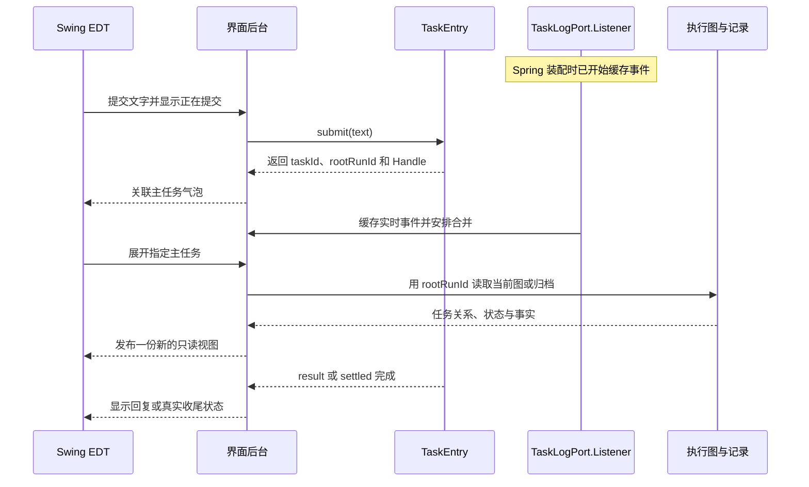

# Swing 桌面调试界面开发文档

更新于 2026-11-18。Swing 首版、雷姆基础动作和空闲行为均已实现。本页记录当前使用方式、接口与验证范围。最初的交互方案仍见[29 桌面设计](../../planned/29-桌面助手调试界面设计.md)。

## 1. 放在哪，怎么启动

桌面适配放在 `interaction.desktop`，使用 JDK 25 自带 Swing/AWT。`MyHelperApplication` 创建非 Web Spring 容器。通过 `--myhelper.ui=desktop` 打开桌面模式，缺省启动终端。本次进程只启用一个输入界面，两种模式使用同一套 `TaskEntry`、编排器、模型客户端、工作池与持久恢复装配。默认恢复需要 Neo4j。仅调试交互时可显式加 `--myhelper.records.enabled=false`。 [启动类](../../../src/main/java/com/example/myhelper/MyHelperApplication.java) · [装配文档](../deployment/21-装配部署与集成验收.md)

- 桌面模式在 Spring 启动前配置 `SpringApplication.setHeadless(false)`，在 Spring 装配阶段装好轻量日志监听器及缓存，使启动恢复任务的首批事件可以先放进缓存。窗口创建安排到 Swing 事件线程（EDT）。
- 角色、任务泡和悬停预览需要逐像素透明与窗口裁形支持。按鼠标所在屏幕和窗口实际工作区计算停靠位置，并对工作区边缘做夹取。悬停预览保持非输入焦点，用户打开对话时再让对话框接收键盘输入。
- 当前 `main` 用 `try` 管理 Spring 容器寿命。桌面窗口创建后，启动线程在 EDT 之外等待显式退出信号。关闭对话或详情仅隐藏该窗口。退出桌面助手时先让 UI 停止提交和订阅，再由启动线程关闭容器，复用现有停机与任务收尾。 [应用入口清理](../../../src/main/java/com/example/myhelper/interaction/TaskEntry.java)

## 2. 桌面使用的接口

| 需求 | 复用的入口 | 当前桌面接法 |
| --- | --- | --- |
| 发送对话文字 | `TaskEntry.submit(String)` 返回 `Handle`，包括 `taskId`、`rootRunId`、`result()`、`settled()` 和取消操作 | 后台提交，保留输入直到获得句柄，按返回身份关联气泡。`result` 用于回复，`settled` 用于真实收尾。 |
| 收实时过程 | `TaskLogPort.Listener.onEvent(Event)` | 桌面模式装配有界 `TaskLogBuffer`。日志线程写缓存，观察线程按序号回放各运行事件，应用日志同时保留。 |
| 读取运行中的任务树 | `ExecutionTraceStore.findSnapshot(rootRunId)` | `DesktopTaskGraph` 从只读图投影节点层次和依赖关系。 |
| 启动时知道正在跑哪些任务 | `TaskEntry.activeHandles()` 含启动恢复接管的句柄 | 观察线程合并活动句柄和实时回放，按任务、运行身份关联气泡。 |
| 查某一次运行的历史 | `RunArchivePort.readArchive(ArchiveRef)` 提供已结束归档和固定图 | 点击本会话已收尾的任务，按已知身份后台读取归档。手工按 ID 查询目前由终端提供。 |

桌面端沿用已有日志投影及归档完整性标记。查看可直接调用的接口及当前边界，可对照源码和模块合同。 [任务提交](../../../src/main/java/com/example/myhelper/interaction/TaskEntry.java) · [任务日志](../tasklog/任务日志开发文档.md) · [执行图](../../../src/main/java/com/example/myhelper/orchestration/ExecutionTraceStore.java) · [持久事件读取和最终归档](../records/28-执行记录与恢复端口开发文档.md#134-运行期间读取与最终归档)

## 3. 从发消息到更新气泡

对话提交可能在返回 `Handle` 前同步登记任务和领取运行权，调用应放在界面后台执行，失败时保留原文供重试。后台合并日志、查图和历史，EDT 只打开窗口并渲染结果。监听器无需请求窗口 Bean，直接接收数据并短暂停留在缓存，避免影响日志线程上的其他监听器。 [运行登记与领取](../../../src/main/java/com/example/myhelper/orchestration/RunRecordAccess.java)

- `taskId` 决定主任务气泡。`rootRunId` 决定这次执行的树和时间线。`runId` 关联递归任务，`nodeId` 进一步关联模型、工具和验收。选中的气泡有自己的身份，收到其他任务或旧运行的迟到事件时只更新其对应记录。
- 初次提交可以先显示一条本地对话消息。返回句柄后关联任务 ID，并合并可能已经先到的实时事件。同一个任务再次恢复时保留一个主气泡，同时将新运行设为当前运行。
- 子任务树以只读图快照为准。图节点 `RUNNING` 可能包含等待依赖或排队。收到实际模型调用、工具返回和验收等事件后才细化文案。`TOOL_INTENT` 对应「准备执行工具」，收到该事件时动作可能仍在等待资源锁。模型提交 `COMPLETE` 后等待实际结果和验收。 [任务日志事件定义](../../../src/main/java/com/example/myhelper/tasklog/TaskLogProjection.java)
- 终端、日志和桌面继续消费同一份语义事件。模型区显示目标、用途、耗时和已返回的计划摘要。无任务身份的事件留在应用日志中。气泡用可显示的标题和脱敏摘要，日志白名单字段由日志模块管理。

## 4. 打开界面、重连和切换历史

1. 桌面模式在 Spring 装配时建立日志缓存。打开窗口后，观察线程回放已收到的事件并合并活动句柄、当前运行的只读图，再把视图交给 EDT。
2. 缓存按接收顺序分配序号。缓存发生缺口或上游丢弃计数增加时，界面提示实时事件缺失，并通过当前活动句柄与任务树更新可用状态。
3. 运行真实结束后先保留最后一份只读摘要。用户查看本会话中已经结束的任务时，有归档端口就按该任务的已知运行身份读取固定归档。归档缺失或读取失败时显示提示。 [桌面会话](../../../src/main/java/com/example/myhelper/interaction/desktop/DesktopSession.java)

跨重启列出旧任务、手工输入 ID 打开旧历史，以及运行中的持久事件分页补读，属于后续桌面工作。存储模块已有分页入口，终端也已有指定任务和运行的归档查询。 [持久事件分页](../../../src/main/java/com/example/myhelper/records/StoredTaskRecords.java) · [终端历史查询](20-交互与语音开发文档.md#已实现的文字入口)

## 5. 实施顺序与验收

下表保留最初的验收计划。已验证项及其环境见第 6、7 节。持久历史串接仍按第 4 节推进。

| 顺序 | 交付 | 可观察的验收结果 |
| --- | --- | --- |
| 1 | 桌面模式、玩偶、对话框、后台提交 | 同一个进程中提交两个任务，出现两个气泡。等待一个慢模型时，界面仍可拖动、打开详情和提交另一任务。关闭详情不会结束正在运行的任务。 |
| 2 | 日志监听、任务树、实时状态和收尾 | 每条任务有独立时间线，能展开两层子任务。可以通过详情区分等待模型、等待依赖、工具失败以及工具成功但验收失败。取消请求与真实收尾各自可见。 |
| 3 | 首屏合并、断线补读和历史串接 | 先收日志后拿句柄、先启动恢复后打开窗口时各只有一个主任务气泡。模拟丢弃时看到缺口及状态刷新。用相同 `taskId` 查看重启前后的两个 `rootRunId`。 |
| 4 | Windows 本机窗口验收 | 玩偶和气泡停在任务栏上方，移到屏幕边缘仍可查看详情。高 DPI 和多屏下能输入和点开。应用退出走已有真实收尾路径。 |

桌面视图合并、事件去重和状态转换检查放在独立 `checks`，用替身事件和句柄验证。Windows 停靠、透明、焦点和缩放用实际窗口验收。真实模型和 Neo4j 联调与这两类验证分别登记。 [独立检查约定](../../../checks/README.md)

## 6. 首版实现与验证

- 使用 `--myhelper.ui=desktop` 启动。Q 版雷姆初始位于工作区右下角，点击单手拎着的小包打开对话。头顶随任务显示半透明渐变小椭圆，默认最多三枚任务泡，超出后可展开。悬停展开椭圆文字预览，点击打开任务详情。点选任务树节点可筛选事件。对话以「新任务」提交，等待受理与提交失败时保留输入。 [桌面窗口](../../../src/main/java/com/example/myhelper/interaction/desktop/DesktopWindow.java)
- 角色使用透明 PNG，资源紧贴图像边界。AWT `Window.setShape` 按缩放后的可见像素生成角色命中区域。任务泡和悬停预览分别使用独立椭圆窗口。点击角色轮廓外、气泡外角和间隙时，桌面接收鼠标事件。详情和对话采用浅紫圆角面板。 [角色轮廓](../../../src/main/java/com/example/myhelper/interaction/desktop/DesktopMascot.java) · [气泡](../../../src/main/java/com/example/myhelper/interaction/desktop/DesktopBubble.java)
- 任务提交、图读取和归档查询在 EDT 外运行。按 `taskId` 合并气泡，以 `rootRunId` 维护本次与近期运行的时间线。结果来自 `result()`，收尾以 `settled()` 为准。启动时合并已受理句柄与实时回放。桌面保留 24 个已收尾任务，短任务的最终图在释放前投影到最多 32 个运行的缓存。 [桌面会话](../../../src/main/java/com/example/myhelper/interaction/desktop/DesktopSession.java) · [任务入口](../../../src/main/java/com/example/myhelper/interaction/TaskEntry.java)
- 日志缓冲从 Spring 装配时接收事件并分配递增序号，默认保留最近 512 条。读到缺口时显示提示并读取当前活动句柄和任务树。模型过程展示实际请求与结构化公开结果的摘要，工具返回和验收分别显示。点击当前会话已收尾任务可按已知身份读取固定归档。 [实时日志缓冲](../../../src/main/java/com/example/myhelper/tasklog/TaskLogBuffer.java)
- 2026-11-17 早期窗口版本在 Windows 本机验证了手捧对话泡、悬停、详情筛选、Esc 收起和拖动。回环模型验证两个并发任务的回复归属、收尾后图可见与退出。该快照的桌面与日志专项 13 项 JUnit 通过，复跑全量 229 项 JUnit 和 4 组存储检查通过。首跑有一项启动恢复等待超时，该检查的等待时序在后续恢复整改中修正。 [检查记录](../../../checks/README.md) · [恢复整改](../records/28-执行记录与恢复端口开发文档.md#15-2026-11-17-恢复策略边界与可读性整改)
- 2026-11-17 雷姆手提包版本在 Windows 上复验角色透明角、小泡与预览外角及气泡间隙，鼠标事件落到后面的测试窗口。点击包身可打开对话。该快照通过 229 项 JUnit 和 4 组存储检查，并用回环模型复验两个并发任务的回复、任务树与退出。 [检查记录](../../../checks/README.md)
- 除第 4 节记录的历史查询接线外，关联回答 `NEEDS_INPUT`、多屏和高 DPI 验收仍待完成。真实模型和 Neo4j 联调单独验收。
- 雷姆的空闲行为和本地道具由独立行为模块驱动。提交、运行和实际收尾期间显示固定状态。 [32 短期行为规划器](32-短期行为规划器设计.md#6-首版实现)

## 7. 雷姆基础动作

角色资源使用原站姿及新增的眨眼、抬眼、专注和微笑四张透明 PNG。各帧沿用同一画布和手提包位置，鼠标命中轮廓与气泡锚点保持一致。Swing 定时器在本地播放，鼠标按住角色或手提包时暂停。 [素材目录](../../../src/main/resources/desktop/) · [绘制与播放](../../../src/main/java/com/example/myhelper/interaction/desktop/DesktopBehaviorView.java)

| 当前阶段 | 固定表现 |
| --- | --- |
| 待机 | 站立，间隔眨眼 |
| 等待业务模型 | 抬眼看向任务泡 |
| 受理、运行工具或核对 | 保持专注姿势 |
| 验收 | 在专注和抬眼之间切换 |
| 收尾 | 回到站立，等待运行结束 |
| 最后一个任务成功收尾 | 短暂微笑，回到站立 |

用户任务占用期间停止发起新的短期行为规划。已派发的空闲请求如在任务期间返回，其结果会作废。并发时以仍活跃的任务为先，收到提前结果、运行失败和收尾异常时均不会播放成功姿势。 [阶段投影](../../../src/main/java/com/example/myhelper/interaction/desktop/DesktopTasks.java) · [占用与空闲请求](32-短期行为规划器设计.md#6-首版实现)

Windows 本机验证了姿势切换、眨眼、按住暂停、手包点击和轮廓点透。正式应用入口使用回环模型，验证了等待用户任务时的固定姿势、任务期间没有派发新的空闲请求、丢弃旧响应、真实收尾后微笑以及重新空闲后创建道具。最终使用现有 JDK 25 重新编译 157 个 Java 文件，260 项 JUnit 和 4 组存储检查通过。 [检查记录](../../../checks/README.md)
