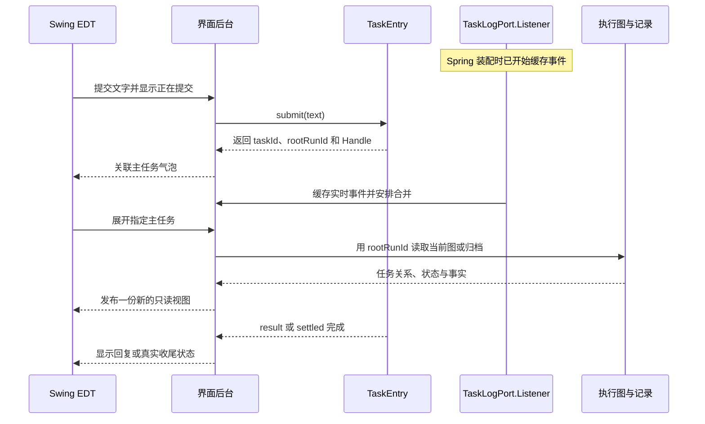

# Swing 桌面调试界面开发文档

2026-11-17 · Swing 首版已实现。玩偶、任务气泡、悬停和对话框的交互见 [29 桌面助手调试界面设计](../../planned/29-桌面助手调试界面设计.md)。下文保留实施方案，当前交付范围见[第 6 节](#6-首版实现与验证)。

## 1. 放在哪，怎么启动

桌面适配放在 `interaction.desktop`，使用 JDK 25 自带 Swing/AWT。借用现有 `MyHelperApplication` 创建一个非 Web Spring 容器。建议通过 `--myhelper.ui=desktop` 选择桌面模式，默认依旧使用现有终端入口。同一个应用实例中的 `TaskEntry`、编排器、模型客户端、工作池、记录和恢复服务由两种入口共用。启动时只选择其中一个输入入口。 [现有启动类](../../../src/main/java/com/example/myhelper/MyHelperApplication.java)

- 桌面模式在 Spring 启动前配置 `SpringApplication.setHeadless(false)`，在 Spring 装配阶段装好轻量日志监听器及缓存，使启动恢复任务的首批事件可以先放进缓存。窗口创建安排到 Swing 事件线程（EDT）。
- 角色、任务泡和悬停预览需要逐像素透明与窗口裁形支持。按鼠标所在屏幕和窗口实际工作区计算停靠位置，并对工作区边缘做夹取。悬停预览保持非输入焦点，用户打开对话时再让对话框接收键盘输入。
- 当前 `main` 用 `try` 管理 Spring 容器寿命。桌面窗口创建后，启动线程在 EDT 之外等待显式退出信号。关闭对话或详情仅隐藏该窗口。退出桌面助手时先让 UI 停止提交和订阅，再由启动线程关闭容器，复用现有停机与任务收尾。 [应用入口清理](../../../src/main/java/com/example/myhelper/interaction/TaskEntry.java)

## 2. 现有接口和首版需要接上的接口

| 需求 | 复用的入口 | 桌面端要补的部分 |
| --- | --- | --- |
| 发送对话文字 | `TaskEntry.submit(String)` 返回 `Handle`，包括 `taskId`、`rootRunId`、`result()`、`settled()` 和取消操作 | 后台提交，保留输入直到获得句柄，按返回身份关联气泡。`result` 用于回复，`settled` 用于真实收尾。 |
| 收实时过程 | `TaskLogPort.Listener.onEvent(Event)`，由日志线程触发，应用默认输出同时保留 | 注册仅在桌面模式装配的监听 Bean。回调只写入有界的桌面事件缓存并安排刷新。桌面消费端补序号、按运行订阅和最近事件回放。 |
| 读取运行中的任务树 | `ExecutionTraceStore.snapshot(rootRunId)` 返回只读节点、边和图内事件 | 加只读视图映射。读取 `TASK` 及所属步骤，由 `parentId` 或 `SPAWNED` 构建任务层次。`DEPENDS_ON` 只用于显示等待关系。只取显示所需字段。 |
| 启动时知道正在跑哪些任务 | `TaskEntry` 已纳管启动恢复的句柄 | 加一个对本进程活动任务的只读摘要查询，返回任务及当前运行身份、允许显示的标题和阶段。复用现有活动句柄信息，界面不用持有内部领取凭据。 |
| 查某一次运行的历史 | `StoredTaskRecords.readEvents(taskId, rootRunId, afterEventId, limit)` 读取已确认事实。`TaskLogHistory.read(ArchiveRef)` 读取结束归档的日志摘要，`RunArchivePort.readArchive` 可读取其中的固定图 | 交互层统一调用只读查询与安全摘要投影。已知两种 ID 时可直接打开详情。按 `taskId` 列运行的查询在记录侧补齐，以支持启动后打开最近历史。 |

桌面端沿用已有日志投影及归档完整性标记。查看可直接调用的接口及当前边界，可对照源码和模块合同。 [任务提交](../../../src/main/java/com/example/myhelper/interaction/TaskEntry.java) · [任务日志](../tasklog/任务日志开发文档.md) · [执行图](../../../src/main/java/com/example/myhelper/orchestration/ExecutionTraceStore.java) · [持久事件读取和最终归档](../records/28-执行记录与恢复端口开发文档.md#134-运行期间读取与最终归档)

## 3. 从发消息到更新气泡

对话提交可能在返回 `Handle` 前同步登记任务和领取运行权，调用应放在界面后台执行，失败时保留原文供重试。后台合并日志、查图和历史，EDT 只打开窗口并渲染结果。监听器无需请求窗口 Bean，直接接收数据并短暂停留在缓存，避免影响日志线程上的其他监听器。 [运行登记与领取](../../../src/main/java/com/example/myhelper/orchestration/RunRecordAccess.java)

- `taskId` 决定主任务气泡。`rootRunId` 决定这次执行的树和时间线。`runId` 关联递归任务，`nodeId` 进一步关联模型、工具和验收。选中的气泡有自己的身份，收到其他任务或旧运行的迟到事件时只更新其对应记录。
- 初次提交可以先显示一条本地对话消息。返回句柄后关联任务 ID，并合并可能已经先到的实时事件。同一个任务再次恢复时保留一个主气泡，同时将新运行设为当前运行。
- 子任务树以只读图快照为准。图节点 `RUNNING` 可能包含等待依赖或排队。收到实际模型调用、工具返回和验收等事件后才细化文案。`TOOL_INTENT` 对应「准备执行工具」，收到该事件时动作可能仍在等待资源锁。模型提交 `COMPLETE` 后等待实际结果和验收。 [任务日志事件定义](../../../src/main/java/com/example/myhelper/tasklog/TaskLogProjection.java)
- 终端、日志和桌面继续消费同一份语义事件。模型区显示目标、用途、耗时和已返回的计划摘要。无任务身份的事件留在应用日志中。气泡用可显示的标题和脱敏摘要，日志白名单字段由日志模块管理。

## 4. 打开界面、重连和切换历史

1. 打开界面前，后台监听器已经接收日志。界面附着时先建立接收队列，再后台读活动任务摘要及选中运行的快照。合并读到的状态与这段时间收到的事件，发布到 EDT。先启动恢复后才打开窗口的任务用同样流程加入气泡。
2. 桌面缓存按接收顺序编号。界面暂停订阅时记下最后读到的编号，重新订阅优先读缓存中后续事件。实时事实与持久事实按同一执行 `eventId` 去重，实际模型事件另用调用身份与类型区分。
3. 桌面缓存过期或 `AsyncTaskLog.droppedCount()` 增加时，展示「部分实时事件缺失」，后台刷新活动摘要和图。平时合并同一运行的刷新请求，对正在查看的运行定期补读，以覆盖末条通知丢失的情况。持久记录可用时，从该运行最后一条已应用的事件 ID 起分页读取。使用 `EventPage.nextCursor` 翻页，即使读到当前末尾也保留最后一条事实 ID。桌面编号仅供自身缓存使用，事实的提交顺序由持久游标给出。上游丢弃的实时专属阶段保持缺口。 [异步投递](../../../src/main/java/com/example/myhelper/tasklog/AsyncTaskLog.java) · [分页实现](../../../src/main/java/com/example/myhelper/records/StoredTaskRecords.java)
4. 运行真实结束后，`TaskEntry` 可能已回收内存图。界面先保留最后的只读摘要，详细数据转读固定归档或持久事件。归档不存在或证据不完整时展示相应提示。切换气泡或历史运行后，仅应用与当前详情身份匹配的后台查询结果。用户在前一次运行的详情上可以继续看历史，同一个任务的新运行单独显示实时状态。

首版可以手工输入已知的 `taskId` 和 `rootRunId` 打开历史，和现有终端查询能力一致。后续增加按任务列运行的分页入口，供重启后直接选择以前的任务。实时展示可以在记录关闭时调试，历史能力在记录与启动恢复装配成功后验收。

## 5. 实施顺序与验收

| 顺序 | 交付 | 可观察的验收结果 |
| --- | --- | --- |
| 1 | 桌面模式、玩偶、对话框、后台提交 | 同一个进程中提交两个任务，出现两个气泡。等待一个慢模型时，界面仍可拖动、打开详情和提交另一任务。关闭详情不会结束正在运行的任务。 |
| 2 | 日志监听、任务树、实时状态和收尾 | 每条任务有独立时间线，能展开两层子任务。可以通过详情区分等待模型、等待依赖、工具失败以及工具成功但验收失败。取消请求与真实收尾各自可见。 |
| 3 | 首屏合并、断线补读和历史串接 | 先收日志后拿句柄、先启动恢复后打开窗口时各只有一个主任务气泡。模拟丢弃时看到缺口及状态刷新。用相同 `taskId` 查看重启前后的两个 `rootRunId`。 |
| 4 | Windows 本机窗口验收 | 玩偶和气泡停在任务栏上方，移到屏幕边缘仍可查看详情。高 DPI 和多屏下能输入和点开。应用退出走已有真实收尾路径。 |

桌面视图合并、事件去重和状态转换检查放在独立 `checks`，用替身事件和句柄验证。Windows 停靠、透明、焦点和缩放用实际窗口验收。真实模型和 Neo4j 联调与这两类验证分别登记。 [独立检查约定](../../../checks/README.md)

## 6. 首版实现与验证

- 使用 `--myhelper.ui=desktop` 启动。Q 版雷姆初始位于工作区右下角，点击单手拎着的小包打开对话。头顶随任务显示半透明渐变小椭圆，默认最多三枚任务泡，超出后可展开。悬停展开椭圆文字预览，点击打开任务详情。点选任务树节点可筛选事件。对话以「新任务」提交，等待受理与提交失败时保留输入。 [桌面窗口](../../../src/main/java/com/example/myhelper/interaction/desktop/DesktopWindow.java)
- 角色使用透明 PNG，资源紧贴图像边界。AWT `Window.setShape` 按缩放后的可见像素生成角色命中区域。任务泡和悬停预览分别使用独立椭圆窗口。点击角色轮廓外、气泡外角和间隙时，桌面接收鼠标事件。详情和对话采用浅紫圆角面板。 [角色轮廓](../../../src/main/java/com/example/myhelper/interaction/desktop/DesktopMascot.java) · [气泡](../../../src/main/java/com/example/myhelper/interaction/desktop/DesktopBubble.java)
- 任务提交、图读取和归档查询在 EDT 外运行。按 `taskId` 合并气泡，以 `rootRunId` 维护本次与近期运行的时间线。结果来自 `result()`，收尾以 `settled()` 为准。启动时合并已受理句柄与实时回放。桌面保留 24 个已收尾任务，短任务的最终图在释放前投影到最多 32 个运行的缓存。 [桌面会话](../../../src/main/java/com/example/myhelper/interaction/desktop/DesktopSession.java) · [任务入口](../../../src/main/java/com/example/myhelper/interaction/TaskEntry.java)
- 日志缓冲从 Spring 装配时接收事件并分配递增序号，默认保留最近 512 条。读到缺口时显示提示并读取当前活动句柄和任务树。模型过程展示实际请求与结构化公开结果的摘要，工具返回和验收分别显示。点击当前会话已收尾任务可按已知身份读取固定归档。 [实时日志缓冲](../../../src/main/java/com/example/myhelper/tasklog/TaskLogBuffer.java)
- Windows 本机验证了空闲时的手捧对话泡、任务泡的椭圆区域、悬停放大、详情筛选、Esc 收起和拖动。用回环 OpenAI 兼容替身通过正式入口提交两个并发任务，核对两枚头顶任务泡、两条等待状态、回复归属、收尾后图可见和正常退出。最终源码的桌面与日志专项 13 项 JUnit 通过。同一产物复跑全量，229 项 JUnit 和 4 组存储检查通过。首跑有一项启动恢复等待超时。 [检查记录](../../../checks/README.md)
- 雷姆版本在 Windows 上复验角色透明角、小泡与展开预览的椭圆外角及气泡间隙，鼠标事件落到后面的测试窗口。点击实际包身可以打开对话。最终源码重新编译后通过 229 项 JUnit 和 4 组存储检查，使用回环模型复验两个并发任务的回复、任务树与正常退出。 [检查记录](../../../checks/README.md)
- 后续工作包括跨重启浏览旧任务、按 ID 手工查询历史、运行中的持久事件分页补读、关联回答 `NEEDS_INPUT`、多屏和高 DPI 验收。真实模型和 Neo4j 联调单独验收。
- 雷姆的空闲行为和本地道具由独立行为模块驱动。提交、运行和实际收尾期间显示固定状态。 [32 短期行为规划器](32-短期行为规划器设计.md#6-首版实现)

## 7. 雷姆基础动作

角色资源使用原站姿及新增的眨眼、抬眼、专注和微笑四张透明 PNG。各帧沿用同一画布和手提包位置，鼠标命中轮廓与气泡锚点保持一致。Swing 定时器在本地播放，鼠标按住角色或手提包时暂停。 [素材目录](../../../src/main/resources/desktop/) · [绘制与播放](../../../src/main/java/com/example/myhelper/interaction/desktop/DesktopBehaviorView.java)

| 当前阶段 | 固定表现 |
| --- | --- |
| 待机 | 站立，间隔眨眼 |
| 等待业务模型 | 抬眼看向任务泡 |
| 受理、运行工具或核对 | 保持专注姿势 |
| 验收 | 在专注和抬眼之间切换 |
| 收尾 | 回到站立，等待运行结束 |
| 最后一个任务成功收尾 | 短暂微笑，回到站立 |

用户任务占用期间停止发起新的短期行为规划。已派发的空闲请求如在任务期间返回，其结果会作废。并发时以仍活跃的任务为先，收到提前结果、运行失败和收尾异常时均不会播放成功姿势。 [阶段投影](../../../src/main/java/com/example/myhelper/interaction/desktop/DesktopTasks.java) · [占用与空闲请求](32-短期行为规划器设计.md#6-首版实现)

Windows 本机验证了姿势切换、眨眼、按住暂停、手包点击和轮廓点透。正式应用入口使用回环模型，验证了等待用户任务时的固定姿势、任务期间没有派发新的空闲请求、丢弃旧响应、真实收尾后微笑以及重新空闲后创建道具。最终使用现有 JDK 25 重新编译 157 个 Java 文件，260 项 JUnit 和 4 组存储检查通过。 [检查记录](../../../checks/README.md)
