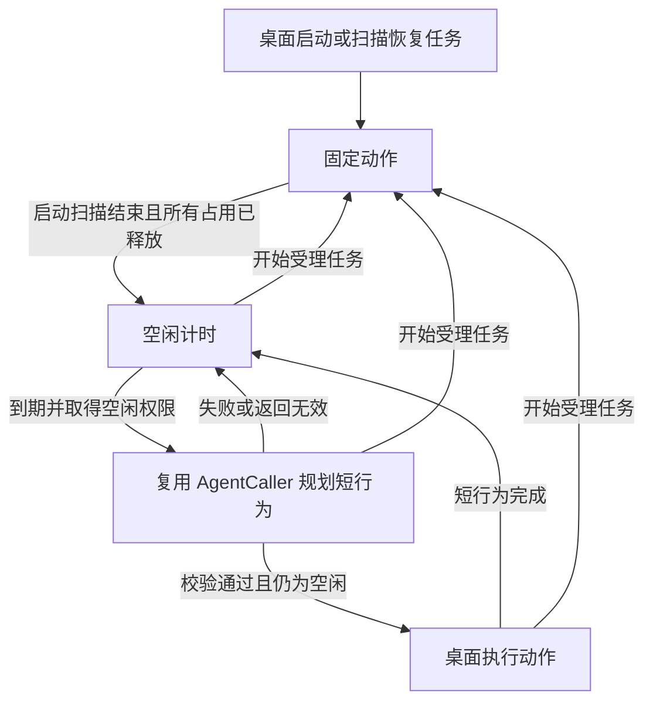

# 短期行为规划器设计

更新于 2026-11-18。首版已接入 Swing。第 1–5 节保留设计及实施前基线，实际启动选项、动作合同和检查范围见[第 6 节](#6-首版实现)。

UI 窗口讨论了让桌面角色在空闲时定期调用模型，决定接下来几个动作，也可以组合或生成桌面道具。本聊天确认了任务优先的边界。**只要有主任务正在提交、执行或真实收尾，短期行为规划器就不发起新调用，角色只播放预先定义的动作。** 等业务模型、等工具返回以及取消后的在途工作，都属于任务占用期。

## 1. 模块位置与复用方式

短期行为属于桌面交互。`interaction.desktop.behavior` 随 Swing 会话维护空闲计时、角色状态、虚拟道具和动作播放。业务任务与其子任务继续沿现有入口、循环、执行和恢复流程。桌面行为模型调用只产生其自身的模型日志。

| 当前能力 | 短期行为规划器怎么用 |
| --- | --- |
| `DesktopSession`、`DesktopWindow` | 复用桌面生命周期、工作区夹取、气泡锚点和拖动逻辑。后台收到动作后，把角色位置、姿势和道具刷新交给 Swing EDT。手动拖动优先于自动位移。 |
| `DesktopMascot` 与 `rem-mascot.png` | 复用现有雷姆立绘和实际透明轮廓。首版可做定姿、轻微位移和虚拟道具摆放。有新姿势素材时，显示和点击轮廓随同一帧刷新。 |
| `AgentCaller` 和现有模型配置 | 空闲规划复用配置好的模型客户端，以 `CALL_ONLY` 单次请求返回结构化动作。加独立调用用途供现有日志识别。固定提示词与输出合同集中到 `LlmTexts`。 |
| `TaskLogBuffer` 和桌面任务视图 | 复用已发生的规划、工具、等待和验收事件，决定播放哪个固定动作。日志可丢弃，任务是否占用使用运行生命周期信号。 |
| 业务任务和归档 | 复用现有任务身份和生命周期。第一版的行为状态和道具留在桌面会话内，应用重启后业务任务照现有恢复机制处理。 |

[桌面开发与当前实现](31-Swing桌面调试界面开发文档.md#6-首版实现与验证) · [单次调用](../agent/11-单次模型调用模块.md) · [任务日志](../tasklog/任务日志开发文档.md)

## 2. 空闲与任务占用



1. **先登记占用，再派发任务。** UI、其他 `TaskEntry` 调用方以及启动恢复都要受到同一规则约束。建议由应用提供一个通用的运行活动接口，在 `AgentOrchestrator` 共用的根运行入口进入记录登记前登记占用，登记失败路径也释放。编排只报告运行生命周期，桌面行为规则留在交互层。`TaskEntry.activeHandles()` 可用于展示，它在提交或恢复受理之后才能看到句柄。 [任务登记与真实收尾](../../../src/main/java/com/example/myhelper/orchestration/AgentOrchestrator.java#L284) · [句柄管理](../../../src/main/java/com/example/myhelper/interaction/TaskEntry.java#L63)
2. **启动扫描期间先保持固定动作。** 启动恢复在后台分批调用 `resume`，在句柄被 `TaskEntry.adopt` 接收之前就可能已经开始运行。启动扫描正常结束、异常终止或显式禁用时结束扫描占用，已登记的任务继续各自占用。多个任务并发用计数管理，最后一个任务真实收尾后才重新开始空闲计时。提前返回的 `result()`、气泡消失和 `RUN_ENDED` 日志都只用于展示。 [启动恢复](../../../src/main/java/com/example/myhelper/application/StartupTaskRecovery.java#L59)
3. **空闲调用和任务受理通过同一入口仲裁。** 用同一短临界区处理占用计数、空闲许可和版本，模型请求、数据库操作和 EDT 刷新在锁外完成。空闲定时到期后，后台工作线程在实际发起调用的边界重新取得许可。任务进入受理时，取消待发的计划及后续动作、使当前空闲版本失效，并切换到固定动作。返回结果派发到 EDT 前及每个动作开始前均校验空闲版本，过期结果不会创建道具或改变角色位置。已摆放道具在任务期间保持原位。
4. **处理先前已发出的请求。** 现有 `AgentCaller` 的模型调用是同步的，当前没有确认远端取消的机制。首版建议任务优先，任务占用期不启动任何新的短期行为调用或执行其结果。若空闲请求已经发出，停止等待它的界面结果并丢弃迟到响应。若同时要求「任务开始执行时，之前发出的空闲请求也已结束」，需在进入业务派发前等待已开始请求结束，或使用能确认取消的客户端。该条件会影响任务启动延迟，应另行验收。 [实际模型调用边界](../../../src/main/java/com/example/myhelper/agent/AgentCaller.java#L212)

任务期间只消费预置动作映射。例如业务模型请求时显示看向气泡的固定姿势，工具运行时使用工作姿势，验收时保持观察姿势，出现结果时短暂显示相应固定状态。现有单张立绘可先配合气泡或状态图标。并发时选择一个固定姿势呈现，例如优先显示待核对，再显示验收、工具和模型等待，所有任务气泡继续各自更新。缺少阶段事件时用通用工作姿势。忙碌期不会生成行为计划或新道具，也不因任务正在等待模型而重新进入空闲。

## 3. 空闲规划的输入与输出

首版默认连续空闲两分钟才调用。每次最多三个动作，整段最长 15 秒，同一桌面会话只有一条空闲请求在途。空闲间隔可配置，动作数量和总时长由程序校验。请求与动作完成后重新计时，失败时播放预置空闲动作。计时和模型调用在后台运行，EDT 负责绘制和位置更新。

**输入**包含角色坐标所在工作区、可用动作与道具类型、当前桌面道具、最近少量已完成动作和上次结果。业务任务正文、工具参数和用户桌面内容不进入请求。当前是否空闲由程序在调用前决定。

**输出**为受控的动作列表。例如在空闲时把一个淡紫色茶杯摆到右侧桌面锚点，然后看向它。

```json
{
  "actions": [
    {"type": "CREATE_PROP", "style": "CUP", "color": "LAVENDER", "slot": "RIGHT", "durationMs": 1200},
    {"type": "LOOK_AT_SLOT", "slot": "RIGHT", "durationMs": 900}
  ]
}
```

解析器只接受已登记的动作、已有槽位、允许组合的道具部件和限定时长。像素坐标由程序从槽位映射并夹取。播放前在临时状态中按顺序校验整段计划，后续动作可以引用本轮前面已经创建的道具。重复占用槽位或引用不存在道具时拒绝整段计划。动作可从定姿、移到工作区锚点、看向槽位、展示道具和收起道具开始。模型提出的是数据，执行器只调用这些桌面动作。

## 4. 道具生成

- **首版用本地素材组合。** 模型提出道具类型、颜色、可选图案和槽位，程序绘制桌面虚拟物品。后续查看、显示和收起按所在槽位寻址。拿取、放下及手提包库存为设计扩展。
- **新外观可作为后续独立接入。** 在确认图像能力后，可空闲时异步生成透明素材，保存为之后可复用的道具。任务开始时停止后续生成派发，结果回到桌面时再次核对空闲版本。道具生成的 UI 数据和素材路径由应用生成，行为响应不指定任意文件、网址或系统操作。

## 5. 实施和验收

| 顺序 | 实施与验收 |
| --- | --- |
| 1. 任务占用和固定动作 | 先以替身验证新任务、恢复任务、两个并发任务、取消早返回、启动失败和最后一个任务真实收尾。占用期间的短期规划调用计数始终为 0。业务规划、工具和验收照常运行。 |
| 2. 空闲调用与竞态 | 使用现有模型调用入口和本地模型替身，验证空闲后只调用一次且动作受限。覆盖到期与任务提交同时发生、业务任务开始后旧空闲响应返回、手动拖动打断自动位移和关窗时仍有计划。 |
| 3. 虚拟道具和窗口 | 验证空闲时可生成、查看和收起道具，任务期间不生成。围绕角色窗口形状、工作区和气泡位置在 Windows 本机复验。 |

2026-11-17 对当前项目使用已有 JDK 25 和依赖执行 `checks/run.ps1`，重新编译 141 个源文件，**229 项 JUnit 和 4 组存储检查通过**。运行目录为 `checks/build/run-14f212088f2a4589be9fee262361e73c`。该次运行验证了实施前的复用基础。当前实现及验收见第 6 节。 [检查说明](../../../checks/README.md)

## 6. 首版实现

使用 `--myhelper.ui=desktop` 启动，持久恢复沿用正式入口的默认值。默认连续空闲 2 分钟后发起一次规划，整段播放或固定休息动作结束后再次计时。可通过 `--myhelper.desktop.behavior.idle-delay=5s` 缩短本机调试间隔，或通过 `--myhelper.desktop.behavior.enabled=false` 关闭空闲模型，继续显示固定任务状态。计时和请求使用专用后台线程，播放和窗口操作由 Swing EDT 执行。 [会话装配](../../../src/main/java/com/example/myhelper/interaction/desktop/DesktopSession.java) · [规划和播放](../../../src/main/java/com/example/myhelper/interaction/desktop/behavior/DesktopBehavior.java) · [启动与持久恢复](../deployment/21-装配部署与集成验收.md)

- **任务优先。** 新任务和恢复在访问记录前占用，桌面发送队列从点击发送起占用。启动扫描单独计数。每条根运行在实际工作、模型会话回收和归档处理结束后释放 `TaskActivity`，提前结果仅供显示。并发任务全部释放才会重新计时。达到计时时间后，在 `ChatModel.call` 边界仲裁带版本的许可，任务进入或退出会使旧轮次作废。已派发的同步请求可以继续返回，结果会被丢弃，业务任务可立即开始。 [活动仲裁](../../../src/main/java/com/example/myhelper/application/TaskActivity.java) · [运行接线](../../../src/main/java/com/example/myhelper/orchestration/AgentOrchestrator.java)
- **固定状态。** 桌面以本地素材播放工作、模型等待、工具、验收、待核对、收尾和成功动作。并发时待核对优先，其次是验收、工具和模型等待。等所有占用释放且任务成功收尾才显示微笑。日志只影响显示。手动拖动停止旧轮的待发动作，拖完重新计时。忙碌期及拖动期间已摆放道具保留原位。 [桌面任务状态](../../../src/main/java/com/example/myhelper/interaction/desktop/DesktopTasks.java) · [固定动作](31-Swing桌面调试界面开发文档.md#7-雷姆基础动作)
- **模型调用。** 共用已配置的模型客户端，`DESKTOP_BEHAVIOR` 用途的 `CALL_ONLY` 请求无工具白名单项。输入限工作区尺寸、角色相对坐标、槽位道具、最多六个近期已完成动作及上次结果。请求日志保留独立用途和调用结果。 [模型入口](../../../src/main/java/com/example/myhelper/interaction/desktop/behavior/ModelBehaviorPlanner.java) · [提示词](../../../src/main/java/com/example/myhelper/llm/LlmTexts.java)
- **动作与道具。** 每轮 1 至 3 个动作，合计最多 15 秒。支持定姿、向当前工作区锚点小幅位移、创建、查看、高亮和收起。道具使用杯子、书本和星星三种本地形状，以及固定颜色和图案，最多占左、中、右三个槽位。播放前先按顺序校验整个计划，再逐个核对空闲版本。非法计划回固定休息动作。已摆放道具使用无焦点裁形窗口，收起会释放槽位和窗口，退出会销毁本次会话的所有道具。 [动作合同](../../../src/main/java/com/example/myhelper/interaction/desktop/behavior/BehaviorPlan.java) · [道具窗口](../../../src/main/java/com/example/myhelper/interaction/desktop/DesktopProp.java)

图像生成及可跨会话复用的素材仍属第 4 节的后续方案。

### 验证

使用现有 JDK 25 和依赖重新编译 157 个源文件，248 项 JUnit 和 4 组存储检查通过。新增检查覆盖真实收尾、启动失败、倒计时与派发之间的竞态、陈旧响应、手动拖动、关闭窗口、整段校验和透明轮廓。Windows 本机使用规划替身验证了原生道具窗口、忙碌时停止未开始动作并保留道具位置，以及再次空闲后收起和退出释放。真实供应商、多屏及高 DPI 仍待验证。 [检查记录](../../../checks/README.md#2026-11-17-桌面短期行为规划验证)

正式应用入口另在 Windows 上用回环模型验证了空闲请求发出、任务期间丢弃迟到响应、收尾后重新规划并创建道具，以及窗口退出。该次启动关闭了正式记录。 [检查记录](../../../checks/README.md#2026-11-17-桌面短期行为规划验证)
