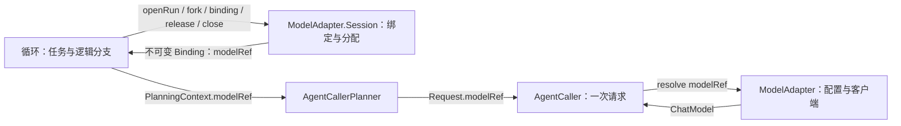

# 模型适配器开发文档

更新日期 2026-11-16。用户已确认由循环向独立模型适配器申请模型。绑定按逻辑分支维护，线性沿用，分叉优先分配其他模型，候选不足时其余分支继承父模型，汇合恢复父模型。

**已实现 `ConfiguredModelAdapter`、循环会话接线、规划协议筛选和分叉画像偏好排序。** Spring 已提供单对话连接、单次调用及共享文本嵌入组件。完整应用、多连接装配、生产画像、每连接请求配额和供应商联调仍待完成。 [接续文档](../../重写架构与进度.md)

开始前阅读 [AGENTS.md](../../../AGENTS.md)、[接续文档](../../重写架构与进度.md)、[共同规范](../../24-LLM文本与代码可读性规范.md)和 [checks 说明](../../../checks/README.md)。不用 Lambda；字段注释放声明上方；固定模型文本/反馈放 `LlmTexts`；检查只放 `checks`。不要修改世界模型模块或实施本文未要求的验收、任务仓储、断点恢复。

## 1. 谁负责什么

| 模块 | 负责 | 输入/输出 |
| --- | --- | --- |
| 循环 `AgentOrchestrator` | 根运行、轮次、DAG、依赖、分叉/汇合、预算、取消、工具和固化执行 | 提交逻辑分支身份，取得模型引用，组织下一轮 |
| 循环 `PlanBranches` | 分析需要模型的计划，校验分叉、汇合和显式 routing | 步骤到逻辑分支、父子与汇合关系 |
| 循环 `PlanModelBindings` | 维护计划内分支身份，在分叉时申请整组，在汇合时通知释放。纯工具计划沿用所属分支 | 保留会话返回的不可变绑定快照 |
| 循环 `RunModelAccess` | 按需打开一次模型会话，校验外部合同，按身份读取，实际工作结束后关闭 | 不选择模型、不读取供应商配置、不解析客户端 |
| **模型适配器** | 模型配置/目录、兼容候选、分支绑定、分配/继承、引用计数、回收、配置引用到客户端解析 | 实现 `ModelAdapter` 与其 `Session` |
| 单次 `AgentCaller` | 根据显式 modelRef 取得 ChatModel，执行一次模型请求，按模式返回或执行本轮工具 | 现有 `Function<String, ChatModel>` 接口可直接接收 `ConfiguredModelAdapter` |
| 公共变量模块：后续 | 按 rootRunId、branchId 提供只读运行视图 | 从适配器读取事实，不另建可写的模型分配表 |

`AgentCallerPlanner` 声明规划协议所需能力，并把单次响应转成计划决策。`ModelAdapter` 按能力要求分配模型并解析客户端。 [单次调用](../agent/11-单次模型调用模块.md) · [循环编排](../orchestration/12-并行分支循环编排设计.md)



## 2. 身份和模型的含义

| 字段 | 含义与约束 |
| --- | --- |
| rootRunId | 一次根运行，共享一个 Session；`submit/resume` 每次生成新的 UUID，与稳定 taskId 分开 |
| taskId | 由独立记录模块登记的任务身份；resume 沿用它，但不沿用旧 Session。未装配记录时不提供跨运行恢复 |
| branchId / Binding.id | 逻辑执行分支身份。根目前等于 rootRunId；计划子分支使用计划作用域 UUID 加逻辑名。适配器当成不透明字符串，不拆字符串推断业务 |
| parentId | 创建该分支的父分支身份；根为空。父等待子结果期间仍有活动绑定 |
| modelRef | 已配置模型连接的引用，不是裸供应商模型名称；同名模型的不同连接可有不同引用 |
| Java 线程 ID | 执行器临时运行位置，与分支身份和模型选择没有绑定关系 |

一个分支可能先后由不同工作线程运行，一个工作线程也会处理不同分支。因此不能用 `Thread.currentThread().threadId()`、`ThreadLocal` 或全局 `currentModelId` 选模型。适配器可以管理配置和客户端资源，但它不是创建 Java 工作线程的线程池。

模型对象可共享的前提是其客户端实现支持并发。**共享 modelRef 不共享对话历史、消息列表或可变请求参数。** 循环为各任务组装自己的上下文，适配器不保存一个“当前对话”。

## 3. 已固定的接口

源码合同以 [ModelAdapter.java](../../../src/main/java/com/example/myhelper/llm/ModelAdapter.java) 为准。实现方直接实现现有接口，不另起一套同名 DTO，不把旧分配器放回 orchestration。

```java
public interface ModelAdapter {
    Session openRun(RunRequest request);
    ChatModel resolve(String modelRef);

    enum Requirement { TOOL_CALLING }

    record RunRequest(String rootRunId, String rootBranchId,
                      String modelRef, List<String> toolNames,
                      Set<Requirement> requirements) {
        public RunRequest(String rootRunId, String rootBranchId,
                          String modelRef, List<String> toolNames) {
            this(rootRunId, rootBranchId, modelRef, toolNames,
                 Set.of(Requirement.TOOL_CALLING));
        }
    }

    record RoutingTask(String goal, List<String> toolNames) {}
    record BranchRequest(String branchId, List<RoutingTask> tasks) {}

    enum Assignment { ROOT, OTHER_MODEL, INHERITED, NOT_REQUESTED }

    record Binding(String id, String parentId,
                   String modelRef, Assignment assignment) {}

    interface Session extends AutoCloseable {
        Binding root();
        Binding binding(String branchId);
        List<Binding> fork(Binding parent, List<String> childIds);
        default List<Binding> forkWithTasks(Binding parent, List<BranchRequest> children) { ... }
        boolean release(String branchId);
        void close();
    }
}
```

上面省略了记录构造校验。实际 `RunRequest` 防御性复制业务工具列表及协议能力集合，`Binding` 校验身份、父关系、分配来源和模型引用。四参构造保守要求 `TOOL_CALLING`。确实只需要纯文本的调用方可通过五参构造明确传入空能力集合。 [接口源码](../../../src/main/java/com/example/myhelper/llm/ModelAdapter.java)

### 规划协议与业务工具范围

- `Planner.requirements()` 由规划协议声明，默认返回空集合。实际 `AgentCallerPlanner` 总是声明 `TOOL_CALLING`，因为每轮要求模型用 `submit_plan` 或 `finish_task` 返回结构化决策，即使本次没有普通业务工具。自定义 Planner 若使用原生工具调用也须显式声明。
- `AgentOrchestrator.submit` 读取规划器的要求，存入本次 `RunRequest`。`ConfiguredModelAdapter` 对根模型和所有后续分叉应用同一份要求，`TOOL_CALLING` 检查 `ModelConfig.supportsTools`，同时要求连接启用。即使业务名单为空，也会拒绝不兼容根模型并跳过不兼容分支候选。
- 业务 `toolNames` 表示允许计划使用的动作范围，规划器将相应说明放入输入，实际模型请求只注册这两个控制工具。计划中的普通工具名由编排器校验，权限和执行资格由各自的策略检查。目前没有每模型的工具名称匹配表。

### openRun 与读取

1. `openRun` 为该根运行建立会话，校验指定根模型存在、启用且满足 `requirements`。登记会话只处理元数据。
2. `root()` 返回 `ROOT` 绑定，id 等于 rootBranchId，parentId 为空，modelRef 与请求相同。
3. `binding(id)` 只读已有活动绑定，返回不可变快照。未知、已释放、会话已关闭时明确报错；不能借读取创建新分支或重新选模型。
4. 同一个 Session 的根/分支绑定一旦建立，在其生命周期内不改变 modelRef。配置停用或客户端错误不能静默改绑，应明确失败。未来显式迁移另行设计。
5. 循环保证同一根运行只成功打开一次；适配器仍应隔离不同运行，拒绝同 rootRunId 的重复活动会话，而不是覆盖已有状态。打开失败须自行清理尚未返回的内部资源。

### fork：一组分支一次申请

1. 父绑定必须与本会话现有活动记录完全一致。childIds 至少两个，按给定顺序处理；全部非空、互不重复且不能覆盖其他身份。
2. **全组校验、选择、登记是一个原子操作。** 返回列表长度、顺序、各 child.id 必须与输入逐项一致，parentId 都等于父 id。
3. 从已配置且兼容的候选中，以稳定顺序为本组分配当前根运行尚未被活动绑定使用的其他模型。父和祖先、尚未结束的兄弟所用模型均算已使用。
4. 新模型有几个分几个；剩余子分支的 modelRef 等于父引用，标记 `INHERITED`。选到不同引用则标记 `OTHER_MODEL`。禁止候选不足时把整组一律回退，也不等待新模型空闲而阻塞父工作线程。
5. 父绑定保持原样。相同有序 childIds、相同父绑定的整批重放返回原结果，不能再次计数；部分身份重用、顺序不同的重用、父不同或已释放批次的重开明确拒绝。
6. 任一异常不得留下半组新绑定。目录读取/配置异常与“没有其他兼容模型”不同，前者抛出明确错误，不能假装没有候选而继续执行。

按子身份顺序逐支分配。新入口 `Session.forkWithTasks` 携带整组任务描述，装配外部画像后优先采用逐支候选顺序。整组登记仍受会话锁保护，不同根运行可使用同一配置模型。模型绑定和请求配额的区别见第 6 节。

### release 与 close

- `release(childId)` 由循环在子分支真实结束、汇合前调用；存在活动后代时拒绝释放父。首次释放返回 true；重复释放、未知身份和根身份返回 false。
- 回收继承绑定只减少该绑定的计数，不能删除父/兄弟正在使用的同一模型。模型没有活动引用后，后续新分叉可再次选它；旧 branchId 仍不可重开。
- `close()` 在根真实工作链结束后回收所有剩余绑定，幂等。关闭后禁止读写绑定。可释放根引用，但不能销毁其他根运行仍使用的共享 ChatModel。
- **对外返回 CANCELLED/超时不等于实际请求结束。** 循环会等待已发出的工作收束，再关闭 Session；适配器不能看到一次取消就复用仍在途的专属资源。
- close 失败时循环保留执行 value，以 UNKNOWN 报告资源状态待核对，并增加 MODEL_SESSION 异常节点。即使调用方已先收到取消，图里仍保留迟到的清理失败。外部 close 应尽量完成全部清理再报告失败。
- release 失败同样保留完整计划的已执行输出，以 UNKNOWN 停止后续重规划，并记录 MODEL_SESSION/release；局部汇合时发生的释放异常也会保留到计划收尾。循环尽量释放其他分支，最后仍调用根 Session.close，不把清理异常当成任务尚未执行而从头再来。

## 4. 分配实例

```text
根 A 规划 ── 无分叉 ── A 执行/再规划
  │
  ├─ 分支 x：B ── 再分叉 ─┬─ D
  │                       └─ E
  │                D/E 完成 → 恢复 B
  └─ 分支 y：C
             B/C 完成 → 恢复 A
```

| 配置/现状 | 申请两条子分支的结果 |
| --- | --- |
| 根 A，其他 B/C 空闲可用 | B、C；父 A 保留 |
| 根 A，只能提供 B | B、A；第二项标记 INHERITED |
| 根 A，没有其他兼容模型 | A、A；两项都 INHERITED，各自上下文独立 |
| A 等待 B/C，B 再分叉，D/E 可用 | D、E；A/B/C 都仍有活动绑定 |
| A 等待 B/C，B 再分叉，无其他模型 | B、B；不能把父 B 换掉，也不能借走等待中的 A |
| D/E 结束并释放，B 继续规划 | 按 B 的 branchId 读回 B；不从当前工作线程猜模型 |
| 同一根下一轮再次分叉 | 新计划生成新子 branchId；已释放且合格的模型可重新分配 |

分叉登记和绑定查询都只读写绑定元数据。模型请求发生在 `ChatModel.call`。根入口直接执行的纯工具固化路径可以全程跳过编排模型会话。

## 5. 循环现有调用时机与纯工具例外

1. `submit/resume` 建立新的 `RunModelAccess` 和根逻辑占位，不调用 openRun。已启用记录时先查询外部快照；正常新任务才执行唯一一次入口固化检索，恢复入口跳过它。
2. 进入首次实际模型决策时，`forCall` 打开 Session，校验 root，并按 branchId 调 binding。返回真实 modelRef 后才建立 MODEL 请求节点。
3. 执行计划前，`planNeedsModels` 按当前实际选中的固化定义递归判断是否还有 TASK 需要模型。`PlanModelBindings` 仅为需要模型的计划调用 `PlanBranches.analyze`，提前核对分叉和汇合布局。
4. 含模型工作的计划首次进入一个分叉时，`PlanModelBindings` 为整组子分支生成身份并调用 fork；嵌套分叉先取得父绑定。即使本分支先做工具后做 TASK，其身份也已登记。
5. 全部为直接工具的计划沿用 `TaskPlan` 已校验的执行依赖和参数绑定。每一步沿用所属分支，跳过模型分支的 routing 归属校验，依赖和参数流继续记入执行图。该段执行不申请或释放子模型绑定。若根会话从未打开，则所属身份为 `NOT_REQUESTED`，modelRef 可为空。若计划来自先前的模型决策，则可沿用已有实际绑定，随后仍可进入模型决策轮次。
6. 每次实际模型调用前按 Session.binding 读取；局部汇合释放该组子绑定，后续用原父身份继续；完整计划真实结束后清理余下局部分支。根真实结束最后 close。

含 TASK 的混合计划在首次进入分叉时可提前登记整组。若根入口命中固化并且整个执行路径只需普通工具，编排侧零 `openRun`、零 `fork`、零 `resolve` 和零 `release`。这里统计的是编排模型路径，实际工具、门禁和验收是否调用外部服务由其自身实现决定。

`resume(taskId)` 从外部记录加载原始 modelRef 和工具范围，生成新根运行后按需打开新 Session；不会重用旧绑定对象或恢复 Java 工作线程。`PlanningContext.phase` 的 NORMAL/RECOVERY 由记录查询结论决定，模型仍按当前分支调用。启用任务记录时，模型请求故障发出 MODEL_FAILED 事件并返回 WAITING，待办保留与后续唤醒由记录模块及应用入口实现。适配器只负责模型会话，不关闭业务问题。[记录与恢复端口](../records/28-执行记录与恢复端口开发文档.md)

## 6. 实现与装配

生产组件接收有序的 `ModelConfig` 列表。每项提供稳定的 modelRef、已配置的 ChatModel、启用状态和工具调用能力。构造时拒绝重复引用，目录在实例生命周期内固定。客户端由装配方创建并管理，共享客户端应支持并发调用。供应商配置和能力声明也由装配方提供。 [ConfiguredModelAdapter](../../../src/main/java/com/example/myhelper/llm/ConfiguredModelAdapter.java)

每个根运行独立持有活动绑定、引用计数和整批分叉记录。释放最后一个逻辑引用后，该 modelRef 可参与同一运行之后的分叉分配。关闭会话清理该运行的记录，共享客户端由装配方管理。`resolve` 只查启用配置并返回客户端，独立使用 `AgentCaller` 时可直接解析 modelRef，Session 的活动身份由编排侧通过 `binding` 单独确认。

```java
ConfiguredModelAdapter adapter = new ConfiguredModelAdapter(modelConfigs, routingProvider);
AgentCaller caller = new AgentCaller(adapter, toolCallbacks);
AgentCallerPlanner planner = new AgentCallerPlanner(caller);
AgentOrchestrator orchestrator = new AgentOrchestrator(
        planner, capabilitySearch, actions, checks, traces, workers, timer, limits, adapter);
```

`ConfiguredModelAdapter` 同时实现 `ModelAdapter` 和 `Function<String, ChatModel>`，所以同一实例可以传给两个构造器。变量声明为 `ModelAdapter` 或采用另一实现时，给 `AgentCaller` 传入调用该实例 `resolve` 的具名 `Function` 实现。`AgentCaller` 仍使用原构造签名。

### Spring 对话模型装配

宿主扫描或导入 [ModelClientConfiguration](../../../src/main/java/com/example/myhelper/llm/ModelClientConfiguration.java) 后，可以注入同一组 `ConfiguredModelAdapter` 和 `AgentCaller`。宿主启用 Spring Boot 自动配置，由项目已有 Spring AI OpenAI Starter 根据 `spring.ai.openai` 提供 `openAiChatModel`，并负责读取凭据。装配沿用其连接和模型选项，将本项目调用使用的客户端重试设为零。直接注册为 Bean 的 `ToolCallback` 注入单次助手；宿主负责将希望注册的工具接入该集合。

默认 `modelRef` 与已配置模型名一致，当前为 `deepseek-v4-pro`。可用 `myhelper.llm.model-ref` 配置稳定别名，用 `myhelper.llm.supports-tools=false` 标记仅支持纯文本的连接。技能的 `myhelper.skill.model-ref` 与循环任务中的引用应使用同一个值。现有 YAML 装配一个连接，多连接仍可通过有序 `ModelConfig` 列表构建。存在 `ModelRoutingProvider` Bean 时使用其本地快照。画像预加载和保存由画像模块经 `DualWriteStore` 完成，未装配提供方时沿用配置顺序。

### 技能发布与检索共享嵌入

宿主可单独扫描或导入 [EmbeddingConfiguration](../../../src/main/java/com/example/myhelper/llm/EmbeddingConfiguration.java)。注入 `@Qualifier("textEmbedding") Function<String, Embedding>` 可直接生成带模型、版本摘要和向量值的完整 `Embedding`。同一个 Bean 供技能发布与能力检索使用。也可按具体类型注入 `OllamaTextEmbedding`，读取 `model()`、`dimensions()` 或显式查询 `version()`。Spring 装配只校验配置，应用首次生成向量时访问 Ollama。

默认从 `embedding.model` 取得 `nomic-embed-text`，从 `qdrant.vector-size` 取得 768，服务默认 `http://localhost:11434`，可设置 `embedding.base-url`。使用 Ollama `/api/embed` 生成向量，前后经 `/api/tags` 核对当前模型标签的 SHA-256 摘要。可配置 `embedding.version` 将部署固定到已核对的摘要。返回维数不符、可观测到的摘要变化或服务错误时，请求失败并交调用方处理。生成响应只有模型名，两次读取之间不可观测的标签往返变更无法靠 API 排除。 [Ollama 嵌入协议](https://docs.ollama.com/api/embed) · [Ollama 模型清单协议](https://docs.ollama.com/api/tags)

[CapabilityRepositoryConfiguration](../../../src/main/java/com/example/myhelper/capability/CapabilityRepositoryConfiguration.java) 用同一个 Bean 装配 `QdrantCapabilityRepository.withTextEmbedding(store, searchConfig, embedding)`。检索将本次嵌入返回的模型和实际摘要传给 `DualWriteStore`，无需在仓储配置重复填写版本。以前以不同模型或摘要发布的向量需要重建索引向量后才能进入当前版本的检索。

整体应用入口、动态配置、统一用量及真实供应商联调待完成。当前引用计数影响本会话的候选分配，根任务的模型调用总数预算由编排器管理。每连接的请求并发许可仍待实现。Session 按实际工作链收束时机关闭。

## 7. 清理与兼容变化

| 位置 | 当前状态 |
| --- | --- |
| `orchestration/BranchModelAllocator.java` | 已删除；循环不再持有模型选择或引用计数实现 |
| `orchestration/ModelCatalog.java` | 已删除；候选检索与配置来源进入适配器内部，不再交给循环 |
| `llm/ModelAdapter.java` | 现有接口与 DTO，由 ConfiguredModelAdapter 实现 |
| `orchestration/RunModelAccess.java` | 新增接线和合同校验，不能在这里补候选或默认分配策略 |
| `PlanBranches`、`PlanModelBindings` | 保留拓扑和生命周期；后者已改为调用适配器 |
| `AgentCaller` | 现有构造和单次调用语义。具体适配器实例可直接作为解析函数 |
| `Planner.requirements`、`AgentCallerPlanner` | 当前规划协议能显式声明 `TOOL_CALLING`，不再由业务工具名单推断 |
| `CapabilitySearchPort`、已有检索/缓存 | 保留原方法和业务逻辑；新增上下文重载默认委托旧方法，具体恢复约束由外部实现 |
| `checks/.../support/TestModelAdapter` | 仅供检查的替身，不能注入生产或视为模块已交付 |

**九参数构造最后一参为 `ModelAdapter`，使用旧目录的调用方需更新。八参数构造供根入口直接执行纯工具固化，进入模型路径时返回 `FAILED` 和未装配错误。** 生产单模型场景应显式装配只含一项的 `ConfiguredModelAdapter`，各子分支继承其父模型。

十参数构造在模型适配器后接 `TaskRecordPort`，十一参数构造再接 `CapabilityUsePort`；新增端口不把任务仓储或固化适用策略移入模型模块。九参数示例默认禁用任务记录，不提供恢复保证。执行图依赖类型已改为 `ExecutionTracePort`，现有 `ExecutionTraceStore` 可继续传入。

## 8. 本模块验收清单

- 使用真实 Session 实现验证根绑定、线性保持、嵌套分叉/汇合、部分不足继承、全部不足、重复释放、活动后代保护、根保护、关闭幂等。
- 原子性检查：同批重复申请不计两次；并行申请不会重复占用新模型；冲突/部分无效 childIds 不留下半组；已释放身份不能重开；多个根运行互不覆盖。
- 配置与客户端：所有返回的 modelRef 都能被同一适配器 resolve；未知、停用、协议不兼容的模型明确失败。一个模型并发服务多个上下文时不串消息。
- 使用真实适配器替换现有 checks 替身运行循环检查：A→B/C→D/E、汇合恢复、单工作线程接续、纯工具零 openRun、混合固化 TOOL→TASK、取消迟到释放、外部故障不假回退。
- 使用已有 JDK 25 与依赖显式执行 `checks/run.ps1`；新增检查继续放 checks，不新增 src/test、不修改环境或下载依赖。
- 有真实凭据/服务后再做真实模型协议与并发联调。缺少这些条件时如实记录未联调，不能用替身通过替代真实实现验收。

已有 `ModelAdapterSessionContractTest` 与 `BranchOrchestrationTest` 使用 `TestModelAdapter` 等替身验证循环端口和故障处理。`ConfiguredModelAdapterTest` 直接检查生产适配器会话，以禁止发出请求的客户端替身覆盖筛选、部分继承、嵌套分叉、批次重放、冲突原子性、引用回收和关闭。`ModelRequirementsTest` 覆盖业务工具为空时拒绝纯文本根模型、跳过不兼容分支候选、显式纯文本协议和不可变能力集合。`PureToolPlanTest` 覆盖入口直接执行、交叉工具依赖、固化替换后跳过子分支模型调用，以及含模型计划仍校验 routing。

交付后同步本文件、[18](18-模型接入与路由开发文档.md)、[21](../deployment/21-装配部署与集成验收.md)和[接续文档](../../重写架构与进度.md)，分别写清生产实现、装配和真实验证状态。无需替循环重写递归调度，也无需替单次模块增加内部循环。

2026-11-12 使用既有 JDK 25 和依赖重新编译 59 个 Java 文件，80 项 JUnit 和 4 组存储检查通过，含模型能力筛选、分支会话与纯工具路由检查。实际供应商调用和应用装配仍待联调。 [检查记录](../../../checks/README.md)

## 9. 任务画像路由与事实数据（2026-11-13）

2026-11-13 数据库接入确认：标签/画像提供方的数据库加载和保存必须走 [DualWriteStore](../persistence/10-统一双写模块分析.md)，可按已知实体 ID 批量读取，或按 `/data/modelRef`、标签等上层定义的字段查询，再以 write/writeBatch 保存派生实体。字段含义、画像评分、实体类型与存储位置仍由上层定义，存储模块不参与模型选型。

`ModelRoutingProvider.route` 的生产合同仍是并发、本地、有界读取，不得在分叉登记的会话锁内增加数据库或模型请求。画像模块应在回调外通过存储入口加载并更新本地只读快照，再由 route 返回候选顺序。当前生产标签分类、画像装载器及持久仓储尚未实现；本轮只补齐其可调用的通用存储查询能力，不把检查中的画像替身当作生产接入。

**用户确认：**在新分支分配时传入逐支任务描述，使用外部标签和模型能力画像排序。缺少有效画像时按配置顺序，兼容连接用尽后继承父模型。线性沿用、父子汇合和显式根模型保持既有规则。

**已接线：**循环在每次 `forCall` 取得实际绑定后，将具体任务目标、参数、允许工具、实际 modelRef、分支和阶段交 `TaskRecordPort`；后续有调用开始、正常返回及模型失败事件。各轮使用独立 MODEL nodeId 作为 callId，同一模型接多个任务不会互相覆盖。结果验收另外关联；原始事件的完整合同见[28](../records/28-执行记录与恢复端口开发文档.md)。本轮没有修改单次 AgentCaller。

**分配前输入：**循环按实际执行计划组织 `BranchRequest(branchId, tasks)`。每个 `RoutingTask` 提供已知目标和允许的业务工具；同一分支可携带多个模型任务。固化为纯工具的步骤没有模型任务描述，混合计划中的无模型子分支可随整组登记，但跳过画像读取。实际执行后才出现的参数和结果继续由任务记录提供。

**画像入口：**用 `new ConfiguredModelAdapter(modelConfigs, routingProvider)` 装配 [ModelRoutingProvider](../../../src/main/java/com/example/myhelper/llm/ModelRoutingProvider.java)。它为每个有模型任务的分支返回 `Route(labels, preferredModelRefs)`，候选引用按偏好从高到低。适配器只选满足协议、启用且本根运行尚未使用的连接。无标签、无有效推荐或推荐均不可用时，继续按配置顺序选择兼容连接；用尽后继承父模型。画像读取故障会令本组申请失败，分配前不会登记半组。重放已登记的活动批次返回原结果。根继续使用调用方指定的 `modelRef`。

画像提供方并发读取本地快照，在分配时有界返回。任务分类、数据库或模型请求在此端口以外完成。单参构造保留配置顺序，`forkWithTasks` 的默认实现提取有序分支 ID 后调用旧 `fork`。

画像记录应区分供应商、具体模型及修订、模型配置版本、账号连接引用。modelRef 当前只标识连接，模型模块后续需提供可追溯的元数据快照，不能让循环拆字符串猜测。多账号的连接延迟/额度和模型能力评分分别维护。分配次数、调用次数、模型正常返回次数、经验证的任务成功次数是不同指标，事实与评分逻辑应分开。

## 10. 外部画像设计参考与修订建议（2026-11-12）

**状态：**第 9 节已接入逐支任务描述与外部候选排序。本节其余内容属于参考设计，分类器、画像仓储、统计评分、样本时效判定和策略版本记录待独立模块实现。

### 10.1 可参考的三个方向

1. **事实采集、离线画像、在线选择分开。** 运行中保存事实，外部模块按自己的周期分类和聚合，模型适配器在初始分配时读取画像；不在适配器里增加一次隐式 LLM 分类调用。历史数据离线贴标签与新任务取得标签是两条数据流，后者仍由外部分类模块提供。参考稿第 3、7、9 节。
2. **按结果与证据评价能力。** 使用经验证的任务结果、耗时、返工和成本，保留来源与缺失状态；调用多不等于擅长，模型正常返回也不等于任务验收通过。参考稿第 4 节。
3. **保留缺少画像时的回退、标签版本和样本时效。** 先保留当前可运行路径，再接入画像选择。标签词表变更、模型修订和近期表现都应可追溯，不能把历史评分当成永久能力。参考稿第 5、7、9 节。

### 10.2 接入前需要修正的五项合同

**一、选型前输入与执行后事实分开。** 选型前可用的是任务目标、当前参数摘要、允许或明确要求的工具、已知输入规模、外部提供的标签及分类版本。实际调用的工具、实际输出形态、失败原因、真实耗时和验收证据属于执行后事实，不能用于假装提前知道本次任务结果。`CODE_GEN` 等语义类别需要说明由谁判定，不能只改名为 feature 就视为免费取得。新任务没有标签时明确回退，历史画像不会自动替新任务完成分类。

整组分叉已逐支提交任务描述和读取候选，并保持全组校验及登记的原子性。画像版本、策略版本、回退原因与自动根选型属于后续设计。

**二、冷启动需要明确样本来源。** 如果低样本模型全部被排除，而每次又只回退到既有强模型，新模型可能一直拿不到样本。建议由画像模块明确选择离线基准任务或受控的试用策略，并记录样本来源与选择策略。试用范围、预算和启用方式另行确定，不由循环暗中增加任务。两个模型分数接近与证据不足应分别表达；原始样本数、近期有效样本数和置信程度不能混为一个字段。

默认强模型只能是明确配置且满足协议能力的候选，不能靠名称推断。没有画像时应保留当前显式根模型及分叉不足继承规则；外部画像读取故障与正常无候选要分别记录，是否允许回退应有明确策略，不能用回退掩盖基础设施错误。

**三、原始事实保持不变，标签和聚合状态单独派生。** 参考稿同时提出“只增不改”和“回填原记录 labels”，应改为以原始事件身份关联版本化的标签结果，保留标签词表版本、分类器版本和分类依据。修正标签或验收结论时追加可追溯的修订，画像重算消费修订，不覆盖当时实际发生的事实。

复用 `TaskRecordPort` 的任务及调用事件，由独立记录模块提供持久事实来源、读取或订阅能力；画像模块可保存派生标签、聚合结果和消费游标，不在循环中再建一套 `OutcomeRecorder` 权威任务日志。查询、订阅和游标合同尚未实现，需要与记录模块共同补齐。消费游标不能使用画像的 `updatedAt`，应采用记录源提供的稳定顺序或可恢复位置，并定义幂等去重、迟到事实、修订重算以及聚合结果与游标的一致提交。

**四、先固定统计单位，再计算综合分。** 分开模型分配、单次请求、任务执行尝试和最终验收；每项统计说明分母、时间范围与关联证据。`MODEL_CALL_RETURNED` 仅表示正常返回决策，`MODEL_FAILED` 表示一次模型请求故障，两者都不能直接替代任务能力评分。工具断网、环境故障、待核对、取消与模型理解或规划错误应分别归因。缺失 token 或费用保留未知，不能按零成本奖励。

耗时、返工和成本比较应限定相近任务类型与规模，明确归一化方式及策略权重。模型能力沿用第 9 节的具体模型及修订身份，账号连接的延迟和配额另行统计。相同供应商或账号组不自动代表共享缓存；连接配额也不能仅靠排序降权保证，实际请求许可仍属于第 6 节待实现的模型接入职责。

**五、区分计算时间与证据时间。** 建议分别保存画像计算时间 `computedAt`、最后有效样本时间 `lastObservedAt`、原始样本数和近期或衰减后的有效样本量。定时重算只更新计算时间，不能让多年未产生新样本的模型持续被视为新鲜。

指数加权的成功率在所有旧样本权重同比缩小时可能保持不变，因此“加了时间衰减”不等于旧结论自动失效；还需按有效样本量与证据时间决定能否参与选型。分位数、标签迁移及后续重算需要保留足够统计量、时间窗口或可回读的原始归档，不能只留均值和 p95 后宣称可任意重算。模型修订变更也应明确区分，不能只依赖衰减混合新旧版本表现。

### 10.3 与中断、恢复和新指令的关系

用户中断、取消或修改目标不能直接记为模型能力失败。事实与派生评价应关联稳定 `taskId`、指令版本 `instructionRevision`、实际 `rootRunId`、分支与 `callId`，说明某次调用处理的是哪个版本的目标。后续获授权实现中断接线时，循环已把指令版本加入调用事实和事件 details，并在实际派发及根完成提交处校验；旧结果保留但不自动完成新目标。生产记录实现仍须提供真正的原子版本保证，画像消费与评价归因仍待实现。

同一活动运行中的普通重新规划不强制更换已有分支模型；新增分叉仍按分叉规则申请，目标与能力要求发生不兼容变化时须明确处理，不能静默改绑。新指令明确打断任务的首版方案是先收尾旧运行，再沿用 `taskId`、生成新根运行并按需打开新 Session；可继续请求原 modelRef，不恢复旧线程或旧会话对象。新指令如何接收、修订和触发重新规划见[任务进度与断点恢复设计](../../planned/26-任务验收进度与断点恢复设计.md)及[执行记录与恢复端口](../records/28-执行记录与恢复端口开发文档.md)；该部分为待实现设计，模型适配器不接管任务进度或恢复事项的权威存储。

### 10.4 本轮边界与后续验证

本轮只完成参考设计的评审与文档补充，未修改生产接口、评分策略或检查代码。当前 `ExecutionTraceStore` 仍是内存执行图，不能据参考稿认定已有定时落盘；生产记录持久化、画像持久化和重启加载分别由所属模块实现。写记录有实际开销，异步化也需要确认接收、持久化和失败处理合同，不承诺“写入零延迟”。

后续实现至少核对：无标签和低样本回退、逐分支任务匹配、分类修订后重算、事件重复及迟到处理、游标崩溃恢复、旧样本失效、用户修订目标后的归因，以及重规划保持绑定和恢复新会话。结果缓存属于另一个能力，本节不把缓存命中执行塞进模型适配器，也不据此认定项目已经具备结果缓存。

## 2026-11-15 数据访问核查交接

未发现本包直接数据库访问，runs/绑定是正常内存状态。生产画像装载器应在 ModelRoutingProvider.route 回调外通过共享 DualWriteStore.readBatch/query 预载，再发布本地只读快照，保存走 write/writeBatch 或明确的 Neo4j 条件写；不在会话锁内新增查库。生产提供方仍待接入，接口与限制见[存储交接](../persistence/10-统一双写模块分析.md#2026-11-15-跨窗口数据访问核查与条件写入)。本轮消息工具拒绝通知（需要审批，策略为 never），文档交接不表示窗口已收到消息或已实现生产仓储。
