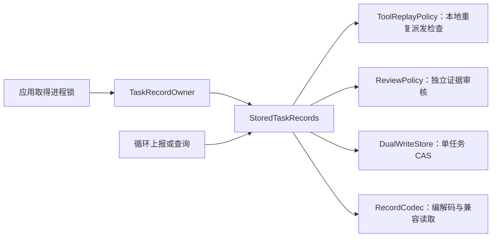

# 执行记录与恢复端口开发文档

> 共同规则：先读 [接续文档](../../重写架构与进度.md)、[AGENTS.md](../../../AGENTS.md) 和 [检查说明](../../../checks/README.md)。固定 LLM 文本放在 `LlmTexts`；不使用 Lambda；字段注释放在声明上方；检查代码只放 `checks`。

更新：2026-11-17。**端口、正式 Neo4j 任务仓储、指令/归档读取及单机启动恢复已实现，见第 13 节。实际远端核对/补偿、稳定要求验收和真实库联调仍待完成。** 本文是独立记录模块的开发交接，不能把检查里的 `RecordingTaskRecords` 当成持久实现。跨模块目标见 [26 任务验收、进度与恢复](../../planned/26-任务验收进度与断点恢复设计.md)。

## 1. 谁负责什么

任务仓储经 [persistence](../persistence/10-统一双写模块分析.md) 的 `DualWriteStore` 访问 Neo4j。`StoredTaskRecords` 以 `writeIfAbsent` 和单实体 CAS 保存任务聚合、指令、事件、领取、归档及消费待办。记录模块定义业务状态和事件顺序，应用提供持锁的本机所有者。分布式租约、远端影响核对以及通用历史修订仍待实现。 [生产实现与验证](#13-2026-11-17-正式持久任务与启动恢复已实现)

| 组件 | 当前职责 | 不承担的职责 |
| --- | --- | --- |
| `AgentOrchestrator` | 发执行事实、查外部快照、传模型上下文、按计划调度、提交处理结论 | 保存权威进度、决定必须回滚、自动清除问题 |
| `TaskRecordPort` 实现方 | 原任务、事件、证据、进度、问题、版本、运行领取及审核结果的权威管理 | 替循环调度 Future 或分配模型 |
| `ExecutionTracePort` 实现方 | 节点、创建关系、执行依赖及数据绑定关系的保存和查询 | 把内存图自动解释为持久恢复待办 |
| 模型与验收模块 | 模型结合证据提出保留、核对、补偿、修复及继续方案；外部验收核实处理结论 | 仅凭模型自称 `resolved=true` 直接关闭问题 |
| 工具实现方 | 实际操作、执行前后状态、版本/回执、核对及补偿能力 | 保证所有动作天然可逆 |
| `CapabilityUsePort` 实现方 | 根据能力、参数和本次上下文判断是否适用 | 固化检索、任务记录管理或模型调用 |

循环仍持有当前运行的 Future、分支、预算和取消信号。这些是调度数据，不能替代外部的任务进度或恢复记录。单次 `AgentCaller` 的入口和职责未扩张。

## 2. 当前源码与接入入口

- [TaskRecordPort.java](../../../src/main/java/com/example/myhelper/records/TaskRecordPort.java)：外部模块必须实现的任务合同及 DTO。
- [ExecutionTracePort.java](../../../src/main/java/com/example/myhelper/records/ExecutionTracePort.java)：执行图合同，现有内存实现 `ExecutionTraceStore` 已实现它。
- [RunRecordAccess.java](../../../src/main/java/com/example/myhelper/orchestration/RunRecordAccess.java)：循环内部的身份、事件封装和端口调用助手，不含仓储或恢复策略。
- [AgentOrchestrator.java](../../../src/main/java/com/example/myhelper/orchestration/AgentOrchestrator.java)：`submit`、`resume`、执行回执和恢复阶段调度。
- [SpringToolExecutor.java](../../../src/main/java/com/example/myhelper/orchestration/SpringToolExecutor.java)：向真实回调传入操作身份和证据上报入口。

十参数构造在模型适配器后加入 `TaskRecordPort`；十一参数再加入独立 `CapabilityUsePort`。九参数及更旧构造使用 `TaskRecordPort.disabled()`，只提供本次运行能力。未启用记录时，`resume` 明确拒绝。

```java
AgentOrchestrator orchestrator = new AgentOrchestrator(
        planner, search, actions, checks, tracePort, workers, timer, limits,
        modelAdapter, taskRecords, capabilityUse);

AgentOrchestrator.Handle first = orchestrator.submit(request);
String stableTaskId = first.taskId();
// 外部确认可以接续后，由应用入口再次调用；运行是否可领取由 taskRecords 校验。
AgentOrchestrator.Handle resumed = orchestrator.resume(stableTaskId);
```

示例变量由运行装配提供，正式 `main` 默认装配记录与恢复。`resume` 读取原目标、参数、模型引用和工具范围，新建根运行并查询进度。恢复跳过原任务的入口固化重放，依据持久证据继续调度。 [正式启动恢复](#13-2026-11-17-正式持久任务与启动恢复已实现)

## 3. 身份与接口

| 身份 | 含义 |
| --- | --- |
| `taskId` | 外部登记的稳定任务身份，多次恢复沿用 |
| `rootRunId` | 每次 submit/resume 的新根运行身份 |
| `runId` | 本次根或递归子任务身份；恢复后的子任务会新建 |
| `nodeId` / `operationId` | 实际执行节点，普通工具的两者相同 |
| `branchId` | 逻辑模型分支，与 Java 线程无关 |
| `eventId` | 单个事件去重身份；一次工具不同阶段各有新事件 |
| `planRevision` | 当前任务中的规划轮次，与外部快照 revision 不同 |
| `RunClaim.token` | 外部授予的本次运行凭据，循环不解析其内容 |

`TaskSpec` 保存 `goal/arguments/modelRef/toolNames`。`TaskSnapshot` 保存 `taskId/task`。映射、列表、事件和提案数据须可表达为 JSON，DTO 已进行只读复制及基础校验。

| 方法 | 实现方必须保证 |
| --- | --- |
| `enabled()` | 显式区分未装配和已装配但无待办；运行期间配置保持一致 |
| `create(TaskSpec)` | 登记原任务并返回稳定身份 |
| `load(taskId)` | 返回原始任务；不存在时明确失败，不能创建另一任务 |
| `beginRun(taskId, rootRunId)` | 原子校验恢复资格和冲突领取，返回匹配身份的凭据 |
| `query(claim, runId)` | 返回该子任务当前需要的最新进度、问题和接续结论 |
| `append(claim, event)` | 校验身份、幂等接受事件并提交派生记录；正常返回表示已按实现约定持久提交 |
| `review(claim, proposal)` | 校验快照版本、实际效果和证据，返回审核后的权威状态 |
| `endRun(claim, event)` | 原子保存真实结束事实并结束领取；不能先释放再尝试保存 |

并发分支可能同时上报事件和查询。实现方必须线程安全，明确按 `runId` 分派问题，避免多个分支重复处理同一影响。快照应包含恢复时需要的旧运行证据；不能仅因新的 `runId` 没有旧事件而返回空进度。

跨进程领取、租约续期、失效凭据隔离和迟到回执由实现方负责。进程消失不证明外部工具没有继续执行，不能只因租约超时就重新派发有副作用的动作。

## 4. 循环实际发出的数据

每个事件包含 `eventId/taskId/rootRunId/runId/nodeId/branchId/planRevision/kind/details`；`details.recordedAt` 为观测时间，不能替代持久仓储的有序提交版本。

| kind | 当前发送点 | details 主要内容 |
| --- | --- | --- |
| `MODEL_TASK_ASSIGNED` | 本轮取得实际模型绑定后、排队前 | `goal/arguments/toolNames/modelRef/branchId/parentBranchId/modelAssignment/phase/round` |
| `MODEL_CALL_STARTED` | 通过预算检查，准备进入规划调用 | 同上，并有 `startedAt` |
| `MODEL_CALL_RETURNED` | 规划器正常返回决策 | 同上，并有 `decisionKind/elapsedNanos/completedAt`；不表示任务成功 |
| `INTENT` | 普通工具派发前 | `goal/tool/arguments` |
| `OBSERVED` | 工具显式上报观察 | `phase=BEFORE/AFTER`、`evidence` |
| `RETURNED` | 工具返回或抛错后 | `goal/tool/arguments/outcome`，保留实际值及未知效果 |
| `VERIFIED` | 工具、能力组合和普通 COMPLETE 验收后 | `goal/arguments/performed/outcome` |
| `MODEL_FAILED` | 实际进入规划模型后失败 | `error/phase/goal/modelRef/elapsedNanos/completedAt`；使用实际 MODEL 节点身份；预算、取消、装配和派发失败不冒充模型故障 |
| `RUN_ENDED` | 全部真实在途工作收束后 | 最终 `outcome`；可能晚于对外 CANCELLED |

`outcome` 含 `status/value/error`。`performed` 表示本次是否对成功执行结果进行验收，不是“是否产生副作用”。原工具返回在 `RETURNED`，验收结果在 `VERIFIED`，必须分别保留。现有 `Checks.verify` 仍为布尔合同；完整结构化证据判定、稳定 R1/R2 要求模型未在本轮实现。

工具门禁拒绝时尚未进入执行，不发 `INTENT`。已知输入和返回不能证明完整效果；例如只收到超时，应明确标为未知，不能补造 before/after。当前没有将全部模型消息写入任务事件；模型摘要、步骤依赖和参数来源另走执行图端口，完整模型响应归档仍待扩展。

### 模型接了什么任务：结构化事实（2026-11-12 已接线）

用户要求初次获取模型时就保存其任务，标签和画像交其他模块。当前在 `invokeDecision` 的 `forCall` 返回后立即发 `MODEL_TASK_ASSIGNED`，首次与后续各轮均记录；每轮的实际 MODEL 节点 `nodeId` 就是 `callId`。这表示本次任务取得了哪个绑定，不宣称每轮都重新选模型，也不等同于混合计划在 fork 时提前登记的整组绑定。

按 `taskId/rootRunId/runId/branchId` 关联任务，用 `nodeId` 区分每轮调用。同一 modelRef 的多个分支分别保存，同一分支的不同子任务也不能覆盖。事件 `eventId` 只用于事件去重。根和嵌套任务都保留其实际 goal、参数及当前阶段；标签尚未提供，循环不会自行从目标或工具名称生成分类。

ASSIGNED 在排队前保存；预算耗尽、排队拒绝或取消时可能没有后续调用。STARTED 是进入调用前的本地事实，进程在它之后崩溃或收到取消时仍不能据此证明供应商已接收请求。RETURNED 表示 `planner.decide` 正常返回，实际工具执行和任务验收另行关联，COMPLETE 也不能直接计为成功样本。

`elapsedNanos` 使用单调时钟测量本地规划器调用区间，包含其序列化、网络等待和响应解析，不包含工作池排队或外部事件提交；它不是供应商纯推理耗时。`startedAt/completedAt/recordedAt` 用于定位阶段，不用墙上时钟差代替该指标。真正模型异常记录相同 callId；返回记录写入故障不发 MODEL_FAILED，避免把存储故障计为模型失败。

允许工具列表不是实际工具使用证据。外部画像模块要关联具体 TOOL、执行/验收事件及任务结果，分别判断模型能力、工具故障和连接问题。纯工具固化直接完成不发模型事件；提前分配但从未调用的模型不能形成已执行样本。

当前记录的是 modelRef 连接引用，不猜供应商、模型版本或账号。后续适配器应提供其版本化身份快照，能力按具体模型统计，账号额度/排队按连接统计。画像表、标签生成、按画像选型及生产记录持久化仍由独立模块实现；旧构造 disabled 时只保留已有内存执行图，不宣称已写数据库。

## 5. 工具如何提供“改了什么”

自定义 `ActionExecutor` 可直接使用 `CallContext`；Spring AI `ToolCallback` 的上下文中现有 `rootRunId/runId/nodeId/deadline/cancellation` 继续保留，并新增 `taskId/operationId/executionContext`。后者是相同 `CallContext`。

```java
// 真正的工具读到了修改前版本后上报，不由循环猜测磁盘或远程状态。
context.reportBefore(Map.of("target", target, "revision", beforeRevision,
        "contentHash", beforeHash));
// 实际执行后，保存可以再次查询的回执及修改后的版本。
context.reportAfter(Map.of("target", target, "revision", afterRevision,
        "receipt", receipt));
```

工具模块应按领域定义目标定位、前后版本/内容摘要、必要差异、动作回执及可查询的状态。大文件或快照可保存到独立存储并传证据引用。核对/补偿需要版本条件和实际工具支持；有回执不等于具备通用回滚。记录失败后动作可能已完成，循环保留产物并返回 `UNKNOWN`，不能据此重复写入。

## 6. 恢复查询和模型接续

`RecoverySnapshot` 包含 `revision/disposition/pending/progress/reason`。`RecoveryItem` 包含稳定问题 `id`、外部定义的 `state`、模型可理解的 `description` 及 `evidence`。循环不自行从 pending 数量推断业务是否阻断。

| disposition | 当前循环行为 |
| --- | --- |
| `CONTINUE` | 正常任务阶段；外部可能认为剩余问题已隔离或由其他工作处理 |
| `CONSULT_MODEL` | 模型收到 `PlanningPhase.RECOVERY`，结合问题和证据提出计划或结论 |
| `WAIT` | 返回 `Status.WAITING`，不重复请求模型忙等 |

根入口先查一次快照；正常新任务才进行唯一的入口固化检索。每轮模型决策前查最新快照；每次 PLAN 后仍检索整条及子节点固化。适用端口及检索的上下文包含 `taskId/rootRunId/runId/recovery`。检索默认重载仅转调旧接口，**不会自动解释恢复限制**；真实筛选由其实现与适用判断负责。

入口固化的已知失败也会带实际反馈进入下一轮。普通完成验收失败可以继续规划；`UNKNOWN` 只有外部明确要求咨询模型时才接入恢复判断，否则保留未知结果或等待。普通 COMPLETE 验收通过后会再次查询外部状态，避免模型思考期间新增的问题被旧快照绕过。

恢复阶段模型可以提出核对、保留正确修改、补偿、修复或不受影响的工作。`finish_task COMPLETE` 只形成 `ResolutionProposal(runId, expectedRevision, incidentIds, conclusion)`；外部 `review` 才能验证并更新待办。它通过后循环仍需继续原目标的正常决策和验收，不把“问题处理完”当成“原任务完成”。

模型调用失败时发送 `MODEL_FAILED` 并返回 WAITING；外部需根据已有事件保留未完成任务和问题。模型恢复可用后由应用或外部调度调用 `resume(taskId)`。当前不含自动重连、轮询或恢复定时器。

## 7. 实现方需处理的故障窗口

1. **INTENT 写入未成功：**循环不派发动作。若服务端已提交但回包丢失，外部可保留意图待核对。
2. **INTENT 已有、动作是否生效未知：**查询实际目标/回执，确认未生效才允许重新执行；无法确认保留待核对。
3. **RETURNED 已有、验收未完成：**优先检查现有结果，而非重复动作。
4. **记录、链路写入或后续查询失败：**已有产物保留，影响不明返回 UNKNOWN；外部不能把未收到某阶段解释为没有效果。
5. **模型提案基于旧 revision：**不得覆盖新问题；重新核对并返回最新快照或明确拒绝。
6. **取消或超时先对外返回：**旧工作仍可能在途；循环等真实结束才 `endRun`，外部接受迟到回执。
7. **启动时计时器/控制对象创建失败：**尚未派发工作，循环尝试保存结束并释放领取；若记录模块也不可用，需由其故障接管机制处理。
8. **结束保存失败：**不得无记录释放；后续由外部对账/接管。循环不能保证外部持久服务不可用时记录仍成功落盘。

事件幂等只解决同一事件重复提交，不能提供外部动作 exactly-once。本地记录事务与文件、网络设备、其他数据库的动作不是同一个原子事务。执行图是另一类数据；实现方若需要图与事件一致，应自行确定存储事务或补齐机制。

## 8. 其他窗口的开发清单

独立记录模块先实现持久 `TaskRecordPort`，选定事务存储，保存任务、运行领取、事件、证据引用、进度与问题版本。按实际事件关联要求进度，查询组装足够的上下文；接外部审核与核对工具，提供明确 CONTINUE/CONSULT_MODEL/WAIT 结论。需验证进程重启、重复事件、领取冲突、崩溃间隙、迟到回执、旧版本提案及存储故障。

固化模块实现自己的 `CapabilityUsePort`，接真实能力合同与本次状态判断。默认 `CheckedCapabilityUse` 只适配现有版本可用检查和 `Checks.allow`，不是完整业务恢复判断。

工具模块为具体动作补 before/after、回执、核对和条件补偿。验收模块补通过/失败/待核对的结构化合同；保持模型提案与事实验收分离。应用装配负责同时接入端口、显示稳定 taskId、按用户或外部调度触发 resume。

本轮检查位于 `TaskRecordPortTest`、`RecoveryOrchestrationTest`、`RecoveryFailureBoundaryTest` 和 `TraceAndCompletionBoundaryTest`，使用进程内替身验证接线及故障边界。实际通过次数和运行目录见 [checks 记录](../../../checks/README.md)，不代表生产持久恢复或真实模型联调完成。

## 9. 中断与新指令合同扩展（目标设计）

2026-11-12 用户先确认设计，随后授权实现。跨模块流程见 [26 第 10 节](../../planned/26-任务验收进度与断点恢复设计.md)。本节保留目标合同；已实现的接口、循环接线与尚未实现的存储保证以第 10 节为准，不能把完整目标设计都视为当前能力。

### 9.1 首版接续边界

首版保留同一 `taskId`。应用明确把新指令关联到正在执行的任务，并表达“打断该任务后调整”的意图；不能把任意新聊天消息自动当作旧任务的修改。记录模块先持久接收指令和停止派发请求；循环停止旧计划的新派发，收束真实在途动作并保存回执。在正常打断路径中，旧运行结束且恢复资格核对通过后，以新 `rootRunId` 按新版指令进入 `resume` 和重新规划。崩溃或长期失联走第 9.4 节的异常接管，不等待旧进程产生无法补出的 RUN_ENDED。

这条路径不等于调用 `Handle.cancel` 后立即 `resume`。当前取消可提前完成对外结果，在途工具仍可能运行；新运行不能据此抢占旧运行权。新指令的“已接收”“旧运行已收束”“已开始按新版执行”应分别返回或查询。只要求停止而没有要求继续时，收束后保留待接续状态，不自动恢复原任务。

新一轮上下文应含原目标、按接受顺序保存的用户修订、当前适用的指令版本、已执行与已验收事项、产物版本、未执行事项、结果未知的动作和待处理影响。模型判断怎样调整计划以及哪些成果可复用；循环落实版本、依赖和派发边界。接受多条待处理指令时逐条保存，不简单用最后一句覆盖此前全部要求；明确替代关系交给模型结合原文理解，存在冲突或缺口时请求输入。

### 9.2 指令入口与版本

用户输入发生在模型运行之外，不能要求它持有旧运行的 `RunClaim`。建议由应用完成身份和任务权限校验后调用独立 `TaskInstructionPort`；端口实现仍属于记录模块，并与任务、领取和执行事实共用一致性边界。

| 候选合同 | 需要保证的含义 |
| --- | --- |
| `accept(taskId, commandId, expectedInstructionRevision, content)` | 持久、幂等接收指令；同事务保存新版本和对应停止派发请求；返回接收回执，不冒充已经停止或应用 |
| `query(taskId)` | 返回最新已接收版本、当前运行使用版本、待应用指令与收束状态；应用查询同样校验权限 |
| 扩展任务加载及运行领取 | 读取新版有效输入及原始指令链，原子领取运行并固定本次采用的指令版本；不能只读取当前 `TaskSpec` 原目标 |
| 扩展派发前确认 | 对新的模型/工具工作校验领取、指令版本和停止请求；与接收指令形成明确的先后界线，可扩展现有 `INTENT` 确认合同 |
| 扩展任务完成提交 | 原子核对有效领取、已接收/已应用版本及验收快照；与新指令接收排序，防止旧 COMPLETE 完成新版目标 |

`commandId` 在同一任务内去重。同一身份、同一正文和请求参数重试，返回原回执且不重复递增版本；同一身份但正文或参数不同则拒绝。先核对已有幂等记录，再对新命令执行 `expectedInstructionRevision` 的比较并更新；版本冲突返回最新状态，由应用处理，不能无条件覆盖。应用已确认权限的范围不能因模型重写目标而自动扩大。

| 版本/身份 | 用途 |
| --- | --- |
| `acceptedInstructionRevision` | 记录模块已持久接受的最新用户指令版本；不表示循环已停止或新方案已经执行 |
| `runningInstructionRevision` | 本次运行领取时固定采用的指令版本，用于规划和派发校验；领取本身不表示新指令已被完整理解或应用 |
| `appliedInstructionRevision` | 已经校验并纳入可执行计划或明确处理结论的指令版本；不表示任务已完成。可暂时小于已接受版本 |
| `RecoverySnapshot.revision` | 进度、问题及证据快照的一致性版本，用于审核；不能替代用户指令版本 |
| `planRevision` | 一次子任务中的规划轮次，须结合 `rootRunId/runId` 定位；不能作为跨重启或跨指令的全局版本 |
| `RunClaim` 及领取代次 | 确定哪个运行有权派发和更新当前状态；与用户修订版本分别校验 |

新运行领取与所采用指令版本必须原子确定。领取后又收到新指令，仍按同样的收束流程处理，不能静默修改正在运行的任务目标。原始 `TaskSpec`、指令原文和旧规划依据均保留，禁止为更新当前输入而覆盖历史事实。

`endRun` 仅保存本次运行结束，不自动表示最新任务目标完成。任务完成提交与指令接收须按版本原子排序；先收到新指令时旧完成提案不能通过，已完成后再接收的修改须保持待处理或显式重新打开任务，不能被原完成状态吞掉。

### 9.3 旧动作、新指令与迟到结果

派发许可应绑定 `rootRunId/operationId/instructionRevision` 和当前领取。接收新指令后，旧版本尚未获得许可的动作不能继续派发；此前已获得许可、是否已发送尚不确定的动作纳入在途核对，不能因本地 Future 取消就算未执行。模型返回计划时也要校验其依据版本；旧模型迟到响应保存为事实，不得安装为新版执行计划。

正常打断路径等待旧运行实际工作链收束，再调用结束合同并申请新运行；崩溃或长期失联须经第 9.4 节的受控接管。若远程动作状态仍未知，先由记录/恢复模块根据回执与工具查询核对，未获得明确接续资格时保持等待；无法确认安全的冲突动作不得重做。核对旧效果、保留成果或处理影响仍由模型及独立审核模块决定，循环不根据取消状态自行回滚全部修改。

迟到回执必须关联旧运行、原 `operationId` 和原指令版本。记录模块按已登记操作与可信来源校验、幂等保存，不能让过期领取借上报之名派发新动作或直接覆盖新版进度。迟到事实若表明新版依据已变化，由记录模块生成待核对事项或使相关验收失效，再通过当前版本审核更新进度；不能简单丢弃它。具体迟到事实入口可独立于普通活动领取写入，但不能放松来源与操作身份验证。

### 9.4 进程异常后的发现与领取

优雅退出时可尽力请求停止并保存状态；强杀、断电或崩溃不会可靠执行退出钩子，因此不能依赖进程临终写入“已中断”。记录模块通过已持久登记的运行、心跳/租约、未闭合动作和缺失结束事件识别异常；应用启动或独立调度触发有界扫描，找出需要核对或允许恢复的任务。扫描、退避、去重及持久待办不放入循环。

恢复前先核对旧领取与实际在途效果：失效旧领取只阻止旧执行者继续修改受保护的当前状态，不能取消已经发往远端的操作。远端仍运行或效果未知时，按操作回执、幂等身份及实际资源版本查询；租约过期、本地进程消失或线程结束均不是重复执行的依据。应用触发恢复，记录模块在循环进入时原子授予新领取并固定指令版本。现有 resume 内部会调用 beginRun；应用扫描只发现候选，不能先领取一次再调用现有 resume 重复领取。若以后支持传入预领取凭据，须另设明确入口并保证只领取一次。

启动扫描发现异常是一个持久观察事实，不应伪造旧运行已经正常发出 `RUN_ENDED`。旧运行被异常接管与旧动作已确认结束须分别记录。已接收但尚未应用的新指令也要从持久记录恢复；不恢复旧 Java Future、线程或模型 Session。

### 9.5 候选数据、事件与验收

任务快照拟增加原指令链引用、已接收/已应用指令版本、当前运行及收束状态；运行快照拟增加采用的指令版本、领取代次及未闭合操作引用。执行事件和规划依据拟增加 `instructionRevision`，保持现有 `eventId/taskId/rootRunId/runId/nodeId/planRevision` 的关联。是否拆分 DTO 与实际 Java 命名留给实现阶段，不用任意 `details` 字段替代必要的版本校验合同。

候选事实包括 `INSTRUCTION_ACCEPTED`、`INTERRUPTION_REQUESTED`、`RUN_QUIESCING`、`INSTRUCTION_APPLIED` 和 `RUN_INTERRUPTION_DETECTED`；现有 `RETURNED/VERIFIED/RUN_ENDED` 继续表达实际返回、验收及正常收尾。每项都需明确发生点、关联命令/运行/版本和幂等身份；“已接收”不能当成“已应用”，“要求停止”不能当成“外部效果已撤销”。

实现时至少验证：

1. 同命令重试只接受一次，正文冲突与过期预期版本明确拒绝；接收不依赖工作运行的领取。
2. 新指令到达后旧计划未获许可的动作不再派发，旧模型迟到计划不能执行；已在途动作仍能提交真实结果。
3. 对外取消结果先完成时不能立即产生冲突新运行；真实收束和运行结束保存失败均不得无记录放行接管。
4. 连续多条指令、中断后重启、已接受但未应用的指令均保留；采用版本和最新接受版本可区分。
5. 在动作意图、外部生效、回执及结束保存之间分别模拟崩溃；启动扫描先核对未知效果，不盲目重放。
6. 多恢复者竞争时仅一个获得有效领取；旧领取不能更新新版权威进度，可信迟到事实仍能存档并触发重新核对。

权威指令、进度、执行事实、运行领取和扫描状态由记录模块持久管理；应用负责授权输入、启动扫描触发与恢复入口，循环只查询、发送事实和调度。单次 `AgentCaller` 仍执行一次调用，不增加指令队列、恢复或持久化职责。本节未增加生产实现或检查通过声明。

## 10. 已实现的中断、指令与接续接口（2026-11-12）

用户授权后，本轮实现了 [TaskInstructionPort](../../../src/main/java/com/example/myhelper/records/TaskInstructionPort.java)、循环接线及[应用恢复组件](../../../src/main/java/com/example/myhelper/application/TaskRecoveryService.java)。**没有新增生产任务仓储。** `RecordingTaskInstructions/RecordingTaskRecords` 只在 checks 中，以同一监视器模拟记录事务和领取；其通过不证明断电后可恢复。

### 10.1 外部记录实现如何装配

`TaskRecordPort.instructions()` 为默认方法，旧实现返回 disabled。生产记录模块覆盖该方法，返回与自身共用任务、领取和一致性边界的 TaskInstructionPort。编排器继续使用现有含 TaskRecordPort 的构造，不额外创建指令仓库。未装配时原 submit/resume 路径保持兼容，instruct/amend 和恢复扫描明确报错。

| 实际接口 | 实现方需要保证 |
| --- | --- |
| `accept(Command)` | command 含 taskId、commandId、expectedRevision、kind、text；正文非空。应用先鉴权。先查幂等，再比较预期版本；新输入及停止派发要求一起提交 |
| `bind(RunClaim)` | 在 beginRun 后、任何动作前固定当前指令快照。暂停、取消、无效领取或不满足恢复资格时拒绝；绑定失败循环尝试结束未执行的领取 |
| `check(claim, revision)` | 原子校验当前领取、停止要求与本运行固定版本，返回 PROCEED/REPLAN/PAUSE/CANCEL/WAIT；不可用不得冒充 PROCEED |
| `applied(claim, revision, runId, planRevision, plan)` | 记录已校验的根计划采用该版指令，旧版本返回 false；传入的是计划目标与步骤、依赖及参数绑定的摘要 |
| `complete(claim, revision, expectedRecoveryRevision, outcome)` | 根任务验收后原子提交完成，核对指令、领取、记录快照和当前问题；直接 COMPLETE 可同时应用指令。仅运行结束不能代替它 |
| `query(taskId)` | 返回应用可查询的最新指令快照；读取权限由应用校验 |
| `recoverable(limit)` | 返回有界、已由外部判定可接续的候选；不预先领取，不包含暂停/取消原目标。失联检测、未知动作核对及安全接管由实现方承担 |

Snapshot 的 `revision` 在 query 时表示已接受版本，在 bind 时成为该运行固定采用版本；`appliedRevision` 表示已经纳入计划或处理结论。`instructions` 保存按序原文，`latestKind` 保存最新控制类型。没有单独新增名为 runningInstructionRevision 的字段，也没有覆盖 TaskSnapshot 中的原 TaskSpec；循环通过固定 Snapshot 取得同一语义。

事件 details 现在带 `instructionRevision`；中断事实枚举新增 `RUN_INTERRUPTION_REQUESTED`。用户指令接受及中断请求的事务由指令端口实现。超时和未启用指令端口的旧取消路径立即停止并返回；循环保存请求时间，在真实收尾、endRun 前发送中断事实，避免持久写入阻塞共享计时器。这两条旧路径不能声称返回取消时中断事件已经落盘，收尾前崩溃仍由外部根据未结束运行检测。真实 RETURNED/VERIFIED 继续允许在停止后上报，不能将它们全部拒绝为过期结果。失效领取的跨进程迟到回执通道、RUN_INTERRUPTION_DETECTED 和持久检查点还需记录模块实现。

### 10.2 调用方怎样使用

```java
// 与原 submit 使用同一记录实现，输入权限由应用确认。
TaskInstructionPort.Snapshot current = taskRecords.instructions().query(taskId);
TaskInstructionPort.Command change = new TaskInstructionPort.Command(
        taskId, commandId, current.revision(), TaskInstructionPort.Kind.AMEND,
        "保留 A 已写入的文件，剩余结果改为写到 B");
CompletableFuture<AgentOrchestrator.Handle> next = orchestrator.amend(change);
```

`instruct(command)` 只接收并通知本实例活动运行，不自动开始下一次执行。`amend(command)` 仅接受 AMEND，异步等待旧运行真实收尾后调用 resume；旧运行期间多条修订共享一次接续，新运行绑定最新快照。PAUSE/CANCEL 使用 instruct；CONTINUE 接收成功后，在旧运行收尾或已结束时显式 resume。所有入口均不从自然语言猜测目标 taskId 或控制类型。

活动运行通知按回执版本更新，保留本实例见到的最高版本。重放旧指令返回原回执时，旧回执无法覆盖更新的停止状态。派发仍可用本地停止信号中止。收尾优先检查外部权威指令，只有外部允许继续时才使用本地停止信号或截止时间。

Handle 的 `result()` 可能先报告取消；新增 `settled()` 仅在真实工作链、模型资源及记录收尾完成后结束，任一收尾失败则异常完成，amend 不据此自动续跑。旧 Handle.cancel 在指令端口启用时生成持久 CANCEL，未启用时仍记录当前运行取消。工具是否实际停止以回执为准。

循环只保存活动 Control 和最多 128 条近期 AMEND 接续句柄；同一命令近期重试返回原句柄，正文冲突拒绝。满容量只淘汰已完成句柄，不丢掉在途接续。**这不是持久调度去重：跨实例、重启或缓存淘汰后的 command→续跑 run 关系仍需外部记录/应用实现。** 指令接受的幂等与自动恢复派发的幂等分开验收。

### 10.3 模型、工具与验收接线

PlanningContext 新增固定 `instructions`；原始 goal、recovery.progress/pending 和新指令同时传入。恢复模型由 AgentCallerPlanner 追加 LlmTexts 中的说明，让模型依据已有修改、未知影响和新要求规划；语义解释由模型承担。每次新 PLAN 后检索保持不变，resume 不重放入口整链。

循环在异步工作开始、模型实际调用前、模型响应处理、工具执行器入口以及完成提交处检查版本。CallContext 新增 dispatchCheck；SpringToolExecutor 在等待和取得资源锁后调用 check。自定义 ActionExecutor 若内部排队或等待资源，也必须在真正动作前再调用 context.check。已获准且发出的远端动作不会因本地检查而自动撤销。

根任务完成无论来自入口纯工具固化还是模型 COMPLETE，都经过原子 complete。子任务成功不直接完成根任务。`RuntimeGate.verify` 的指令感知重载可以核对修订后的验收要求，旧 `AgentOrchestrator.Checks` 实现继续通过兼容接口运行。稳定要求身份、完整结构化验收和条件版本仍是独立模块的后续工作。[运行门禁](../gate/15-门禁与验收开发文档.md)

### 10.4 启动恢复与未交付范围

应用可在装配后调用 `new TaskRecoveryService(orchestrator, taskRecords).resumeAvailable(limit)`。它先验证候选批次、按 taskId 去重，再逐项调用 resume；单项受理失败不删除待办，也不阻止其他候选。返回 Handle 只表示受理，不表示任务完成。应用与循环必须使用同一权威记录来源。

本节保存最初的有界恢复入口。现已由 `StartupTaskRecovery` 配合正式仓储在启动时核对并恢复本机所有者的任务，见第 13 节。每次运行仍使用本次 `Limits`。远端效果核对、跨运行预算、分布式租约及外部访问鉴权单独接续。

检查覆盖指令幂等/版本、迟到模型及工具、验收期间新输入、等待资源锁、连续与重复修订、取消/暂停/继续、收尾失败、恢复候选与领取边界。最终执行数量和目录见[checks 记录](../../../checks/README.md)，测试源码均在 checks，没有把替身加入生产源码。

## 11. 收尾归档与任务外固化交接（2026-11-13）

本节保存归档接线前的交接记录。当前 `RunFinalization`、固定图读取合同与技能侧消费组件见第 12 节。

本节记录技能固化窗口转来的职责交接，并对照当前源码区分已有接线和生产缺口。本轮只核对与维护文档，没有增加归档实现或技能生成代码。

### 11.1 职责与统一入库路径

```text
循环真实工作链结束
  → 循环经 TaskRecordPort 提交最终执行记录
  → 独立记录仓储组织数据，调用 persistence / DualWriteStore 保存
  → 持久归档可读取后，技能固化模块在任务外取得固定快照和验收证据
  → 固化模块独立生成候选、审核、发布
```

循环负责收尾时机、发送实际数据和处理提交结果，不在循环实现数据库客户端、权威日志仓库或固化算法。记录模块负责数据合同、归档身份、关联、去重、持久提交与查询，所有数据库访问经统一 persistence；库来源/写入目标由业务仓储明确指定。技能固化不在运行收尾中同步执行，不影响本次任务返回的业务结论，也不直接读取循环里的可变 Map。

“收尾提交”不能代替执行中的 INTENT、RETURNED、OBSERVED 和 VERIFIED 持久确认。动作前后的事实仍按现有端口逐阶段发送，最终提交汇集并固定一次运行的结果与出处。失败、取消、WAITING、UNKNOWN 的真实结束同样要记录，不能只存成功任务；一个 taskId 可以关联多次 rootRunId。

### 11.2 当前真正发生的收尾

| 顺序 | 当前代码点 | 已有行为及限制 |
| --- | --- | --- |
| 1 | `AgentOrchestrator.start` 的 `work.whenComplete` | 等真实工作链结束；不是对外 result 提前取消时收尾 |
| 2 | `AgentOrchestrator.endRun` | 补本地停止事实，检查指令/完成依据；成功结果按已启用的指令端口调用 complete。complete 是根目标完成检查，不是完整执行图归档 |
| 3 | 同一 endRun | 关闭模型会话，保存可观察到的清理异常，再调用 `traces.close(rootRunId)` |
| 4 | `RunRecordAccess.end` → `TaskRecordPort.endRun` | 提交 RUN_ENDED，details 当前只有最终 outcome，以及通用补充的 recordedAt、instructionRevision。端口合同要求保存结束事实后才结束领取 |
| 5 | start 的收尾回调 | 移除本实例活动句柄，完成 result/settled；清理或结束写入失败时 settled 异常，已知产物保留 |

上表是 2026-11-13 的收尾快照。第 12 节记录最终信封及封存图合同，第 13 节记录正式持久仓储与启动装配。

`ExecutionTraceStore.close` 只设置内存 closed 标记，不保存数据库、不产生归档编号；当前 API 也没有以 closed 强制禁止所有后续写入。快照固定性必须由真实收尾、写入协调与不可变归档共同保证，不能只检查一个布尔值。当前 settled 成功也不证明存在数据库图快照，尤其旧构造默认禁用记录时更无此保证。

### 11.3 已有可关联标识

| 当前标识 | 可用于什么 | 不能据此认定什么 |
| --- | --- | --- |
| `taskId` | 多次中断/恢复仍属于同一用户任务 | 不能唯一标识某一次执行图 |
| `rootRunId` | 本次根运行；当前内存 `snapshot(rootRunId)` 的查找键 | 不是持久归档实体 ID，也不是图内根节点 ID |
| `runId` | 图和事件所属的根工作/递归子任务 | 应与 rootRunId 联合定位，不替代稳定要求身份 |
| `nodeId` | 关联图节点与该动作事件；普通 TOOL 上同时作为 operationId，MODEL 上同时作为 callId | 当前 operationId 不是跨运行重试的稳定业务幂等键 |
| `branchId` | 逻辑模型分支，事件与部分图节点 input 已保存 | 不是线程 ID，也不等同于能力定义中的永久位置 |
| `runId + planRevision` | 一次子任务的某轮计划；再关联 STEP.input.stepId | 不是全任务/跨重启全局修订 |
| `eventId` | TaskRecordPort 中每阶段独立事件；可引用 RETURNED、OBSERVED、VERIFIED、RUN_ENDED | 不是图事件 sequence，当前没有对外历史事件读取接口 |
| `instructionRevision` | 当前事件 details 和模型事实中的指令版本 | 不是图版本或验收条件修订 |
| 图 `Event.sequence` | 仅在一个 rootRunId 图内递增，可描述某次快照覆盖的末尾位置 | 图事件载荷不足以重放历史；不能当数据库分页游标或跨图消费位置 |

注意：当前 RUN_ENDED 将 runId/nodeId/branchId 均填为 rootRunId，用作运行级标记；这些值不保证对应图内存在的 Node。关联整图用 rootRunId，不能拿 RUN_ENDED.nodeId 当根节点查询。

当前验收事实由 VERIFIED 事件关联执行节点或目标节点，details 含 goal、arguments、performed、outcome；工具修改凭据通过 OBSERVED(BEFORE/AFTER) 和 RETURNED 保存。`performed` 不是“产生了副作用”的保证。Checks.verify 仍为布尔合同，完整逐项条件、条件修订、独立 verificationId/evidenceRef 不是现成能力。固化消费者不得把图节点 COMPLETED 或一次模型 COMPLETE 当成验收通过。

### 11.4 最终归档合同需要补什么（建议，未实现）

建议在现有 TaskRecordPort 收尾边界增加类型明确的最终运行载荷/重载及归档回执；不要仅约定任意 details 字符串就假设所有实现都会保存完整图。具体 Java 命名需记录模块和循环模块共同接入。

| 建议载荷 | 内容及来源 |
| --- | --- |
| 运行信封 | taskId、rootRunId、指令版本、结束原因、最终 outcome、结束事件 ID；附结构版本 |
| 固定图快照 | nodes、edges、events、closed，另显式携带 rootRunId；当前 Snapshot DTO 本身没有 rootRunId。采集在真实工作和模型清理记录收齐后 |
| 事实及验收关联 | 本次运行的执行/观察/验收 eventId 清单或稳定持久读取范围，产物/证据位置与版本、缺失项；不是再造一份相互独立的权威进度 |
| 归档回执 | archiveId/snapshotRef、不可变修订或内容校验值、提交标识与可读取状态；这些字段当前均未实现 |

目标顺序为：收齐真实结果和清理异常 → 取得固定图 → 经记录端口提交图及结束载荷 → 记录仓储通过统一存储确认可读 → 确认结束领取与归档回执。归档失败保留已有结果与待提交记录，不向固化模块发布“完整可消费”，不先删内存图。若图因记录故障不完整，可以单独保存结束/失败事实，但必须明确标缺口，不能伪装完整轨迹。

图、事件和证据跨多次写入时，需要明确一致性边界：同事务支持不足时，可先写不可变片段，再提交最终归档清单；消费者只读取已确认完整的清单。该提交/可见性协议、失败补齐及跨进程控制仍需实现，不能靠当前 DualWriteStore 的同步补偿冒充事务。最终提交重试须复用原提交身份及固定载荷；当前 RunRecordAccess 每次构造事件会生成新 UUID，尚没有持久收尾重放队列。

### 11.5 技能固化如何读取与当前生产缺口

技能固化的目标读入口应由记录模块提供，例如按归档引用读取固定运行快照及对应证据，按持久候选/消费游标发现待处理归档。方法名是建议，当前 TaskRecordPort.query 返回恢复进度/问题，load 返回原任务；两者都不是完整图归档查询。

固化候选应记录 taskId、rootRunId、snapshotRef、来源 nodeIds、验收/证据引用和所依据版本，保持可追溯。归档可读表示记录完整，不代表技能可发布；是否可提取整图或独立验收子图、如何参数化、是否审核通过及何时发布均由固化模块独立判断。当前内存 snapshot 只供本进程查看，不作为任务外持久消费的交付承诺。

此处的接口清单来自 2026-11-13 交接。当前已提供任务载荷、固定快照提交、归档读取、消费待办与确认，并经 Neo4j CAS 持久保存。技能自动子图提取、业务分流及审核的剩余工作见技能模块。 [当前仓储](#13-2026-11-17-正式持久任务与启动恢复已实现) · [技能模块](../skill/16-技能固化开发文档.md)

统一 persistence 当前已有按 ID/EntityRef 读取、批量 ID、字段条件分页、向量查询与指定目标写入，但 EntityRef 只核对当前实体，不能取被覆盖的旧修订；条件分页不是事件消费游标；同步补偿不是跨库原子事务，当前缺持久日志、CAS 和跨进程领取保证。相关能力需扩展统一数据库模块，再由记录仓储实现业务合同。见[10 数据库边界](../persistence/10-统一双写模块分析.md)。

本次仅源码与文档静态核对，没有新增运行检查；后续实现至少验证图与结束结果可联合读取、清理异常不漏归档、重复提交去重、归档失败不宣布可消费、旧快照不可被覆盖，以及取消后的迟到事实完整保留。

## 2026-11-15 存储条件写能力更新

统一存储新增 writeIfAbsent/compareAndSet，仅支持明确 NEO4J 目标，核对 ID 唯一约束后在节点锁内比较完整单实体快照，正文及投影同事务保存。可供仓储自身的单实体状态转移；未提供多实体条件事务、租约/fencing、事件订阅或恢复队列，不代表 TaskRecordPort 全部原子合同已经实现。真实收尾和完整归档继续按第 11 节接续。循环首次已收到本轮边界通知，后续检查补充消息被工具审批策略拒绝。见[数据库交接](../persistence/10-统一双写模块分析.md#2026-11-15-跨窗口数据访问核查与条件写入)。

## 12. 2026-11-16 生产记录接线合同（实现进行中）

循环真实收尾关闭图后调用 TaskRecordPort.endRun(RunClaim, RunFinalization)，信封包含稳定 RUN_ENDED、冻结 Snapshot、graphComplete、gaps 和 evidenceGaps。启动或 bind 失败允许 graph=null，此时记录图缺口并跳过固化待办。

供技能窗口接入的固定签名（records.RunArchivePort）：

```java
Optional<ArchivedRun> readArchive(ArchiveRef ref);
List<ArchiveRef> pendingConsolidations(int limit);
void acknowledgeConsolidation(ArchiveRef ref);
// ArchiveRef(taskId, rootRunId)
// ArchivedRun(ref, schemaVersion, endEvent, graph, graphComplete, gaps, events, internalValidation, evidenceGaps)
```

ArchivedRun.events 为该运行全部持久事件及验收/观察证据，包括结束事件；graph 是固定节点/边/图事件快照。归档身份由 taskId+rootRunId 确定，不用全库猜根运行所属任务。普通用户任务失败/取消也可产生完整归档，是否能提取局部已验收子图由技能模块判断。内部验证来源新增为 Request/TaskSpec 的显式 internalValidation 字段，原四参构造默认 false，不能依赖用户 arguments 中同名键。

逐阶段 append 抛错时，循环将事件种类、nodeId 和 eventId 写入 evidenceGaps，随后继续原有异常处理。graphComplete 表示图的结构完整性，evidenceComplete() 表示事件写入均无已知缺口。自动固化待办、唤醒及消费要求两项都通过。回执丢失时写入有可能已经生效，仓储可凭 eventId 对账。最终提交重试复用同一信封。

StoredTaskRecords 将以 Neo4j 单 WorldEntity 聚合保存任务/指令/领取/事件/归档/待办，用 DualWriteStore 的单实体 CAS 同时提交归档与结束领取、待办标识。确认消费只修改待办状态，不改固定归档；消费者必须按来源身份幂等，跨技能发布和 ack 不声称恰好一次。wakeConsolidation 仅是提交后的可丢失通知，待办可重扫。生产只使用明确 NEO4J 目标，不做多库事务或直接连接数据库。

异常失联的旧领取不会仅因超时被自动回收；须确认旧执行不再运行后显式核对并关闭，未确认动作保留待核对。权威问题处理仍需独立审核，不信任模型自称已解决。生产仓储具体限制与实际检查结果将在完成后补齐。

2026-11-16 源码复核确认，循环复用固定的结束事件和封存图进行有界提交重试，图完整且属于用户任务时才尝试唤醒。技能侧已提供 ArchivedSkillProcessing 和参数归档重放组件，生产 RunArchivePort、记录仓储、通知接线及完整固化分流仍待装配。已验证的是构造好的归档样本可重放，实际工具到生产归档的整条链仍待联调。 [全量复核](../../completed/全量实现与代码复核.md)


## 13. 2026-11-17 正式持久任务与启动恢复（已实现）

本节取代前文“生产仓储待实现”的当前状态描述，历史交接保留。正式实现为 StoredTaskRecords，同时实现 TaskRecordPort、TaskInstructionPort 和 RunArchivePort；RecordsConfiguration 装配单一仓储。循环负责上报、查询和调度，未承担数据库或问题审核职责。

### 13.1 提交、身份与数据

所有读写经共享 DualWriteStore，明确使用 NEO4J。每个 taskId 对应一个 ContextUnitType.OBSERVATION 实体，data.kind=TASK_RECORD、schema=1。一个聚合保存原任务、内部验证标志、指令/回执、固定运行绑定、当前及历史领取、计划、事件及顺序、审核提案、问题、完成判定、各运行归档和固化待办。记录存储格式由 records 管理，不新增世界实体类型或数据库旁路。

首次创建用 writeIfAbsent，后续变更用 compareAndSet 比较完整旧实体。指令和其版本、事件和派生问题、最终归档和释放领取/待办分别在单实体提交中完成，不把多次普通写解释成事务。冲突有界重读；提交回包异常会读回并核对同一幂等操作是否已生效。不能确认时上抛。eventId 和 commandId 重放必须内容相同；同 rootRunId 的固定归档不能被新内容覆盖，旧运行的重复提交不能释放新运行。

恢复依据 revision 与数据库 CAS revision 分开。模型分配/请求元数据不会自行使刚读取的恢复依据过期；执行返回、观察、验收等证据变化会更新依据。progress 当前提供按原始事件关联的 executionFacts，保留实际参数、产物、结果和验收；它不是已实现的 R1/R2 稳定要求验收表，后者仍见 26 的待做设计。

### 13.2 中断、未知效果及新指令

INTENT 在工具派发前同步确认；RETURNED 保存真实结果，VERIFIED 保存后续验收。缺失返回和成功返回但缺失验收分别形成 UNCONFIRMED/UNVERIFIED，不自动解释为未执行。明确 dispatchStarted=false 的回执按未派发处理。含未核对影响的任务可将已有事实交模型；ToolReplayPolicy 默认只拦截未知、缺返回或缺验收事项关联的同工具名、同完整参数 INTENT，明确 FAILED 本身不再一律阻止重试。失败事实和问题仍保留。该保护不是业务资源级幂等，也不能保证不同参数或不同别名没有同一外部效果。策略与提交的边界见第 15 节。

模型完成处理只是 ResolutionProposal，ReviewPolicy 负责独立审核。默认策略保留事项并 WAIT，不相信模型自称 resolved。宿主可注入经过证据核实的策略，显式返回批准事项、原因和 CONTINUE/CONSULT_MODEL/WAIT；仓储按版本保存，不按剩余事项数量另行改判。用户指令 CONTINUE/AMEND 允许重新判断，保留问题；模型请求失败的新尝试只去掉等待模型的调度标记，历史失败事实与实际影响不丢失。

PAUSE/CANCEL 排除自动恢复并在领取、绑定、派发检查处再次校验。AMEND 固定新版本，旧运行真实收尾后由原循环接续。应用退出使用 stopForShutdown，仅停止当前派发，不写用户 CANCEL。已经原子提交 complete 的目标不会仅因最终图尚未归档就重新执行；若出现新的未确认动作或最终结果变成 UNKNOWN，重新打开相关核对状态。

### 13.3 正式启动与所有权

MyHelperApplication 导入 TaskRecoveryConfiguration；默认 myhelper.records.enabled=true。启动创建共享存储、任务仓储和 TaskRecoveryService，显式初始化 Neo4j 实体 ID 唯一约束。数据库不可用明确启动失败，不悄悄退为内存模式；本功能不初始化 Qdrant 集合。

TaskProcessLock 在固定安装目录持有操作系统文件独占锁，文件保存稳定 ownerId，正式锁保留到 JVM 退出。默认目录为用户目录下 .myhelper/task-runtime，可通过 myhelper.records.state-directory 覆盖。相同安装必须固定目录，不复制、删除或替换运行中的锁文件。不同安装使用不同身份。该方案限单机安装，不声称分布式租约或自动接管其他主机。

取得锁后，StartupTaskRecovery 只核对同 ownerId 的旧领取，写明本地派发器停止证据，以不完整图归档保存旧运行的 UNKNOWN 收尾。远端动作仍须核对，不能因进程退出宣称远端动作终止。其他 owner 和无 owner 的旧领取保持不变，需宿主提供证据后显式调用 reconcileStoppedRun。

随后专用后台线程按 recoverablePage 的数据库游标分批调用 TaskRecoveryService.resumeCandidates，仍由 orchestrator.resume 唯一领取；同 taskId 新 rootRunId，跳过入口固化重放。默认每批 4 条，可用 myhelper.records.recovery-batch-size 配置，不能超过图容量。等待本批真实收尾及入口释放图后再读下一批，不占用模型/工具工作线程，不阻塞终端启动。失败候选保留，当前启动扫描不循环重试同一候选，也不是永久后台重试服务。恢复句柄通过 TaskEntry.adopt 与新任务共享停机、异常和图释放管理。

### 13.4 运行期间读取与最终归档

| 时间 | 可读取数据 | 入口 |
| --- | --- | --- |
| 执行期间，每次 append 确认后 | INTENT、RETURNED、VERIFIED、OBSERVED、模型调用元数据、停止请求；保留 taskId/rootRunId/runId/nodeId/branchId/eventId/planRevision 及动态 details | readEvents(taskId, rootRunId, afterEventId, limit) |
| 执行期间和恢复前 | 原任务、指令及版本、问题与执行进度 | load、instructions().query、query(claim, runId) |
| 真实收尾提交后 | 不可覆盖的图快照、该运行全部事实、结束事件、graphComplete/gaps/evidenceGaps/internalValidation | readArchive(ArchiveRef(taskId, rootRunId)) |
| 崩溃前未完成最终图提交 | 已确认的逐阶段事实仍可读取；新进程只生成显式不完整归档，不能复原丢失内存图 | readEvents、reconcileStoppedRun 后 readArchive |

事件分页上限 1–1000，保持明确的原提交顺序，游标为原始 eventId；不接受跨运行或不存在的游标。返回数量有界，但当前聚合读取仍加载整个任务，并不是分片事件存储。首版日志历史可直接使用固定归档，记录模块不实现日志展示或异步日志投递。

最终图、结束事实、释放领取与固化待办一起提交。图与证据均完整且非内部验证运行才进入待办；确认消费仅移除待办，不改归档。wakeConsolidation 是提交后的可丢失通知，消费者可重扫 pendingConsolidations。跨技能发布和确认消费没有恰好一次事务，本次未实现固化生成、自动分流或技能算法。

### 13.5 已知范围与验证

单机进程所有权与数据库任务互斥已落地；真实工具的状态查询、补偿和独立业务验收由各自模块提供。没有自动全量回滚、远端操作 fencing、跨运行累计预算或无限重试保证。任务聚合随着历史增长，暂未分片/压缩；完整内存执行图只在最终提交后持久保存。稳定要求编号及三态逐项验收仍属 26 的后续工作。

独立检查使用实际生产仓储、EntityJson、DualWriteStore 与循环，数据库边界为内存 CAS 参与者；验证不等于真实 Neo4j 的锁和断电耐久性验证。实际检查数量、产物与外部服务探测结果见 checks/README.md。本轮没有下载依赖或修改环境。


2026-11-17 最终验证：140 文件现编译，229 项 JUnit 和 4 组存储检查通过；本轮新增 21 项覆盖仓储、归档、启动及进程锁。产物 checks/build/run-2fa0558980e74253bf1045eb90649dc7，验证口径见 [checks 记录](../../../checks/README.md#2026-11-17-正式任务持久化与启动恢复验证)。当前真实 Neo4j 只读探测连接失败，未验证真实库重启恢复；这是外部运行条件，不能用本地替身结果代替。


## 14. 2026-11-17 职责、规范与可读性自查（静态审查，待整改）

用户要求核对本窗口职责、代码规范、简洁可读性及注释。本次只核对当前源码，没有修改运行逻辑或重跑检查；以下发现不能登记为已修复。

职责主体仍分开：循环上报/查询/调度，records 保存权威事实和版本，application 处理单机所有权与启动恢复，数据库访问经 persistence。此次实现范围包含获授权的持久任务与恢复，不表示这些成为循环模块永久职责，也没有将模型选型或固化生成加入记录仓储。

确认的边界与行为问题：
- StoredTaskRecords.acceptEvent 同时将 FAILED/UNKNOWN 作为待核对事项，而 rejectUnreviewedReplay 对相关事项统一按工具名和完整参数拦截。规则并不限于未知效果，可能阻止明确失败、可安全重试的只读动作；注释却只写未知影响。应将重试/影响核对规则与存储操作分开，保留原子提交时的校验。
- ReviewDecision 仅包含批准事项和原因；review 无论注入什么策略，都在剩余事项非空时强制 WAIT。独立策略无法表达隔离问题后继续或让模型继续核查。默认无核验服务时等待可以保留，但应由明确策略返回接续结论。
- RecordsConfiguration 直接依赖 application.TaskProcessLock，装配层反向耦合到具体宿主。建议由应用完成 ownerId 的装配，记录仓储只接收身份或抽象合同。

规范与可读性：所查 records/application 新文件未见 Lambda，箭头均为 switch；测试位于 checks，主要字段注释在声明上方，主要恢复文本在 LlmTexts。StoredTaskRecords 为 867 行，包含较长匿名 Change.apply、单行压缩、序列化、查询和恢复规则；适合提取有业务名称的方法、独立编解码与策略，不能拆散 CAS 事务。OPEN/WAITING_MODEL/UNCONFIRMED/UNVERIFIED 等状态建议统一为命名常量或类型，保持原持久字符串兼容。RecordsConfiguration 的默认审核与仓储现有工厂重复。Loaded(entity,state) 缺分量注释；LlmTexts 的部分新增常量只有组注释，尚非逐字段完整说明。记录异常直接进入模型反馈的路径还须统一固定文本。

确认的检查时序问题：StartupTaskRecoveryTest.closedEntryStopsEveryAlreadyAcceptedRunInTheBatch 在放行模型前等待持久 RUN_INTERRUPTION_REQUESTED，而 requestLocalStop 仅先置停止信号，持久事件需真实收尾时 recordLocalStop 写入。模型已经进入 latch 时形成等待环，解释另一窗口观察到的偶发超时。应先观察即时停止信号、放行模型，再断言持久事件与归档；不能为了让检查通过提前保存真实收尾。此前 229 项通过是当次运行事实，不能据此否认该检查的不稳定性。

建议整改顺序：先修检查同步点和两处恢复策略边界，再整理装配依赖、方法结构及注释；本次自查没有将这些建议实施。用户随后授权整改，后续实现及验证见第 15 节。

## 15. 2026-11-17 恢复策略边界与可读性整改

状态：用户已授权，整改已实现并通过本地检查。第 14 节保留审查时的发现，不再作为当前现状说明；实际检查范围见本节末及 checks 记录。

### 15.1 分工与接线

| 组件 | 负责内容 | 调用约束 |
| --- | --- | --- |
| `AgentOrchestrator` | 上报执行事实，读取记录结论，调用模型、工具和恢复审核端口 | 不保存数据库聚合，不推断业务回滚 |
| `StoredTaskRecords` | 维护领取、版本、事件、指令、问题与固定归档；原子提交审核结论和动作意图 | 数据库访问全部经 `DualWriteStore` |
| `ToolReplayPolicy` | 判断当前新动作是否与未核对影响冲突 | 只读取本次快照；CAS 重试可多次调用，禁止模型请求、数据库查询和外部修改 |
| `ReviewPolicy` | 根据证据核验模型提案，明确给出批准事项、原因及接续结论 | 在 CAS 外只调用一次；随后仓储按原版本提交，冲突须重新核对 |
| `RecordState` / `RecordCodec` | 任务聚合字段与持久状态常量 / 格式编解码、兼容读取及内容比较 | 保持同一任务聚合，不拆散原子提交边界 |
| `TaskRecoveryConfiguration` / `TaskProcessLock` | 取得本机独占锁，提供跨启动稳定身份，装配启动恢复 | 具体文件锁属于应用层 |
| `TaskRecordOwner` | 将宿主身份传入记录模块 | 仅是身份数据，不证明远端动作已停止 |

`RecordsConfiguration` 只依赖 `TaskRecordOwner`，不再导入 `application.TaskProcessLock`。应用创建身份 Bean 后注入仓储；其他宿主可以提供自己的稳定身份和所有权机制。`ToolReplayPolicy` 与 `ReviewPolicy` 均可通过 Bean 注入；未提供时分别使用默认重复派发保护和保留事项的审核策略。

源码入口：[仓储](../../../src/main/java/com/example/myhelper/records/StoredTaskRecords.java) · [重复派发策略](../../../src/main/java/com/example/myhelper/records/ToolReplayPolicy.java) · [聚合状态](../../../src/main/java/com/example/myhelper/records/RecordState.java) · [编解码](../../../src/main/java/com/example/myhelper/records/RecordCodec.java) · [身份合同](../../../src/main/java/com/example/myhelper/records/TaskRecordOwner.java) · [记录装配](../../../src/main/java/com/example/myhelper/records/RecordsConfiguration.java)。

### 15.2 两处明确的行为修正

**重复派发保护。** 默认策略依据待核对事项及其关联事件判断，只阻止同工具名、同完整参数的效果未知（`UNKNOWN`）、缺少返回（`UNCONFIRMED`）或成功但缺少验收（`UNVERIFIED`）动作。仅有明确 `FAILED` 不再一律拦截同参数重试，但失败事件和问题仍保留，重试获准不等于问题已经解决。是否允许业务上的非幂等重试，仍须由工具合同和独立业务策略判断；默认规则不是资源级幂等保证。

策略检查与新 `INTENT` 保存在同一个 CAS 变更中。若期间新增了问题，仓储重读后重新检查，不能拿旧快照的“允许”覆盖新问题。策略只能给出允许/拒绝和原因，不能执行动作或自行清除事项。

**独立审核结论。** `ReviewDecision(approvedIds, reason, disposition)` 显式包含 `CONTINUE`、`CONSULT_MODEL` 或 `WAIT`。仓储只删除独立策略批准且属于本提案的事项，并按原版本保存结论，不再因为剩余事项非空而改写为 `WAIT`。默认 `retainingReviews()` 仍保留事项并返回 `WAIT`。

`CONTINUE` 表示允许继续调度，不表示问题全部解决。根任务完成仍检查当前领取、指令版本、恢复依据版本、成功结果和不存在待处理事项。模型直接声称“已解决”仍不足以关闭问题。

接入兼容性：旧 `StoredTaskRecords` 构造保留并使用默认重复派发策略；需替换规则时使用五参构造或注入 `ToolReplayPolicy` Bean。实现 `ReviewPolicy` 的调用方须在构造 `ReviewDecision` 时显式填写第三个 `disposition`，不再由仓储猜测。持久实体及归档版本仍为 1，字段名和原状态字符串保持；旧 schema 1 缺少 `eventOrder` 时仍可读取，下一次写入补齐。JSON 数字宽度、对象键顺序和固化待办顺序的原语义保持。

### 15.3 阅读代码的顺序

先看 `RecordsConfiguration` 了解装配，再看 `StoredTaskRecords` 的 `beginRun`、`append`、`review`、`endRun` 与 `complete`，随后按需要进入 `ToolReplayPolicy` 和编解码辅助类。回调只表达 CAS 变更入口，具体操作放入有业务名称的方法；不把审核服务调用藏进重试回调。



持久状态字符串使用命名常量，值继续兼容原记录；字段与 record 分量的注释放在声明上方。项目生成的固定归档及记录反馈集中在 `LlmTexts`，动态参数、证据和异常原因仍动态传入。启动恢复使用具名后台入口；仍先核对同宿主旧领取，再按数据库游标恢复，每批等待实际收尾及入口清理完成。

### 15.4 验证范围

停机检查已改为以即时 `STOP_REQUESTED` 确认两个本地停止信号，随后放行已经进入模型的执行，再断言持久中断事件、真实结束和归档。检查替身在第二次受理时等待第一个模型进入，明确覆盖真实在途情形；未增加睡眠或扩大超时，也未提前提交生产收尾事件。

新增 10 项仓储检查，覆盖三类未知动作拦截、明确执行/验收失败可再尝试且事项保留、显式审核结论、审核期间版本冲突、根完成约束、意图提交竞争后重新判断、格式兼容及无应用文件锁的记录模块装配；旧检查另补默认等待断言。所有检查位于独立 `checks/java`。数据库边界仍为内存 CAS 参与者，真实数据库与供应商联调不在本次本地检查结论内。

使用现有 JDK 25 和本地依赖经 `checks/run.ps1` 重编译 157 个 Java 文件，**258 项 JUnit 和 4 组存储检查全部通过**。最终产物为 `checks/build/run-5b10b9acbe4a437bafa8f93ebc37eb6f`；本轮记录、恢复、装配、固定文本及对应检查的源码哈希在运行前后保持一致。桌面窗口仍有并行修改，总数含其本次编译时的代码，不代表其后续改动已验证。详见[检查记录](../../../checks/README.md#2026-11-17-恢复策略边界与可读性整改验证)。本轮未连接真实服务，未下载依赖或修改环境。
