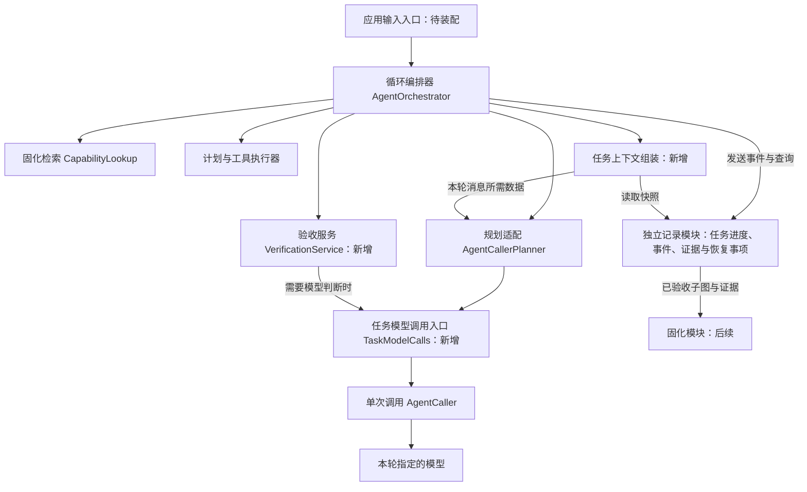

# 任务验收、进度与断点恢复设计

> 共同开发约定见[开发规范](../24-LLM文本与代码可读性规范.md)，测试与检查资料统一放入 `checks`。

初稿 2026-11-11，更新 2026-11-12。本文保留完整目标设计，并区分已确认边界、已实现接线与待实现能力。适用于用户任务和模型规划的子任务；下面用 `R3 按版本读取实体` 说明验收、进度和恢复如何关联。

当前编排器保留每轮 `Feedback`，`Checks.verify` 仍返回布尔值，执行图仍在内存。本轮已接入独立 `ExecutionTracePort/TaskRecordPort`、稳定任务身份、执行事件、外部进度/问题快照、RECOVERY 模型上下文和 `resume(taskId)`。生产持久仓储、按要求编号的完整进度、结构化验收、自动证据采集和跨重启保证仍待实现。当前准确端口见[记录与恢复模块](../modules/records/28-执行记录与恢复端口开发文档.md)，第 1～6 节仍主要描述目标设计。[现有循环](../modules/orchestration/12-并行分支循环编排设计.md) · [现有执行记录](../modules/orchestration/13-执行链路记录开发文档.md)

2026-11-12 用户新增要求：保存中断记录、启动后恢复，以及执行途中收到新指令后依据已做事项重新规划。先完成第 10 节设计，随后用户授权实现；现已接通 TaskInstructionPort、instruct/amend、真实收尾信号、指令上下文与版本检查，以及有界恢复组件。生产存储和跨进程保证仍待外部实现，实际接口与限制见[28 第 10 节](../modules/records/28-执行记录与恢复端口开发文档.md)。

## 1. 三项功能使用同一份任务进度

```text
目标与验收条件 → 选择依赖已满足的工作（可多项并发） → 执行并记录实际结果
 → 验收 → 更新进度并保存 → 组装下一轮上下文 → 继续或完成
中断后 → 读取同一任务进度 → 核对实际状态 → 回到对应步骤
```

| 记录 | 保存内容 | 用途 |
|---|---|---|
| 任务 | 固定 `taskId`、用户原始目标、设计文档版本、要求列表、运行预算 | 重新打开同一个任务，知道当前依据哪版目标继续 |
| 要求 | 固定 `requirementId`、目标、验收条件、依赖、当前状态、最近的证据和待处理事项 | `R3` 在第 12 轮、第 13 轮和恢复后仍指向同一项要求 |
| 执行尝试 | `attemptId`、对应要求、`rootRunId`、计划版本和步骤、输入、执行前依据、实际结果和执行是否生效 | 区分同一项要求的不同尝试，查清这次到底做了什么 |
| 验收记录 | 对应要求和尝试、验收条件版本、产物或状态版本、结论、逐项理由、证据引用 | 后续步骤能确认哪些结果已验收，以及在哪个版本上验收的 |

`TaskPlan` 的步骤 ID 仍标识一次计划里的节点。编排器携带计划步骤所服务的要求编号并向记录模块发送关联。同一项要求可跨多轮执行，也可以有多个步骤。模型可以建议拆出新要求，由独立记录模块登记父子归属并返回稳定编号。用户原始目标和已确认条件保存在任务记录中。用户改变要求时由对应模块建立新修订，受影响项重新验收。

要求的主要状态为 `待做 → 执行中 → 待验收 → 已验收`。确认为未达成时进入 `待修正`。结果或证据不确定时进入 `待核对`。执行记录描述发生过什么，任务进度描述当前哪些要求已经达成。两者用要求编号、尝试编号和证据关联。

## 2. 验收怎么判

**什么时候验收。** 独立子任务形成可交付结果后验收，根任务返回前做整体验收。每次调用记录真实返回和错误。几次调用共同完成一个目标时，把证据合到该子任务再判。一个步骤的输出可以先通过格式或数据合同检查，供只依赖该输出的步骤使用。明确依赖某个目标已达成的步骤，要等该目标验收通过。

**标准怎么来。** 用户目标和设计文档提供根要求。模型拆子任务时为该子目标提出可观察的完成条件，例如 `R3` 的「能编译」「库有第 1、2 版时，读第 1 版得到第 1 版」「指定不存在的版本时明确返回缺失」。编排器校验编号、父子归属、版本、权限范围及依赖等结构约束；子目标是否覆盖父目标，只有存在明确规则时才能直接判断，否则交给模型判断，不能假定编排代码能理解任意自然语言。模型不能通过下一轮计划删除或降低已确认要求来取得通过。标准有歧义且会影响结果时，请用户确认。

**谁判。** 继续由编排器调用验收逻辑。确定性条件交给程序检查，剩下需要理解目标、产物和约束的条件由验收模块通过 `AgentCaller` 发起一次独立模型请求。可以使用同一个模型。传入原目标、具体条件、已执行结果和可用证据。模型输出逐项结论、理由、引用的证据，以及缺哪些证据。代码检查结论结构和证据编号。模型验收调用计入本次任务的预算。

| 结论 | 条件 | 编排动作 |
|---|---|---|
| `PASS` | 每项必验条件都有对应证据，结论为达成 | 标记该要求已验收，放行依赖它的步骤 |
| `FAIL` | 有证据证明必验条件未达成 | 记录失败的条件、实际值和受影响范围。副作用已核对且有明确修复路径时，把剩余工作交给下一轮 |
| `UNKNOWN` | 证据缺失、过期或冲突，或者验收请求超时、返回格式错误 | 标记待核对，记录具体缺口。由编排器决定是否补取证据或等待确认，保留动作可能已生效的事实 |

验收请求建议包含任务/要求/尝试身份、目标、条件、实际入参及结果、证据引用和剩余预算。返回建议包含总判定、逐项判定、证据及未达成原因。验收记录和实际执行结果分别保存。文件写入成功但行为检查失败时，两项事实都保留，下一轮针对已有文件修复。因前驱阻塞而没有执行的后继记录为未执行。步骤原有业务输出继续供依赖绑定使用。

目标设计中，根任务收到模型 `COMPLETE` 后先核对必做项，再验整体结果和集成条件；复用验收证据需核对版本、条件和范围。当前已经接通普通 `COMPLETE` 验收失败后的反馈与下一轮，UNKNOWN 是否进入模型由外部快照决定；RECOVERY 的 `COMPLETE` 交外部 `review` 核对，不能由模型直接关闭问题。完整必做项清单和逐项结构化验收仍待实现。[门禁与验收模块](../modules/gate/15-门禁与验收开发文档.md)

## 3. 几十轮后怎么知道做到哪

每次执行和验收有结果，编排器向独立记录模块发送数据，由该模块更新对应要求的状态、产物和待处理事项；编排器查询返回的进度。历史按尝试保留。进度表保留每项当前结论。例如第 12 轮后可以是：

```text
R1 实体字段       已验收
R2 当前版本读取   已验收
R3 指定版本读取   待修正
  已有产物         仓储读取方法，文件版本 V12
  已通过           编译
  未通过           请求第 1 版，实际返回第 2 版
  下一步           修复版本选择，再验旧版和版本缺失场景
R4 接入上层       等待 R3 验收通过
```

第 13 轮上下文由程序组装。传入原始总目标、当前项及其验收条件、直接依赖的已确认结果、当前产物版本、最近的失败及待办。相关旧结果可按编号取回。运行时完整的步骤结果保留给参数绑定，较大的日志和产物保存引用。发给模型的上下文可裁剪为必要片段、摘要和可回查的证据编号。当前的整份 `Feedback` 逐轮累加，需要在规划适配前改为这套组装方式。 [上下文模块](../modules/world/23-世界模型查询与上下文开发文档.md)

每个分支只接收自己的目标和直接依赖结果。编排器从进度中确定哪些依赖已经满足。模型重新提交计划时，校验要求编号和现有状态。已经验收的要求默认继续保留。若产物、上游数据或验收标准发生变化，标记受影响的要求待复验，保留原验收记录。这样模型换了步骤名称，也能跟原要求对上。

## 4. 中断和重启怎么恢复

首版使用一个支持事务的持久化任务仓储。一次提交一起保存执行事件、证据引用和对应进度更新。任务、进度与历史按 `taskId` 查询，当前进度有递增版本。并发分支更新前校验记录版本；事件按独立 `eventId` 或「尝试编号＋阶段＋阶段内序号」去重，不能仅按 `attemptId` 去重，否则同一次尝试的执行前、返回后和验收事件会被误当成重复。恢复时取得该任务的运行权，避免两个实例同时继续同一项。现有内存执行图可以继续提供运行中的视图。 [执行记录模块](../modules/orchestration/13-执行链路记录开发文档.md)

每次可能产生副作用的执行都有三个保存点。

1. **执行前。** 先记录尝试编号、本次动作、输入、前置状态或版本。保存成功后再派发执行。
2. **执行返回后。** 保存实际结果和产物引用。未完成验收时保留「待验收」状态。
3. **验收后。** 保存验收证据和判定，并更新进度、下游依赖和待办。

目标设计中，重启时使用同一个 `taskId` 加载任务，建立新运行，并读取进度和剩余预算，核对中断时的动作与产物。当前 `resume(taskId)` 已读取外部原任务和最新快照、建立新 rootRunId，但使用本次配置的 `Limits`；跨运行预算累计、要求游标及持久重放尚未实现，不能把入口接通理解为这些保证已经具备。

| 恢复时查到的情况 | 如何继续 |
|---|---|
| 已验收，证据和产物版本仍有效 | 保留完成记录，从下一项继续 |
| 已执行，缺少验收记录 | 对现有结果验收，按结论决定推进还是修复 |
| 有执行前记录，实际产物部分写入 | 记录差异，将现有状态交给下一轮修复，保留已经写好的内容 |
| 有执行前记录，能确认动作未生效 | 重新核对执行条件，再用新的尝试记录重试 |
| 有执行前记录，动作是否生效无法确认 | 保留待核对，先获取实际状态或请用户确认，再决定是否继续 |
| 验收过的产物或依赖发生变化 | 保留旧记录，标记受影响项待复验 |

例如 `R3` 第 13 轮修好后，文件已经保存，但还未来得及记录验收就重启。恢复时核对当前文件，然后跑 `R3` 的验收。通过就保存新版本和证据，再放行 `R4`。失败就记录当前失败原因，继续修 `R3`。

## 5. 接入顺序与验收场景

| 实施顺序 | 接入位置 | 验证场景 |
|---|---|---|
| 0. 对齐身份与结果合同 | 明确任务、要求及其修订、执行尝试、证据的关联；分别表达执行事实和验收判定，可先使用内存实现 | 换计划不换要求身份。文件写入成功与行为验收失败能同时保留。普通工具业务输出形状不变 |
| 1. 结构化验收 | `AgentOrchestrator.checked` 对接结构化验收结果，验收实现按需调用 `AgentCaller` | 程序可判时直接判。模型验收能引用实际证据。失败原因进入下一轮。证据不足时任务待核对 |
| 2. 要求进度与上下文 | 独立记录模块维护要求和尝试的对应关系；编排器在 `runDecisionRound` 前查询并组装相关进度 | 多轮修改同一 `R3`，下一轮收到最新待办及依据。依赖项按验收结论放行。修改已验收产物后能复验 |
| 3. 持久化与恢复 | 执行记录增加持久化仓储，编排器提供按 `taskId` 恢复的入口 | 分别在执行前、写入后、验收后中断，恢复到相应阶段。未知动作效果保持待核对。并发分支结果完整且重复事件不推进两次 |

后续结构化验收提示词及协议仍集中到 `LlmTexts`，沿用单次调用边界和外层调度预算，检查代码放在 `checks`。表中的完整要求进度和生产仓储仍待实现；当前记录事件、外部快照、模型恢复提案及入口接线以[28](../modules/records/28-执行记录与恢复端口开发文档.md)为准。

## 6. 与现有项目衔接的复核建议

2026-11-11 对照总文档、门禁/验收、上下文、执行记录、固化文档和当前源码后的补充。以下仍待确认，未修改业务代码、未验证运行行为。

**进度由谁维护。** 用户已明确任务进度、执行记录及恢复事项由独立模块管理。编排器通过端口发送执行事实并查询带版本的快照，验收模块提供判定，不由循环维护权威进度 Map。执行图保留过程、证据和关系，进度保留当前结论，两者关联。世界模型提供知识和能力定义，固化模块消费已验收子图，不各自维护另一份任务完成状态。步骤依赖与要求依赖分开表达：前者可以只等输出可用，后者可以要求目标验收通过；编号 R1/R2/R3 不代表串行顺序。

**要求如何建立，并保留直接复用。** 对动态任务，由模型提出要求、完成条件以及步骤到要求的对应关系，独立记录模块登记稳定编号，编排器携带映射并校验结构；不要求程序手写每一种目标。新任务根入口仍按已确认时机检索固化。若目标、参数与已发布能力合同的对应关系可确定，可依据合同建立本次要求记录，不能为了生成要求列表而强制增加一次模型调用。不能确定覆盖关系时才进入模型求解。每次实际 PLAN 后重新检索的规则保持不变；采用固化整链或子节点后，要保留其执行节点、输出及证据到本次要求的映射。完整要求登记仍为后续工作。

**不能直接给所有 verify 调用加一次 LLM。** 当前 `checked` 同时用于普通工具、组合能力及 `COMPLETE`。接入时须区分工具输出合同检查、可交付子目标验收、根任务整体验收，按要求收集证据，避免多次重复评价同一结果。确定性判断依赖已有可执行检查和断言，并不意味着 Java 能自动把任意目标变成测试。缺少观测时，验收模块返回证据缺口；需要工具补取时仍由编排器经门禁调度，不能让验收模块另开不受控工具循环。模型只可依据实际证据作出判定，结构与编号校验本身不能证明结论为真。

**执行结果、验收结果分别保存。** `执行成功＋验收 FAIL` 可基于现有产物修复；`执行成功＋验收 UNKNOWN` 可补证据；`执行效果 UNKNOWN` 不能当作未执行而重做。当前已用 RETURNED 与 VERIFIED 分开向外提交实际结果和验收结论，保留 `.value()` 的业务输出形状；COMPLETE 失败与 UNKNOWN 的接续也已接通。逐项条件、证据版本及影响状态仍不能只靠一个 Outcome.status 表达，须继续由独立记录与验收模块扩展。

**预算与零 Token。** 当前模型预算只在 `runDecisionRound` 调用规划器前累计。验收经 `AgentCaller` 调模型时，需经过同一任务的预算、取消和调度入口，不能直接调用后漏记。固化可保存验收规则并执行本次确定性检查；复用旧通过结论必须满足同一条件、产物版本、范围和时效。不能以“能力曾验收过”代替本次实际结果验收。只有本次所计路径无需生成式模型时才符合零 Token 口径。

**任务仓储与恢复去重。** 建议将任务进度、事件和证据关联放在同一事务边界，原执行记录文档中的 `TraceRepository` 可作为该仓储的事件读写端口，避免再独立写一套任务状态。此方案不强制新增数据库或服务；现有双写补偿模块尚不能提供所需事务与恢复保证。数据库提交也不能包含任意外部工具副作用。逻辑动作可增加稳定 `operationId`，同一动作的恢复重试沿用它；每次实际派发仍有新 `attemptId`。支持幂等键的工具才能据此去重，不支持的工具仍需实际状态核对。进度版本校验和运行权还需拒绝旧运行、旧要求修订的迟到结果覆盖当前结论，并保存其已发生的执行事实。

## 7. 架构与两个主流程窗口的分工

2026-11-12。用户要求先看架构、设计和双方改动范围，再决定如何修改。本节是具体接入建议，不是本轮编码授权；新增类名、字段及接口均未实现。下文“循环窗口”指维护本方案的递归并发主流程窗口，“单次窗口”指“单次主流程”。

后续实施已部分调整此处的模型分工：循环不再实现模型选择或权威绑定表，ModelAdapter 接口及生命周期接线见第 8 节，生产适配器由[独立模块](../modules/llm/27-模型适配器开发文档.md)实现。用户随后明确：固化适用判断、执行记录、任务进度和恢复事项管理也归独立模块，循环只查询、传递数据及调度。以下表格按该边界修订；本节任务进度、结构化验收和恢复等候选结构仍未实施。

### 7.1 调用关系



图为职责依赖图，响应沿调用关系返回。进度和完整执行图仍分别保存，用身份关联；图中仓储表示统一事务边界。确定性验收直接返回，不经过单次模型调用。已匹配固化可以从编排器直接进入执行器。规划器和验收器都可以使用同一个 `AgentCaller`，请求、提示词和返回合同分别独立。

模型从当前消息和工具合同中知道“本次规划”或“本次验收”。用途由业务适配器决定；单次类无需增加一个理解 PLAN/VERIFY/总结的业务 switch。现有 `Mode.CALL_ONLY/CALL_AND_EXECUTE` 只决定本次返回后是否顺带执行工具，与业务用途不同。

### 7.2 循环窗口负责的修改

本节同时列出当前接线与后续合同。已落地的是 `RunRecordAccess`、记录事件/查询、`PlanningContext.taskId/phase/recovery`、`resume`、恢复结论外部审核，以及独立固化适用判断。`TaskProgress`、要求登记、`TaskContextBuilder`、`TaskModelCalls` 和结构化 `VerificationService` 尚未实现，不能因为表中列出组件而视为已经交付。[当前端口合同](../modules/records/28-执行记录与恢复端口开发文档.md)

| 位置或候选组件 | 要增加什么 | 边界 |
|---|---|---|
| `orchestration/AgentOrchestrator` | 驱动规划/执行/验收，向外发送结果，查询进度及待处理事项，按模型决策和外部结论接续 | 保留当前运行的依赖调度、分支、预算及取消状态；不管理权威任务进度、日志或恢复事项 |
| `orchestration/TaskPlan` 与 `AgentCallerPlanner` | 新要求建议、完成条件、步骤关联的要求编号及修订；把模型响应解析成这些结构 | 模型提出语义内容，代码校验合同。Planner 属于循环模块，即使名字包含 AgentCaller |
| 独立进度/记录模块，候选 `TaskProgress` 等 | 循环发送要求关联及实际结果，查询当前进度供上下文和调度使用 | 要求编号、权威状态、历史及证据关联由独立模块管理；不再作为循环自有的 orchestration/progress 实现 |
| 候选 `TaskContextBuilder` | 按当前目标及进度组装上下文，加入直接依赖结果、失败证据、剩余工作和所需工具合同 | 可先放编排包；世界事实及案例由独立查询模块提供，不能复制世界查询/固化缓存 |
| 候选 `TaskModelCalls` | 统一规划与验收调用的预算检查、任务关联、并发调度、截止时间及执行事件发送 | 接到现有 `AgentCaller.call`；记录管理归独立模块。保持异步接续，不让工作线程阻塞等待同一线程池里的下游任务 |
| 门禁/验收模块的候选 `VerificationService` 及模型适配器 | 循环调用验收端口，接收逐项 PASS/FAIL/UNKNOWN 和证据缺口，驱动后续动作 | 按第 8 节最新边界，具体策略和模型验收适配等待验收模块提供；循环提供共享模型调用入口，需要补证据的工具仍由编排器执行 |
| 独立执行记录/恢复事项模块的接入 | 在约定节点发送执行前、返回后和验收结果；查询待恢复数据并交给模型，按返回结果接续 | 持久化、状态转换、去重、版本与恢复领取由外部模块实现；循环不自建日志仓储或待办队列 |
| 固化查询与适用判断模块接入 | 保持原查询时机；取得外部确认可用的能力后交执行层使用，无可用项时交模型 | 适用性、版本资格、参数/输出合同及选择由独立模块判断；循环不实施固化复用策略 |

这些是职责拆分，不要求新增服务、Maven 子模块或更多聊天。仅为本方案所需的验收和任务上下文适配，不自动承包全部世界查询、技能固化和工具管理模块。已有世界模型和底层存储分工保持。

### 7.3 单次窗口负责的范围

当前 `AgentCaller` 的 `call(Request, scopedTools)` 已能接收每次专用工具合同，`CALL_ONLY` 返回原始文本及 `toolCalls`，首版足够支持规划和模型验收。此次任务进度方案没有必须先加进单次类的业务字段或循环逻辑。

| 内容 | 单次窗口维护或增强 | 循环窗口对应职责 |
|---|---|---|
| 现有单次合同 | 保持一次请求、模型引用解析、请求级工具隔离、工具名/调用 ID 预检、原始响应及错误返回 | 决定何时调用、给什么消息、收到结果如何继续 |
| 通用用量信息（建议增强） | 如需统一，提取供应商报告的 token、请求 ID、结束原因等；未提供的用量标未知 | 按任务/要求累计调用与用量、决定预算和停止策略。首版可读取现有原始响应元数据 |
| 单次超时及传输取消（生产增强） | 接收可选的剩余时限/取消信息，在模型适配层落实底层支持的超时或取消 | 拥有整项任务的 deadline、停止信号、迟到响应处理及恢复策略 |
| 通用关联信息（可选） | 可透明携带 modelCallId 等追踪信息 | 创建 taskId、requirementId、attemptId 等并保存关联，不要求单次类理解整个任务进度 |
| 模型接入（持续职责） | 单次使用注入的解析函数，`ConfiguredModelAdapter` 可直接作为该函数；模型分配和配置解析由独立适配器实现 | 提交分支需求、使用返回的 modelRef 并通知结束 |

不能把外层返回“取消”解释成底层 HTTP 请求已停止。具体模型不支持取消时，仍记录迟到结果。通用接口增强要兼容原有调用方式，不为了本方案先更换框架或模型 SDK。

核心循环统一采用 `CALL_ONLY`，模型返回的普通业务工具请求由外层执行，以覆盖门禁、资源锁和三个保存点。已有 `CALL_AND_EXECUTE` 便捷路径保留其原边界，不用它执行需要任务级恢复保证的动作。

### 7.4 双方交接什么数据

首版复用现有单次合同：

```text
循环侧业务适配器 → TaskModelCalls → AgentCaller
  Request(modelRef, messages, toolNames, CALL_ONLY)
  scopedTools：本次规划或验收的结构化响应工具

AgentCaller → TaskModelCalls → 原业务适配器
  Result(response, messages, executionAttempted)
  response 中保留文本、toolCalls 的 id/name/arguments 及供应商元数据
```

规划适配器解析 `submit_plan/finish_task`；模型验收适配器可用候选响应工具 `submit_verification` 返回结构化判定。它们是把模型输出交回代码的控制工具，回调不会直接修改任务进度或递归执行；运行时负责解析、校验和应用结果。工具名和协议尚待确认。

新增业务数据保留在单次模块外：

| 记录 | 建议的最小内容 |
|---|---|
| `TaskProgress` | taskId、原始目标及修订、progressRevision、要求 Map、预算、当前运行阶段 |
| `RequirementProgress` | requirementId、父要求、目标与完成条件及修订、依赖条件、当前进度、产物/证据引用、剩余工作 |
| `ExecutionAttempt` | operationId、attemptId、runId、planRevision/stepId、requirementRefs、实际入参、执行前版本、执行事实及效果状态、原始业务输出 |
| `VerificationResult` | requirementId 与条件修订、对应尝试集合、产物/输入版本、总判定、逐项判定、证据引用、失败原因或缺口 |

模型可在计划里使用临时的新要求引用，由独立记录模块登记成稳定编号，编排器携带返回映射；已有要求必须引用已登记编号及相应修订。完成条件由要求记录维护，不能在每次计划中无声覆盖。验收结果可以汇总多个尝试的证据，不能仅绑定最后一次工具调用。

固定提示词、控制工具说明、JSON Schema 和反馈仍全部集中在 `LlmTexts.java`。规划、验收相关段落由循环窗口维护；单次协议与通用错误段落由单次窗口维护。共享文件按段落修改前重读，双方不同时改写整文件；集中存放不等于业务职责全部归单次模块。

### 7.5 一轮如何走

1. 应用通过记录模块创建/读取稳定 taskId，循环建立本次 runId 并查询待处理数据及根入口固化。外部适用判断模块返回可用则执行，需要模型处理则携带相关数据调用模型。
2. 模型返回要求建议和计划；循环校验执行结构并向记录模块发送关联。每次 PLAN 都重新进行规划后查询，使用外部模块确认可用的整条或子节点固化。
3. 编排器根据依赖与当前进度选出可执行节点，独立节点并发，需要前驱输出或验收结论的节点等待。
4. 派发动作前向记录模块发送意图与尝试，按合同取得持久确认；拿到实际结果后发送输出、产物版本和效果数据。记录模块负责保存，执行/验收模块核对输出合同。
5. 可交付目标证据齐备时发起验收；需要模型理解才经共享调用入口请求一次单次调用。证据不足则返回缺口，由编排器安排补证据或等待。
6. 记录模块原子保存验收和进度更新，循环查询结论并按依赖接续；模型结合失败或未知效果提出核对/修复计划，独立的其他分支按计划及外部许可推进。
7. 模型返回 COMPLETE 只是结束建议。编排器核对所有必做项与整体验收；通过才完成，明确失败且可安全修复则继续预算内的下一轮。
8. 恢复模块领取并提供原任务的待处理数据，循环建立新 runId、查询最新记录并交模型接续，携带原要求编号与预算。不会自动从入口检索、动作执行开始重跑整项任务。

上述第 3 步的并发由循环侧调度器/线程池控制，模型负责提出任务与依赖，单次类只执行被调度的一次请求。持久进度、验收、上下文和恢复是本方案新增部分；已有 DAG 调度、检索和单次调用继续复用。

### 7.6 建议修改顺序

当前已先完成记录与固化适用端口、执行事件、恢复上下文和 resume 接线。后续由独立模块补生产持久提交、领取、待办管理及审核，再完善要求身份、结构化验收和证据查询；循环只补相应协议和调用点，不自建内存权威进度。单次窗口核对现有调用合同，并按实际需要补通用用量或超时支持，不增加业务恢复循环。

正式应用 main/Bean 装配及文字入口依然属于应用装配范围，当前未实现；后续由应用入口调用循环的 submit/resume。不能用 checks 中的 Harness 充当生产启动，也不把 AgentCaller.call 当成自动启动整个 Agent 的入口。

## 8. 外部模块端口与分支模型绑定

2026-11-12 用户确认模型按线性路径保持、分叉分配、汇合恢复，不足时“能分配多少就分配多少，其余沿用父模型”。分配和绑定已由独立的 `ConfiguredModelAdapter` 实现，循环通过 `ModelAdapter` 使用它。任务记录与恢复的端口及接线已实现，完整进度、结构化验收及生产持久恢复待实施。见[模型适配器](../modules/llm/27-模型适配器开发文档.md)和[记录与恢复端口](../modules/records/28-执行记录与恢复端口开发文档.md)。

### 8.1 外部能力先留接口

| 外部能力 | 循环侧保留 | 外部模块提供 |
|---|---|---|
| 固化检索与缓存 | 入口一次检索、每次 PLAN 后检索、已绑定能力的执行资格检查，以及候选/绑定/不可用结果合同 | 数据库召回、匹配、固定版本加载、缓存和发布状态读取 |
| 模型适配器 | 按需 openRun，提交分叉身份，校验返回 Binding，使用 modelRef，通知 release/close | 候选、兼容性、模型选择、权威绑定、引用计数、回收、resolve 及供应商请求额度 |
| 门禁与验收 | 检查/验收调用点、结构化结论接收、进度更新和失败接续；按请求提供统一模型调用通道 | 实际条件策略、证据判读、验收消息/协议及模型验收适配 |
| 世界上下文、案例 | 任务上下文组装时的查询接口与结果/证据引用 | 事实、历史、案例的实际查询和裁剪 |
| 任务记录与恢复事项 | 已有 TaskRecordPort、三个事件发送点、外部快照查询与 resume 接线 | 生产持久存储、原子状态转换、去重、领取、版本审核及唤醒；未装配时明确无恢复保证 |

现有 CapabilityLookup 和 Qdrant 适配保留，循环已通过 CapabilitySearchPort 接入。没有接入可选检索时显式记录“未启用”，后续模型路径还必须具备真实模型适配器；已接入后发生故障不能伪装成“没有固化”，已绑定能力缺少资格证据时不能直接放行。门禁/验收缺失也不能用全放行假实现冒充完成。

### 8.2 模型跟着分支，父绑定保留

完整规则见[模型接入与路由文档](../modules/llm/18-模型接入与路由开发文档.md)。A 沿线执行时始终用 A；拆成两支后分别使用 B/C。B 再拆成 D/E，B 保留自己的上下文与模型绑定等待；D/E 汇合后由 B 继续，B/C 汇合后由 A 继续。只有 A/B 时，根的两个子分支分别用 B/A；只有 A 时两支都用 A，各自上下文仍隔离。

循环保留 PlanBranches 的步骤归属与 Fork 拓扑，PlanModelBindings 保存外部返回 Binding 与计划 scope/fork 的关联；生产 BranchModelAllocator 已删除。模型绑定的权威状态在外部 ModelAdapter.Session。未来任务进度按要求编号记录“完成什么”，分支上下文记录“在哪条支线上推进”，两者不互相替代；模型身份不作为要求身份。

外部 `Session` 按规则选择和保存 `modelRef`，循环的 `RunModelAccess` 负责按需打开、读取和校验绑定及关闭。预算与异步接续由编排器驱动。建议中的 `TaskModelCalls` 尚未实施。 `AgentCaller` 使用实际绑定的 `modelRef` 调一次，`ConfiguredModelAdapter` 可直接作为解析函数。父分支等待期间保留绑定并异步接续，单个线性 `TASK` 递归沿用当前模型，局部汇合回对应父分支。

### 8.3 对上一节分工的收敛

循环窗口负责外部接口、控制拓扑、分叉/汇合时机及真实结束后的接续。模型选择、权威绑定及回收实现由独立适配器模块负责；固化检索/缓存、领域门禁及验收策略也由对应模块提供。第 7 节曾建议本窗口实现首版验收服务，此处仍收敛为留端口并处理结论。单次模块只处理一次请求；checks 中的模型适配器替身不能当作生产默认实现。

### 8.4 2026-11-12 当前交付与历史变更

原循环内的 `BranchModelAllocator` 和 `ModelCatalog` 已移除。当前 `ConfiguredModelAdapter` 负责配置解析、按 `RunRequest.requirements` 筛选、分支分配和会话回收；`AgentCallerPlanner` 即使没有普通工具也声明 `TOOL_CALLING`。循环保留 `CapabilitySearchPort`、执行依赖、模型分支拓扑和生命周期。

九参数编排器构造显式传入 `ModelAdapter`。八参数构造可执行根入口直接命中的纯工具固化，模型路径会报告未装配。循环按选中能力替换和递归展开后的实际计划判断是否需要模型。纯工具计划保留 DAG，沿用计划所有者的分支并跳过模型路由，无需新增模型会话或分叉绑定。仍需模型的计划在分叉时整组登记真实绑定。根会话在工作链实际结束后关闭，取消回执可以先返回。

第 1～7 节的生产进度仓储、结构化 `verify`、`TaskModelCalls` 和验收策略仍待实现，现有 `Checks.verify` 返回布尔值。`resume(taskId)` 和 `TaskRecordPort` 接线已通过本地替身检查，生产仓储及跨重启恢复仍待完成。见[循环主流程](../modules/orchestration/12-并行分支循环编排设计.md)、[模型适配器](../modules/llm/27-模型适配器开发文档.md)及[检查记录](../../checks/README.md)。

## 9. 执行失败的影响记录、优先处理与模型离线接续

2026-11-12 用户要求分析固化失败后的回滚和变更记录、先处理失败影响再推进目标，以及模型不可用时保留问题以便接续。本节保留完整设计。当前端口和接线状态见[循环主流程](../modules/orchestration/12-并行分支循环编排设计.md)。

用户随后明确职责：循环只查询独立模块、发送数据和按返回结果调度；固化是否可用、执行记录及恢复事项管理均不属于循环。失败是否需要回滚、怎样修复以及哪些工作可以继续，由模型结合证据及外部合同判断。此边界已通过 ExecutionTracePort、TaskRecordPort、CapabilityUsePort 及循环接线落实；下面的完整持久化、状态采集和补偿策略仍有待外部模块实现。

### 9.1 当前代码实际做到哪里

| 场景 | 目前行为 | 缺口 |
| --- | --- | --- |
| 根入口命中整条固化 | 先由适用端口判断资格，执行并验收。成功且外部记录允许继续时直接返回，失败进入接续判断 | 待补生产适用策略及效果证据 |
| 每次 PLAN 后命中整条/子节点固化 | 执行后汇总。SUCCESS/FAILED 进入下一轮并附反馈，模型阶段由外部恢复快照决定 | 待补独立的影响核对、恢复审核和持久仓储实现 |
| 工具回调开始后抛异常 | 结果为 UNKNOWN 时，按外部快照决定交模型核对、返回 WAITING 或保留 UNKNOWN | 待补可持久保存的待处理事项和实际效果证据 |
| 执行已成功但验收不通过 | 保留 value，返回 FAILED | FAILED 并不等于没有修改，不能据此认定可重做 |
| 模型请求失败 | 启用任务记录时发送 MODEL_FAILED 并返回 WAITING。恢复时以 taskId 读取原任务，跳过根入口固化重放 | 待补持久等待事项、唤醒及生产运行领取 |
| 执行记录 | 执行图仍在内存，循环可向外部任务记录端口发事件和查询快照 | 待补通用执行前后状态、变更差异、备份、可恢复凭据和跨进程保存 |

`PlanningContext` 增加稳定 taskId、NORMAL/RECOVERY 阶段和外部 RecoverySnapshot。外部 CONTINUE 允许正常推进，CONSULT_MODEL 交模型判断，WAIT 返回 WAITING。RECOVERY 中的 COMPLETE 提交 ResolutionProposal，包含所依据的快照版本和问题编号；外部 review 核对后返回新的接续结论。循环不因模型自称 resolved 自动清待办，也不以 pending 非空自行禁止全部独立工作。

工具节点发送 INTENT/RETURNED/VERIFIED；CallContext.reportBefore/reportAfter 可追加 OBSERVED 证据，实际采集由工具负责。模型失败发 MODEL_FAILED，真实工作结束后发 RUN_ENDED 并结束领取。启用记录时不能把落盘失败当作无记录模式继续执行。TaskRecordPort.disabled() 允许旧组件路径运行，但明确没有跨运行恢复能力。当前接口、异常边界和外部实现清单见[28](../modules/records/28-执行记录与恢复端口开发文档.md)。

入口前检索只在根入口一次，每次模型 PLAN 后重新检索整条/子节点，时机未改变。检索返回候选不产生业务回滚需求；执行选中的能力后，副作用处理与普通工具走同一合同。DualWriteStore 已有的同步快照补偿仅覆盖它自己的写入批次，不覆盖任意文件、服务或整条固化任务，也不提供崩溃恢复。

### 9.2 职责分配

| 位置 | 建议承担 |
| --- | --- |
| 循环编排 | 查询可用能力、进度和待恢复数据；将结果交给模型；按模型计划及外部模块结论调度；发送输入、输出和异常。只保留当前运行所需的分支、Future、预算、取消等临时状态 |
| 独立固化适用判断模块 | 结合检索候选、当前任务、参数及必要条件判断是否可用，向循环提供明确结果；语义命中本身不等于可执行 |
| 执行器与具体工具适配 | 产生实际变更凭据；按本次资源、参数取得必要的前后状态；提供可用的查询、撤销、补偿能力，明确不能观测和不能撤销的情况 |
| 模型及独立恢复模块 | 模型基于证据判断是否需要处理、怎样处理、能否继续其他工作；恢复模块提供问题数据、明确合同和恢复能力，不让循环代码推断业务影响 |
| 独立记录/恢复事项管理模块 | 接收循环及执行器发出的事件，管理持久操作日志、任务进度、待处理事项、状态版本、去重和恢复领取，向循环提供查询结果 |
| 门禁/验收 | 核对恢复动作的范围和版本前提；根据证据确认影响已处理，不能只接受模型声称已解决 |
| 单次调用与模型适配器 | 仍只负责一次请求及模型接入；不接管任务积压、数据库日志或业务补偿 |

以上通过独立包和端口协作，无需拆成多个部署服务。业务记录与恢复事项的权威状态在外部模块，循环只保留运行调度状态；快照、配置、数据库和补偿策略落实在对应模块。SpringToolExecutor、ExecutionTraceStore 虽与编排器同包，逻辑上分别是执行层和记录模块。当前循环已改依赖 ExecutionTracePort，并用 TaskRecordPort 查询与发送事实，未新增生产任务仓储。

### 9.3 需要保存什么

把“执行是否成功”“实际产生哪些修改”“目标是否验收通过”“失败影响是否已处理”分开记录。状态不能只扩展一个 success 布尔值，也不能只存一段模型摘要。

当前 ExecutionEvent 已包含独立 eventId、taskId、rootRunId、runId、nodeId、branchId、planRevision、kind 和 details；工具的 nodeId 同时作为本次 operationId。原目标与恢复问题通过稳定 taskId 和 incidentId 关联，恢复动作建新节点，不覆盖原始失败。完整 requirementId/attemptId 及跨尝试幂等身份仍是扩展设计。

| 内容 | 需要记录的证据 |
| --- | --- |
| 准备做什么 | 工具/固化固定版本、已解析参数、具体对象或资源范围、允许修改的内容 |
| 执行前是什么 | 资源 ID、版本/哈希、相关字段旧值或备份引用；不存在的对象也记录不存在 |
| 实际做了什么 | 实际返回、外部操作/请求编号、新版本、可确认的前后差异、创建/删除对象、工具返回的恢复凭据 |
| 哪里失败 | 错误、开始/返回/验收阶段、已完成步骤、未执行步骤、仍在途或结果未知的动作 |
| 怎样继续 | 可用核对/补偿能力及其前提、剩余影响、证据缺口、恢复状态和下一次处理条件 |

同一任务仓储事务内保存执行返回事件、凭据引用、进度和问题更新；外部动作与本地仓储不能因此被假定为一个原子事务。先持久写入动作意图及必要的执行前依据，成功后才派发有副作用动作。收到返回后落盘事实，再验收；如果程序在外部生效与回执落盘之间退出，恢复时按 operationId 查询实际状态，无法确认则保持 UNKNOWN。

不能在日志缺失时仍承诺每项修改可追溯。持久记录不可用时，停止派发新的有副作用动作，或采用已明确实现并验证的本地持久降级；不能退回内存就继续声称已保证恢复。已在途动作仍需收集迟到回执。

**通用执行器只看工具名和参数，不会自动知道外部改动了什么。** 写文件工具可返回旧/新哈希、备份和 diff；数据库工具可返回对象键、版本和字段变更；远程操作可返回查询句柄。工具不能观测的影响必须标未知。工具合同需要提供这类能力，但它不取代模型按本次任务提出依赖，也不回到“注册时固定是否可并发”的设计。

### 9.4 回滚、补偿和修复如何选择

不保证所有固化失败均可回滚。未提交的本地事务可以回滚；已产生的外部效果需要具体补偿或向前修复；不可逆的动作只能如实记录并处理后续影响。验收失败但已有修改有用时，可以修补现有产物，不必先全部撤销。

处理顺序建议为：核对实际效果 → 判断是否存在待处理影响 → 根据合同/目标决定保留、撤销、补偿或修复 → 执行 → 验证 → 关闭问题。没有副作用的调用失败可以进入受限重试/重新规划，不必人为制造清理任务。是否处理成功以新证据为准，不能通过模型直接填写 RESOLVED 绕过验收。

并发时先停止派发受影响的下游及冲突资源上的新写入，收集相关已在途分支结果；能够证明隔离的其他任务可以继续。补偿根据已发生效果的依赖关系逆序安排，不能按日志返回时间机械倒序。恢复前重新读取当前状态并校验版本：例如本任务把文件 V1 改到 V2，其他任务后来改到 V3，不能把 V1 备份直接覆盖 V3。

超时请求可能仍在远端执行。需要提供方支持的取消确认、操作查询、幂等身份或版本条件等证据来判断；本地线程结束或锁释放不证明远端已经停止。相关效果仍不确定时，先核对并保留资源/依赖上的阻断，不一边回滚一边继续原动作。

### 9.5 先处理问题，再继续原目标

恢复阶段与外部查询/审核端口已接线；持久问题状态和完整处理策略仍由独立模块实现。下图描述模块协作，不能据此宣称生产持久恢复已经完成：

```text
失败/效果未知 → 循环向外发送执行事实
  → 独立模块保存记录并管理待处理事项
  → 循环查询待处理数据，把证据及原目标交给模型
  → 模型判断：补充核对 / 补偿 / 修复 / 无需处理 / 可先做不受影响的工作
  → 循环按返回计划调度工具，向外发送结果
  → 外部验收及记录模块更新结论
  → 循环查询最新状态，继续下一轮

模型不可用 → 向外报告调用失败，由记录模块保留待模型处理状态
  → 后续运行重新查询并交模型，不丢失原问题
```

RECOVERY 请求提供原目标、失败操作及因果关系、实际变化和最新状态、证据缺口、待处理问题、允许的核对/修复工具与预算。模型首先判断是否需要处理、怎样处理，可以提出只读取证步骤；并非每次失败都强制改回原样。模型计划仍由循环调度，恢复的完成仍经验收。

“优先处理”的业务判断由模型承担：是否仍有影响、是否需要撤销、采用哪种修复、哪些原目标步骤可以继续。循环根据查询到的待处理事项组装本次模型上下文，不能自行把任意 FAILED 判成必须回滚，也不能规定所有错误都要清空后才允许任何工作。

程序负责落实已给出的执行关系和明确合同：例如模型计划要求先修复 A、再做依赖 A 的 B，调度器就按依赖等待；若独立门禁明确返回某资源当前禁止写入，执行层遵守该结果。需要这些执行机制，是因为模型输出计划不会自行改变已经排队的 Future 或工作线程。若把“恢复前不允许某动作”设为硬性规则，应由用户要求或独立策略/门禁明确提供，不能由循环根据失败码自行发明。仅靠模型提示词不能提供硬性规则的确定性保证，但这不把业务判断权交给循环。

恢复计划再次产生 PLAN 时，已沿用原规划后检索时机并传递外部问题上下文。检索端口的新 context 重载默认委托旧实现，不自动解释失败版本；CheckedCapabilityUse 也只组合已有发布状态与门禁。根据问题、版本、参数和原因限制再次复用的实际策略仍需外部实现。失败不等于该技能在所有任务中全局失效。

### 9.6 模型暂时不可用与下次接续

记录模块应在模型请求前持久登记待处理问题。模型不可用时，循环发送调用失败数据，由记录模块维护等待状态；循环不能自行把问题标为已解决，也不因模型失败而重跑整条固化。按外部合同获准的既有补偿可以无需模型执行；需要模型决定的后续动作保持等待。

待办扫描、退避、去重和领取由独立记录/恢复模块及应用入口负责，循环不内置后台恢复队列。应用启动、人工恢复或模型可用通知可触发该模块查询并领取待处理工作，使用原 taskId/incidentId、新 attemptId/rootRunId 和事务版本/租约避免重复处理，再进入一次循环。避免依赖下一条用户消息恰好包含旧上下文，或让工作线程一直 sleep 等待模型。

再次处理先刷新外部状态和权限/版本条件，再调用模型判断：影响是否仍存在、是否已经被其他动作处理、哪些变化应保留、还需做什么。跨运行保存目标、问题及 modelRef 等配置引用，不保存 Java 线程、Future、ChatModel 或旧 Session；重启后通过适配器建立新运行会话。

当前在新任务根入口、每轮模型决策和固化适用判断处查询外部事项，相关上下文交给独立检索与适用端口。记录模块决定 CONTINUE/CONSULT_MODEL/WAIT，适用模块返回本次能力的 usable/reason；循环按合同调度，不自行解释问题影响范围。resume 跳过入口检索，每次新 PLAN 仍检索。任务取消后的迟到事实仍需保存；目标修订和当前授权校验的完整合同待外部模块提供。

### 9.7 建议实施顺序

当前已打通事件合同、入口和规划内失败接续、RECOVERY 上下文、外部审核及 resume。下一步优先补生产持久记录、运行领取与租约、工具影响凭据、恢复审核策略和应用唤醒，再完善要求进度与结构化验收。继续共用 taskId 和权威记录来源，不在循环另建仓储或待办队列。

完整生产验收仍需覆盖：写入后验收失败保留差异；远端超时先查不重做；进程重启后问题仍在；多恢复者互斥；拒绝旧快照覆盖其他修改；补偿失败保留影响。已有本地替身检查覆盖入口失败接续、模型离线待办、跨编排器实例沿用 taskId、外部审核和事件顺序等接口行为；它们不证明进程重启、真实数据库事务或实际业务补偿已完成。最新运行结果见[接续文档](../重写架构与进度.md)及[检查记录](../../checks/README.md)。

## 10. 中断记录、启动恢复与追加指令重新规划

2026-11-12。**需求已确认，端口与循环/应用接线已实现，完整持久恢复仍待实现。** 以下保留目标流程，共用第 1～9 节的任务、进度、事实和证据；具体已落地字段和方法以[28 第 10 节](../modules/records/28-执行记录与恢复端口开发文档.md)为准，不把目标状态全部视为已实现。

### 10.1 区分中断、取消和目标变化

| 情况 | 保存和接续方式 |
| --- | --- |
| 进程退出、断电或失联 | 保留最近已提交事实。再次启动后检测未结束运行，核对未确认动作，再恢复同一任务 |
| 用户暂停当前任务 | 持久保存暂停请求，停止新增派发，收集在途结果；等待用户明确继续，不因重启自动取消暂停 |
| 用户打断并修改当前任务 | 保存新指令及版本，停止旧计划继续派发，整理实际进度，交模型按新要求重新规划 |
| 用户明确取消任务 | 停止新增派发，保留已经发生的效果和待核对事项；不自动恢复原目标。取消也不代表已回滚 |
| 用户发起另一个独立任务 | 创建另一个 taskId，可并发；不能把所有新消息都解释为打断当前任务 |
| 仅打断语音播放 | 只停止播音；执行控制须有明确的任务关联和指令 |

入口负责关联用户、会话和 taskId。自然语言里“这个先停一下”“改成写到另一个目录”等含义由模型解释；无法确定关联时请求澄清，不由循环猜测目标任务。明确的暂停/取消按钮可以直接产生控制命令，无需先问模型。

首版建议采用**同一 taskId、旧运行收束后新建运行**。它复用现有领取、真实工作收尾与 resume 的边界，避免复用已置为停止状态的 Control。只是换一次执行尝试，原始目标、历史指令、产物、要求编号和问题继续保留。更细的分支局部修订留作后续；首版明确打断一个任务时暂停该任务的新派发，不暂停其他 taskId。

### 10.2 需要持久保存什么

| 数据 | 目标字段或关联 | 由谁保存 |
| --- | --- | --- |
| 用户指令 | commandId、taskId、原文、来源、接收时间、明确的控制类型、expectedInstructionRevision | 记录模块的指令入口；应用先校验用户对任务的操作权限 |
| 指令版本 | acceptedInstructionRevision、runningInstructionRevision、appliedInstructionRevision、有效要求修订及来源 commandId | 记录模块。分别表示已持久接收、本次运行采用、已校验并纳入可执行计划/明确处理结论；仅领取不算已应用 |
| 中断记录 | interruptionId、原因、旧 rootRunId、请求或检测时间、最后持久事件位置、在途操作引用、接续意图 | 记录模块；正常中断接收循环事实，异常失联接收恢复扫描的观察 |
| 动作事实 | operationId、attemptId、nodeId、工具和解析后的参数、执行前版本、回执、执行后差异、实际效果与验收证据 | 工具提供事实，循环发送，记录模块提交 |
| 规划依据 | taskId、rootRunId/runId、planRevision、instructionRevision、快照 revision、要求及证据引用 | 循环携带，记录模块保存；模型响应不能伪造当前身份或版本 |
| 接续状态 | 暂停/取消/待恢复等原因、待核对事项、当前运行领取、后续触发条件、预算用量 | 记录模块维护，应用查询和展示 |

`instructionRevision` 是用户要求的版本；`planRevision` 是一次子任务运行内的规划轮次；`RecoverySnapshot.revision` 是记录快照版本。三个值不能混用。恢复后规划轮次可重新开始，完整身份用运行编号加轮次区分。要求语义仍相同可沿用 requirementId 并更新条件修订；新增目标建立新要求，取消的旧要求保留历史及来源，不能通过覆盖原始目标抹掉变化过程。

TaskSnapshot 继续保留原 TaskSpec；当前由独立 TaskInstructionPort.Snapshot 提供指令及版本，在运行领取后、派发前绑定。工具 operationId 仍等于新建节点身份，尚不具备跨运行重试的稳定动作键。后续需区分逻辑动作 operationId 与每次实际尝试 attemptId。恢复确认重试同一动作时沿用逻辑键；新指令改变目标、参数或效果时应建立新动作，不能仅凭相同工具名复用幂等键。

中断摘要至少能回答“做了什么、改了哪里、什么已验收、什么未知、还剩什么”。大文件保存产物引用、版本、差异或备份位置。模型摘要可用于阅读，事实和证据仍以原始记录为准。检查点是这些记录的一致性视图及事件游标，不保存 Java 线程、Future、调用栈或 ChatModel 实例；未解决事项和仍被引用的证据不能被画像清理任务提前删除。

### 10.3 中断请求与实际停止分开记录

```text
中断/新指令持久接收
  → 通知当前运行，禁止旧计划新增派发
  → 收集已在途动作的真实返回，必要时查询远端状态
  → 保存已完成、未开始、仍未知的事项和产物
  → 旧运行结束或进入受控接管
  → 暂停等待 / 新运行核对并重规划 / 保持取消
```

指令接收与动作派发须有明确的先后边界：先提交新指令版本和停止派发要求，再返回“已接收”。新动作取得派发资格时检查当前运行凭据与指令版本；执行器排队、等资源锁后也要在实际调用前检查。同一控制边界内已获准的动作按在途处理，不能向用户声称“消息一到远端就停止”。只在规划前读一次版本会留下旧动作继续派发的竞态。

循环接收通知后停止安排旧计划的未开始节点。支持取消的工具发送取消请求并记录是否确认；不支持取消或没有确认时，保留在途/未知状态。正在调用的模型也可能迟到返回：保留该次调用事实和用量，但旧指令版本的 PLAN 不再派发，旧 COMPLETE 不得完成新版任务。

正常情况下，旧运行收齐真实工作链后才能保存结束并释放模型会话及运行领取。现有对外 CANCELLED 的 Future 不是这项收尾证明，因此不能直接 `cancel()` 后立即 `resume()`。中断原因与任务最终状态分别保存，避免把“为修改要求而中断本次运行”误记为“用户永久取消任务”。

如果远端动作长期无法确认，结束等待必须有超时和核对入口，不能一直占线程等待。外部恢复模块保留未知动作；待领取/隔离协议实现并验证后，才允许按其规则接管核对，没有证据前不能派发冲突动作。任务可以处于待核对，由模型提出后续方案，独立策略决定哪些资源或动作能继续，而不是由循环看到错误就强制全部回滚。

### 10.4 程序再次启动后的恢复

1. 应用启动后向记录模块查询可接续任务。暂停的任务、明确取消的原目标不自动恢复；等待模型、异常中断及已经接收待处理的新指令按接续策略入队。第一版可先提供列表和人工恢复，再接自动唤醒。
2. 记录模块原子校验任务和领取状态；旧运行仍存活时将指令送到原运行，不再启动第二个执行者。对异常失联，保存“检测到中断”及最后心跳/事件位置，不能伪造退出时刻或假定进程写出了中断事件。
3. 获准接管后使用同一 taskId 和新 rootRunId。领取代次用于拒绝旧运行推进当前状态；租约到期本身不证明远端操作已停止。旧事实通过可验证的回执/核对通道归档，不能让旧凭据继续安排动作。
4. 读取原目标、最新已接收指令、有效要求、产物与验收记录、未确认操作和预算。再次核对当前环境及权限，按第 4 节区分“已验收”“只完成执行”“确认未执行”“效果未知”，不得从头重放整个计划。
5. 若有待处理影响，把证据交模型提出核对、保留、补偿、修复及可继续工作；若只有未完成目标，直接根据现有进度规划剩余工作。模型无法连接时保存等待原因及待处理版本，退出本次运行，待后续触发恢复。
6. 新计划按当前版本验收后执行。新运行结果继续写入同一任务历史，原中断和旧产物不删除。

跨运行的任务总预算必须累计；只换 rootRunId 不能重新获得无限调用次数。当前 resume 使用新运行的 Limits，完整累计预算仍待记录模块和循环共同接入。后台扫描、退避、去重及唤醒由应用和记录模块承担，循环只处理一次获准运行。

### 10.5 执行途中新增用户指令的接续流程

1. **接收并保存。** 入口提交 taskId、commandId、预期指令版本和新原文。记录模块幂等保存并递增 acceptedInstructionRevision；相同 commandId 相同内容返回原回执，同 ID 不同内容拒绝。并发提交按版本冲突返回最新版本或按明确的追加规则排序，不静默覆盖另一条要求。
2. **请求打断。** 对明确“打断并修改”的同一任务持久保存停止派发要求，再通知循环。通知仅用于唤醒；通知丢失后仍能从记录查到。应用分别显示“已接收”“正在收束”“已纳入新计划”，不能在接收时声称修改已执行。
3. **保存旧进度。** 按 10.3 收束旧运行，区分已生效、未开始和效果未知。已验收结果保留，可能受新要求影响的结果标为待重新判定，不无条件清空全部进度。
4. **启动接续。** 旧运行完成收尾后发起同一任务的新运行。当前 amend 已等待 settled 后调用 resume，resume 加载原 TaskSpec 后绑定最新指令快照；原始 goal 保留，新要求随 instructions 交模型，不用覆盖原文假装已经解释完用户变化。
5. **让模型理解变化。** 将原始目标、按序新指令、已做事项、实际改动、验收与未知事项同时传给规划模型。模型提出哪些要求保留、哪些替换/新增、已有结果能否沿用、需要补验/处理什么影响，再给剩余工作的计划。含义有冲突则返回 NEEDS_INPUT，并保留该条待处理指令。
6. **校验并应用。** 校验计划关联的指令版本、记录版本、要求身份、权限、依赖和完成条件；旧版本响应保留为历史，不能执行。指令已被完整处理后，记录模块以版本条件更新 appliedInstructionRevision 及计划/要求关联。模型仅说“收到”不算应用完成；明确无工作可做也须经过相应结论审核。
7. **继续循环。** 执行每个步骤前检查有效版本。规划期间又收到指令时，把尚未应用的指令按序带入下一次规划，不用旧计划覆盖。首版仍先收束当前运行，再由新运行读取指令，不原地更改旧运行采用的版本；合并多条输入发生在新运行确定采用版本之前，原文和顺序全部保存。最终完成也须检查没有尚未应用的新指令，并在提交完成时做版本条件校验。

**示例：**原任务要求将数据写到目录 A，R1 数据读取已验收，R2 写入 A 已发生，R3 汇总尚未开始。用户打断后要求“改为写到 B，A 中已有文件保留，汇总加一列”。新上下文明确记录 A 已写入，模型可复用 R1、保留 A，规划写 B 和新的汇总验收。若 A 的写入还未确认，先查实际状态；若用户没有说明 A 是否保留，模型根据目标和证据提出处理或询问。不能把“改为 B”直接解释为自动删除 A，也不能把 R2 的旧验收当作 B 已完成。

### 10.6 重规划上下文、固化检索和模型选择

重规划上下文建议包含以下结构化片段，固定提示仍放 LlmTexts，内容来自外部快照：

| 片段 | 本轮模型要看到什么 |
| --- | --- |
| 本轮原因和依据 | 进程恢复/用户修改/补充答复/失败接续；当前 taskId、指令版本和快照版本 |
| 目标 | 原始目标、有效要求与完成条件、尚未应用的新指令及其顺序 |
| 已完成事实 | 要求编号、实际动作、产物位置和版本、已通过的验收与证据 |
| 未确认事项 | 在途或未知效果、相关资源、核对结果、已有失败与影响，不能省略成一句“上次失败” |
| 剩余工作 | 未开始项、受影响待复验项、未解决问题与直接依赖 |
| 可用范围 | 允许工具、明确的执行限制、剩余预算、可引用的历史记录 |

不需要在单次主流程增加一个业务循环。AgentCallerPlanner 负责把这些数据包装成一次请求并解析 PLAN/COMPLETE/NEEDS_INPUT；模型负责语义判断。循环负责版本检查和调度，独立模块负责进度、证据、验收与影响结论。REPLAN 可先作为请求原因字段，不必为了表达重规划就新增顶层工具或强制多调用一次总结模型。

已确认的检索时机保持：新 taskId 的根入口规划前检索一次；同一任务 resume 不再次入口整链重放；**每次实际新 PLAN 后仍按最新总任务和子任务检索**。新指令改变参数或目标后不能直接沿用旧匹配结果，适用性由独立 CapabilityUsePort 核对；内容缓存可以复用同版本定义，执行资格仍按本次上下文判断。

同一运行内线性分支沿用绑定，重新规划本身不触发换模型。首版中断收尾后开启的是新运行会话，可继续请求原 modelRef；不能恢复旧 Session 或按线程 ID 找模型。画像路由以后若重新选型，应传最新版任务描述和外部标签。调用事实关联指令版本；用户中断、目标变更、尚未验收及工具效果未知分别记录，不能一律算成模型能力失败。画像与标签建议见[模型适配器第 9、10 节](../modules/llm/27-模型适配器开发文档.md)。

### 10.7 各模块需要加什么

| 模块 | 后续改动 | 保持的边界 |
| --- | --- | --- |
| 交互/应用入口 | 按 taskId 接收暂停、取消、继续、打断并追加；显示持久接收和实际停止进度；启动扫描与恢复调度 | 不解析执行 DAG，不把普通新消息一律当取消 |
| 记录模块 | 指令日志及版本、中断/检测记录、检查点、可恢复任务查询、运行领取与旧代次隔离、迟到事实、跨运行预算 | 权威事实和进度均在这里；候选指令接口独立于活动 RunClaim，避免任务停止后无法接收输入 |
| 循环编排 | 观察控制版本、停止旧派发、收束在途链路、传出事实、查询最新目标与进度、重规划与派发/完成版本校验 | 不持久自管任务、不自行解释新指令、不依据失败码决定回滚 |
| AgentCallerPlanner/LlmTexts | 组装恢复/指令变化上下文；解析模型对要求变化、剩余工作和问题处理的计划 | 仍属于循环侧协议适配，固定文本集中维护 |
| 单次 AgentCaller | 继续接收本轮 messages、modelRef 和工具协议并返回一次结果；底层可用的取消/调用事实按调用合同透传 | 不添加任务指令仓库、恢复扫描、计划合并或重规划循环 |
| 工具、验收与适用模块 | 可观测修改凭据、实际取消确认/查询、业务幂等、条件补偿；复核变化后的产物和固化使用资格 | 不能承诺任意工具可回滚；没有证据就返回未知 |
| 模型适配器/画像模块 | 新会话按当前任务描述取模型，画像消费关联版本的执行和验收事实 | 不管理中断日志或用户指令，不将主动打断直接作为能力失败样本 |

### 10.8 实施顺序与必须验证的场景

建议依次完成：记录模块的持久事实/领取 → 指令与中断合同 → 循环停止派发及版本检查 → resume 加载最新指令和进度 → 应用恢复入口/启动扫描 → 自动唤醒与画像消费。实现前须对齐工具取消/核对能力及事务合同，不把接口可调用等同于跨重启已可靠。

| 场景 | 预期 |
| --- | --- |
| 意图落盘后崩溃，工具可能已执行 | 恢复先核对实际状态；同一动作不因缺少回执就重复执行 |
| 动作完成但验收前退出 | 保留产物，优先验收现有结果 |
| 进程被强制终止，没有退出事件 | 启动扫描根据未结束运行检测异常，记录检测依据，不能依赖 finally |
| 新指令提交后、唤醒通知前退出 | 指令仍可查询；恢复按最新版本处理 |
| 工具排队或等锁时被打断 | 派发前检查版本，旧版尚未开始动作不得进入工具调用 |
| 工具已经在途或模型迟到返回 | 保留真实效果、回执和用量；旧计划不再派发，旧 COMPLETE 不完成新版目标 |
| 一次操作已改文件，新指令又改变目标 | 新计划包含已改文件和版本，模型提出保留/修改/核对，不假设回到原状 |
| 连续多条输入或重复提交 | 按持久顺序处理，同 ID 去重；规划期间新版本不被旧结果覆盖 |
| 两个恢复者及旧实例复活 | 只有有效领取推进当前状态；旧事实可归档，未知远端效果仍须核对 |
| 模型不可用、用户暂停或明确取消 | 保存各自原因；模型可用才唤醒等待项，暂停/取消原目标不被启动扫描自动执行 |
| 重规划后命中固化 | 新 PLAN 后检索并核对当前条件；不绕过新指令版本检查 |
| 已宣布完成附近又接收修改 | 完成提交与指令提交按版本排序；较新指令保持待处理或显式重新打开任务 |

本轮已按上述边界增加指令合同、循环及应用恢复检查；当前覆盖的是本地组件、真实 ToolCallback 与记录替身。真正跨进程、实际业务动作和生产持久存储验证仍待相应模块完成。检查记录见[checks](../../checks/README.md)，没有把全部目标设计声明为已交付。
