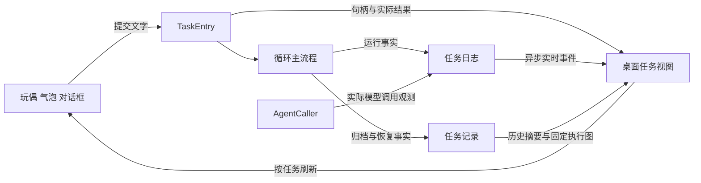

# MyHelper 桌面助手调试界面设计

2026-11-17 · 首版交互设计。Swing 初版已实现。接口、启动方式和实际交付范围见 [31 Swing 桌面调试界面开发文档](../modules/interaction/31-Swing桌面调试界面开发文档.md)。

用户要求桌面右下角显示 Q 版雷姆，头顶按主任务出现半透明渐变的小椭圆泡，单手拎的小包作为常驻对话入口。移到任务泡上时展开文字预览，点击打开任务详情。角色和气泡的桌面点击区域按可见轮廓裁剪。首版以自己调试为目标。

## 1. 桌面上看到什么

```text
                           ◦   ◦   ◦
                              头
                              身  手──包
                              双脚
──────────────────────────── 桌面工作区底部 ───────────
```

| 界面元素 | 首版行为 |
| --- | --- |
| 雷姆 | 初始停在右下角工作区内，可拖动。按角色可见像素构造桌面命中区域。 |
| 主任务气泡 | 每个主任务对应头顶的一枚半透明渐变小椭圆泡，默认收起。悬停扩展为标题和进度预览，点击打开详情。更多任务可通过溢出气泡展开。椭圆外角和气泡间隙把鼠标事件交给桌面。 |
| 悬停预览 | 显示该主任务正在处理或等待的子任务，以及最近一条过程消息。移开后收起，鼠标移动到预览内时保持展开。 |
| 点击详情 | 固定一个任务面板，可切换其他气泡。上半区显示任务树，下半区显示时间线，点击某个子任务可筛选相关事件。关闭面板只收起展示。 |
| 手提包 | 雷姆单手拎着的小包始终可点击。点击小包打开输入与回复。输入后显示「正在提交」，收到任务句柄即高亮对应气泡。提交模式显示「新任务」。 |
| 任务完成 | 显示结果或错误，稍后从头顶收起，保留在当前会话的最近任务列表。归档可读时可以回看历史。查看失败时，标题与详情保持可关联。 |

点击气泡可以看到悬停预览的全部内容，键盘可以打开对话、切换任务和用 Esc 收起浮层。玩偶靠近边缘时，气泡和面板向工作区内侧展开。悬停期间保持气泡顺序，避免并发更新引起误点。已受理运行可用现有取消句柄，收到取消请求后显示「正在收尾」，由实际收尾信号更新最终状态。展示 `NEEDS_INPUT` 的问题，关联回答依赖同一任务的指令接续入口。

## 2. 气泡怎么显示模型思考和过程

设计三种来源，界面会标清是哪一种。

| 来源 | 示例 | 显示规则 |
| --- | --- | --- |
| 正在执行的阶段 | 正在请求规划模型 · 生成月报 · 已等待 4 秒 | 由实际模型调用和计时产生。开始调用时展示目标和用途，等待时间取自已收到事件。 |
| 模型已经返回的内容 | 收到 3 步计划 · 读取数据、校验数据、生成报告 | 从得到的结构化计划提取标题和依赖。收到 `COMPLETE` 时先显示「提交了完成结论」，任务成功取实际验收及结果。 |
| 程序实际执行的事实 | 数据读取返回 · 校验未通过 · 缺少日期列 | 由派发、返回和验收事件产生，分别标注动作结果和验收结果。点开后展示已记录的原因、耗时和关联身份。 |

界面把前两种合成「模型处理」区。当前模型接口可提供正在处理的目标和已返回的公开计划，内部思考过程没有可用数据。首版由现有任务目标、结构化决策和事件生成展示文字，保持一次调用原有的请求数和行为。缺少开始事件时显示最近已知阶段，排队和依赖等待有明确依据时才显示相应状态。

## 3. 与现有模块的接法



| 层 | 职责与首版接口 |
| --- | --- |
| `interaction` 桌面视图 | 位置、显示、悬停、展开、停靠和输入。提交沿用 `TaskEntry.submit(text)`，用返回的 `Handle` 关联任务和结果。视图维护当前会话的展示数据。 |
| `tasklog` 日志 | 将执行和模型事件投影为安全摘要。增加可绑定的实时消费端，以异步方式交给界面。已有 `TaskLogPort` 提供类型、时间、上下文和关联 ID，`AsyncTaskLog` 已有有界队列与丢弃计数。 |
| `orchestration` 循环 | 继续按已有边界执行、上报和查询。任务层次及依赖优先复用已有执行图，仅在现有数据缺少准确阶段时，在公共任务边界补一次结构化事件。 |
| `records` 任务记录 | 提供按任务或运行查询的已保存历史。已有 `TaskLogHistory` 接收已知归档身份后可做历史摘要投影。启动后列出最近任务如需新增查询，仍由记录层提供。 |

当前工作树已有 `TaskEntry`、执行图、`tasklog`、生产记录与启动恢复组件。实时日志已提供 `TaskLogPort.Listener` 接口，桌面监听及短期回放仍待实现。`TaskLogHistory` 按已知归档引用读取摘要，运行期间可按运行身份分页读取持久事件。日志摘要提供身份和阶段，任务层次取执行图中的父子关系。真实服务、重启恢复和桌面联动验收分别记录。 [文字入口](../../src/main/java/com/example/myhelper/interaction/TaskEntry.java) · [日志接口](../../src/main/java/com/example/myhelper/tasklog/TaskLogPort.java) · [运行期间读取与归档](../modules/records/28-执行记录与恢复端口开发文档.md#134-运行期间读取与最终归档)

## 4. 数据怎样变成气泡

| 显示对象 | 身份与数据来源 |
| --- | --- |
| 主任务气泡 | 用 `taskId` 去重和关联标题，当前一次执行用 `rootRunId`。同一个任务恢复后更新气泡的当前运行，旧运行留在详情历史中。 |
| 子任务和工具步骤 | 用 `runId` 和节点关联，按执行图中的父子关系组织。工具是所属任务下的步骤，依赖关系用已有 `DEPENDS_ON`。没有关系数据时先显示已知节点和状态。 |
| 最近过程 | 使用日志事件的类型、时间、关联 ID 和摘要。实时端为事件提供递增序号，供断线续读时去重。已持久化的事实按事件 ID 合并，归档保留自己的提交顺序。 |
| 最终结果 | 新提交任务用 `Handle.result()` 展示对外结果，用 `settled()` 标识实际收尾。历史运行用正式记录的结果和证据缺口。 |

**首版任务树可按需读取执行图快照。** 点开或悬停时，从现有执行图读取该根运行的快照，通过只读投影取节点标题、类型、父子关系和状态。实时事件到达时按运行合并刷新。执行图会在任务收尾后回收，桌面保留最后一次展示摘要，详情可用时再读归档。未发现对应事件或归档时显示「部分记录暂不可用」。 [执行图快照](../../src/main/java/com/example/myhelper/orchestration/ExecutionTraceStore.java) · [应用收尾](../../src/main/java/com/example/myhelper/interaction/TaskEntry.java)

进度来源以真实行为为准。图中节点的 `RUNNING` 可能涵盖排队或等待，界面可以显示「进行中」。收到实际模型开始、工具派发状态或明确等待原因后，界面再换成更具体的文案。逻辑分支标识用于筛选和定位，任务树按父子关系呈现。

日志、快照和任务提交都在后台处理。`TaskEntry.submit` 返回异步句柄，但返回前可能同步登记任务并领取运行权。界面线程只渲染状态，提交失败时在原输入处显示原因。等待模型时仍可移动玩偶、展开气泡或发新任务。实时事件有遗漏时，界面提示并刷新当前状态，历史可用时再补查已保存事件。默认摘要使用日志白名单，详细证据按需打开。气泡正文保留简短目标和步骤标题。

实时缓冲随应用装配，在启动恢复与提交新任务前就绪。窗口打开后先读当前任务摘要和缓冲序号，再接收后续事件。任务的第一条事件可能先于 `submit` 返回句柄，视图按任务 ID 和运行 ID 合并，避免漏掉模型开始或出现两个气泡。前一次运行的迟到事件可进入其历史，只用当前 `rootRunId` 更新气泡进度。缺少任务身份的独立请求留在应用日志中。

## 5. 桌面运行方式

首版建议使用 JDK 自带的 Swing/AWT。当前本机 JDK 25 已包含 `java.desktop`。桌面窗口与现有 Spring Boot 容器同进程运行，桌面入口复用现有应用装配。可以增加显式模式参数，例如 `--myhelper.ui=desktop`，继续保留终端模式供运行和对照调试。

桌面模式在创建窗口前配置非 headless 环境。窗口边界覆盖玩偶和实际可见浮层，停靠时避开任务栏，避免透明背景区域挡住其他应用。玩偶小窗口可以置顶，详情和对话只在用户交互时取得焦点。点击退出进程时复用现有的任务停止和有界收尾流程。

技术验收先覆盖 Windows 本机运行、工作区边缘、缩放和从第二屏拖回主屏。

## 6. 首版实施顺序和验收

1. **把窗口和任务入口接起来。** 打开右下角玩偶和对话框，先用替身让两个任务同时出现，各自只生成一个主任务气泡，结果回到对应任务。
2. **接实时过程和任务树。** 让其中一个任务分出两个子任务。悬停看到当前子任务，点击展开后按阶段显示规划、工具、等待和验收。并发更新时保持任务归属正确。
3. **验证失败定位和历史。** 模拟等待模型、工具失败、工具成功但验收失败三种情况，气泡和详情显示不同状态。归档接通后，按一个 `taskId` 展示恢复前后的运行记录。归档不可用时，实时调试仍可运行。
4. **验证桌面行为。** 慢模型调用期间可正常移动玩偶、展开气泡和发新任务。悬停只预览，用户点击对话框才取得输入焦点。退出后检查工作线程与运行收尾。

首版只需跑通「输入任务、看主任务、展开看子任务、定位等待和错误」。玩偶动画、语音与更复杂的任务控制由后续交互迭代接入。检查代码继续放在 `checks`。首版运行验收可使用本地模型和工具替身，真实服务验收另记。 [检查约定](../../checks/README.md)
